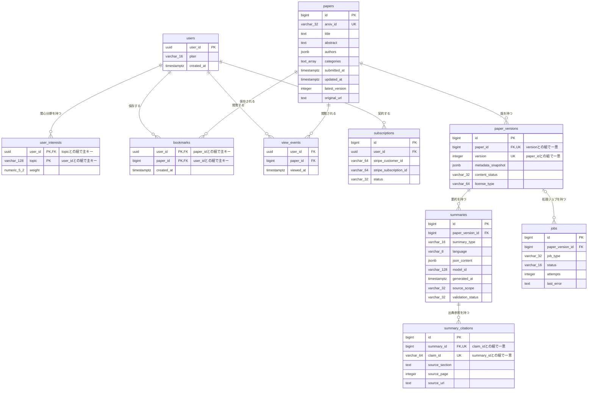

# DB物理設計書 — T007 ブックマーク（`bookmarks`）

| 項目 | 内容 |
| :--- | :--- |
| 文書名 | DB物理設計書 T007 ブックマーク（`bookmarks`） |
| 対象システム | Kaine personal pj — arXiv日本語研究ダイジェスト Webアプリ |
| 対象テーブル | T007 ブックマーク（`bookmarks`）1テーブル |
| 版 | 1.1（第1回セルフレビュー `docs/reviews/db_T007_review_applied.md` の Major 1件・Minor 1件を反映。Blocker は0件） |
| 作成日 / 更新日 | 2026-10-26 / 2026-10-26 |
| 作成方法 | creating-db-physical-design v1.6.0 準拠。上流の確定設計書と `source/` の企画資料から作成。`docs/db/DB.T001.DB物理設計.md`〜`DB.T006.DB物理設計.md` の規約・判断を引き継ぐ |
| インプット | (b) `docs/基本設計書_概要.md` §6（テーブル一覧 T007、論理テーブル定義「T007 bookmarks（ブックマーク）」、概念ER図、CRUD図）、§2（BF07・BF08・BF13・EX05）、§3（P104・P106）、§4（F07・F08・F16・F19）、§7（API06 `POST /api/bookmarks`・API07 `DELETE /api/bookmarks/{arxivId}`）、§8（認証・認可設計、セキュリティ対策）、§10（バックアップ、運用監視）、§11（ARC010）、付録 Q17・Q22・Q26・Q27・Q32・Q34／(a) `source/03_システム構成.md:8,10,41,52-53`、`source/02_機能要求定義.md:12,13,48`、`source/01_企画概要.md:29`、`source/04_収益化とロードマップ.md:4,35,45`／(c) `legacy/`（空。突合結果は下記） |

## 前提: インプットの性質と突合結果

* **既存版**: `docs/db/DB.T007.DB物理設計.md` の旧版はありません（本書が初版です）。消さずに残すべき既存記述はありません。
* **source/（挙動の正）**: `source/` は企画・初期設計案のMarkdown 6ファイルだけで、`schema.rb`・マイグレーション・SQL・ORM定義はありません（本単位の作業開始時にファイル数6件で、T001〜T006 作成時から変更が無いことを確認）。`bookmarks` について資料にあるのは列名の並び1行（`source/03_システム構成.md:41`: user_id, paper_id, created_at）、登録と解除のAPI（`:52-53`）、機能「論文の保存・整理」（`source/02_機能要求定義.md:12`）、マイページにブックマークを置くこと（`source/01_企画概要.md:29`）、Free プランで使えること（`source/04_収益化とロードマップ.md:4`）、検証指標「ブックマーク率」（`:45`）、退会・削除に対応すること（`source/02_機能要求定義.md:48`）だけです。**型・桁・NOT NULL・初期値・制約・インデックスはすべて資料に無いため、本書の物理定義はすべて※推測**です。上流の論理テーブル定義（`docs/基本設計書_概要.md` §6「T007 bookmarks（ブックマーク）」）の型・制約の案を正として引き継ぎ、物理的な詳細（初期値・削除時の動き・インデックス・行単位アクセス制御・DDL）を本書で加えています。
* **legacy/（既存設計）**: `legacy/` は空ディレクトリです（ファイル0件）。突合する既存仕様・業務意図・非機能の記述はありません。
* **上流との対応**: カラム3件は上流の論理テーブル定義の3行と1対1で一致します（列名・順序とも同じ）。上流の論理定義に無い列は追加していません。主キーは上流の「paper_id との組でPK」のとおり、利用者IDと論文IDの組です（代理キーは追加していません）。
* **上流に無い要素**: 外部キー2件の削除時の動きは上流 §6 に定義がありません（※上流未定義）。利用者側は T005 §4.5 No.2 の推奨（一緒に削除）、論文側は T001 §4.5 No.2 の推奨（削除を拒否）を、本書で確定させます（§4.5）。
* **ファイル名**: T001〜T006 と同じく、作業指示に従いテーブルIDで命名しています（上流 §10 は `DB.{物理名}` 形式。※上流要確認。T001 §9 No.7 と同じ事項）。

---

## 1. データベース概要

T001（`docs/db/DB.T001.DB物理設計.md` §1）〜T006 と同じ規約を使います。本書で読むだけで分かるよう、内容を次に書きます。

* **対象RDBMS**: PostgreSQL（Supabase 上のマネージドDB）。製品は上流 §1 で確定です（`source/03_システム構成.md:8`）。バージョンは未定義のため、PostgreSQL 15 以上を前提にします（※推測。上流 Q02）。
* **文字コード / 照合順序**: UTF8 / Supabase の既定照合順序（※推測: 資料に定義なし）。本テーブルに文字列の列はありません。
* **命名規則**:
  * テーブル名・カラム名: 英小文字のスネークケース。テーブル名は複数形です（`bookmarks`。上流 §6 の物理名をそのまま使います）。
  * 制約名・インデックス名（※推測）: 主キー `pk_{テーブル}`、一意制約 `uq_{テーブル}_{列}`、外部キー `fk_{子テーブル}_{列}`、CHECK制約 `ck_{テーブル}_{意味}`、インデックス `idx_{テーブル}_{列または用途}`。
* **共通カラム規約**: 上流 §6 にはシステム共通の監査列（作成日時・更新日時・論理削除フラグ）の規約がありません。本テーブルには上流の論理定義にある3列だけを置きます。登録日時（`created_at`）が作成日時を兼ねます。行を書き換える操作が無いため（§4.6）、更新日時の列は持ちません。
* **論理削除**: 採用しません。ブックマークを外したときと退会したときは、行を物理的に削除します（上流 BF07「bookmarks から削除」、BF13、CRUD図 F07「CRD」・F16「D」、上流 ARC010）。

---

## 2. 物理テーブル一覧

本書が設計するのは T007 だけです。外部キーでつながるテーブルを区別するため、上流 §6 テーブル一覧の全件を載せています。

| No | 概要書ID | 論理名 | 物理名 | ドメイン | 概要 | 本書での扱い | 定義状況 | 詳細の所在 |
| :--- | :--- | :--- | :--- | :--- | :--- | :--- | :--- | :--- |
| 1 | T001 | 論文 | papers | 論文 | arXiv論文1本につき1行。最新版のメタデータを持つ | 関連（本テーブルが外部キーで参照する親テーブル） | 詳細 | `docs/db/DB.T001.DB物理設計.md` |
| 2 | T002 | 論文バージョン | paper_versions | 論文 | 論文の版（v1/v2…）ごとに1行。取得時点のメタデータ、本文の取得状況、ライセンス種別を持つ | 対象外（関係なし。ブックマークは版ではなく論文を指す） | 詳細 | `docs/db/DB.T002.DB物理設計.md` |
| 3 | T003 | 要約 | summaries | 要約 | 論文の版ごと・要約の深さごとの日本語要約JSON | 対象外（関係なし） | 詳細 | `docs/db/DB.T003.DB物理設計.md` |
| 4 | T004 | 要約出典参照 | summary_citations | 要約 | 要約内の主張ごとに原文の章・ページ・URLを結びつける | 対象外（関係なし） | 詳細 | `docs/db/DB.T004.DB物理設計.md` |
| 5 | T005 | 利用者 | users | 利用者 | 会員1人につき1行。プラン（Free/Pro）と登録日時を持つ | 関連（本テーブルが外部キーで参照する親テーブル） | 詳細 | `docs/db/DB.T005.DB物理設計.md` |
| 6 | T006 | 利用者関心分野 | user_interests | 利用者 | 利用者が登録した関心トピックと、その重み | 対象外（関係なし） | 詳細 | `docs/db/DB.T006.DB物理設計.md` |
| 7 | T007 | ブックマーク | bookmarks | 利用者 | 利用者が保存した論文 | **設計対象** | 詳細 | 本書 §4〜§7 |
| 8 | T008 | 閲覧イベント | view_events | 利用者 | 利用者が論文を開いた記録。プライバシーに配慮して最小限だけ持つ | 対象外（関係なし） | 詳細 | `docs/db/DB.T008.DB物理設計.md`（未作成） |
| 9 | T009 | ジョブ | jobs | 運用 | 論文の版ごとの処理ジョブの種類・状態・試行回数・直近エラー | 対象外（関係なし） | 詳細 | `docs/db/DB.T009.DB物理設計.md`（未作成） |
| 10 | T010 | サブスクリプション | subscriptions | 課金 | 利用者とStripeの顧客・定期課金を結びつけ、契約状態を持つ | 対象外（関係なし） | 詳細 | `docs/db/DB.T010.DB物理設計.md`（未作成） |

**総件数: 10件（本書の設計対象1件・外部キーで直接つながる関連2件・対象外7件）。全数である根拠**: `docs/基本設計書_概要.md` §6 テーブル一覧の T001〜T010 の全10行と1対1で対応します（上流の総件数10件と一致）。概要書ID・論理名・物理名・ドメイン（上流の「分類」列）・定義状況は上流の値をそのまま引き継ぎ、新規採番していません。T001〜T006 は作成済み、T008〜T010 の物理定義は各テーブルのDB物理設計書の責務で未作成です。

---

## 3. ER図（物理エンティティ関連図）

§2 の全10テーブルと、上流 §6 概念ER図の全10リレーションを描いています。`bookmarks` は §4 の物理定義どおりに、複合主キーの2列へ `PK` を付けています。`papers`〜`user_interests` は T001〜T006 の物理定義どおりに全列を載せています。他の3テーブル（T008〜T010）は上流 §6 概念ER図の属性を全部そのまま写したもので、物理的な確定は各テーブルのDB物理設計書で行います。T001〜T006 の設計書の §3 ER図は `bookmarks` の主キーに `PK` が付いていません（上流の概念ER図を写したため）。本書 §4 の物理定義が正で、各設計書の図は次の改訂時にそろえます。



* **リレーション数**: 全10本（上流 §6 概念ER図の10本と一致）。このうち `bookmarks` に関わるものは2本（親 `users` から、親 `papers` から）で、§4.5 外部キー一覧の No.1・No.2 と1対1で対応します。
* **多重度の意味**:
  * 利用者1人に対し、ブックマークは0件以上です。会員登録の直後は0件です。
  * 論文1本に対し、ブックマークは0件以上です（何人の利用者が保存したか）。
  * 同じ利用者が同じ論文を2回保存することはありません（主キーで防ぐ。§4.4 No.1）。

---

## 4. テーブル詳細定義

### テーブル名: ブックマーク (`bookmarks`)
* **概要**: 利用者が「あとで読む」「手元に残す」ために保存した論文の一覧です。1行が「1人の利用者が1本の論文を保存したこと」を表します。論文詳細（P104）のボタンで登録・解除し（API06・API07）、マイページ（P106）で保存した論文を新しい順に一覧します。推薦（F08）では、保存した論文を利用者の行動履歴として使います。検証指標の「ブックマーク率」の集計元でもあります（上流 §6 T007、BF07、F07、F08、F19、`source/03_システム構成.md:41,52-53`、`source/04_収益化とロードマップ.md:45`）。
* **対応ドメイン**: 利用者（上流 §6 テーブル一覧の分類）
* **概要書ID**: T007
* **想定件数**（※推測）: 上流 §8 の規模の目安（月間アクティブユーザー1,000〜30,000人）で、利用者1人あたり数十〜数百件を保存するとして、数万〜数百万行です。利用者テーブル（数千〜数万行）より1〜2桁多くなります。
* **版の扱い**: ブックマークは論文（T001）を指し、論文の版（T002）は指しません。保存した後に論文が改訂されても、マイページからは最新版の論文詳細を開きます（上流 §6「FK→papers.id」）。保存した時点の版を残すかは §9 No.2 で確認します（※推測）。
* **個人情報の扱い**: どの論文を保存したかは利用者の興味を表す個人の行動データです。本人以外は読み書きできないようにし（§7 行単位アクセス制御）、退会時には必ず消します（上流 ARC010、§8「他人のデータの閲覧・改ざん」）。
* **保護の重要度**: 利用者が自分で保存した、再生成できないデータのため、バックアップの対象に必ず含めます（上流 §10 バックアップ・リカバリ方針「利用者データ（users・user_interests・bookmarks・subscriptions）は再生成できないため必ず対象にします」）。

#### 4.1 カラム一覧（ロースター）

| No | ID | カラム論理名 | カラム物理名 | 概要 | 定義状況 | 詳細の所在 |
| :--- | :--- | :--- | :--- | :--- | :--- | :--- |
| 1 | T007.user_id | 利用者ID | user_id | 保存した利用者。論文IDとの組で行を一意に決める | 詳細 | §4.3 (1) |
| 2 | T007.paper_id | 論文ID | paper_id | 保存した論文。利用者IDとの組で行を一意に決める | 詳細 | §4.3 (2) |
| 3 | T007.created_at | 登録日時 | created_at | 保存した日時。マイページでの並び順に使う | 詳細 | §4.3 (3) |

**総件数: 3件（詳細3件・簡易0件）。全数である根拠**: 上流 `docs/基本設計書_概要.md` §6「T007 bookmarks（ブックマーク）」の論理テーブル定義の全3行と1対1で対応し、資料の列名（`source/03_システム構成.md:41` の3列）とも一致します。ID列は上流のテーブルID「T007」に物理名をつないだもので、新しい番号は振っていません。
**定義状況の判定**（completeness 3-1）: `user_id` は利用者テーブルとまたがり（3-1 の3）、退会時の削除が連動する（3-1 の5）ため「詳細」です。`paper_id` は論文テーブルとまたがり（3-1 の3）、APIが受け取る arXiv ID から値を引き当てる業務ルールを含む（3-1 の7）ため「詳細」です。`created_at` は二重登録のときに最初の日時を残す扱い（3-1 の5）と一覧の並び順の業務ルール（3-1 の7）を含むため「詳細」です。

#### 4.2 カラム定義

| カラム論理名 | カラム物理名 | データ型 | PK | FK | 必須 (NN) | デフォルト値 / 制約 | 備考 |
| :--- | :--- | :--- | :--- | :--- | :--- | :--- | :--- |
| 利用者ID | user_id | UUID（※推測） | ○（paper_id との複合） | ○（users.user_id） | ○ | 自動採番しない。ログイン中の利用者IDを入れる。利用者の行が消えたら一緒に消える（ON DELETE CASCADE）（※推測） | 本人以外の行は読み書きできません（§7 行単位アクセス制御） |
| 論文ID | paper_id | BIGINT（※推測） | ○（user_id との複合） | ○（papers.id） | ○ | 自動採番しない。APIが受け取った arXiv ID から論文テーブルの論文IDを引き当てて入れる。ブックマークが残っている論文は削除できない（ON DELETE RESTRICT）（※推測） | 型は T001 `papers.id`（BIGINT）に合わせています |
| 登録日時 | created_at | TIMESTAMPTZ（※推測） | - | - | ○ | DEFAULT CURRENT_TIMESTAMP（※推測） | 一度入れた値は変えません。同じ論文を保存し直しても最初の日時のままです（§4.3 (3)） |

* **必須の判定**: 3列とも必須です。上流 §6 T007 の論理定義（利用者ID・論文ID・登録日時ともに「必須」）をそのまま引き継いだものです（※推測。上流 Q22 で確認待ち）。

#### 4.3 カラム詳細（定義状況＝詳細の3列）

ロースターは §4.1 です。本節では定義状況が「詳細」の3列について、値の決め方と業務ルールを書きます。

**(1) T007.user_id — 利用者ID**
* **値の決め方**: ブックマークを操作したログイン中の利用者の利用者ID（Supabase Auth の利用者IDと同じ値。T005 §4.3 (1)）を入れます。ブラウザから送られた値ではなく、APIがセッションから取り出した値を使います（上流 API06・API07 は利用者IDを引数に持たない。※推測）。未ログインで登録しようとした場合は、APIが行を作る前に認証エラーを返します（上流 EX05）。
* **親テーブルとの結びつき**: 利用者テーブル（`users.user_id`）を参照する外部キーを付け、存在しない利用者のブックマークを作れないようにします（上流 §6「FK→users.user_id」、§4.5 No.1）。
* **退会時の削除**: 利用者の行を消すと、その利用者のブックマークもDBが一緒に消します（ON DELETE CASCADE。§4.5 No.1）。上流 BF13 は退会時に `bookmarks` を明示的に削除する手順を持ちますが、手順の書き忘れや順序の違いがあっても保存した論文の一覧が残らないようにするためです（上流 F16、ARC010、`source/02_機能要求定義.md:48`）。

**(2) T007.paper_id — 論文ID**
* **値の決め方**: 登録のAPI（API06）と解除のAPI（API07）は論文を arXiv ID（`2401.01234` のような arXiv 上の識別子）で受け取ります（上流 §7 API06「`arxivId`」、API07「`{arxivId}`（パス）」）。APIは、論文テーブルの arXiv ID（T001 `arxiv_id`、一意）で論文を探し、その論文IDを本列に入れます。arXiv ID に一致する論文が無ければ、登録のAPIは「論文なし」（※推測: HTTP 404）を返し、行を作りません（上流 API06 エラー時）。
* **親テーブルとの結びつき**: 論文テーブル（`papers.id`）を参照する外部キーを付けます（上流 §6「FK→papers.id」、§4.5 No.2）。
* **論文を消すとき**: ブックマークが残っている論文は削除できません（ON DELETE RESTRICT。§4.5 No.2）。論文は業務上消さない方針で、論文を消すのは誤操作か特別な運用作業だけのため、利用者が保存した論文の一覧が知らないうちに減ることを防ぎます（T001 §4.5 No.2 の推奨と同じ判断）。
* **版を指さない理由**: 上流の論理定義が `papers.id` を参照しているためです。保存した論文の詳細は常に最新版で表示します。

**(3) T007.created_at — 登録日時**
* **意味**: 利用者がその論文を保存した日時です。行を作った時刻を入れます（DEFAULT CURRENT_TIMESTAMP。※推測）。
* **使い方**: マイページ（P106）のブックマーク一覧を、保存した日時の新しい順に並べるのに使います（上流 §6 T007「マイページでの並び順に使う」）。検証指標「ブックマーク率」（上流 F19、`source/04_収益化とロードマップ.md:45`）を週ごとに集計するときの基準日時にも使えます（※推測: 指標の定義は未定）。
* **二重登録のときの扱い**: 上流 API06 は「登録済みの場合も成功として扱う」としています。すでに保存済みの論文をもう一度登録しても、行を作り直さず、最初に保存した日時を変えません（`INSERT ... ON CONFLICT (user_id, paper_id) DO NOTHING`）。一覧の並びが、ボタンを押し直しただけで変わらないようにするためです（※推測）。成功時に返す登録日時は、既存の行の値です。
* **解除してから保存し直したとき**: 解除で行を消すため、保存し直すと新しい登録日時の行になります。
* **任意の日時を入れさせない**（※推測）: Supabase 環境では、行を追加するときに登録日時を必ず現在時刻に置き換えるトリガーを付けます（§7 `trg_bookmarks_created_at`）。ブラウザから直接追加された場合でも、過去や未来の日時を指定して一覧の並び順を操作できないようにするためです。トリガーは制約ではないため、§4.4 の制約一覧には含めていません。

#### 4.4 制約一覧（ロースター）

| No | ID（制約名） | 種別 | 対象カラム | 概要 | 定義状況 | 詳細の所在 |
| :--- | :--- | :--- | :--- | :--- | :--- | :--- |
| 1 | pk_bookmarks | PRIMARY KEY | user_id, paper_id | 同じ利用者が同じ論文を二重に保存できないようにし、ブックマークの登録済み判定と解除の鍵にする | 詳細 | §4.3 (1)・(2)・(3) |
| 2 | fk_bookmarks_user_id | FOREIGN KEY | user_id → users.user_id | 存在しない利用者のブックマークを作らせない。利用者が消されたら一緒に消す | 詳細 | §4.5 No.1 |
| 3 | fk_bookmarks_paper_id | FOREIGN KEY | paper_id → papers.id | 存在しない論文を保存させない。ブックマークが残っている論文の削除を拒否する | 詳細 | §4.5 No.2 |
| 4 | NOT NULL（user_id） | NOT NULL | user_id | 主キーの一部なので空を許さない（主キー制約に含まれる） | 簡易 | §4.2 |
| 5 | NOT NULL（paper_id） | NOT NULL | paper_id | 主キーの一部なので空を許さない（主キー制約に含まれる） | 簡易 | §4.2 |
| 6 | NOT NULL（created_at） | NOT NULL | created_at | 保存した日時を必ず記録する（初期値で必ず埋まる） | 簡易 | §4.2 |
| 7 | DEFAULT（created_at） | DEFAULT | created_at | 行を作った時刻を登録日時として入れる | 簡易 | §4.3 (3) |

**総件数: 7件（PRIMARY KEY 1件・FOREIGN KEY 2件・NOT NULL 3件・DEFAULT 1件）。UNIQUE と CHECK は0件です（主キー以外に一意にすべき列の組が無く、値の範囲を決める列もありません）。全数である根拠**: §7 DDL の `CREATE TABLE bookmarks` に書いた制約（CONSTRAINT 句3件、NOT NULL 3句（主キーの2列にも明記）、DEFAULT 1句）をすべて数えたものです。NOT NULL の3件は §4.2 で必須を「○」とした3列と一致します。PRIMARY KEY・FOREIGN KEY 2件は上流 §6 T007 の「paper_id との組でPK」「FK→users.user_id」「FK→papers.id」と一致し、外部キーの削除時の動きと登録日時の初期値は本書で追加した※推測です。
**定義状況の判定**: 複数テーブルにまたがる制約（3-1 の3）と削除時の扱いが自明でない制約（3-1 の5）は「詳細」、空を許さないだけの制約と初期値は判断を含まないため「簡易」としました。

#### 4.5 外部キー（FKリレーション）一覧（ロースター）

| No | ID（制約名） | 向き | 子テーブル.列 | 親テーブル.列 | 多重度 | 削除時の動き | 概要 | 定義状況 | 詳細の所在 |
| :--- | :--- | :--- | :--- | :--- | :--- | :--- | :--- | :--- | :--- |
| 1 | fk_bookmarks_user_id | 本テーブルが参照する | bookmarks.user_id（T007） | users.user_id（T005） | 利用者1 : ブックマーク0以上 | 利用者と一緒に削除（ON DELETE CASCADE）（※上流未定義） | 保存した利用者を示す。退会で利用者を消すとブックマークも消える | 詳細 | 本書 §4.3 (1)、§7 |
| 2 | fk_bookmarks_paper_id | 本テーブルが参照する | bookmarks.paper_id（T007） | papers.id（T001） | 論文1 : ブックマーク0以上 | ブックマークが残っていれば論文の削除を拒否（ON DELETE RESTRICT）（※上流未定義） | 保存した論文を示す | 詳細 | 本書 §4.3 (2)、§7 |

**総件数: 2件（参照する2件・参照される0件）。全数である根拠**: 上流 §6 の論理テーブル定義 T007 で「FK→」と書かれた列は `user_id`（→users.user_id）と `paper_id`（→papers.id）の2列だけで、上流 §6 概念ER図で `bookmarks` に入るリレーションも `users` と `papers` からの2本だけです。上流 §6 の論理テーブル定義 T001〜T010 の全定義に `bookmarks` を参照する列は無いため、参照される外部キーは0件です。No.1 は T005 設計書 §4.5 No.2、No.2 は T001 設計書 §4.5 No.2 の行と、制約名・向き・多重度・削除時の動きが一致します。
**削除時の動きを分ける理由**: 利用者側（No.1）は、退会したら利用者に紐づくデータをすべて消す方針のため「一緒に削除」です（上流 BF13、F16、ARC010）。論文側（No.2）は、論文を業務上消さない方針で、誤って論文を消したときに利用者の保存した一覧が巻き添えで消えることの方が害が大きいため「削除を拒否」です（T001 §4.5）。どちらも上流 §6 に削除時の動きの定義はありません（※上流未定義）。
**更新時の動き**: 利用者IDと論文IDはどちらも変わらない値（T005 §4.3 (1)、T001 の自動採番の主キー）のため、更新時の動きは既定（NO ACTION）のままにします。
**定義状況の判定**: 2件とも複数テーブルにまたがり（3-1 の3）、削除時の扱いが自明でない（3-1 の5）ため「詳細」です。

#### 4.6 本テーブルを操作する機能・バッチ（ロースター）

| No | ID | 名称 | 操作（C/R/U/D） | 本テーブルに対する内容 | 定義状況 | 詳細の所在 |
| :--- | :--- | :--- | :--- | :--- | :--- | :--- |
| 1 | F07 | ブックマーク（API06・API07） | CRD | 論文詳細（P104）で論文を保存する（API06。保存済みなら何もせず成功を返す）。保存を外す（API07。保存していなければ「ブックマークに無い」（※推測: HTTP 404）を返す）。マイページ（P106）で保存した論文を新しい順に一覧する（一覧のAPIは上流で未定義。上流 Q27）。論文詳細を開いたときに保存済みかを表示するため、利用者と論文の組で行の有無を読む（※推測） | 詳細 | `docs/detail/be/BE.F07.BE詳細設計.md`（未作成） |
| 2 | F08 | レコメンド（API05） | R | ログイン中の利用者が保存した論文を、行動履歴として推薦の点数付けに使う（上流 F-08「関心カテゴリと行動履歴に基づく推薦」）。すでに保存した論文をおすすめから外すかは F08 のBE詳細設計で決める（※推測） | 詳細 | `docs/detail/be/BE.F08.BE詳細設計.md`（未作成） |
| 3 | F16 | 退会・個人データ削除 | D | 退会時にその利用者のブックマークを削除する（上流 BF13 で明示的に削除。利用者の行を消したときも外部キーで一緒に消える。§4.5 No.1） | 詳細 | `docs/detail/be/BE.F16.BE詳細設計.md`（未作成） |
| 4 | F19 | コスト監視・利用状況分析 | R | 検証指標「ブックマーク率」を集計するため、保存の件数・保存した利用者数を期間ごとに数える（`source/04_収益化とロードマップ.md:45`。指標の計算式は未定義） | 簡易 | -（未作成） |

**総件数: 4件。全数である根拠**: 上流 §6 CRUD図の全21行（F01〜F19、B010、B011）のうち、`bookmarks` 列が「-」でない行を数えたものです（F07「CRD」、F08「R」、F16「D」、F19「R」の4行。残りの17行は「-」）。定義状況と詳細の所在は上流 §4 機能一覧の値を引き継いでいます。本テーブルを更新（U）する機能はありません。
**※上流要確認**: 機能 F-07 は「論文の保存・整理」です（`source/02_機能要求定義.md:12`、上流 F07「マイページで一覧・整理する」）。「整理」がフォルダ分け・タグ付け・メモのような追加の情報を持つことを意味する場合、本テーブルの3列では表せず、列またはテーブルの追加が必要です。本書では「整理」を一覧での並べ替えと解除の意味に取り、列を追加していません（§9 No.1）。

---

## 5. インデックス設計

#### 5.1 インデックス一覧（ロースター）

| No | ID（インデックス名） | 対象カラム | 種別 | 概要 | 定義状況 | 詳細の所在 |
| :--- | :--- | :--- | :--- | :--- | :--- | :--- |
| 1 | pk_bookmarks | user_id, paper_id | B-Tree（UNIQUE） | 主キー制約で自動的に作られる。登録済みかの判定（API06・論文詳細の表示）、解除（API07）、利用者を消したときに子の行を探す検索に使う | 簡易 | §4.4 No.1 |
| 2 | idx_bookmarks_user_id_created_at | user_id, created_at（降順） | B-Tree | 利用者ごとのブックマーク一覧を保存した日時の新しい順に引くための索引 | 詳細 | §5.2 |
| 3 | idx_bookmarks_paper_id | paper_id | B-Tree | 論文側の外部キーの確認と、論文ごとの保存数の集計のための索引 | 詳細 | §5.2 |

**総件数: 3件（主キーで自動的に作られるもの1件、明示的に作るもの2件）。全数である根拠**: §7 DDL で `bookmarks` に作られるインデックスをすべて数えたものです（`CREATE INDEX` 文2文、主キー制約による自動作成1件）。
**外部キー列のインデックス**: `user_id` は主キーの先頭の列なので、主キーのインデックスで利用者側の外部キーの検索が速くなります。`paper_id` は主キーの2列目で、主キーのインデックスでは論文IDだけの検索が速くならないため、別にインデックスを作ります（No.3）。
**作らないと判断したもの**（※推測）:
* `created_at` だけのインデックス: 期間ごとの保存数の集計（F19）は運用者の管理用の集計で、頻度が低く、数百万行の全件を読んでも許容できる規模のためです。行数が上流 §8 の目安を大きく超えた場合に見直します。
**定義状況の判定**: 主キーのインデックスは自動作成で判断を含まないため「簡易」、明示的に作る2件は大量件数での性能上の判断（3-1 の6）を含むため「詳細」です。

#### 5.2 インデックス定義（主キーを除く）

| 対象テーブル物理名 | インデックス名 | 対象カラム | 種別 | 目的・理由 |
| :--- | :--- | :--- | :--- | :--- |
| bookmarks | idx_bookmarks_user_id_created_at | user_id, created_at DESC | B-Tree | マイページ（P106）のブックマーク一覧は、ログイン中の利用者の行を保存日時の新しい順に並べて表示します。利用者IDで絞り込んだ後に並べ替えをせずに済むよう、並び順どおりの索引を持たせます。件数が多い利用者で一覧を少しずつ読み込む場合（ページ送り）にも、この並びで続きを引けます（※推測: 一覧のAPIとページ送りの方式は上流 Q27 で未定義） |
| bookmarks | idx_bookmarks_paper_id | paper_id | B-Tree | 論文を削除しようとしたとき、DBはその論文を保存しているブックマークが残っていないかを調べます（§4.5 No.2 の削除の拒否）。この確認で数百万行の全件を読まないための索引です。論文ごとに何人が保存したかを数える集計（F19、推薦で人気を加味する場合の F08）にも使います（※推測） |

---

## 6. コード定義（区分値・ステータス定義）

**該当なし**。根拠: 本テーブルの全3列（§4.1）のうち、値の一覧を本システムが定める列はありません。`user_id` は利用者ID、`paper_id` は論文ID、`created_at` は日時で、どれも区分値ではありません。

| 対象テーブル | 対象カラム | 設定値 | 意味・遷移条件 |
| :--- | :--- | :--- | :--- |
| bookmarks | —（該当なし） | — | 区分値・ステータスを持つ列はありません |

---

## 7. DDL (データ定義言語)

`bookmarks` の全定義です。PostgreSQL 15 以上でそのまま実行できます（※推測: 型・制約はすべて本書の設計案）。利用者テーブル（T005 `users`）と論文テーブル（T001 `papers`）を参照するため、`docs/db/DB.T005.DB物理設計.md` §7 と `docs/db/DB.T001.DB物理設計.md` §7 の DDL を先に実行してください。

```sql
-- =========================================================
-- T007 ブックマーク (bookmarks)
-- 前提: T001 papers・T005 users が作成済みであること
-- =========================================================
CREATE TABLE bookmarks (
    user_id     UUID         NOT NULL,
    paper_id    BIGINT       NOT NULL,
    created_at  TIMESTAMPTZ  NOT NULL DEFAULT CURRENT_TIMESTAMP,

    CONSTRAINT pk_bookmarks PRIMARY KEY (user_id, paper_id),

    -- 利用者を消したらブックマークも一緒に消す（退会時の個人データ削除）
    CONSTRAINT fk_bookmarks_user_id
        FOREIGN KEY (user_id) REFERENCES users (user_id)
        ON DELETE CASCADE,

    -- ブックマークが残っている論文は削除させない
    CONSTRAINT fk_bookmarks_paper_id
        FOREIGN KEY (paper_id) REFERENCES papers (id)
        ON DELETE RESTRICT
);

-- インデックス: 主キーで自動作成される1件に加え、明示的に2件（§5）
CREATE INDEX idx_bookmarks_user_id_created_at ON bookmarks (user_id, created_at DESC);
CREATE INDEX idx_bookmarks_paper_id           ON bookmarks (paper_id);

-- コメント
COMMENT ON TABLE  bookmarks            IS 'T007 ブックマーク: 利用者1人が論文1本を保存したことを1行で表す。マイページの一覧と推薦に使う';
COMMENT ON COLUMN bookmarks.user_id    IS '利用者ID（users.user_id。利用者を消すと一緒に消える）';
COMMENT ON COLUMN bookmarks.paper_id   IS '論文ID（papers.id。ブックマークが残る論文は削除できない）';
COMMENT ON COLUMN bookmarks.created_at IS '登録日時（保存した日時。保存し直しても変えない）';
```

**Supabase 環境のみの追加定義（※推測）**: 次の文は Supabase の既定ロール（`authenticated`）と、ログイン中の利用者IDを返す関数 `auth.uid()` がある環境でだけ実行できます。

* **行単位アクセス制御**: ログイン中の利用者が自分のブックマークだけを読み、追加・削除できるようにします（上流 §8「ブックマーク・関心分野・閲覧履歴は本人だけが読み書きできるよう、Supabase の行単位アクセス制御で利用者IDを照合します」、上流 Q32）。他人の利用者IDを指定した追加は拒否されます。本テーブルを更新する機能は無いため（§4.6）、更新のポリシーは作らず、ブラウザからの更新はすべて拒否します。退会処理は、行単位アクセス制御を通らないサーバ側のサービスロールで動きます。
* **登録日時の固定**: 追加のポリシーは利用者IDだけを確かめるため、ブラウザから直接追加すると登録日時に任意の値を指定できてしまいます。これを防ぐため、行を追加するときは指定された値にかかわらず登録日時を現在時刻に置き換えるトリガーを付けます（`trg_bookmarks_created_at`）。更新のポリシーが無いことと合わせて、登録日時は「実際に保存した時刻」から変わりません。サーバ側のAPIから追加する場合も同じく現在時刻になります。

```sql
ALTER TABLE bookmarks ENABLE ROW LEVEL SECURITY;

-- 本人のブックマークだけを読める
CREATE POLICY bookmarks_select_own
    ON bookmarks
    FOR SELECT
    TO authenticated
    USING (user_id = auth.uid());

-- 本人の利用者IDでだけ追加できる
CREATE POLICY bookmarks_insert_own
    ON bookmarks
    FOR INSERT
    TO authenticated
    WITH CHECK (user_id = auth.uid());

-- 本人の行だけを削除できる。更新のポリシーは作らない（ブラウザからの更新はすべて拒否）
CREATE POLICY bookmarks_delete_own
    ON bookmarks
    FOR DELETE
    TO authenticated
    USING (user_id = auth.uid());

-- 追加時は登録日時を必ず現在時刻にする（ブラウザから任意の日時を入れさせない）
CREATE FUNCTION bookmarks_set_created_at()
    RETURNS trigger
    LANGUAGE plpgsql
AS $$
BEGIN
    NEW.created_at := CURRENT_TIMESTAMP;
    RETURN NEW;
END;
$$;

CREATE TRIGGER trg_bookmarks_created_at
    BEFORE INSERT ON bookmarks
    FOR EACH ROW
    EXECUTE FUNCTION bookmarks_set_created_at();
```

---

## 8. マイグレーション計画（該当する場合のみ）

**該当なし（新規構築）**。根拠: 既存のDB・スキーマ・マイグレーションはありません（`source/` にスキーマ定義が無く、`legacy/` は空。上流 §10「システム移行計画: 該当なし」）。

初回構築の手順（※推測）:

| No | 対象テーブル | 変更種別 | 変更内容 | 影響範囲 | 備考 |
| :--- | :--- | :--- | :--- | :--- | :--- |
| 1 | bookmarks | テーブル新規作成 | §7 DDL の `CREATE TABLE bookmarks`・`CREATE INDEX` 2文・コメントを実行する | なし（新規） | T001 `papers`・T005 `users` の作成後に実行する。マイグレーションの置き場所とツールは未定（※推測: Supabase のマイグレーション機能。上流 Q34） |
| 2 | bookmarks | 権限設定 | §7 の Supabase 環境のみの追加定義（行単位アクセス制御、本人の行の読み取り・追加・削除の3ポリシー、登録日時を現在時刻に置き換えるトリガー）を実行する | ブックマークの登録・解除・一覧 | Supabase 環境のみ（※推測。上流 Q32） |

---

## 9. 確認事項（※推測・※上流要確認の集約）

| No | 区分 | 確認事項 | 本書での仮置き | 関連箇所 | 上流の確認事項 |
| :--- | :--- | :--- | :--- | :--- | :--- |
| 1 | 列の追加 | 機能「論文の保存・整理」の「整理」に、フォルダ分け・タグ付け・メモを含めるか（※上流要確認） | 含めない。一覧での並べ替えと解除だけ | §4.6 | —（※上流未定義） |
| 2 | 版 | 保存した時点の論文の版を残すか | 残さない。常に最新版を開く | §4 版の扱い | —（※上流未定義） |
| 3 | 型・制約 | 全列の型・必須・登録日時の初期値 | §4.2・§4.4 のとおり | §4 | Q22 |
| 4 | 外部キー | 利用者を消したときに一緒に消すか、ブックマークの残る論文の削除を拒否するか（※上流未定義） | 利用者側は一緒に削除、論文側は削除を拒否 | §4.5 | Q17 |
| 5 | API | ブックマーク一覧を取得するAPIと、その並び順・ページ送りの方式 | 保存日時の新しい順。ページ送りの方式は未定 | §4.6、§5.2 | Q27 |
| 6 | API | 登録済みの論文を再登録したときに登録日時を変えるか | 変えない（最初の日時のまま） | §4.3 (3) | Q26 |
| 7 | 件数 | 利用者1人が保存できるブックマークの上限件数（Free と Pro で分けるか） | 上限なし（DBでは制限しない） | §4 想定件数 | —（※上流未定義） |
| 8 | 指標 | 検証指標「ブックマーク率」の計算式（分母を閲覧数・利用者数・要約閲覧数のどれにするか） | 未定 | §4.6 No.4 | —（※上流未定義） |

**「—（※上流未定義）」の行について**: No.1・No.2・No.7・No.8 は、上流 `docs/基本設計書_概要.md` 付録の顧客確認事項（Q01〜Q37）に対応する質問がありません。似た論点の質問（Q14 は Pro機能の利用量上限、Q22 は主キー列の追加と型・桁、Q37 はユーザーフィードバックと要約の誤り率の収集手段）とは内容が違うため、ひも付けていません。上流の確認事項に4件を追加することを提案します。

---

## 出力前チェックリスト（自己検証）

- [x] §2 物理テーブル一覧に、基本設計書（概要）§6テーブル一覧の全10行を列挙した
- [x] §2 の「概要書ID」が上流のテーブルID T001〜T010 と1対1で対応している
- [x] §3 ER図に §2 の全10テーブルをエンティティとして描いた
- [x] §3 ER図のリレーションが §4.5 の外部キー2件（`users` → `bookmarks`、`papers` → `bookmarks`）を表現している（図の10本は上流 §6 概念ER図の全リレーション）
- [x] §3 ER図の `bookmarks` のエンティティ名・PK（user_id, paper_id）・FK（user_id, paper_id）が §4.2 と一致している
- [x] §3 のMermaid記法が規約どおり（型はアンダースコア区切り・括弧なし、リレーション記号の前後にスペース）
- [x] §4 全3列のカラム定義（PK/FK/NN/デフォルト）を網羅した
- [x] §5 インデックスを外部キー・検索条件・日付の列に設計し、作らない理由を明記した
- [x] §6 区分値を持つ列が無いことを根拠付きで明記した
- [x] §7 DDL を出力した（CREATE TABLE・FOREIGN KEY 2件・CREATE INDEX 2件、Supabase 環境のみの行単位アクセス制御と登録日時のトリガー）
- [x] 推測箇所に「※推測」を明記した
