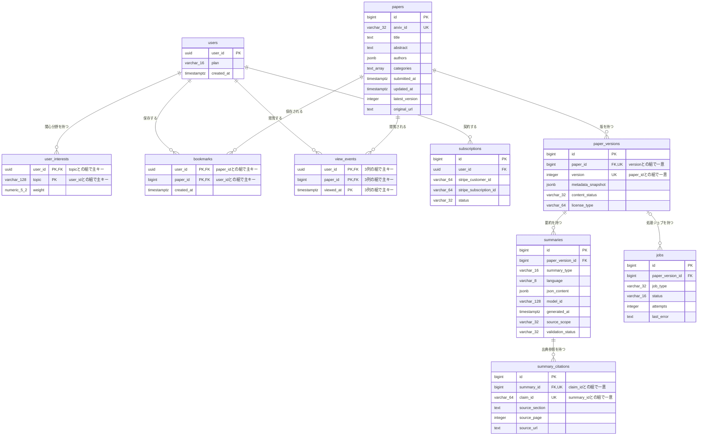

# DB物理設計書 — T008 閲覧イベント（`view_events`）

| 項目 | 内容 |
| :--- | :--- |
| 文書名 | DB物理設計書 T008 閲覧イベント（`view_events`） |
| 対象システム | Kaine personal pj — arXiv日本語研究ダイジェスト Webアプリ |
| 対象テーブル | T008 閲覧イベント（`view_events`）1テーブル |
| 版 | 1.1（第1回セルフレビュー `docs/reviews/db_T008_review_applied.md` の Major 1件・Minor 1件を反映。Blocker は0件） |
| 作成日 / 更新日 | 2026-10-26 / 2026-10-26 |
| 作成方法 | creating-db-physical-design v1.6.0 準拠。上流の確定設計書と `source/` の企画資料から作成。`docs/db/DB.T001.DB物理設計.md`〜`DB.T007.DB物理設計.md` の規約・判断を引き継ぐ |
| インプット | (b) `docs/基本設計書_概要.md` §6（テーブル一覧 T008、論理テーブル定義「T008 view_events（閲覧イベント）」、概念ER図、CRUD図）、§2（BF05・BF08・BF13）、§3（P104・P106）、§4（F08・F15・F16・F19）、§8（認証・認可設計、セキュリティ対策「個人の行動データの過剰保持」）、§10（運用監視）、§11（ARC010）、付録 Q17・Q22・Q25・Q27・Q32・Q34／(a) `source/03_システム構成.md:8,10,42`、`source/02_機能要求定義.md:13,48`、`source/01_企画概要.md:29`、`source/04_収益化とロードマップ.md:35,45`／(c) `legacy/`（空。突合結果は下記） |

## 前提: インプットの性質と突合結果

* **既存版**: `docs/db/DB.T008.DB物理設計.md` の旧版はありません（本書が初版です）。消さずに残すべき既存記述はありません。
* **source/（挙動の正）**: `source/` は企画・初期設計案のMarkdown 6ファイルだけで、`schema.rb`・マイグレーション・SQL・ORM定義はありません（本単位の作業開始時にファイル数6件で、T001〜T007 作成時から変更が無いことを確認）。`view_events` について資料にあるのは列名の並び1行（`source/03_システム構成.md:42`: user_id, paper_id, viewed_at「（プライバシーに配慮）」）、マイページに閲覧履歴を置くこと（`source/01_企画概要.md:29`）、Phase 2 で閲覧履歴を作ること（`source/04_収益化とロードマップ.md:35`）、推薦に行動履歴を使うこと（`source/02_機能要求定義.md:13`）、個人の行動ログは必要最小限にし退会・削除に対応すること（`:48`）、検証指標の週間利用継続率・要約閲覧数（`source/04_収益化とロードマップ.md:45`）だけです。**型・桁・NOT NULL・初期値・制約・インデックス・保持期間はすべて資料に無いため、本書の物理定義はすべて※推測**です。上流の論理テーブル定義（`docs/基本設計書_概要.md` §6「T008 view_events（閲覧イベント）」）の型・制約の案を正として引き継ぎ、物理的な詳細（主キー・初期値・削除時の動き・インデックス・保持期間の扱い・行単位アクセス制御・DDL）を本書で加えています。
* **legacy/（既存設計）**: `legacy/` は空ディレクトリです（ファイル0件）。突合する既存仕様・業務意図・非機能の記述はありません。
* **上流との対応**: カラム3件は上流の論理テーブル定義の3行と1対1で一致します（列名・順序とも同じ）。上流の論理定義に無い列は追加していません。
* **上流に無い要素**（※上流未定義）:
  * **主キー**: 上流 §6 T008 の論理定義には主キーの記載がありません（T006・T007 は「組でPK」と書かれていますが、T008 にはありません）。本書では列を追加せず、3列の組「利用者ID＋論文ID＋閲覧日時」を主キーにします（§4.3、§4.4 No.1）。代理キー（`id`）を足さないのは、上流の3列だけを持つという「プライバシーに配慮して最小限だけ持つ」の方針（上流 §6 T008 概要）を崩さないためです。
  * **外部キーの削除時の動き**: 利用者側は T005 §4.5 No.3 の推奨（一緒に削除）、論文側は T001 §4.5 No.3 の推奨（削除を拒否）を、本書で確定させます（§4.5）。
  * **保持期間を過ぎた行の削除**: 保持期間は未定です（上流 Q25）。古い行を消す仕組みは上流 §5 バッチ一覧にありません。本書では削除の方法とそのためのインデックスだけを用意し、バッチIDは振りません（§4.3 (3)、§9 No.1・No.2）。
* **ファイル名**: T001〜T007 と同じく、作業指示に従いテーブルIDで命名しています（上流 §10 は `DB.{物理名}` 形式。※上流要確認。T001 §9 No.7 と同じ事項）。

---

## 1. データベース概要

T001（`docs/db/DB.T001.DB物理設計.md` §1）〜T007 と同じ規約を使います。本書で読むだけで分かるよう、内容を次に書きます。

* **対象RDBMS**: PostgreSQL（Supabase 上のマネージドDB）。製品は上流 §1 で確定です（`source/03_システム構成.md:8`）。バージョンは未定義のため、PostgreSQL 15 以上を前提にします（※推測。上流 Q02）。
* **文字コード / 照合順序**: UTF8 / Supabase の既定照合順序（※推測: 資料に定義なし）。本テーブルに文字列の列はありません。
* **命名規則**:
  * テーブル名・カラム名: 英小文字のスネークケース。テーブル名は複数形です（`view_events`。上流 §6 の物理名をそのまま使います）。
  * 制約名・インデックス名（※推測）: 主キー `pk_{テーブル}`、一意制約 `uq_{テーブル}_{列}`、外部キー `fk_{子テーブル}_{列}`、CHECK制約 `ck_{テーブル}_{意味}`、インデックス `idx_{テーブル}_{列または用途}`。
* **共通カラム規約**: 上流 §6 にはシステム共通の監査列（作成日時・更新日時・論理削除フラグ）の規約がありません。本テーブルには上流の論理定義にある3列だけを置きます。閲覧日時（`viewed_at`）が作成日時を兼ねます。行を書き換える操作が無いため（§4.6）、更新日時の列は持ちません。
* **論理削除**: 採用しません。退会したときと保持期間を過ぎたときは、行を物理的に削除します（上流 BF13、CRUD図 F16「D」、§8「閲覧記録は必要最小限にし、退会時に削除する」、上流 ARC010）。

---

## 2. 物理テーブル一覧

本書が設計するのは T008 だけです。外部キーでつながるテーブルを区別するため、上流 §6 テーブル一覧の全件を載せています。

| No | 概要書ID | 論理名 | 物理名 | ドメイン | 概要 | 本書での扱い | 定義状況 | 詳細の所在 |
| :--- | :--- | :--- | :--- | :--- | :--- | :--- | :--- | :--- |
| 1 | T001 | 論文 | papers | 論文 | arXiv論文1本につき1行。最新版のメタデータを持つ | 関連（本テーブルが外部キーで参照する親テーブル） | 詳細 | `docs/db/DB.T001.DB物理設計.md` |
| 2 | T002 | 論文バージョン | paper_versions | 論文 | 論文の版（v1/v2…）ごとに1行。取得時点のメタデータ、本文の取得状況、ライセンス種別を持つ | 対象外（関係なし。閲覧は版ではなく論文に記録する） | 詳細 | `docs/db/DB.T002.DB物理設計.md` |
| 3 | T003 | 要約 | summaries | 要約 | 論文の版ごと・要約の深さごとの日本語要約JSON | 対象外（関係なし） | 詳細 | `docs/db/DB.T003.DB物理設計.md` |
| 4 | T004 | 要約出典参照 | summary_citations | 要約 | 要約内の主張ごとに原文の章・ページ・URLを結びつける | 対象外（関係なし） | 詳細 | `docs/db/DB.T004.DB物理設計.md` |
| 5 | T005 | 利用者 | users | 利用者 | 会員1人につき1行。プラン（Free/Pro）と登録日時を持つ | 関連（本テーブルが外部キーで参照する親テーブル） | 詳細 | `docs/db/DB.T005.DB物理設計.md` |
| 6 | T006 | 利用者関心分野 | user_interests | 利用者 | 利用者が登録した関心トピックと、その重み | 対象外（関係なし） | 詳細 | `docs/db/DB.T006.DB物理設計.md` |
| 7 | T007 | ブックマーク | bookmarks | 利用者 | 利用者が保存した論文 | 対象外（関係なし） | 詳細 | `docs/db/DB.T007.DB物理設計.md` |
| 8 | T008 | 閲覧イベント | view_events | 利用者 | 利用者が論文を開いた記録。プライバシーに配慮して最小限だけ持つ | **設計対象** | 詳細 | 本書 §4〜§7 |
| 9 | T009 | ジョブ | jobs | 運用 | 論文の版ごとの処理ジョブの種類・状態・試行回数・直近エラー | 対象外（関係なし） | 詳細 | `docs/db/DB.T009.DB物理設計.md`（未作成） |
| 10 | T010 | サブスクリプション | subscriptions | 課金 | 利用者とStripeの顧客・定期課金を結びつけ、契約状態を持つ | 対象外（関係なし） | 詳細 | `docs/db/DB.T010.DB物理設計.md`（未作成） |

**総件数: 10件（本書の設計対象1件・外部キーで直接つながる関連2件・対象外7件）。全数である根拠**: `docs/基本設計書_概要.md` §6 テーブル一覧の T001〜T010 の全10行と1対1で対応します（上流の総件数10件と一致）。概要書ID・論理名・物理名・ドメイン（上流の「分類」列）・定義状況は上流の値をそのまま引き継ぎ、新規採番していません。T001〜T007 は作成済み、T009・T010 の物理定義は各テーブルのDB物理設計書の責務で未作成です。

---

## 3. ER図（物理エンティティ関連図）

§2 の全10テーブルと、上流 §6 概念ER図の全10リレーションを描いています。`view_events` は §4 の物理定義どおりに、主キーの3列へ `PK` を付けています。`papers`〜`bookmarks` は T001〜T007 の物理定義どおりに全列を載せています。他の2テーブル（T009・T010）は上流 §6 概念ER図の属性を全部そのまま写したもので、物理的な確定は各テーブルのDB物理設計書で行います。T001〜T007 の設計書の §3 ER図は `view_events` の主キーを表していません（本書で初めて主キーを決めたため）。本書 §4 の物理定義が正で、各設計書の図は次の改訂時にそろえます。



* **リレーション数**: 全10本（上流 §6 概念ER図の10本と一致）。このうち `view_events` に関わるものは2本（親 `users` から、親 `papers` から）で、§4.5 外部キー一覧の No.1・No.2 と1対1で対応します。
* **多重度の意味**:
  * 利用者1人に対し、閲覧イベントは0件以上です。同じ論文を何度も開けば、そのたびに行が増えます（ただし短時間の開き直しは記録しない。§4.3 (3)）。
  * 論文1本に対し、閲覧イベントは0件以上です（ログイン中の利用者に何回開かれたか）。未ログインの閲覧は記録しません（上流 BF05「ログイン中」のときだけ記録）。

---

## 4. テーブル詳細定義

### テーブル名: 閲覧イベント (`view_events`)
* **概要**: ログイン中の利用者が論文詳細（P104）を開いたことを1回1行で記録する表です。記録は「誰が・どの論文を・いつ開いたか」の3つだけで、滞在時間・閲覧した要約の深さ・端末・IPアドレスのような情報は持ちません（`source/03_システム構成.md:42`「プライバシーに配慮」、`source/02_機能要求定義.md:48`、上流 ARC010）。マイページ（P106）の閲覧履歴（F15）、推薦の行動履歴（F08）、週間利用継続率と要約閲覧数の集計（F19）に使います。退会したときと保持期間を過ぎたときに消します。
* **対応ドメイン**: 利用者（上流 §6 テーブル一覧の分類）
* **概要書ID**: T008
* **想定件数**（※推測）: 上流 §8 の規模の目安（月間アクティブユーザー1,000〜30,000人）で、1人が月に数十本の論文を開くとして、月に数万〜百万行程度増えます。保持期間を180日（§4.3 (3) の仮置き）とすると、常時数十万〜数百万行です。10テーブルの中で最も行が増えやすいテーブルのため、保持期間を過ぎた行の削除とインデックスを設計に含めます。
* **個人情報の扱い**: どの論文をいつ開いたかは、利用者の興味と行動の時刻を表す個人の行動データです。本人以外は読めないようにし（§7 行単位アクセス制御）、退会時と保持期間の経過後には必ず消します（上流 §8 セキュリティ対策「個人の行動データの過剰保持」、ARC010）。
* **保護の重要度**: 上流 §10 のバックアップ方針で「必ず対象にする」利用者データ（users・user_interests・bookmarks・subscriptions）に本テーブルは含まれていません。行動データを長く残さない方針と合わせ、バックアップからの復元で消えた期間の記録が欠けても許容する扱いと読み取れます（※推測）。ただし Supabase の日次バックアップはデータベース全体を対象とするため、本テーブルもバックアップには含まれます。退会者の行がバックアップに残る期間はバックアップの保管期間（上流 Q35）に従います。

#### 4.1 カラム一覧（ロースター）

| No | ID | カラム論理名 | カラム物理名 | 概要 | 定義状況 | 詳細の所在 |
| :--- | :--- | :--- | :--- | :--- | :--- | :--- |
| 1 | T008.user_id | 利用者ID | user_id | 閲覧した利用者。退会時に削除する | 詳細 | §4.3 (1) |
| 2 | T008.paper_id | 論文ID | paper_id | 閲覧した論文 | 詳細 | §4.3 (2) |
| 3 | T008.viewed_at | 閲覧日時 | viewed_at | 閲覧した日時。閲覧履歴と推薦に使い、保持期間の判定の基準になる | 詳細 | §4.3 (3) |

**総件数: 3件（詳細3件・簡易0件）。全数である根拠**: 上流 `docs/基本設計書_概要.md` §6「T008 view_events（閲覧イベント）」の論理テーブル定義の全3行と1対1で対応し、資料の列名（`source/03_システム構成.md:42` の3列）とも一致します。ID列は上流のテーブルID「T008」に物理名をつないだもので、新しい番号は振っていません。
**定義状況の判定**（completeness 3-1）: `user_id` は利用者テーブルとまたがり（3-1 の3）、退会時の削除が連動する（3-1 の5）ため「詳細」です。`paper_id` は論文テーブルとまたがり（3-1 の3）、閲覧した論文を引き当てる業務ルールを含む（3-1 の7）ため「詳細」です。`viewed_at` は短時間の開き直しを記録しない分岐（3-1 の1）、保持期間を過ぎた行の削除（3-1 の2）、大量件数の削除の性能上の注意（3-1 の6）を含むため「詳細」です。

#### 4.2 カラム定義

| カラム論理名 | カラム物理名 | データ型 | PK | FK | 必須 (NN) | デフォルト値 / 制約 | 備考 |
| :--- | :--- | :--- | :--- | :--- | :--- | :--- | :--- |
| 利用者ID | user_id | UUID（※推測） | ○（3列の複合。※上流未定義） | ○（users.user_id） | ○ | 自動採番しない。ログイン中の利用者IDを入れる。利用者の行が消えたら一緒に消える（ON DELETE CASCADE）（※推測） | 本人以外の行は読めません（§7 行単位アクセス制御） |
| 論文ID | paper_id | BIGINT（※推測） | ○（3列の複合。※上流未定義） | ○（papers.id） | ○ | 自動採番しない。開いた論文詳細の論文IDを入れる。閲覧イベントが残っている論文は削除できない（ON DELETE RESTRICT）（※推測） | 型は T001 `papers.id`（BIGINT）に合わせています |
| 閲覧日時 | viewed_at | TIMESTAMPTZ（※推測） | ○（3列の複合。※上流未定義） | - | ○ | DEFAULT CURRENT_TIMESTAMP（※推測） | 一度入れた値は変えません。保持期間を過ぎたかの判定に使います（§4.3 (3)） |

* **必須の判定**: 3列とも必須です。上流 §6 T008 の論理定義（利用者ID・論文ID・閲覧日時ともに「必須」）をそのまま引き継いだものです（※推測。上流 Q22 で確認待ち）。

#### 4.3 カラム詳細（定義状況＝詳細の3列）

ロースターは §4.1 です。本節では定義状況が「詳細」の3列について、値の決め方と業務ルールを書きます。

**(1) T008.user_id — 利用者ID**
* **値の決め方**: 論文詳細を開いたログイン中の利用者の利用者ID（Supabase Auth の利用者IDと同じ値。T005 §4.3 (1)）を入れます。ブラウザから送られた値ではなく、APIがセッションから取り出した値を使います（※推測）。未ログインの閲覧は記録しません（上流 BF05「opt ログイン中: view_events に閲覧を記録」）。
* **親テーブルとの結びつき**: 利用者テーブル（`users.user_id`）を参照する外部キーを付け、存在しない利用者の閲覧を記録できないようにします（上流 §6「FK→users.user_id」、§4.5 No.1）。
* **退会時の削除**: 利用者の行を消すと、その利用者の閲覧イベントもDBが一緒に消します（ON DELETE CASCADE。§4.5 No.1）。上流 BF13 は退会時に `view_events` を最初に明示的に削除する手順を持ちますが、手順の書き忘れや順序の違いがあっても行動データが残らないようにするためです（上流 §6 T008「退会時に削除する」、F16、ARC010、`source/02_機能要求定義.md:48`）。

**(2) T008.paper_id — 論文ID**
* **値の決め方**: 利用者が開いた論文詳細の論文を、arXiv ID で論文テーブルから引き当て、その論文IDを入れます。arXiv ID に一致する論文が無ければ論文詳細自体が「論文なし」になるため、記録もしません（上流 API03 `GET /api/papers/{arxivId}` のエラー時）。
* **記録するAPI**（※上流要確認）: 上流 BF05 の図は、論文詳細（API03）と要約（API04）を取得したあとに「ログイン中なら記録」としていますが、どのAPIが記録するかは定めていません。上流 §7 では API03・API04 とも認証「不要（※推測）」のため、ログイン中かどうかを見て記録する処理をどちらに置くか、または記録専用のAPIを設けるかを §9 No.9 で確認します。本書のテーブル設計は、どのAPIから記録しても同じです。
* **親テーブルとの結びつき**: 論文テーブル（`papers.id`）を参照する外部キーを付けます（上流 §6「FK→papers.id」、§4.5 No.2）。
* **論文を消すとき**: 閲覧イベントが残っている論文は削除できません（ON DELETE RESTRICT。§4.5 No.2）。論文は業務上消さない方針で、誤って消したときに利用者の閲覧履歴が巻き添えで消えるのを防ぐためです（T001 §4.5 No.3 の推奨と同じ判断）。保持期間を過ぎた行の削除が進めば、古い論文に残る行も自然に減ります。
* **版を記録しない理由**: 上流の論理定義が `papers.id` を参照しているためです。どの版の要約を読んだかは持ちません（記録を最小限にする方針）。

**(3) T008.viewed_at — 閲覧日時**
* **意味**: 利用者が論文詳細を開いた日時です。行を作った時刻を入れます（DEFAULT CURRENT_TIMESTAMP。※推測）。
* **使い方**:
  * マイページ（P106）の閲覧履歴を、開いた日時の新しい順に並べます。同じ論文を何度も開いた場合は、論文ごとに最も新しい閲覧だけを1行として見せます（※推測: 表示の方式は F15 のBE詳細設計で確定する）。
  * 推薦（F08）では、最近開いた論文を行動履歴として使います（`source/02_機能要求定義.md:13`）。
  * 週間利用継続率と要約閲覧数（F19、`source/04_収益化とロードマップ.md:45`）を、期間で区切って集計する基準にします。
* **短時間の開き直しを記録しない**（※推測）: 画面の再読み込みや、論文詳細とAppendix（P105）の行き来のたびに行が増えると、行動データが必要以上に増え、要約閲覧数も実態より多く数えられます。このため、同じ利用者が同じ論文を直近30分以内に記録済みなら、新しい行を作りません。この確認はDBのトリガーで行います（§7 `trg_view_events_before_insert`: 追加しようとした行と同じ利用者・同じ論文で、閲覧日時が30分以内の行があれば、その追加を取りやめてエラーにはしない）。アプリだけで確かめると、ブラウザから直接記録された場合（§7 行単位アクセス制御で本人の記録は許している）に規則を通らずに行が増え、行動データの最小化（上流 ARC010）と閲覧数の集計が崩れるためです。トリガーは記録の経路によらず働きます。30分という値は仮置きで、§9 No.3 で確認します。
* **主キーに含める理由**: 上流が主キーを定めていないため、3列の組で行を一意にします。上の規則で同じ利用者・同じ論文の行は30分以上離れるため、閲覧日時を含めた組が重なることは通常起きません。ただし、同じ利用者が同じ論文をほぼ同時に2回記録した場合は、互いの行がまだ見えないため2件とも規則を通ることがあります。その場合も閲覧日時がマイクロ秒単位で異なれば2行になり、同じ時刻なら主キーが重なった2件目を記録しないだけです（`INSERT ... ON CONFLICT DO NOTHING`）。どちらでも論文詳細の表示は止めません。ほぼ同時の二重記録で1行多く残ることは、集計への影響が小さいため許容します（※推測）。
* **任意の日時を入れさせない**（※推測）: 上の30分の確認と同じトリガーで、行を追加するときに閲覧日時を必ず現在時刻に置き換えます（§7 `trg_view_events_before_insert`）。ブラウザから直接追加された場合でも、過去や未来の日時を指定して履歴や集計を操作したり、30分の確認をすり抜けたりできないようにするためです。トリガーは制約ではないため、§4.4 の制約一覧には含めていません。
* **保持期間を過ぎた行の削除**（※推測・※上流未定義）: 保持期間は上流で未定です（上流 Q25）。本書では180日を仮置きにし、閲覧日時が180日より前の行を1日1回まとめて削除する案にします（`DELETE FROM view_events WHERE viewed_at < CURRENT_TIMESTAMP - INTERVAL '180 days'`）。180日は、推薦の行動履歴と週間利用継続率の集計に半年分あれば足りる、という見立てです。削除を行うバッチは上流 §5 バッチ一覧に無いため、バッチIDは振らず §9 No.2 で追加を確認します。削除の対象を閲覧日時のインデックス（`idx_view_events_viewed_at`）で探すため、全件を読まずに済みます。一度に消す行が多い場合は、数千行ずつに分けて消し、ほかの処理を長く止めないようにします。

#### 4.4 制約一覧（ロースター）

| No | ID（制約名） | 種別 | 対象カラム | 概要 | 定義状況 | 詳細の所在 |
| :--- | :--- | :--- | :--- | :--- | :--- | :--- |
| 1 | pk_view_events | PRIMARY KEY | user_id, paper_id, viewed_at | 閲覧1回を一意に決める。上流が主キーを定めていないため、列を足さずに3列の組で決める（※上流未定義） | 詳細 | §4.3 (3) |
| 2 | fk_view_events_user_id | FOREIGN KEY | user_id → users.user_id | 存在しない利用者の閲覧を記録させない。利用者が消されたら一緒に消す | 詳細 | §4.5 No.1 |
| 3 | fk_view_events_paper_id | FOREIGN KEY | paper_id → papers.id | 存在しない論文の閲覧を記録させない。閲覧イベントが残っている論文の削除を拒否する | 詳細 | §4.5 No.2 |
| 4 | NOT NULL（user_id） | NOT NULL | user_id | 主キーの一部なので空を許さない（主キー制約に含まれる） | 簡易 | §4.2 |
| 5 | NOT NULL（paper_id） | NOT NULL | paper_id | 主キーの一部なので空を許さない（主キー制約に含まれる） | 簡易 | §4.2 |
| 6 | NOT NULL（viewed_at） | NOT NULL | viewed_at | 主キーの一部なので空を許さない（主キー制約に含まれる） | 簡易 | §4.2 |
| 7 | DEFAULT（viewed_at） | DEFAULT | viewed_at | 行を作った時刻を閲覧日時として入れる | 簡易 | §4.3 (3) |

**総件数: 7件（PRIMARY KEY 1件・FOREIGN KEY 2件・NOT NULL 3件・DEFAULT 1件）。UNIQUE と CHECK は0件です（主キー以外に一意にすべき列の組が無く、値の範囲を決める列もありません）。全数である根拠**: §7 DDL の `CREATE TABLE view_events` に書いた制約（CONSTRAINT 句3件、NOT NULL 3句、DEFAULT 1句）をすべて数えたものです。NOT NULL の3件は §4.2 で必須を「○」とした3列と一致します。FOREIGN KEY 2件は上流 §6 T008 の「FK→users.user_id」「FK→papers.id」と一致し、PRIMARY KEY・外部キーの削除時の動き・閲覧日時の初期値は本書で追加した※推測（主キーは※上流未定義）です。
**定義状況の判定**: 上流に無い判断を含む主キー（3-1 の7）、複数テーブルにまたがる制約（3-1 の3）と削除時の扱いが自明でない制約（3-1 の5）は「詳細」、空を許さないだけの制約と初期値は判断を含まないため「簡易」としました。

#### 4.5 外部キー（FKリレーション）一覧（ロースター）

| No | ID（制約名） | 向き | 子テーブル.列 | 親テーブル.列 | 多重度 | 削除時の動き | 概要 | 定義状況 | 詳細の所在 |
| :--- | :--- | :--- | :--- | :--- | :--- | :--- | :--- | :--- | :--- |
| 1 | fk_view_events_user_id | 本テーブルが参照する | view_events.user_id（T008） | users.user_id（T005） | 利用者1 : 閲覧イベント0以上 | 利用者と一緒に削除（ON DELETE CASCADE）（※上流未定義） | 閲覧した利用者を示す。退会で利用者を消すと閲覧イベントも消える | 詳細 | 本書 §4.3 (1)、§7 |
| 2 | fk_view_events_paper_id | 本テーブルが参照する | view_events.paper_id（T008） | papers.id（T001） | 論文1 : 閲覧イベント0以上 | 閲覧イベントが残っていれば論文の削除を拒否（ON DELETE RESTRICT）（※上流未定義） | 閲覧した論文を示す | 詳細 | 本書 §4.3 (2)、§7 |

**総件数: 2件（参照する2件・参照される0件）。全数である根拠**: 上流 §6 の論理テーブル定義 T008 で「FK→」と書かれた列は `user_id`（→users.user_id）と `paper_id`（→papers.id）の2列だけで、上流 §6 概念ER図で `view_events` に入るリレーションも `users` と `papers` からの2本だけです。上流 §6 の論理テーブル定義 T001〜T010 の全定義に `view_events` を参照する列は無いため、参照される外部キーは0件です。No.1 は T005 設計書 §4.5 No.3、No.2 は T001 設計書 §4.5 No.3 の行と、制約名・向き・多重度・削除時の動きが一致します。
**削除時の動きを分ける理由**: 利用者側（No.1）は、退会したら利用者に紐づく行動データをすべて消す方針のため「一緒に削除」です（上流 BF13、F16、ARC010）。論文側（No.2）は、論文を業務上消さない方針で、誤って論文を消したときに閲覧履歴が巻き添えで消えるのを防ぐため「削除を拒否」です（T001 §4.5）。どちらも上流 §6 に削除時の動きの定義はありません（※上流未定義）。
**更新時の動き**: 利用者IDと論文IDはどちらも変わらない値のため、更新時の動きは既定（NO ACTION）のままにします。
**定義状況の判定**: 2件とも複数テーブルにまたがり（3-1 の3）、削除時の扱いが自明でない（3-1 の5）ため「詳細」です。

#### 4.6 本テーブルを操作する機能・バッチ（ロースター）

| No | ID | 名称 | 操作（C/R/U/D） | 本テーブルに対する内容 | 定義状況 | 詳細の所在 |
| :--- | :--- | :--- | :--- | :--- | :--- | :--- |
| 1 | F08 | レコメンド（API05） | R | ログイン中の利用者が最近開いた論文を、行動履歴として推薦の点数付けに使う（上流 BF08「user_interests・閲覧履歴・新着論文を取得」）。すでに開いた論文をおすすめから外すかは F08 のBE詳細設計で決める（※推測） | 詳細 | `docs/detail/be/BE.F08.BE詳細設計.md`（未作成） |
| 2 | F15 | 閲覧履歴 | CR | ログイン中の利用者が論文詳細（P104）を開いたときに1行記録する。直近30分以内に同じ論文を記録済みなら記録しない（上流 BF05、§4.3 (3)）。マイページ（P106）で、論文ごとに最も新しい閲覧を新しい順に一覧する（一覧のAPIは上流で未定義。上流 Q27） | 詳細 | `docs/detail/be/BE.F15.BE詳細設計.md`（未作成） |
| 3 | F16 | 退会・個人データ削除 | D | 退会時にその利用者の閲覧イベントを削除する（上流 BF13 で最初に明示的に削除。利用者の行を消したときも外部キーで一緒に消える。§4.5 No.1） | 詳細 | `docs/detail/be/BE.F16.BE詳細設計.md`（未作成） |
| 4 | F19 | コスト監視・利用状況分析 | R | 週ごとに閲覧のあった利用者数（週間利用継続率の材料）と閲覧回数（要約閲覧数の材料）を数える（`source/04_収益化とロードマップ.md:45`。指標の計算式は未定義） | 簡易 | -（未作成） |

**総件数: 4件。全数である根拠**: 上流 §6 CRUD図の全21行（F01〜F19、B010、B011）のうち、`view_events` 列が「-」でない行を数えたものです（F08「R」、F15「CR」、F16「D」、F19「R」の4行。残りの17行は「-」）。論文詳細の流れ（上流 BF05）で記録しますが、記録は F15 の責務として CRUD図の F15 行に載っており、F05 の行は「-」です（上流 §2 の対応「F15→BF05」）。定義状況と詳細の所在は上流 §4 機能一覧の値を引き継いでいます。本テーブルを更新（U）する機能はありません。
**上流に無い操作**（※上流未定義）: 保持期間を過ぎた行の定期的な削除（§4.3 (3)）は、上流 CRUD図・§5 バッチ一覧のどの行にもありません。本書ではバッチIDを振らず、§9 No.2 で追加を確認します。
**※上流要確認**: 利用者が自分の閲覧履歴を消す操作（1件ずつ、またはまとめて）は上流 CRUD図にありません（F15 は「CR」）。行動データを最小限にする方針（ARC010）からは、利用者が自分で履歴を消せる方が望ましいため、F15 に「D」を加えるかを確認します（§9 No.4）。本書では利用者による削除を許さない前提で、§7 の行単位アクセス制御に削除のポリシーを作っていません。

---

## 5. インデックス設計

#### 5.1 インデックス一覧（ロースター）

| No | ID（インデックス名） | 対象カラム | 種別 | 概要 | 定義状況 | 詳細の所在 |
| :--- | :--- | :--- | :--- | :--- | :--- | :--- |
| 1 | pk_view_events | user_id, paper_id, viewed_at | B-Tree（UNIQUE） | 主キー制約で自動的に作られる。同じ利用者・同じ論文の直近の閲覧を探す確認（§4.3 (3) の30分の判定。トリガーが追加のたびに使う）と、利用者を消したときに子の行を探す検索に使う | 詳細 | §4.4 No.1、§5.2 |
| 2 | idx_view_events_user_id_viewed_at | user_id, viewed_at（降順） | B-Tree | 利用者ごとの閲覧履歴を新しい順に引くための索引 | 詳細 | §5.2 |
| 3 | idx_view_events_paper_id | paper_id | B-Tree | 論文側の外部キーの確認と、論文ごとの閲覧数の集計のための索引 | 詳細 | §5.2 |
| 4 | idx_view_events_viewed_at | viewed_at | B-Tree | 保持期間を過ぎた行の削除と、期間で区切る集計のための索引 | 詳細 | §5.2 |

**総件数: 4件（主キーで自動的に作られるもの1件、明示的に作るもの3件）。全数である根拠**: §7 DDL で `view_events` に作られるインデックスをすべて数えたものです（`CREATE INDEX` 文3文、主キー制約による自動作成1件）。
**外部キー列のインデックス**: `user_id` は主キーと No.2 の先頭の列なので、利用者側の外部キーの検索はこれらで速くなります。`paper_id` は先頭の列にしているインデックスが無いため、別に作ります（No.3）。
**作らないと判断したもの**（※推測）: 論文と閲覧日時の組のインデックス（論文ごとの期間別の閲覧数）: 運用者の集計だけで使うため、No.3 と No.4 のどちらかで絞り込めば足ります。集計が遅くなった場合に見直します。
**定義状況の判定**: 4件とも、大量件数での性能上の判断（3-1 の6）を含むため「詳細」です。主キーのインデックスも、30分の判定の検索に使う設計上の判断を含むため「詳細」としました。

#### 5.2 インデックス定義（主キーを除く）

| 対象テーブル物理名 | インデックス名 | 対象カラム | 種別 | 目的・理由 |
| :--- | :--- | :--- | :--- | :--- |
| view_events | idx_view_events_user_id_viewed_at | user_id, viewed_at DESC | B-Tree | マイページ（P106）の閲覧履歴は、ログイン中の利用者の行を開いた日時の新しい順に並べます。推薦（F08）も同じ利用者の最近の閲覧を新しい順に読みます。利用者IDで絞り込んだ後に並べ替えをせずに済むよう、並び順どおりの索引を持たせます（※推測） |
| view_events | idx_view_events_paper_id | paper_id | B-Tree | 論文を削除しようとしたとき、DBはその論文の閲覧イベントが残っていないかを調べます（§4.5 No.2 の削除の拒否）。この確認で数百万行の全件を読まないための索引です。論文ごとの閲覧数の集計（F19、推薦で人気を加味する場合の F08）にも使います（※推測） |
| view_events | idx_view_events_viewed_at | viewed_at | B-Tree | 保持期間を過ぎた行を1日1回まとめて消すとき、消す対象（閲覧日時が保持期間より前の行）を全件を読まずに探すための索引です。週ごとの閲覧のあった利用者数・閲覧回数の集計（F19）も、この索引で期間を絞り込みます（※推測） |

主キーのインデックス（`pk_view_events`: user_id, paper_id, viewed_at）は、列の並びが「利用者→論文→日時」のため、記録の前の「同じ利用者・同じ論文で直近30分以内の行があるか」の確認（§4.3 (3)、トリガー `trg_view_events_before_insert` が追加のたびに実行する）をこの1本で速く引けます。

---

## 6. コード定義（区分値・ステータス定義）

**該当なし**。根拠: 本テーブルの全3列（§4.1）のうち、値の一覧を本システムが定める列はありません。`user_id` は利用者ID、`paper_id` は論文ID、`viewed_at` は日時で、どれも区分値ではありません。閲覧の種類（要約の深さ・Appendix の閲覧）を区別する列は、記録を最小限にする方針から持ちません。

| 対象テーブル | 対象カラム | 設定値 | 意味・遷移条件 |
| :--- | :--- | :--- | :--- |
| view_events | —（該当なし） | — | 区分値・ステータスを持つ列はありません |

---

## 7. DDL (データ定義言語)

`view_events` の全定義です。PostgreSQL 15 以上でそのまま実行できます（※推測: 型・制約はすべて本書の設計案）。利用者テーブル（T005 `users`）と論文テーブル（T001 `papers`）を参照するため、`docs/db/DB.T005.DB物理設計.md` §7 と `docs/db/DB.T001.DB物理設計.md` §7 の DDL を先に実行してください。

```sql
-- =========================================================
-- T008 閲覧イベント (view_events)
-- 前提: T001 papers・T005 users が作成済みであること
-- =========================================================
CREATE TABLE view_events (
    user_id    UUID         NOT NULL,
    paper_id   BIGINT       NOT NULL,
    viewed_at  TIMESTAMPTZ  NOT NULL DEFAULT CURRENT_TIMESTAMP,

    -- 上流に主キーの定義が無いため、列を足さずに3列の組で閲覧1回を決める
    CONSTRAINT pk_view_events PRIMARY KEY (user_id, paper_id, viewed_at),

    -- 利用者を消したら閲覧イベントも一緒に消す（退会時の個人データ削除）
    CONSTRAINT fk_view_events_user_id
        FOREIGN KEY (user_id) REFERENCES users (user_id)
        ON DELETE CASCADE,

    -- 閲覧イベントが残っている論文は削除させない
    CONSTRAINT fk_view_events_paper_id
        FOREIGN KEY (paper_id) REFERENCES papers (id)
        ON DELETE RESTRICT
);

-- インデックス: 主キーで自動作成される1件に加え、明示的に3件（§5）
CREATE INDEX idx_view_events_user_id_viewed_at ON view_events (user_id, viewed_at DESC);
CREATE INDEX idx_view_events_paper_id          ON view_events (paper_id);
CREATE INDEX idx_view_events_viewed_at         ON view_events (viewed_at);

-- 追加の前に、閲覧日時を現在時刻に固定し、同じ利用者・同じ論文の直近30分以内の記録があれば追加しない（§4.3 (3)）
CREATE FUNCTION view_events_before_insert()
    RETURNS trigger
    LANGUAGE plpgsql
AS $$
BEGIN
    NEW.viewed_at := CURRENT_TIMESTAMP;

    IF EXISTS (
        SELECT 1
        FROM view_events
        WHERE user_id   = NEW.user_id
          AND paper_id  = NEW.paper_id
          AND viewed_at > NEW.viewed_at - INTERVAL '30 minutes'
    ) THEN
        RETURN NULL;  -- 追加を取りやめる（エラーにはしない）
    END IF;

    RETURN NEW;
END;
$$;

CREATE TRIGGER trg_view_events_before_insert
    BEFORE INSERT ON view_events
    FOR EACH ROW
    EXECUTE FUNCTION view_events_before_insert();

-- コメント
COMMENT ON TABLE  view_events           IS 'T008 閲覧イベント: ログイン中の利用者が論文詳細を開いた1回を1行で記録する。誰が・どの論文を・いつの3つだけを持つ';
COMMENT ON COLUMN view_events.user_id   IS '利用者ID（users.user_id。利用者を消すと一緒に消える）';
COMMENT ON COLUMN view_events.paper_id  IS '論文ID（papers.id。閲覧イベントが残る論文は削除できない）';
COMMENT ON COLUMN view_events.viewed_at IS '閲覧日時（開いた日時。保持期間を過ぎた行は定期的に削除する）';
```

**運用で実行する文（※推測・※上流未定義）**: 保持期間（仮置き180日）を過ぎた行の削除です。1日1回、数千行ずつ繰り返して実行します（§4.3 (3)）。

```sql
-- 保持期間を過ぎた閲覧イベントを1回あたり5,000行まで削除する（0行になるまで繰り返す）
DELETE FROM view_events
WHERE ctid IN (
    SELECT ctid
    FROM view_events
    WHERE viewed_at < CURRENT_TIMESTAMP - INTERVAL '180 days'
    LIMIT 5000
);
```

**Supabase 環境のみの追加定義（※推測）**: 次の文は Supabase の既定ロール（`authenticated`）と、ログイン中の利用者IDを返す関数 `auth.uid()` がある環境でだけ実行できます。

* **行単位アクセス制御**: ログイン中の利用者が自分の閲覧イベントだけを読み、自分の利用者IDでだけ記録できるようにします（上流 §8「ブックマーク・関心分野・閲覧履歴は本人だけが読み書きできるよう、Supabase の行単位アクセス制御で利用者IDを照合します」、上流 Q32）。本テーブルを更新する機能は無く、利用者が履歴を消す機能も上流に無いため（§4.6）、更新と削除のポリシーは作らず、ブラウザからの更新・削除はすべて拒否します。退会処理と保持期間を過ぎた行の削除は、行単位アクセス制御を通らないサーバ側のサービスロールで動きます。
* **記録の規則**: 閲覧日時の固定と30分以内の記録の取りやめは、本体のDDLのトリガー（`trg_view_events_before_insert`）で行うため、ブラウザから直接記録された場合にも働きます（§4.3 (3)）。

```sql
ALTER TABLE view_events ENABLE ROW LEVEL SECURITY;

-- 本人の閲覧イベントだけを読める
CREATE POLICY view_events_select_own
    ON view_events
    FOR SELECT
    TO authenticated
    USING (user_id = auth.uid());

-- 本人の利用者IDでだけ記録できる。更新・削除のポリシーは作らない（ブラウザからの更新・削除はすべて拒否）
CREATE POLICY view_events_insert_own
    ON view_events
    FOR INSERT
    TO authenticated
    WITH CHECK (user_id = auth.uid());
```

---

## 8. マイグレーション計画（該当する場合のみ）

**該当なし（新規構築）**。根拠: 既存のDB・スキーマ・マイグレーションはありません（`source/` にスキーマ定義が無く、`legacy/` は空。上流 §10「システム移行計画: 該当なし」）。

初回構築の手順（※推測）:

| No | 対象テーブル | 変更種別 | 変更内容 | 影響範囲 | 備考 |
| :--- | :--- | :--- | :--- | :--- | :--- |
| 1 | view_events | テーブル新規作成 | §7 DDL の `CREATE TABLE view_events`・`CREATE INDEX` 3文・記録の規則のトリガー（関数1つとトリガー1つ）・コメントを実行する | なし（新規） | T001 `papers`・T005 `users` の作成後に実行する。マイグレーションの置き場所とツールは未定（※推測: Supabase のマイグレーション機能。上流 Q34） |
| 2 | view_events | 権限設定 | §7 の Supabase 環境のみの追加定義（行単位アクセス制御と、本人の行の読み取り・記録の2ポリシー）を実行する | 閲覧の記録・閲覧履歴の一覧 | Supabase 環境のみ（※推測。上流 Q32） |
| 3 | view_events | 定期実行の登録 | §7「運用で実行する文」を1日1回動かす定期実行を登録する | 保持期間を過ぎた閲覧イベント | ※上流未定義（上流 §5 にバッチが無い）。保持期間（上流 Q25）とバッチの追加が決まってから登録する |

---

## 9. 確認事項（※推測・※上流要確認の集約）

| No | 区分 | 確認事項 | 本書での仮置き | 関連箇所 | 上流の確認事項 |
| :--- | :--- | :--- | :--- | :--- | :--- |
| 1 | 保持期間 | 閲覧イベントを何日残すか | 180日 | §4.3 (3) | Q25 |
| 2 | バッチ | 保持期間を過ぎた行を削除する定期実行のバッチを上流 §5 に追加するか（※上流未定義） | 1日1回、5,000行ずつ削除 | §4.3 (3)、§4.6、§7、§8 No.3 | —（※上流未定義） |
| 3 | 記録の規則 | 同じ論文の短時間の開き直しを記録しない間隔 | 30分 | §4.3 (3) | —（※上流未定義） |
| 4 | CRUD | 利用者が自分の閲覧履歴を消せるようにするか（上流 CRUD図の F15 に「D」を加えるか）（※上流要確認） | 消せない | §4.6、§7 | —（※上流未定義） |
| 5 | 主キー | 3列の組（利用者ID＋論文ID＋閲覧日時）を主キーにしてよいか（※上流未定義） | 3列の組を主キーにする。代理キーは足さない | §4.4 No.1 | Q22 |
| 6 | 型・制約 | 全列の型・必須・閲覧日時の初期値 | §4.2・§4.4 のとおり | §4 | Q22 |
| 7 | 外部キー | 利用者を消したときに一緒に消すか、閲覧イベントの残る論文の削除を拒否するか（※上流未定義） | 利用者側は一緒に削除、論文側は削除を拒否 | §4.5 | Q17 |
| 8 | API | 閲覧履歴を取得するAPIと、同じ論文の重複の見せ方 | 論文ごとに最も新しい閲覧を新しい順に一覧する | §4.3 (3)、§4.6 | Q27 |
| 9 | API | 閲覧を記録するAPI（論文詳細 API03・要約 API04 のどちらで記録するか、記録専用のAPIを設けるか）と、そのAPIの認証の扱い（※上流要確認） | 決めない（テーブル設計はどのAPIから記録しても同じ） | §4.3 (2) | Q27 |

**「—（※上流未定義）」の行について**: No.2・No.3・No.4 は、上流 `docs/基本設計書_概要.md` 付録の顧客確認事項（Q01〜Q37）に対応する質問がありません。上流の確認事項に3件を追加することを提案します。

---

## 出力前チェックリスト（自己検証）

- [x] §2 物理テーブル一覧に、基本設計書（概要）§6テーブル一覧の全10行を列挙した
- [x] §2 の「概要書ID」が上流のテーブルID T001〜T010 と1対1で対応している
- [x] §3 ER図に §2 の全10テーブルをエンティティとして描いた
- [x] §3 ER図のリレーションが §4.5 の外部キー2件（`users` → `view_events`、`papers` → `view_events`）を表現している（図の10本は上流 §6 概念ER図の全リレーション）
- [x] §3 ER図の `view_events` のエンティティ名・PK（user_id, paper_id, viewed_at）・FK（user_id, paper_id）が §4.2 と一致している
- [x] §3 のMermaid記法が規約どおり（型はアンダースコア区切り・括弧なし、リレーション記号の前後にスペース）
- [x] §4 全3列のカラム定義（PK/FK/NN/デフォルト）を網羅した
- [x] §5 インデックスを外部キー・検索条件・日付の列に設計し、作らない理由を明記した
- [x] §6 区分値を持つ列が無いことを根拠付きで明記した
- [x] §7 DDL を出力した（CREATE TABLE・FOREIGN KEY 2件・CREATE INDEX 3件・記録の規則のトリガー、保持期間の削除文、Supabase 環境のみの行単位アクセス制御）
- [x] 推測箇所に「※推測」を明記した
