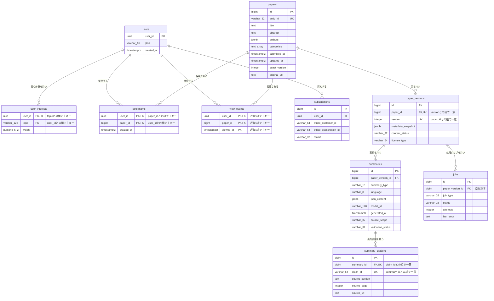

# DB物理設計書 — T009 ジョブ（`jobs`）

| 項目 | 内容 |
| :--- | :--- |
| 文書名 | DB物理設計書 T009 ジョブ（`jobs`） |
| 対象システム | Kaine personal pj — arXiv日本語研究ダイジェスト Webアプリ |
| 対象テーブル | T009 ジョブ（`jobs`）1テーブル |
| 版 | 1.1（第1回セルフレビュー `docs/reviews/db_T009_review_applied.md` の Major 1件・Minor 2件を反映。Blocker は0件） |
| 作成日 / 更新日 | 2026-10-26 / 2026-10-26 |
| 作成方法 | creating-db-physical-design v1.6.0 準拠。上流の確定設計書と `source/` の企画資料から作成。`docs/db/DB.T001.DB物理設計.md`〜`DB.T008.DB物理設計.md` の規約・判断を引き継ぐ |
| インプット | (b) `docs/基本設計書_概要.md` §6（テーブル一覧 T009、論理テーブル定義「T009 jobs（ジョブ）」、概念ER図、CRUD図）、§2（BF01・BF02・BF16・EX01・EX02・EX04）、§4（F01・F03・F04・F14・F17・F19）、§5 バッチ一覧（B001〜B011）、§10（運用監視）、§11（ARC001・ARC006）、付録 Q19・Q22・Q24・Q34・Q36／(a) `source/03_システム構成.md:11,19-32,43`、`source/02_機能要求定義.md:46,57,58`／(c) `legacy/`（空。突合結果は下記） |

## 前提: インプットの性質と突合結果

* **既存版**: `docs/db/DB.T009.DB物理設計.md` の旧版はありません（本書が初版です）。消さずに残すべき既存記述はありません。
* **source/（挙動の正）**: `source/` は企画・初期設計案のMarkdown 6ファイルだけで、`schema.rb`・マイグレーション・SQL・ORM定義はありません（本単位の作業開始時にファイル数6件で、T001〜T008 作成時から変更が無いことを確認）。`jobs` について資料にあるのは列名の並び1行（`source/03_システム構成.md:43`: paper_version_id, job_type, status, attempts, last_error）、ジョブ管理に Redis と Celery または RQ を使うこと（`:11`）、収集・日本語化の処理の流れ（`:19-32`）、バッチ処理にリトライ・重複排除・失敗キュー・監視を備えること（`source/02_機能要求定義.md:46`）、同一論文を重複処理しないこと（`:57`）、失敗時も処理状況を確認できること（`:58`）だけです。**型・桁・NOT NULL・初期値・制約・インデックス・区分値のコードはすべて資料に無いため、本書の物理定義はすべて※推測**です。上流の論理テーブル定義（`docs/基本設計書_概要.md` §6「T009 jobs（ジョブ）」）の型・制約・区分値の案を正として引き継ぎ、物理的な詳細（区分値のコード・CHECK制約・重複実行を防ぐ一意制約・削除時の動き・インデックス・行単位アクセス制御・DDL）を本書で加えています。
* **legacy/（既存設計）**: `legacy/` は空ディレクトリです（ファイル0件）。突合する既存仕様・業務意図・非機能の記述はありません。
* **上流との対応**: カラム6件は上流の論理テーブル定義の6行と1対1で一致します（列名・順序とも同じ）。資料の5列に、上流が主キー `id` を加えたものです（上流 Q22）。上流の論理定義に無い列は追加していません。
* **上流に無い要素**（※上流未定義）:
  * **重複実行を防ぐ一意制約**: 上流は「重複排除」を方針として求めています（上流 §5 バッチ共通の方針、ARC006）が、テーブルでの実現方法は定めていません。本書では「同じ版・同じ種別のジョブが待機中または実行中で2件以上ある状態」を一意インデックスで防ぎます（§4.4 No.7、§5）。
  * **外部キーの削除時の動き**: T002 §4.5 No.3 の推奨（削除を拒否）を本書で確定させます（§4.5）。
  * **区分値のコード**: 上流は状態を「待機・実行中・成功・失敗」、種別を「B001〜B006・B008・B009・B011 の処理種別」と定めています。英字のコードは本書で決めます（§6。上流 Q24）。
* **ファイル名**: T001〜T008 と同じく、作業指示に従いテーブルIDで命名しています（上流 §10 は `DB.{物理名}` 形式。※上流要確認。T001 §9 No.7 と同じ事項）。

---

## 1. データベース概要

T001（`docs/db/DB.T001.DB物理設計.md` §1）〜T008 と同じ規約を使います。本書で読むだけで分かるよう、内容を次に書きます。

* **対象RDBMS**: PostgreSQL（Supabase 上のマネージドDB）。製品は上流 §1 で確定です（`source/03_システム構成.md:8`）。バージョンは未定義のため、PostgreSQL 15 以上を前提にします（※推測。上流 Q02）。
* **文字コード / 照合順序**: UTF8 / Supabase の既定照合順序（※推測: 資料に定義なし）。
* **命名規則**:
  * テーブル名・カラム名: 英小文字のスネークケース。テーブル名は複数形です（`jobs`。上流 §6 の物理名をそのまま使います）。
  * 制約名・インデックス名（※推測）: 主キー `pk_{テーブル}`、一意制約 `uq_{テーブル}_{列または用途}`、外部キー `fk_{子テーブル}_{列}`、CHECK制約 `ck_{テーブル}_{意味}`、インデックス `idx_{テーブル}_{列または用途}`。
  * 区分値のコード（※推測）: 英小文字のスネークケースの文字列（`pending`・`summarize_abstract`）。T002・T003 の区分値と同じ書き方です。
* **共通カラム規約**: 上流 §6 にはシステム共通の監査列（作成日時・更新日時・論理削除フラグ）の規約がありません。本テーブルには上流の論理定義にある6列だけを置きます。ジョブの登録日時・開始日時・終了日時の列は上流に無く、持ちません。これらが無いと、実行中のまま止まったジョブの検出と処理時間の監視ができないため、追加するかを §9 No.1 で確認します（※上流要確認）。
* **論理削除**: 採用しません。ジョブの行は消さずに残し、状態の列で成功・失敗を表します。行の削除（古いジョブの片付け）は上流に定義が無く、§9 No.4 で確認します。

---

## 2. 物理テーブル一覧

本書が設計するのは T009 だけです。外部キーでつながるテーブルを区別するため、上流 §6 テーブル一覧の全件を載せています。

| No | 概要書ID | 論理名 | 物理名 | ドメイン | 概要 | 本書での扱い | 定義状況 | 詳細の所在 |
| :--- | :--- | :--- | :--- | :--- | :--- | :--- | :--- | :--- |
| 1 | T001 | 論文 | papers | 論文 | arXiv論文1本につき1行。最新版のメタデータを持つ | 対象外（T002 経由の間接的な関係のみ） | 詳細 | `docs/db/DB.T001.DB物理設計.md` |
| 2 | T002 | 論文バージョン | paper_versions | 論文 | 論文の版（v1/v2…）ごとに1行。取得時点のメタデータ、本文の取得状況、ライセンス種別を持つ | 関連（本テーブルが外部キーで参照する親テーブル。参照は任意） | 詳細 | `docs/db/DB.T002.DB物理設計.md` |
| 3 | T003 | 要約 | summaries | 要約 | 論文の版ごと・要約の深さごとの日本語要約JSON | 対象外（T002 経由の間接的な関係のみ。要約の生成・検証・公開をジョブで行う） | 詳細 | `docs/db/DB.T003.DB物理設計.md` |
| 4 | T004 | 要約出典参照 | summary_citations | 要約 | 要約内の主張ごとに原文の章・ページ・URLを結びつける | 対象外（関係なし） | 詳細 | `docs/db/DB.T004.DB物理設計.md` |
| 5 | T005 | 利用者 | users | 利用者 | 会員1人につき1行。プラン（Free/Pro）と登録日時を持つ | 対象外（関係なし） | 詳細 | `docs/db/DB.T005.DB物理設計.md` |
| 6 | T006 | 利用者関心分野 | user_interests | 利用者 | 利用者が登録した関心トピックと、その重み | 対象外（関係なし） | 詳細 | `docs/db/DB.T006.DB物理設計.md` |
| 7 | T007 | ブックマーク | bookmarks | 利用者 | 利用者が保存した論文 | 対象外（関係なし） | 詳細 | `docs/db/DB.T007.DB物理設計.md` |
| 8 | T008 | 閲覧イベント | view_events | 利用者 | 利用者が論文を開いた記録。プライバシーに配慮して最小限だけ持つ | 対象外（関係なし） | 詳細 | `docs/db/DB.T008.DB物理設計.md` |
| 9 | T009 | ジョブ | jobs | 運用 | 論文の版ごとの処理ジョブの種類・状態・試行回数・直近エラー | **設計対象** | 詳細 | 本書 §4〜§7 |
| 10 | T010 | サブスクリプション | subscriptions | 課金 | 利用者とStripeの顧客・定期課金を結びつけ、契約状態を持つ | 対象外（関係なし） | 詳細 | `docs/db/DB.T010.DB物理設計.md`（未作成） |

**総件数: 10件（本書の設計対象1件・外部キーで直接つながる関連1件・対象外8件）。全数である根拠**: `docs/基本設計書_概要.md` §6 テーブル一覧の T001〜T010 の全10行と1対1で対応します（上流の総件数10件と一致）。概要書ID・論理名・物理名・ドメイン（上流の「分類」列）・定義状況は上流の値をそのまま引き継ぎ、新規採番していません。T001〜T008 は作成済み、T010 の物理定義はそのDB物理設計書の責務で未作成です。

---

## 3. ER図（物理エンティティ関連図）

§2 の全10テーブルと、上流 §6 概念ER図の全10リレーションを描いています。`jobs` は §4 の物理定義どおりに全列を載せ、`papers`〜`view_events` は T001〜T008 の物理定義どおりに全列を載せています。T010 は上流 §6 概念ER図の属性をそのまま写したもので、物理的な確定はそのDB物理設計書で行います。



* **リレーション数**: 全10本（上流 §6 概念ER図の10本と一致）。このうち `jobs` に関わるものは1本（親 `paper_versions` から）で、§4.5 外部キー一覧の No.1 と1対1で対応します。
* **多重度の意味**: 論文の版1件に対し、ジョブは0件以上です（要約生成・検証・公開・本文解析・Embedding・GitHub関連付け・検索インデックス更新の種別ごとに、再実行も含めて複数）。ジョブ側から見ると、版は0件または1件です。論文メタデータ収集（B001）とarXivオンデマンド同期（B006）のジョブは、版が決まる前に動くため版を持ちません（上流 §6 T009「版が決まる前のジョブでは空になる」）。

---

## 4. テーブル詳細定義

### テーブル名: ジョブ (`jobs`)
* **概要**: 論文の収集・要約・検証・公開・本文解析といったバックグラウンド処理を、1回の処理単位（ジョブ）ごとに1行で記録する表です。ジョブの実行そのものは Redis と Celery または RQ のジョブキューが行い（`source/03_システム構成.md:11`）、本テーブルはその状態（待機・実行中・成功・失敗）、失敗した回数、直近のエラー内容をDBに残します。これにより、同じ版の同じ処理を二重に走らせない判定（上流 ARC001・ARC006）、失敗したジョブの抽出と再処理（B010）、画面での処理状況の表示（F17、MVP完了基準 `source/02_機能要求定義.md:58`）、運用の監視（上流 §10）ができます。
* **対応ドメイン**: 運用（上流 §6 テーブル一覧の分類）
* **概要書ID**: T009
* **想定件数**（※推測）: 新着論文が1日数百〜千本（arXiv の新着の規模）入り、1版あたり要約生成・検証・公開・検索インデックス更新の4ジョブ以上を作るとして、1日数千行、1年で百万行を超えます。行を消す規則が無いと増え続けるため、古いジョブの片付けを §9 No.4 で確認します。
* **個人情報の扱い**: 利用者を指す列はありません。直近エラー（`last_error`）に外部APIの応答をそのまま入れると、APIキーやURLの認証情報が混ざるおそれがあるため、エラー内容から認証情報を取り除いて保存します（§4.3 (6)。※推測）。
* **保護の重要度**: 処理の履歴で、失っても論文・要約のデータは残ります。バックアップは Supabase の日次バックアップに含まれますが、上流 §10 で「必ず対象」とする利用者データには入っていません。

#### 4.1 カラム一覧（ロースター）

| No | ID | カラム論理名 | カラム物理名 | 概要 | 定義状況 | 詳細の所在 |
| :--- | :--- | :--- | :--- | :--- | :--- | :--- |
| 1 | T009.id | ジョブID | id | ジョブを一意に識別する | 簡易 | §4.2 |
| 2 | T009.paper_version_id | 論文バージョンID | paper_version_id | どの版の処理かを示す。版が決まる前のジョブでは空になる | 詳細 | §4.3 (2) |
| 3 | T009.job_type | ジョブ種別 | job_type | 要約生成・検証・公開・本文解析といった処理の種類 | 詳細 | §4.3 (3) |
| 4 | T009.status | 状態 | status | 待機・実行中・成功・失敗のどれか。処理状況の確認と失敗キューの抽出に使う | 詳細 | §4.3 (4) |
| 5 | T009.attempts | 試行回数 | attempts | 失敗した回数。リトライの上限判定に使う | 詳細 | §4.3 (5) |
| 6 | T009.last_error | 直近エラー | last_error | 最後に失敗したときのエラー内容。原因調査に使う | 詳細 | §4.3 (6) |

**総件数: 6件（詳細5件・簡易1件）。全数である根拠**: 上流 `docs/基本設計書_概要.md` §6「T009 jobs（ジョブ）」の論理テーブル定義の全6行と1対1で対応します。資料の列名（`source/03_システム構成.md:43` の5列）に、上流が加えた主キー `id` を足した6列です。ID列は上流のテーブルID「T009」に物理名をつないだもので、新しい番号は振っていません。
**定義状況の判定**（completeness 3-1）: `id` は自動採番の識別子で判断を含まないため「簡易」です。`paper_version_id` は版テーブルとまたがり（3-1 の3）、種別によって空を許すかが分かれる（3-1 の1）ため「詳細」です。`job_type` は種別ごとに処理と版の要否が分かれる（3-1 の1）ため「詳細」です。`status` はワーカーが書き換え（3-1 の2）、状態遷移と重複実行の判定の業務ルールを含む（3-1 の7）ため「詳細」です。`attempts` はリトライの上限判定という失敗時の扱い（3-1 の5）を含むため「詳細」です。`last_error` は外部APIの応答から認証情報を取り除く業務ルール（3-1 の7）を含むため「詳細」です。

#### 4.2 カラム定義

| カラム論理名 | カラム物理名 | データ型 | PK | FK | 必須 (NN) | デフォルト値 / 制約 | 備考 |
| :--- | :--- | :--- | :--- | :--- | :--- | :--- | :--- |
| ジョブID | id | BIGINT（※推測） | ○ | - | ○ | GENERATED ALWAYS AS IDENTITY（※推測） | 資料に列が無く、上流が加えた列です（上流 §6 T009、Q22） |
| 論文バージョンID | paper_version_id | BIGINT（※推測） | - | ○（paper_versions.id） | -（空を許す） | ジョブの残っている版は削除できない（ON DELETE RESTRICT）。収集（B001）とオンデマンド同期（B006）以外の種別では必ず入れる（`ck_jobs_version_required`）（※推測） | 型は T002 `paper_versions.id`（BIGINT）に合わせています |
| ジョブ種別 | job_type | VARCHAR(32)（※推測） | - | - | ○ | §6 の9種類のどれかだけを入れられる（`ck_jobs_job_type`）（※推測） | 上流 §5 のバッチIDと1対1で対応します（§6） |
| 状態 | status | VARCHAR(16)（※推測） | - | - | ○ | DEFAULT `'pending'`。§6 の4種類のどれかだけを入れられる（`ck_jobs_status`）（※推測） | 同じ版・同じ種別で、待機中と実行中のジョブは合わせて1件までです（`uq_jobs_active_per_version`） |
| 試行回数 | attempts | INTEGER（※推測） | - | - | ○ | DEFAULT 0。0以上の値だけを入れられる（`ck_jobs_attempts_non_negative`）（※推測） | — |
| 直近エラー | last_error | TEXT（※推測） | - | - | -（空を許す） | — | 失敗したことが無いジョブでは空です。認証情報を取り除いてから保存します（§4.3 (6)） |

* **必須の判定**: 上流 §6 T009 の論理定義（ジョブIDは PK、論文バージョンIDは「任意」、ジョブ種別・状態・試行回数は「必須」、直近エラーは「任意」）をそのまま引き継いだものです（※推測。上流 Q22 で確認待ち）。

#### 4.3 カラム詳細（定義状況＝詳細の5列）

ロースターは §4.1 です。本節では定義状況が「詳細」の5列について、値の決め方と業務ルールを書きます（番号は §4.1 の No. に合わせています）。

**(2) T009.paper_version_id — 論文バージョンID**
* **値の決め方**: ジョブを登録するときに、処理する論文の版の論文バージョンIDを入れます。論文メタデータ収集（B001）が新しい版を保存したら、その版の要約ジョブ（B002）を登録します（上流 BF01「jobs に要約ジョブを登録」）。
* **空にする場合**: 論文メタデータ収集（B001）とarXivオンデマンド同期（B006）のジョブは、arXiv から取り込む前で版が決まっていないため空にします（上流 §6 T009）。この2種別以外では空を許しません（`ck_jobs_version_required`: 種別が収集・オンデマンド同期のどちらかであるか、または版が入っていること）。版を指さない要約ジョブができると、どの版を要約するのか分からなくなるためです。
* **親テーブルとの結びつき**: 論文バージョンテーブル（`paper_versions.id`）を参照する外部キーを付けます（上流 §6「FK→paper_versions.id」、§4.5 No.1）。
* **版を消すとき**: ジョブが残っている版は削除できません（ON DELETE RESTRICT）。論文と版は業務上消さない方針で、誤って消したときに処理の履歴が失われるのを防ぐためです（T002 §4.5 No.3 の推奨と同じ判断）。

**(3) T009.job_type — ジョブ種別**
* **意味**: ジョブがどの処理かを示します。上流 §6 T009「値は B001〜B006・B008・B009・B011 の処理種別」のとおり、上流 §5 バッチ一覧の9つのバッチと1対1で対応させます（コードと対応は §6）。
* **含めない処理**: 通知・ダイジェスト配信（B007）は論文の版ではなく利用者を単位に送る処理で、失敗ジョブの再処理（B010）は本テーブルの行を読み書きする側の処理のため、どちらも種別に含めません（上流 §6 T009 の値の範囲と同じ）。
* **値の範囲の制約**: §6 の9つのコード以外は入れられません（`ck_jobs_job_type`）。新しいバッチを追加するときは、制約とあわせて §6 を更新します。

**(4) T009.status — 状態**
* **意味**: ジョブがいまどの段階かを示します。値は待機・実行中・成功・失敗の4つです（上流 §6 T009。コードと遷移の条件は §6）。
* **初期値**: 登録した時点は待機です（DEFAULT `'pending'`。※推測）。
* **書き換え**: ジョブワーカーが、実行を始めたら実行中に、正常に終わったら成功にします。失敗したら試行回数を1増やし、上限未満なら待機に戻して再試行し、上限に達したら失敗にして失敗キューへ移します（上流 EX01「jobs の attempts を加算し last_error を記録」「上限到達: jobs の status を失敗にする」）。失敗ジョブの再処理（B010）は、原因を取り除いたジョブを待機に戻します（上流 B010）。
* **実行の取り合い**（※推測）: Celery・RQ は、ワーカーの停止や確認応答の遅れで、同じジョブを別のワーカーへもう一度渡すことがあります。同じ行を2つのワーカーが処理すると LLM の費用が二重にかかるため、ワーカーは処理を始める前に「状態が待機の行だけを実行中に変える」更新を行い、1行変えられたときだけ処理を続けます。0行だった（すでに他のワーカーが実行中か、終わっている）ときは、何もせずに終えます（`UPDATE jobs SET status = 'running' WHERE id = :id AND status = 'pending'`）。処理の後に成功・失敗・待機へ戻す更新も、状態が実行中の行だけを対象にし、他のワーカーの結果を上書きしないようにします（`... WHERE id = :id AND status = 'running'`）。
* **重複実行の防止**（※上流未定義）: 実行の重複は上の取り合いで防ぎ、行の重複は次の一意インデックスで防ぎます。同じ版・同じ種別のジョブが、待機中と実行中を合わせて2件以上にならないようにします（一意インデックス `uq_jobs_active_per_version`: 版と種別の組が同じで、状態が待機または実行中の行は1件まで）。収集が同じ版を2回見つけた場合や、再処理と自動の再試行が重なった場合でも、同じ要約を二重に作ってLLMの費用がかさむのを防ぐためです（`source/02_機能要求定義.md:46,57`、上流 ARC001・ARC006）。登録しようとして一意インデックスに当たったときは、すでに同じジョブが待っているものとして登録を取りやめます（`INSERT ... ON CONFLICT DO NOTHING`）。成功・失敗で終わったジョブはこの制約の対象外のため、同じ版の同じ処理を後からやり直すことはできます。
* **処理状況の表示**: 論文詳細（P104）の要約欄で、要約がまだ無いときに、その論文の最新版の要約ジョブの状態を「処理中」「処理に失敗」として表示します（上流 F17、EX04）。

**(5) T009.attempts — 試行回数**
* **意味**: そのジョブが失敗した回数です。上流 EX01 は失敗したときに加算するため、成功したジョブでは「成功するまでに失敗した回数」になります。
* **初期値**: 0 です（DEFAULT 0。上流 §6 T009「初期値 0」）。
* **使い方**: 失敗して1増やした結果が上限に達したら、それ以上再試行せずに失敗にします。上限の値は未定です（上流 Q19。※推測: 3回）。0未満の値は入れられません（`ck_jobs_attempts_non_negative`）。
* **再処理のとき**: 失敗ジョブの再処理（B010）で待機に戻すときは、試行回数を0に戻します（※推測）。0に戻さないと、再処理した直後の1回の失敗で再び上限に達してしまうためです。過去に失敗した回数は直近エラーとジョブの運用記録で追います。
* **再処理と新しいジョブが重なったとき**（※推測）: 同じ版・同じ種別の別のジョブがすでに待機中か実行中の場合、失敗のジョブを待機に戻す更新は一意インデックス（`uq_jobs_active_per_version`）に当たってエラーになります。この場合は、同じ処理がすでに予定されているものとして、失敗のジョブは失敗のまま残し、直近エラーも書き換えません。再処理の結果としては「重複のため戻さなかった」と運用者に示します。

**(6) T009.last_error — 直近エラー**
* **意味**: 最後に失敗したときのエラー内容です。運用者が失敗の原因を調べ、再処理（B010）するかを判断するのに使います（上流 §6 T009、B010）。
* **書き込み**: 失敗するたびに上書きします（上流 EX01「last_error を記録」）。成功しても消しません。成功したジョブに残っている値は「途中で失敗して再試行した」ことを示します（※推測）。
* **保存する内容**（※推測）: エラーの種類と要約（例: 「arXiv API がタイムアウトした」「要約JSONがスキーマに合わない」）を書きます。外部APIのエラー応答をそのまま入れると、APIキーや認証付きのURLが混ざることがあるため、保存する前に取り除きます。長いスタックトレースは本テーブルに入れず、アプリのログへ出します。

#### 4.4 制約一覧（ロースター）

| No | ID（制約名） | 種別 | 対象カラム | 概要 | 定義状況 | 詳細の所在 |
| :--- | :--- | :--- | :--- | :--- | :--- | :--- |
| 1 | pk_jobs | PRIMARY KEY | id | ジョブを一意に識別する | 簡易 | §4.2 |
| 2 | fk_jobs_paper_version_id | FOREIGN KEY | paper_version_id → paper_versions.id | 存在しない版のジョブを作らせない。ジョブの残る版の削除を拒否する | 詳細 | §4.5 No.1 |
| 3 | ck_jobs_job_type | CHECK | job_type | ジョブ種別を決められた9種類に限る（※推測） | 詳細 | §4.3 (3)・§6 |
| 4 | ck_jobs_status | CHECK | status | 状態を決められた4種類に限る（※推測） | 詳細 | §4.3 (4)・§6 |
| 5 | ck_jobs_attempts_non_negative | CHECK | attempts | 試行回数を0以上に限る（※推測） | 簡易 | §4.3 (5) |
| 6 | ck_jobs_version_required | CHECK | job_type, paper_version_id | 収集とオンデマンド同期以外のジョブには版を必ず入れさせる（※推測） | 詳細 | §4.3 (2) |
| 7 | uq_jobs_active_per_version（一意インデックス・※上流未定義） | UNIQUE | paper_version_id, job_type（状態が待機または実行中の行だけ） | 同じ版・同じ種別のジョブを二重に待機・実行させない | 詳細 | §4.3 (4)・§5 |
| 8 | NOT NULL（id） | NOT NULL | id | 主キーなので空を許さない（主キー制約に含まれる） | 簡易 | §4.2 |
| 9 | NOT NULL（job_type） | NOT NULL | job_type | 種別の分からないジョブを作らない | 簡易 | §4.2 |
| 10 | NOT NULL（status） | NOT NULL | status | 状態の分からないジョブを作らない（初期値で必ず埋まる） | 簡易 | §4.2 |
| 11 | NOT NULL（attempts） | NOT NULL | attempts | 試行回数を必ず持たせる（初期値で必ず埋まる） | 簡易 | §4.2 |
| 12 | IDENTITY（id） | DEFAULT（自動採番） | id | ジョブIDをDBが連番で払い出す | 簡易 | §4.2 |
| 13 | DEFAULT（status） | DEFAULT | status | 登録した時点は待機にする | 簡易 | §4.3 (4) |
| 14 | DEFAULT（attempts） | DEFAULT | attempts | 登録した時点の試行回数を0にする | 簡易 | §4.3 (5) |

**総件数: 14件（PRIMARY KEY 1件・FOREIGN KEY 1件・CHECK 4件・UNIQUE 1件・NOT NULL 4件・自動採番1件・DEFAULT 2件）。全数である根拠**: §7 DDL の `CREATE TABLE jobs` に書いた制約（CONSTRAINT 句6件、NOT NULL 4句、GENERATED ALWAYS AS IDENTITY 1句、DEFAULT 2句）と、`CREATE UNIQUE INDEX` 1文をすべて数えたものです。NOT NULL の4件は §4.2 で必須を「○」とした4列と一致します。PRIMARY KEY・FOREIGN KEY・試行回数の初期値は上流 §6 T009 の「PK」「FK→paper_versions.id」「初期値 0」と一致し、CHECK 4件・UNIQUE 1件・状態の初期値・削除時の動きは本書で追加した※推測です。
**定義状況の判定**: 複数テーブルにまたがる制約（3-1 の3）、値の範囲と版の要否に業務上の判断を含む制約（3-1 の1・3-1 の7）、重複実行を防ぐ制約（3-1 の5）は「詳細」、空を許さないだけの制約・0以上という自明な範囲・初期値は「簡易」としました。

#### 4.5 外部キー（FKリレーション）一覧（ロースター）

| No | ID（制約名） | 向き | 子テーブル.列 | 親テーブル.列 | 多重度 | 削除時の動き | 概要 | 定義状況 | 詳細の所在 |
| :--- | :--- | :--- | :--- | :--- | :--- | :--- | :--- | :--- | :--- |
| 1 | fk_jobs_paper_version_id | 本テーブルが参照する | jobs.paper_version_id（T009。空を許す） | paper_versions.id（T002） | 版0または1 : ジョブ0以上 | ジョブが残っていれば版の削除を拒否（ON DELETE RESTRICT）（※上流未定義） | ジョブがどの版の処理かを示す。版が決まる前のジョブは空 | 詳細 | 本書 §4.3 (2)、§7 |

**総件数: 1件（参照する1件・参照される0件）。全数である根拠**: 上流 §6 の論理テーブル定義 T009 で「FK→」と書かれた列は `paper_version_id` の1列だけで、上流 §6 概念ER図で `jobs` に入るリレーションも `paper_versions` からの1本だけです。上流 §6 の論理テーブル定義 T001〜T010 の全定義に `jobs` を参照する列は無いため、参照される外部キーは0件です。T002 設計書 §4.5 No.3 の行（`fk_jobs_paper_version_id`）と、制約名・多重度・削除時の動きが一致します。
**削除時の動きを「拒否」とする理由**: 論文と版は業務上消さない方針です（T001・T002 §1）。版を消すのは誤操作か特別な運用作業だけで、その版のジョブの履歴を巻き添えで消したり、版を指さないジョブを残したりしないよう、ジョブが残っているうちは版を消せないようにします。上流 §6 に削除時の動きの定義はありません（※上流未定義）。
**定義状況の判定**: 複数テーブルにまたがり（3-1 の3）、削除時の扱いが自明でない（3-1 の5）ため「詳細」です。

#### 4.6 本テーブルを操作する機能・バッチ（ロースター）

| No | ID | 名称 | 操作（C/R/U/D） | 本テーブルに対する内容 | 定義状況 | 詳細の所在 |
| :--- | :--- | :--- | :--- | :--- | :--- | :--- |
| 1 | F01 | 新着論文取得（B001） | C | 定期実行のたびに収集ジョブ（版なし）を登録し、新しく入った版ごとに要約生成ジョブ（B002）を登録する（上流 BF01、B001） | 詳細 | `docs/detail/be/BE.F01.BE詳細設計.md`（未作成）、`docs/detail/batch/BT.B001.バッチ詳細設計.md`（未作成） |
| 2 | F03 | 自由検索（B006） | C | 自前DBに無い論文が必要になったときに、オンデマンド同期ジョブ（版なし）を登録する（上流 BF04、B006） | 詳細 | `docs/detail/be/BE.F03.BE詳細設計.md`（未作成）、`docs/detail/batch/BT.B006.バッチ詳細設計.md`（未作成） |
| 3 | F04 | 日本語構造化要約（B002〜B005） | RU | 要約生成・検証・公開・本文解析のジョブを読み、状態・試行回数・直近エラーを書き換える（上流 BF01・BF02・EX01・EX02）。前の処理が終わったときに次の処理のジョブ（検証・公開・検索インデックス更新）を登録する操作（C）が上流 CRUD図に無い（※上流要確認。§9 No.5） | 詳細 | `docs/detail/be/BE.F04.BE詳細設計.md`（未作成）、`docs/detail/batch/BT.B002.バッチ詳細設計.md`〜`BT.B005.バッチ詳細設計.md`（未作成） |
| 4 | F14 | GitHub関連付け（B009） | C | 論文の版ごとに、GitHub公式実装の関連付けジョブを登録する（上流 B009） | 詳細 | `docs/detail/be/BE.F14.BE詳細設計.md`（未作成）、`docs/detail/batch/BT.B009.バッチ詳細設計.md`（未作成） |
| 5 | F17 | 処理状況の確認 | R | 論文詳細で、最新版の要約ジョブの状態を読んで処理状況を表示する（上流 BF16、EX04） | 簡易 | -（未作成） |
| 6 | F19 | コスト監視・利用状況分析 | R | 種別・状態ごとのジョブ数と失敗の件数を集計し、生成コストと失敗の傾向を確認する（上流 §10 運用監視） | 簡易 | -（未作成） |
| 7 | B010 | 失敗ジョブの再処理 | RU | 失敗のジョブを抽出して直近エラーを確かめ、原因を取り除いたものを待機に戻し、試行回数を0にする。同じ版・種別のジョブがすでに待機中か実行中なら戻さない（上流 B010、§4.3 (5)） | 詳細 | `docs/detail/batch/BT.B010.バッチ詳細設計.md`（未作成） |
| 8 | B011 | 検索インデックス更新 | RU | 検索インデックス更新のジョブを読み、状態・試行回数・直近エラーを書き換える（上流 B011） | 詳細 | `docs/detail/batch/BT.B011.バッチ詳細設計.md`（未作成） |

**総件数: 8件。全数である根拠**: 上流 §6 CRUD図の全21行（F01〜F19、B010、B011）のうち、`jobs` 列が「-」でない行を数えたものです（F01「C」、F03「C」、F04「RU」、F14「C」、F17「R」、F19「R」、B010「RU」、B011「RU」の8行。残りの13行は「-」）。定義状況と詳細の所在は上流 §4 機能一覧・§5 バッチ一覧の値を引き継いでいます。本テーブルの行を削除（D）する機能はありません。
**※上流要確認**: 論文Embedding生成（B008）は種別に含まれます（上流 §6 T009）が、B008 のジョブを登録・更新する機能の行が上流 CRUD図にありません（B008 に対応する機能は F08 の将来の推薦で、F08 の `jobs` 列は「-」）。B008 を実装するときに、CRUD図の行を追加するかを確認します（§9 No.5）。

---

## 5. インデックス設計

#### 5.1 インデックス一覧（ロースター）

| No | ID（インデックス名） | 対象カラム | 種別 | 概要 | 定義状況 | 詳細の所在 |
| :--- | :--- | :--- | :--- | :--- | :--- | :--- |
| 1 | pk_jobs | id | B-Tree（UNIQUE） | 主キー制約で自動的に作られる。ワーカーと再処理がジョブを1件ずつ引くのに使う | 簡易 | §4.4 No.1 |
| 2 | uq_jobs_active_per_version | paper_version_id, job_type（状態が待機または実行中の行だけ） | B-Tree（UNIQUE・部分インデックス） | 同じ版・同じ種別のジョブを二重に待機・実行させないための一意インデックス | 詳細 | §5.2 |
| 3 | idx_jobs_paper_version_id_job_type | paper_version_id, job_type, id（降順） | B-Tree | 版ごと・種別ごとに最も新しいジョブを引く検索と、版側の外部キーの確認のための索引 | 詳細 | §5.2 |
| 4 | idx_jobs_failed | job_type, id（状態が失敗の行だけ） | B-Tree（部分インデックス） | 失敗のジョブだけを種別ごとに抽出するための索引 | 詳細 | §5.2 |

**総件数: 4件（主キーで自動的に作られるもの1件、明示的に作るもの3件）。全数である根拠**: §7 DDL で `jobs` に作られるインデックスをすべて数えたものです（`CREATE UNIQUE INDEX` 文1文・`CREATE INDEX` 文2文、主キー制約による自動作成1件）。
**外部キー列のインデックス**: `paper_version_id` は No.3 の先頭の列なので、版を消そうとしたときの確認がこの索引で速くなります。No.2 は待機・実行中の行だけを持つため、外部キーの確認には使えません。
**作らないと判断したもの**（※推測）:
* `status` だけのインデックス: 値が4種類しかなく、成功の行が大半を占めます。失敗の抽出は No.4 の部分インデックスで足り、待機の抽出はジョブキュー（Redis）が担うため、DBで待機のジョブを探す検索がありません。
* `last_error` のインデックス: エラー内容で検索する処理がありません。運用者が原因を調べるときは、No.4 で失敗の行を絞ってから読みます。
**定義状況の判定**: 主キーのインデックスは自動作成で判断を含まないため「簡易」、明示的に作る3件は大量件数での性能上の判断（3-1 の6）か重複実行を防ぐ業務ルール（3-1 の5）を含むため「詳細」です。

#### 5.2 インデックス定義（主キーを除く）

| 対象テーブル物理名 | インデックス名 | 対象カラム | 種別 | 目的・理由 |
| :--- | :--- | :--- | :--- | :--- |
| jobs | uq_jobs_active_per_version | paper_version_id, job_type（状態が待機または実行中、かつ版が入っている行だけ） | B-Tree（UNIQUE・部分インデックス） | 同じ版・同じ種別のジョブが、待機中と実行中を合わせて1件までであることをDBが保証します（§4.3 (4)）。ジョブを登録する処理（B001・B002〜B005 の後続登録・B009・B010 の再処理）がどの経路から重なっても、LLMを使う処理が二重に走りません。終わったジョブ（成功・失敗）を対象から外しているため、行が増えても索引は小さいままです。版の無いジョブ（収集・オンデマンド同期）は対象外で、これらの重複は arXiv ID と版での重複判定（上流 BF01）が防ぎます（`WHERE status IN ('pending','running') AND paper_version_id IS NOT NULL`） |
| jobs | idx_jobs_paper_version_id_job_type | paper_version_id, job_type, id DESC | B-Tree | 論文詳細の処理状況の表示（F17）は、論文の最新版の要約ジョブを版と種別で引きます。同じ版・種別には再実行の履歴で複数の行があるため、ジョブIDの降順を3列目に置き、並べ替えをせずに最も新しい1行を取れるようにします。版を消そうとしたとき、DBはその版のジョブが残っていないかをこの索引で確かめます（§4.5 No.1 の削除の拒否）。行が百万を超えても全件を読まずに済むための索引です（※推測） |
| jobs | idx_jobs_failed | job_type, id（状態が失敗の行だけ） | B-Tree（部分インデックス） | 失敗ジョブの再処理（B010）と運用の監視（F19）は、失敗のジョブだけを種別ごとに抽出します。失敗の行は全体のごく一部のため、失敗の行だけを持つ小さな索引にします。ジョブIDを2列目に置き、登録の古い順に並べて読めるようにします（`WHERE status = 'failed'`。※推測） |

---

## 6. コード定義（区分値・ステータス定義）

本テーブルで値の一覧を本システムが定める列は `job_type` と `status` の2列です（§4.1 の全6列を確認）。コードは本書で決めた※推測です（上流 Q24）。

| 対象テーブル | 対象カラム | 設定値 | 意味・遷移条件 |
| :--- | :--- | :--- | :--- |
| jobs | job_type | collect_metadata | 論文メタデータ収集（B001）。arXiv の新着メタデータを取得し、重複を除いて論文と版を保存する。定期実行のたびに1件登録する。版を持たない |
| jobs | job_type | summarize_abstract | Abstractベース日本語要約生成（B002）。版ごとに30秒要約と3分要約を作る。収集が新しい版を保存したときに登録する |
| jobs | job_type | validate_summary | 要約の根拠・数値チェック（B003）。生成された要約をスキーマと原文に照らして検証する。要約生成または本文解析が終わったときに登録する |
| jobs | job_type | publish_summary | 公開反映（B004）。検証に合格した要約を公開用データとして確定する。検証に合格したときに登録する |
| jobs | job_type | analyze_full_text | 本文解析・詳細解説生成（B005）。ライセンスで許された版の本文PDFを解析して10分解説を作る。人気論文の判定か利用者のリクエストで登録する |
| jobs | job_type | sync_on_demand | arXivオンデマンド同期（B006）。自前DBに無い論文を arXiv から取り込む。検索で必要になったときに登録する。版を持たない |
| jobs | job_type | generate_embedding | 論文Embedding生成（B008）。将来の推薦のため論文ごとのEmbeddingを作る。公開反映の後に登録する（※推測） |
| jobs | job_type | link_github | GitHub公式実装の関連付け（B009）。論文の公式実装リポジトリを探して関連付ける。登録の契機は上流で未定義 |
| jobs | job_type | update_search_index | 検索インデックス更新（B011）。公開反映が済んだ論文を検索インデックスに加える。公開反映が終わったときに登録する |
| jobs | status | pending | 待機。ジョブを登録した時点の初期値。失敗して試行回数が上限未満のときと、再処理（B010）で戻されたときもこの状態になる |
| jobs | status | running | 実行中。ジョブワーカーが処理を始めたときに待機から移る |
| jobs | status | succeeded | 成功。処理が正常に終わったときに実行中から移る。これ以降は変わらない |
| jobs | status | failed | 失敗。失敗して試行回数が上限に達したときに実行中から移り、失敗キューへ送られる（上流 EX01）。再処理（B010）で待機に戻ることがある |

* **値の総件数: 13件（job_type 9件・status 4件）。全数である根拠**: `job_type` は上流 §6 T009「B001〜B006・B008・B009・B011 の処理種別」の9つのバッチと1対1、`status` は上流 §6 T009「待機・実行中・成功・失敗」の4つと1対1で対応し、§7 DDL の CHECK 制約 `ck_jobs_job_type`・`ck_jobs_status` が許す値と一致させています。
* **状態遷移**: 待機 → 実行中 → 成功、または 実行中 → 待機（失敗して上限未満）、実行中 → 失敗（上限到達）、失敗 → 待機（再処理）の4方向です。成功から他の状態へは移りません。待機から実行中へは、状態が待機であることを条件にした更新で移し、取り合いに勝った1つのワーカーだけが処理します（§4.3 (4)「実行の取り合い」）。実行中のままワーカーが止まった場合に待機へ戻す方法は、実行を始めた日時の列が無いため決められません（§9 No.1）。

---

## 7. DDL (データ定義言語)

`jobs` の全定義です。PostgreSQL 15 以上でそのまま実行できます（※推測: 型・制約はすべて本書の設計案）。論文バージョンテーブル（T002 `paper_versions`）を参照するため、`docs/db/DB.T002.DB物理設計.md` §7 の DDL を先に実行してください。

```sql
-- =========================================================
-- T009 ジョブ (jobs)
-- 前提: T002 paper_versions が作成済みであること
-- =========================================================
CREATE TABLE jobs (
    id                BIGINT       GENERATED ALWAYS AS IDENTITY,
    paper_version_id  BIGINT,
    job_type          VARCHAR(32)  NOT NULL,
    status            VARCHAR(16)  NOT NULL DEFAULT 'pending',
    attempts          INTEGER      NOT NULL DEFAULT 0,
    last_error        TEXT,

    CONSTRAINT pk_jobs PRIMARY KEY (id),

    -- ジョブの残っている版は削除させない
    CONSTRAINT fk_jobs_paper_version_id
        FOREIGN KEY (paper_version_id) REFERENCES paper_versions (id)
        ON DELETE RESTRICT,

    -- ジョブ種別は上流 §5 の9バッチ（B001〜B006・B008・B009・B011）
    CONSTRAINT ck_jobs_job_type CHECK (job_type IN (
        'collect_metadata', 'summarize_abstract', 'validate_summary', 'publish_summary',
        'analyze_full_text', 'sync_on_demand', 'generate_embedding', 'link_github',
        'update_search_index'
    )),

    -- 状態は待機・実行中・成功・失敗の4つ
    CONSTRAINT ck_jobs_status CHECK (status IN ('pending', 'running', 'succeeded', 'failed')),

    -- 試行回数は0以上
    CONSTRAINT ck_jobs_attempts_non_negative CHECK (attempts >= 0),

    -- 収集とオンデマンド同期以外は、どの版の処理かを必ず持つ
    CONSTRAINT ck_jobs_version_required CHECK (
        job_type IN ('collect_metadata', 'sync_on_demand') OR paper_version_id IS NOT NULL
    )
);

-- 同じ版・同じ種別のジョブは、待機中と実行中を合わせて1件まで（重複実行の防止）
CREATE UNIQUE INDEX uq_jobs_active_per_version
    ON jobs (paper_version_id, job_type)
    WHERE status IN ('pending', 'running') AND paper_version_id IS NOT NULL;

-- 版・種別ごとの検索と、版側の外部キーの確認
CREATE INDEX idx_jobs_paper_version_id_job_type ON jobs (paper_version_id, job_type, id DESC);

-- 失敗ジョブの抽出（再処理・監視）
CREATE INDEX idx_jobs_failed ON jobs (job_type, id) WHERE status = 'failed';

-- コメント
COMMENT ON TABLE  jobs                  IS 'T009 ジョブ: バックグラウンド処理1回を1行で記録する。状態・失敗回数・直近エラーを持ち、重複実行の防止と再処理に使う';
COMMENT ON COLUMN jobs.id               IS 'ジョブID（自動採番）';
COMMENT ON COLUMN jobs.paper_version_id IS '論文バージョンID（paper_versions.id。収集とオンデマンド同期のジョブでは空）';
COMMENT ON COLUMN jobs.job_type         IS 'ジョブ種別（上流 §5 のバッチ B001〜B006・B008・B009・B011 に対応する9種類）';
COMMENT ON COLUMN jobs.status           IS '状態（pending=待機 / running=実行中 / succeeded=成功 / failed=失敗）';
COMMENT ON COLUMN jobs.attempts         IS '試行回数（失敗した回数。上限に達したら失敗にする）';
COMMENT ON COLUMN jobs.last_error       IS '直近エラー（最後に失敗したときのエラー内容。認証情報は取り除いて保存する）';
```

**Supabase 環境のみの追加定義（※推測）**: 本テーブルは運用のための表で、ブラウザから直接読み書きする機能はありません。論文詳細の処理状況（F17）はAPIがサーバ側で読んで返します。行単位アクセス制御を有効にし、ポリシーを1つも作らないことで、ブラウザ（`anon`・`authenticated` ロール）からの読み書きをすべて拒否します。ジョブワーカーとAPIは、行単位アクセス制御を通らないサーバ側のサービスロールで接続します。

```sql
-- ポリシーを作らない＝ブラウザからの読み書きをすべて拒否する
ALTER TABLE jobs ENABLE ROW LEVEL SECURITY;
```

---

## 8. マイグレーション計画（該当する場合のみ）

**該当なし（新規構築）**。根拠: 既存のDB・スキーマ・マイグレーションはありません（`source/` にスキーマ定義が無く、`legacy/` は空。上流 §10「システム移行計画: 該当なし」）。

初回構築の手順（※推測）:

| No | 対象テーブル | 変更種別 | 変更内容 | 影響範囲 | 備考 |
| :--- | :--- | :--- | :--- | :--- | :--- |
| 1 | jobs | テーブル新規作成 | §7 DDL の `CREATE TABLE jobs`・`CREATE UNIQUE INDEX` 1文・`CREATE INDEX` 2文・コメントを実行する | なし（新規） | T002 `paper_versions` の作成後に実行する。マイグレーションの置き場所とツールは未定（※推測: Supabase のマイグレーション機能。上流 Q34） |
| 2 | jobs | 権限設定 | §7 の Supabase 環境のみの追加定義（行単位アクセス制御を有効にし、ポリシーは作らない）を実行する | ブラウザからの直接アクセス | Supabase 環境のみ（※推測） |

---

## 9. 確認事項（※推測・※上流要確認の集約）

| No | 区分 | 確認事項 | 本書での仮置き | 関連箇所 | 上流の確認事項 |
| :--- | :--- | :--- | :--- | :--- | :--- |
| 1 | 列の追加 | ジョブの登録日時・開始日時・終了日時の列を追加するか。無いと、実行中のまま止まったジョブの検出、処理時間の監視、失敗の古い順の並べ替えができない（※上流要確認） | 追加しない（上流の6列のまま）。失敗の並びはジョブIDの順で代用する | §1、§6 状態遷移 | —（※上流未定義） |
| 2 | 列の追加 | 版を持たないジョブ（収集・オンデマンド同期）が何を処理したか（取得した日付・arXiv ID）を残す列を追加するか。無いと、失敗したオンデマンド同期を再処理（B010）するときに対象が分からない（※上流要確認） | 追加しない。対象はジョブキュー側のジョブ引数で持つ | §4.3 (2) | —（※上流未定義） |
| 3 | リトライ | 試行回数の上限と再試行の間隔 | 上限3回。間隔は未定 | §4.3 (5) | Q19 |
| 4 | 片付け | 成功・失敗で終わったジョブの行をいつまで残すか | 消さない（上限なし） | §4 想定件数、§1 論理削除 | —（※上流未定義） |
| 5 | CRUD | 後続のジョブ（検証・公開・検索インデックス更新）の登録（C）を F04 の操作として CRUD図に加えるか。B008 のジョブを操作する機能の行を加えるか（※上流要確認） | F04 が後続のジョブを登録する。B008 は未定 | §4.6 | —（※上流未定義） |
| 6 | 区分値 | `job_type`・`status` のコード値 | §6 のとおり | §6 | Q24 |
| 7 | 型・制約 | 全列の型・必須・CHECK制約・重複実行を防ぐ一意制約 | §4.2・§4.4 のとおり | §4 | Q22 |
| 8 | 再処理 | 失敗ジョブの再処理を手動で行うか自動で行うか。再処理で試行回数を0に戻してよいか | 運用者が手動で起動し、試行回数を0に戻す | §4.3 (5)、§4.6 No.7 | Q36 |

**「—（※上流未定義）」の行について**: No.1・No.2・No.4・No.5 は、上流 `docs/基本設計書_概要.md` 付録の顧客確認事項（Q01〜Q37）に対応する質問がありません。上流の確認事項に4件を追加することを提案します。

---

## 出力前チェックリスト（自己検証）

- [x] §2 物理テーブル一覧に、基本設計書（概要）§6テーブル一覧の全10行を列挙した
- [x] §2 の「概要書ID」が上流のテーブルID T001〜T010 と1対1で対応している
- [x] §3 ER図に §2 の全10テーブルをエンティティとして描いた
- [x] §3 ER図のリレーションが §4.5 の外部キー1件（`paper_versions` → `jobs`）を表現している（図の10本は上流 §6 概念ER図の全リレーション）
- [x] §3 ER図の `jobs` のエンティティ名・PK（id）・FK（paper_version_id）が §4.2 と一致している
- [x] §3 のMermaid記法が規約どおり（型はアンダースコア区切り・括弧なし、リレーション記号の前後にスペース）
- [x] §4 全6列のカラム定義（PK/FK/NN/デフォルト）を網羅した
- [x] §5 インデックスを外部キー・検索条件・ステータスの列に設計し、作らない理由を明記した
- [x] §6 区分値 `job_type`（9件）・`status`（4件）の業務的意味と遷移条件を定義した
- [x] §7 DDL を出力した（CREATE TABLE・FOREIGN KEY・CHECK 4件・CREATE UNIQUE INDEX 1件・CREATE INDEX 2件、Supabase 環境のみの行単位アクセス制御）
- [x] 推測箇所に「※推測」を明記した
