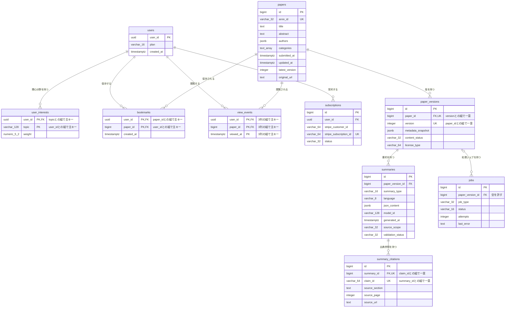

# DB物理設計書 — T010 サブスクリプション（`subscriptions`）

| 項目 | 内容 |
| :--- | :--- |
| 文書名 | DB物理設計書 T010 サブスクリプション（`subscriptions`） |
| 対象システム | Kaine personal pj — arXiv日本語研究ダイジェスト Webアプリ |
| 対象テーブル | T010 サブスクリプション（`subscriptions`）1テーブル |
| 版 | 1.1（第1回セルフレビュー `docs/reviews/db_T010_review_applied.md` の Major 2件を反映。Blocker は0件） |
| 作成日 / 更新日 | 2026-10-26 / 2026-10-26 |
| 作成方法 | creating-db-physical-design v1.6.0 準拠。上流の確定設計書と `source/` の企画資料から作成。`docs/db/DB.T001.DB物理設計.md`〜`DB.T009.DB物理設計.md` の規約・判断を引き継ぐ |
| インプット | (b) `docs/基本設計書_概要.md` §6（テーブル一覧 T010、論理テーブル定義「T010 subscriptions（サブスクリプション）」、概念ER図、CRUD図）、§2（BF12・BF13・EX06・EX07）、§3（P107）、§4（F09・F11・F12・F16・F18・F19）、§7（IF06・IF07、API08 `POST /api/billing/checkout`）、§8（認証・認可設計、セキュリティ対策「Pro機能の不正利用」「決済通知の偽装」）、§10（バックアップ、運用監視）、§11（ARC008・ARC010）、付録 Q14・Q17・Q22・Q24・Q28・Q34／(a) `source/03_システム構成.md:15,44,54`、`source/02_機能要求定義.md:17,48`、`source/01_企画概要.md:30`、`source/04_収益化とロードマップ.md:4-5,21,41,46`／(c) `legacy/`（空。突合結果は下記） |

## 前提: インプットの性質と突合結果

* **既存版**: `docs/db/DB.T010.DB物理設計.md` の旧版はありません（本書が初版です）。消さずに残すべき既存記述はありません。
* **source/（挙動の正）**: `source/` は企画・初期設計案のMarkdown 6ファイルだけで、`schema.rb`・マイグレーション・SQL・ORM定義はありません（本単位の作業開始時にファイル数6件で、T001〜T009 作成時から変更が無いことを確認）。`subscriptions` について資料にあるのは列名の並び1行（`source/03_システム構成.md:44`: user_id, stripe_customer_id, stripe_subscription_id, status）、決済に Stripe を使うこと（`:15`）、申込みのAPI（`:54`）、Stripe による有料プラン管理（`source/02_機能要求定義.md:17`）、料金画面の課金・プラン管理（`source/01_企画概要.md:30`）、Free と Pro の2プラン（`source/04_収益化とロードマップ.md:4-5`）、Phase 4 の Stripe 連携とプラン管理（`:41`）、検証指標の転換率・解約率（`:46`）だけです。**型・桁・NOT NULL・初期値・制約・インデックス・区分値はすべて資料に無いため、本書の物理定義はすべて※推測**です。上流の論理テーブル定義（`docs/基本設計書_概要.md` §6「T010 subscriptions（サブスクリプション）」）の型・制約の案を正として引き継ぎ、物理的な詳細（区分値・CHECK制約・課金中の契約を1人1件に限る一意制約・削除時の動き・インデックス・行単位アクセス制御・DDL）を本書で加えています。
* **legacy/（既存設計）**: `legacy/` は空ディレクトリです（ファイル0件）。突合する既存仕様・業務意図・非機能の記述はありません。
* **上流との対応**: カラム5件は上流の論理テーブル定義の5行と1対1で一致します（列名・順序とも同じ）。資料の4列に、上流が主キー `id` を加えたものです（上流 Q22）。上流の論理定義に無い列は追加していません。
* **上流に無い要素**（※上流未定義）:
  * **課金中の契約を1人1件に限る一意制約**: 上流 API08 は「Pro 契約中なら申込みを断る」（T005 §4.6 No.7「上流 API08 の 409」）としていますが、テーブルでの保証は定めていません。本書では、課金中の契約（試用中・有効・支払い遅延・未払い・一時停止）が同じ利用者に2件以上できないことを一意インデックスで保証します（§4.4 No.4）。
  * **外部キーの削除時の動き**: T005 §4.5 No.4 の推奨（一緒に削除）を本書で確定させます（§4.5）。
  * **区分値**: 上流は「Stripeの定期課金の状態値をそのまま持つ」としています。値の一覧は Stripe の定期課金の状態（`status`）の8値を本書で書き出します（§6。上流 Q24）。
* **ファイル名**: T001〜T009 と同じく、作業指示に従いテーブルIDで命名しています（上流 §10 は `DB.{物理名}` 形式。※上流要確認。T001 §9 No.7 と同じ事項）。

---

## 1. データベース概要

T001（`docs/db/DB.T001.DB物理設計.md` §1）〜T009 と同じ規約を使います。本書で読むだけで分かるよう、内容を次に書きます。

* **対象RDBMS**: PostgreSQL（Supabase 上のマネージドDB）。製品は上流 §1 で確定です（`source/03_システム構成.md:8`）。バージョンは未定義のため、PostgreSQL 15 以上を前提にします（※推測。上流 Q02）。
* **文字コード / 照合順序**: UTF8 / Supabase の既定照合順序（※推測: 資料に定義なし）。Stripe のIDは英数字と下線だけのため、照合順序の影響は受けません。
* **命名規則**:
  * テーブル名・カラム名: 英小文字のスネークケース。テーブル名は複数形です（`subscriptions`。上流 §6 の物理名をそのまま使います）。
  * 制約名・インデックス名（※推測）: 主キー `pk_{テーブル}`、一意制約 `uq_{テーブル}_{列または用途}`、外部キー `fk_{子テーブル}_{列}`、CHECK制約 `ck_{テーブル}_{意味}`、インデックス `idx_{テーブル}_{列または用途}`。
  * 区分値: 本テーブルの `status` は Stripe の値をそのまま持つため、Stripe の英小文字の表記（`active`・`past_due`）に合わせます。
* **共通カラム規約**: 上流 §6 にはシステム共通の監査列（作成日時・更新日時・論理削除フラグ）の規約がありません。本テーブルには上流の論理定義にある5列だけを置きます。契約の開始日時・解約日時・現在の請求期間の列は上流に無く、持ちません。これらが無いと、解約率（`source/04_収益化とロードマップ.md:46`）の期間別の集計と、Pro機能の利用量を請求期間で区切る集計（上流 F18、EX07「当期の利用量」）ができないため、追加するかを §9 No.1 で確認します（※上流要確認）。
* **論理削除**: 採用しません。解約しても行は消さず、契約状態を解約済み（`canceled`）に変えて残します。退会したときは行を物理的に削除します（上流 BF13、CRUD図 F16「RD」、ARC010）。

---

## 2. 物理テーブル一覧

本書が設計するのは T010 だけです。外部キーでつながるテーブルを区別するため、上流 §6 テーブル一覧の全件を載せています。

| No | 概要書ID | 論理名 | 物理名 | ドメイン | 概要 | 本書での扱い | 定義状況 | 詳細の所在 |
| :--- | :--- | :--- | :--- | :--- | :--- | :--- | :--- | :--- |
| 1 | T001 | 論文 | papers | 論文 | arXiv論文1本につき1行。最新版のメタデータを持つ | 対象外（関係なし） | 詳細 | `docs/db/DB.T001.DB物理設計.md` |
| 2 | T002 | 論文バージョン | paper_versions | 論文 | 論文の版（v1/v2…）ごとに1行。取得時点のメタデータ、本文の取得状況、ライセンス種別を持つ | 対象外（関係なし） | 詳細 | `docs/db/DB.T002.DB物理設計.md` |
| 3 | T003 | 要約 | summaries | 要約 | 論文の版ごと・要約の深さごとの日本語要約JSON | 対象外（関係なし） | 詳細 | `docs/db/DB.T003.DB物理設計.md` |
| 4 | T004 | 要約出典参照 | summary_citations | 要約 | 要約内の主張ごとに原文の章・ページ・URLを結びつける | 対象外（関係なし） | 詳細 | `docs/db/DB.T004.DB物理設計.md` |
| 5 | T005 | 利用者 | users | 利用者 | 会員1人につき1行。プラン（Free/Pro）と登録日時を持つ | 関連（本テーブルが外部キーで参照する親テーブル。契約状態からプランを決める） | 詳細 | `docs/db/DB.T005.DB物理設計.md` |
| 6 | T006 | 利用者関心分野 | user_interests | 利用者 | 利用者が登録した関心トピックと、その重み | 対象外（関係なし） | 詳細 | `docs/db/DB.T006.DB物理設計.md` |
| 7 | T007 | ブックマーク | bookmarks | 利用者 | 利用者が保存した論文 | 対象外（関係なし） | 詳細 | `docs/db/DB.T007.DB物理設計.md` |
| 8 | T008 | 閲覧イベント | view_events | 利用者 | 利用者が論文を開いた記録。プライバシーに配慮して最小限だけ持つ | 対象外（関係なし） | 詳細 | `docs/db/DB.T008.DB物理設計.md` |
| 9 | T009 | ジョブ | jobs | 運用 | 論文の版ごとの処理ジョブの種類・状態・試行回数・直近エラー | 対象外（関係なし） | 詳細 | `docs/db/DB.T009.DB物理設計.md` |
| 10 | T010 | サブスクリプション | subscriptions | 課金 | 利用者とStripeの顧客・定期課金を結びつけ、契約状態を持つ | **設計対象** | 詳細 | 本書 §4〜§7 |

**総件数: 10件（本書の設計対象1件・外部キーで直接つながる関連1件・対象外8件）。全数である根拠**: `docs/基本設計書_概要.md` §6 テーブル一覧の T001〜T010 の全10行と1対1で対応します（上流の総件数10件と一致）。概要書ID・論理名・物理名・ドメイン（上流の「分類」列）・定義状況は上流の値をそのまま引き継ぎ、新規採番していません。本書で T001〜T010 の全DB物理設計書がそろいます。

---

## 3. ER図（物理エンティティ関連図）

§2 の全10テーブルと、上流 §6 概念ER図の全10リレーションを描いています。`subscriptions` は §4 の物理定義どおりに、`papers`〜`jobs` は T001〜T009 の物理定義どおりに全列を載せています。全テーブルの物理定義がそろったため、本図が T001〜T010 の物理ER図の最新版です（T001〜T009 の設計書の §3 ER図は、各設計書を作った時点で未確定だったテーブルの主キーを表していないものがあります）。



* **リレーション数**: 全10本（上流 §6 概念ER図の10本と一致）。このうち `subscriptions` に関わるものは1本（親 `users` から）で、§4.5 外部キー一覧の No.1 と1対1で対応します。
* **多重度の意味**: 利用者1人に対し、契約は0件以上です。Free の利用者は0件です。解約したあとに再び申し込むと、過去の解約済みの契約と合わせて複数件になります。ただし、課金中の契約（試用中・有効・支払い遅延・未払い・一時停止）は1人1件までです（§4.4 No.4）。最初の支払いに失敗した契約（`incomplete`）は課金中に数えないため、支払いのやり直しで一時的に2件以上になることがあります。

---

## 4. テーブル詳細定義

### テーブル名: サブスクリプション (`subscriptions`)
* **概要**: 利用者の Pro プランの契約を、Stripe の定期課金1件につき1行で記録する表です。本システムの利用者と、Stripe 上の顧客・定期課金を結びつけ、Stripe から通知される契約状態を持ちます。契約状態が変わったら、同じトランザクションで利用者の `plan`（T005）を書き換え、Pro限定機能を使えるかの判定はプランで行います（上流 §6 T010「users.plan の更新に使う」、BF12、EX06、§8、ARC008）。解約しても行を残し、転換率・解約率の集計（F19）に使います。
* **対応ドメイン**: 課金（上流 §6 テーブル一覧の分類）
* **概要書ID**: T010
* **想定件数**（※推測）: 上流 §8 の規模の目安（月間アクティブユーザー1,000〜30,000人）で、有料に転換する割合を数％とすると、数十〜数千行です。解約済みの行が残るため、時間とともに少しずつ増えます。
* **個人情報・機密の扱い**: カード番号のような決済情報は本テーブルに持ちません（Stripe が持つ）。Stripe の顧客IDと定期課金IDはそれだけで決済はできませんが、Stripe のシークレットキーと組み合わせると契約の操作ができる識別子のため、ブラウザからは読めないようにします（§7 行単位アクセス制御）。
* **保護の重要度**: 再生成できない利用者データのため、バックアップの対象に必ず含めます（上流 §10 バックアップ・リカバリ方針「利用者データ（users・user_interests・bookmarks・subscriptions）は再生成できないため必ず対象にします」）。失った場合は Stripe 側の定期課金の一覧から作り直せます（※推測）。

#### 4.1 カラム一覧（ロースター）

| No | ID | カラム論理名 | カラム物理名 | 概要 | 定義状況 | 詳細の所在 |
| :--- | :--- | :--- | :--- | :--- | :--- | :--- |
| 1 | T010.id | サブスクリプションID | id | 契約を一意に識別する | 簡易 | §4.2 |
| 2 | T010.user_id | 利用者ID | user_id | 契約者 | 詳細 | §4.3 (2) |
| 3 | T010.stripe_customer_id | Stripe顧客ID | stripe_customer_id | Stripe上の顧客を指す | 詳細 | §4.3 (3) |
| 4 | T010.stripe_subscription_id | Stripe定期課金ID | stripe_subscription_id | Stripe上の定期課金を指す | 詳細 | §4.3 (4) |
| 5 | T010.status | 契約状態 | status | 有効・支払い遅延・解約といった契約の状態。users.plan の更新に使う | 詳細 | §4.3 (5) |

**総件数: 5件（詳細4件・簡易1件）。全数である根拠**: 上流 `docs/基本設計書_概要.md` §6「T010 subscriptions（サブスクリプション）」の論理テーブル定義の全5行と1対1で対応します。資料の列名（`source/03_システム構成.md:44` の4列）に、上流が加えた主キー `id` を足した5列です。ID列は上流のテーブルID「T010」に物理名をつないだもので、新しい番号は振っていません。
**定義状況の判定**（completeness 3-1）: `id` は自動採番の識別子で判断を含まないため「簡易」です。`user_id` は利用者テーブルとまたがり（3-1 の3）、退会時の削除と Stripe 側の解約の順序が自明でない（3-1 の5）ため「詳細」です。`stripe_customer_id` と `stripe_subscription_id` は外部サービスと値を一致させ（3-1 の3）、通知の重複・順序の入れ替わりへの備えが要る（3-1 の5）ため「詳細」です。`status` は Stripe の通知で書き換わり（3-1 の2）、値によってプランが分かれる（3-1 の1）ため「詳細」です。

#### 4.2 カラム定義

| カラム論理名 | カラム物理名 | データ型 | PK | FK | 必須 (NN) | デフォルト値 / 制約 | 備考 |
| :--- | :--- | :--- | :--- | :--- | :--- | :--- | :--- |
| サブスクリプションID | id | BIGINT（※推測） | ○ | - | ○ | GENERATED ALWAYS AS IDENTITY（※推測） | 資料に列が無く、上流が加えた列です（上流 §6 T010、Q22） |
| 利用者ID | user_id | UUID（※推測） | - | ○（users.user_id） | ○ | 利用者の行が消えたら一緒に消える（ON DELETE CASCADE）。課金中の契約は1人1件まで（`uq_subscriptions_user_billing`）（※推測） | 行を消す前に Stripe 側の定期課金を解約します（§4.3 (2)） |
| Stripe顧客ID | stripe_customer_id | VARCHAR(64)（※推測） | - | - | ○ | Stripe の顧客IDの形（`cus_` で始まる）の値だけを入れられる（`ck_subscriptions_stripe_ids`）（※推測） | 同じ利用者の契約は、再申込みでも同じ顧客IDを使います（§4.3 (3)） |
| Stripe定期課金ID | stripe_subscription_id | VARCHAR(64)（※推測） | - | - | ○ | 一意（`uq_subscriptions_stripe_subscription_id`）。Stripe の定期課金IDの形（`sub_` で始まる）の値だけを入れられる（`ck_subscriptions_stripe_ids`）（※推測） | Stripe からの通知で、どの行を書き換えるかを決める鍵です |
| 契約状態 | status | VARCHAR(32)（※推測） | - | - | ○ | §6 の8種類のどれかだけを入れられる（`ck_subscriptions_status`）。初期値は持たず、Stripe から受け取った値を入れる（※推測） | 値が変わったら同じトランザクションで users.plan を書き換えます（§4.3 (5)） |

* **必須の判定**: 5列とも必須です。上流 §6 T010 の論理定義（サブスクリプションIDは PK、ほかの4列は「必須」）をそのまま引き継いだものです（※推測。上流 Q22 で確認待ち）。
* **桁の根拠**: Stripe の顧客IDと定期課金IDは接頭辞と英数字の組み合わせで、現在は30文字前後です。Stripe が桁を増やしても収まるよう、上流の varchar(64) のままにします。

#### 4.3 カラム詳細（定義状況＝詳細の4列）

ロースターは §4.1 です。本節では定義状況が「詳細」の4列について、値の決め方と業務ルールを書きます（番号は §4.1 の No. に合わせています）。

**(2) T010.user_id — 利用者ID**
* **値の決め方**: Pro を申し込んだログイン中の利用者の利用者IDです。申込みのAPI（API08）が決済セッションを作るときに、利用者IDを Stripe 側の情報（決済セッションと定期課金のメタデータ）に添えておき、契約成立の通知を受けたときにその値で利用者を特定します（※推測: 上流 BF12 は通知を受けて「subscriptions を作成」とだけ定めている）。
* **親テーブルとの結びつき**: 利用者テーブル（`users.user_id`）を参照する外部キーを付けます（上流 §6「FK→users.user_id」、§4.5 No.1）。
* **課金中の契約は1人1件まで**（※上流未定義）: 課金が続いている、または続く見込みの状態（試用中 `trialing`・有効 `active`・支払い遅延 `past_due`・未払い `unpaid`・一時停止 `paused` の5つ）の行は、同じ利用者に1件までにします（一意インデックス `uq_subscriptions_user_billing`）。二重に申し込んで二重に課金されることを、申込みのAPIの確認（上流 API08: Pro 契約中なら断る）に加えてDBでも防ぐためです。申込みのAPIは、決済セッションを作る前に、この利用者に課金中の契約があるかを確かめ、あれば申し込ませません。未払いの契約がある利用者には、新しい申込みではなく未払いの請求の支払いを案内します（※推測）。
* **最初の支払いに失敗した契約の扱い**（※推測）: 最初の支払いに失敗した契約（`incomplete`）は、まだ課金が始まっていないため課金中に数えません。上流 EX06 のあと利用者が支払いをやり直すと、Stripe 側に新しい定期課金ができることがあり、その契約成立の通知で新しい行を作れるようにするためです。新しい契約が有効になったら、同じ利用者に残っている `incomplete` の定期課金を Stripe 側で取り消します（取り消すと期限切れ `incomplete_expired` になり、通知で本テーブルにも反映されます）。取り消さなくても Stripe は約1日で期限切れにするため、二重課金にはなりません。
* **退会時の削除**: 退会では、まず課金中の契約と最初の支払いに失敗した契約の Stripe 側の定期課金を解約し、そのあと本テーブルの行を削除します（上流 BF13「opt Pro契約中: 定期課金を解約」、CRUD図 F16「RD」）。利用者の行を消したときも、外部キーでその利用者の契約の行が一緒に消えます（ON DELETE CASCADE。§4.5 No.1）。Stripe 側の解約に失敗したら、行を消さずに退会の処理を止めます。行だけ消えて Stripe の課金が続くと、利用者に請求が続くのに本システムから止められなくなるためです（※推測）。Stripe 側の顧客情報まで消すかは未定です（上流 Q17）。

**(3) T010.stripe_customer_id — Stripe顧客ID**
* **値の決め方**: 契約成立の通知に含まれる Stripe の顧客IDを入れます。
* **同じ利用者の再申込み**: 解約したあとに再び申し込むときは、過去の契約の行にある顧客IDを使って決済セッションを作り、Stripe 側に同じ利用者の顧客が2つできないようにします（※推測）。このため、同じ利用者の行は顧客IDが同じになります。顧客IDには一意制約を付けません（解約済みの契約と新しい契約で同じ値になるため）。
* **値の形の確認**: Stripe の顧客IDは `cus_` で始まります。定期課金IDと取り違えて保存しないよう、形を CHECK 制約で確かめます（`ck_subscriptions_stripe_ids`: 顧客IDが `cus_` で、定期課金IDが `sub_` で始まること）。

**(4) T010.stripe_subscription_id — Stripe定期課金ID**
* **値の決め方**: 契約成立の通知に含まれる Stripe の定期課金IDを入れます。Stripe の定期課金1件が本テーブルの1行です。
* **一意にする理由**: Stripe からの通知（上流 IF07。※推測: Webhook）は、同じ通知が2回以上届くことがあり、届く順番が入れ替わることもあります。定期課金IDを一意にし、通知を受けたら「その定期課金IDの行があれば契約状態を書き換え、無ければ作る」（`INSERT ... ON CONFLICT (stripe_subscription_id) DO UPDATE`）ことで、同じ通知が重なっても行が増えません（上流 §6「必須, 一意」）。
* **順番の入れ替わりへの備え**（※推測）: 通知の中の状態をそのまま書くと、遅れて届いた古い通知（例: 支払い遅延）が新しい状態（例: 解約済み）を上書きするおそれがあります。本テーブルには状態を変えた日時の列が無いため、通知を受けたら Stripe のAPIでその定期課金の現在の状態を取り直し、その値を書き込みます。通知は「状態が変わったかもしれない」という合図として扱います。

**(5) T010.status — 契約状態**
* **意味**: Stripe の定期課金の状態です。上流 §6 T010「Stripeの定期課金の状態値をそのまま持つ」のとおり、Stripe の8つの値をそのまま入れます（コードと意味は §6）。
* **初期値**: 持ちません。行を作るのは Stripe の通知を受けたときだけで、そのとき Stripe の状態が必ず分かるためです。
* **書き換え**: Stripe からの通知を受けたサーバだけが書き換えます（上流 IF07、BF12、EX06）。通知の送り主は署名で確かめます（上流 §8 セキュリティ対策「決済通知の偽装」）。
* **プランとの対応**（※推測・※上流要確認）: 契約状態を書き換えたら、同じトランザクションで利用者のプラン（T005 `users.plan`）を次のとおり決め直します。
  * 有効（`active`）・試用中（`trialing`）なら Pro にします（上流 BF12「users の plan を Pro に更新」）。
  * 支払い遅延（`past_due`）は、Stripe が支払いを自動で再試行している間のため、Pro のままにします。再試行がすべて失敗して未払い（`unpaid`）か解約済み（`canceled`）になった時点で Free に戻します。支払い遅延の間を Pro のまま扱うかは上流で未定のため（T005 §9 No.3、上流 Q28）、§9 No.2 で確認します。
  * それ以外（`incomplete`・`incomplete_expired`・`unpaid`・`canceled`・`paused`）なら Free にします。最初の支払いに失敗した契約（`incomplete`）は Free のままです（上流 EX06「subscriptions の status を失敗状態で保存し plan は Free のまま」）。
  * 利用者のすべての契約のうち、課金中の契約（1人1件まで）の状態でプランを決めます。課金中の契約が無ければ Free です。

#### 4.4 制約一覧（ロースター）

| No | ID（制約名） | 種別 | 対象カラム | 概要 | 定義状況 | 詳細の所在 |
| :--- | :--- | :--- | :--- | :--- | :--- | :--- |
| 1 | pk_subscriptions | PRIMARY KEY | id | 契約を一意に識別する | 簡易 | §4.2 |
| 2 | fk_subscriptions_user_id | FOREIGN KEY | user_id → users.user_id | 存在しない利用者の契約を作らせない。利用者が消されたら一緒に消す | 詳細 | §4.5 No.1 |
| 3 | uq_subscriptions_stripe_subscription_id | UNIQUE | stripe_subscription_id | Stripe の定期課金1件につき行を1件にし、通知が重なっても行を増やさない | 詳細 | §4.3 (4) |
| 4 | uq_subscriptions_user_billing（一意インデックス・※上流未定義） | UNIQUE | user_id（状態が試用中・有効・支払い遅延・未払い・一時停止の行だけ） | 課金中の契約を1人1件に限り、二重課金を防ぐ | 詳細 | §4.3 (2)・§5 |
| 5 | ck_subscriptions_status | CHECK | status | 契約状態を Stripe の8種類に限る（※推測） | 詳細 | §4.3 (5)・§6 |
| 6 | ck_subscriptions_stripe_ids | CHECK | stripe_customer_id, stripe_subscription_id | 顧客IDと定期課金IDを取り違えて保存させない（※推測） | 簡易 | §4.3 (3) |
| 7 | NOT NULL（id） | NOT NULL | id | 主キーなので空を許さない（主キー制約に含まれる） | 簡易 | §4.2 |
| 8 | NOT NULL（user_id） | NOT NULL | user_id | 契約者の分からない契約を作らない | 簡易 | §4.2 |
| 9 | NOT NULL（stripe_customer_id） | NOT NULL | stripe_customer_id | Stripe 上の顧客を必ず結びつける | 簡易 | §4.2 |
| 10 | NOT NULL（stripe_subscription_id） | NOT NULL | stripe_subscription_id | Stripe 上の定期課金を必ず結びつける | 簡易 | §4.2 |
| 11 | NOT NULL（status） | NOT NULL | status | 状態の分からない契約を作らない | 簡易 | §4.2 |
| 12 | IDENTITY（id） | DEFAULT（自動採番） | id | サブスクリプションIDをDBが連番で払い出す | 簡易 | §4.2 |

**総件数: 12件（PRIMARY KEY 1件・FOREIGN KEY 1件・UNIQUE 2件・CHECK 2件・NOT NULL 5件・自動採番1件）。DEFAULT は自動採番の1件だけです（契約状態は Stripe の値を必ず入れるため初期値を持ちません）。全数である根拠**: §7 DDL の `CREATE TABLE subscriptions` に書いた制約（CONSTRAINT 句5件、NOT NULL 5句、GENERATED ALWAYS AS IDENTITY 1句）と、`CREATE UNIQUE INDEX` 1文をすべて数えたものです。NOT NULL の5件は §4.2 で必須を「○」とした5列と一致します。PRIMARY KEY・FOREIGN KEY・定期課金IDの一意は上流 §6 T010 の「PK」「FK→users.user_id」「必須, 一意」と一致し、課金中の契約の一意・CHECK 2件・削除時の動きは本書で追加した※推測です。
**定義状況の判定**: 複数テーブルにまたがる制約（3-1 の3）、外部サービスとの対応と通知の重複への備え（3-1 の5）、値によってプランが分かれる制約（3-1 の1）は「詳細」、空を許さないだけの制約・IDの形の確認・自動採番は「簡易」としました。

#### 4.5 外部キー（FKリレーション）一覧（ロースター）

| No | ID（制約名） | 向き | 子テーブル.列 | 親テーブル.列 | 多重度 | 削除時の動き | 概要 | 定義状況 | 詳細の所在 |
| :--- | :--- | :--- | :--- | :--- | :--- | :--- | :--- | :--- | :--- |
| 1 | fk_subscriptions_user_id | 本テーブルが参照する | subscriptions.user_id（T010） | users.user_id（T005） | 利用者1 : 契約0以上 | 利用者と一緒に削除（ON DELETE CASCADE）（※上流未定義） | 契約者を示す。退会で利用者を消すと契約の行も消える | 詳細 | 本書 §4.3 (2)、§7 |

**総件数: 1件（参照する1件・参照される0件）。全数である根拠**: 上流 §6 の論理テーブル定義 T010 で「FK→」と書かれた列は `user_id` の1列だけで、上流 §6 概念ER図で `subscriptions` に入るリレーションも `users` からの1本だけです。上流 §6 の論理テーブル定義 T001〜T010 の全定義に `subscriptions` を参照する列は無いため、参照される外部キーは0件です。T005 設計書 §4.5 No.4 の行（`fk_subscriptions_user_id`）と、制約名・向き・多重度・削除時の動きが一致します。
**削除時の動きを「一緒に削除」とする理由**: 退会したら、利用者に紐づくデータをすべて消す方針です（上流 BF13、F16、ARC010）。ただし契約は Stripe 側の課金と結びついているため、行を消す前にアプリが Stripe 側の定期課金を解約します（§4.3 (2)）。外部キーは、その手順のあとで行が残らないようにするための最後の備えです。上流 §6 に削除時の動きの定義はありません（※上流未定義）。
**定義状況の判定**: 複数テーブルにまたがり（3-1 の3）、削除時の扱いが自明でない（3-1 の5）ため「詳細」です。

#### 4.6 本テーブルを操作する機能・バッチ（ロースター）

| No | ID | 名称 | 操作（C/R/U/D） | 本テーブルに対する内容 | 定義状況 | 詳細の所在 |
| :--- | :--- | :--- | :--- | :--- | :--- | :--- |
| 1 | F09 | AIチャット | R | Pro限定機能の実行の前に、契約を読む（上流 CRUD図「R」）。Pro かどうかの判定は利用者のプラン（T005）で行うため、本テーブルは利用量の集計期間を決めるのに使う想定（※推測・※上流要確認。§9 No.1） | 詳細 | `docs/detail/be/BE.F09.BE詳細設計.md`（未作成） |
| 2 | F11 | 複数論文比較 | R | AIチャットと同じく、Pro限定機能の実行の前に契約を読む（※推測・※上流要確認。§9 No.1） | 詳細 | `docs/detail/be/BE.F11.BE詳細設計.md`（未作成） |
| 3 | F12 | 課金（API08、IF06、IF07） | CRU | 申込みの前に、課金中の契約があるかを読む（あれば申し込ませない）。新しい契約が有効になったら、同じ利用者に残っている最初の支払いに失敗した契約を Stripe 側で取り消す。Stripe の契約成立の通知で行を作り、状態が変わる通知のたびに状態を書き換え、同じトランザクションで利用者のプランを決め直す（上流 BF12、EX06、§4.3 (4)・(5)） | 詳細 | `docs/detail/be/BE.F12.BE詳細設計.md`（未作成） |
| 4 | F16 | 退会・個人データ削除 | RD | 退会の前に課金中の契約と最初の支払いに失敗した契約を読んで Stripe 側の定期課金を解約し、そのあと行を削除する（上流 BF13、§4.3 (2)） | 詳細 | `docs/detail/be/BE.F16.BE詳細設計.md`（未作成） |
| 5 | F18 | Pro機能の利用量制限 | R | 利用量の上限を確かめる前に契約を読む。「当期」の区切りを請求期間に合わせる場合は請求期間の列が必要（上流 EX07、Q14。§9 No.1） | 詳細 | `docs/detail/be/BE.F18.BE詳細設計.md`（未作成） |
| 6 | F19 | コスト監視・利用状況分析 | R | 状態ごとの契約数を数え、無料から有料への転換率と解約率を集計する（`source/04_収益化とロードマップ.md:46`）。期間別の集計には契約の開始日時・解約日時が必要（§9 No.1） | 簡易 | -（未作成） |

**総件数: 6件。全数である根拠**: 上流 §6 CRUD図の全21行（F01〜F19、B010、B011）のうち、`subscriptions` 列が「-」でない行を数えたものです（F09「R」、F11「R」、F12「CRU」、F16「RD」、F18「R」、F19「R」の6行。残りの15行は「-」）。定義状況と詳細の所在は上流 §4 機能一覧の値を引き継いでいます。
**※上流要確認**: F09・F11・F18 が本テーブルを読む目的は上流に書かれていません。Pro かどうかの判定は `users.plan` で行う（上流 §8 認証・認可設計）ため、本テーブルを読むのは利用量の集計期間を知るためと読み取れますが、そのための請求期間の列がありません（§9 No.1）。

---

## 5. インデックス設計

#### 5.1 インデックス一覧（ロースター）

| No | ID（インデックス名） | 対象カラム | 種別 | 概要 | 定義状況 | 詳細の所在 |
| :--- | :--- | :--- | :--- | :--- | :--- | :--- |
| 1 | pk_subscriptions | id | B-Tree（UNIQUE） | 主キー制約で自動的に作られる | 簡易 | §4.4 No.1 |
| 2 | uq_subscriptions_stripe_subscription_id | stripe_subscription_id | B-Tree（UNIQUE） | 一意制約で自動的に作られる。Stripe の通知を受けたときに、書き換える行を定期課金IDで引くのに使う | 詳細 | §4.4 No.3、§4.3 (4) |
| 3 | uq_subscriptions_user_billing | user_id（状態が試用中・有効・支払い遅延・未払い・一時停止の行だけ） | B-Tree（UNIQUE・部分インデックス） | 課金中の契約を1人1件に限る一意インデックス。申込みの前と退会の前に、課金中の契約を引くのにも使う | 詳細 | §5.2 |
| 4 | idx_subscriptions_user_id | user_id | B-Tree | 利用者のすべての契約（解約済みを含む）を引く検索と、利用者側の外部キーの確認のための索引 | 詳細 | §5.2 |

**総件数: 4件（制約で自動的に作られるもの2件、明示的に作るもの2件）。全数である根拠**: §7 DDL で `subscriptions` に作られるインデックスをすべて数えたものです（主キー制約と一意制約による自動作成2件、`CREATE UNIQUE INDEX` 文1文、`CREATE INDEX` 文1文）。
**作らないと判断したもの**（※推測）:
* `stripe_customer_id` のインデックス: 再申込みで顧客IDを探すときは利用者IDから引く（No.4）ため、顧客IDで検索する処理がありません。Stripe の通知は定期課金IDで引きます（No.2）。
* `status` のインデックス: 行数が数十〜数千行と少なく、状態ごとの集計（F19）は全件を読んでも短時間で終わります。
**定義状況の判定**: 主キーのインデックスは自動作成で判断を含まないため「簡易」、ほかの3件は通知の重複への備え・二重課金の防止・外部キーの確認という判断（3-1 の3・3-1 の5）を含むため「詳細」です。

#### 5.2 インデックス定義（主キーを除く）

| 対象テーブル物理名 | インデックス名 | 対象カラム | 種別 | 目的・理由 |
| :--- | :--- | :--- | :--- | :--- |
| subscriptions | uq_subscriptions_stripe_subscription_id | stripe_subscription_id | B-Tree（UNIQUE） | 一意制約に伴って作られる索引です。Stripe の通知を受けたとき、通知に含まれる定期課金IDで書き換える行を引き、無ければ作る処理（§4.3 (4)）をこの索引で行います |
| subscriptions | uq_subscriptions_user_billing | user_id（状態が試用中・有効・支払い遅延・未払い・一時停止の行だけ） | B-Tree（UNIQUE・部分インデックス） | 同じ利用者に課金中の契約が2件できないことをDBが保証します（§4.3 (2)）。最初の支払いに失敗した契約は対象外のため、支払いのやり直しで新しい契約の行を作れます。申込みのAPIが「課金中の契約があるか」を確かめるとき、退会の前に解約する契約を探すとき、プランを決め直すときに、この小さな索引で1行を引けます（`WHERE status IN ('trialing', 'active', 'past_due', 'unpaid', 'paused')`） |
| subscriptions | idx_subscriptions_user_id | user_id | B-Tree | 再申込みのときに過去の契約から顧客IDを探す検索、退会で利用者の行を消したときに子の行を探す検索（§4.5 No.1）に使います。No.3 は課金中の契約だけを持つため、解約済みの契約を探せず、外部キーの確認にも使えません |

---

## 6. コード定義（区分値・ステータス定義）

本テーブルで値の一覧を持つ列は `status` の1列です（§4.1 の全5列を確認）。値は Stripe の定期課金の状態の値で、本システムでは決めません（上流 §6 T010「Stripeの定期課金の状態値をそのまま持つ」）。プランとの対応は §4.3 (5) の※推測です。

| 対象テーブル | 対象カラム | 設定値 | 意味・遷移条件 |
| :--- | :--- | :--- | :--- |
| subscriptions | status | incomplete | 最初の支払いがまだ済んでいない。申込みの決済で支払いに失敗したときにこの状態で作られる（上流 EX06）。プランは Free のまま。約1日以内に支払われれば有効へ、支払われなければ期限切れへ移る |
| subscriptions | status | incomplete_expired | 最初の支払いがされないまま期限が切れた。最初の支払いが済んでいない状態から移る。終わった契約で、プランは Free。これ以降は変わらない |
| subscriptions | status | trialing | 試用期間中。試用付きのプランで申し込んだときの状態で、プランは Pro。試用が終わると有効か支払い遅延へ移る（※推測: 試用期間を設けるかは未定） |
| subscriptions | status | active | 有効。支払いが済み、契約が続いている。プランは Pro（上流 BF12）。請求の支払いに失敗すると支払い遅延へ、解約すると解約済みへ移る |
| subscriptions | status | past_due | 支払い遅延。請求の支払いに失敗し、Stripe が自動で再試行している。プランは Pro のまま（※推測・※上流要確認。§9 No.2）。支払われれば有効へ戻り、再試行がすべて失敗すると未払いか解約済みへ移る |
| subscriptions | status | unpaid | 未払い。支払いの再試行がすべて失敗し、契約は残っているが請求が止まっている。プランは Free。支払われれば有効へ戻る |
| subscriptions | status | canceled | 解約済み。利用者の解約、退会、または支払いの再試行の失敗で契約が終わった。終わった契約で、プランは Free。これ以降は変わらない。解約率の集計（F19）の対象 |
| subscriptions | status | paused | 一時停止。試用期間が、支払い方法が登録されないまま終わったときに、Stripe が契約を止めた状態。プランは Free。再開すれば有効へ戻る（※推測: 本システムで一時停止を使うかは未定） |

* **値の総件数: 8件。全数である根拠**: Stripe の定期課金オブジェクトの `status` が取りうる値の全8件（incomplete・incomplete_expired・trialing・active・past_due・unpaid・canceled・paused）と1対1で対応し、§7 DDL の CHECK 制約 `ck_subscriptions_status` が許す値と一致させています。Stripe が値を追加した場合は、CHECK 制約とあわせて本表を更新します。
* **状態の3つのまとまり**:
  * **終わった契約**: 解約済み（`canceled`）と期限切れ（`incomplete_expired`）の2つ。これ以降状態が変わりません。
  * **課金中の契約**: 試用中（`trialing`）・有効（`active`）・支払い遅延（`past_due`）・未払い（`unpaid`）・一時停止（`paused`）の5つ。課金が続いている、または続く見込みの契約で、1人1件まで（`uq_subscriptions_user_billing`）です。
  * **支払い待ちの契約**: 最初の支払いがまだ済んでいない（`incomplete`）の1つ。課金が始まっていないため課金中に数えず、支払いのやり直しで同じ利用者に複数できることがあります（§4.3 (2)）。

---

## 7. DDL (データ定義言語)

`subscriptions` の全定義です。PostgreSQL 15 以上でそのまま実行できます（※推測: 型・制約はすべて本書の設計案）。利用者テーブル（T005 `users`）を参照するため、`docs/db/DB.T005.DB物理設計.md` §7 の DDL を先に実行してください。

```sql
-- =========================================================
-- T010 サブスクリプション (subscriptions)
-- 前提: T005 users が作成済みであること
-- =========================================================
CREATE TABLE subscriptions (
    id                      BIGINT       GENERATED ALWAYS AS IDENTITY,
    user_id                 UUID         NOT NULL,
    stripe_customer_id      VARCHAR(64)  NOT NULL,
    stripe_subscription_id  VARCHAR(64)  NOT NULL,
    status                  VARCHAR(32)  NOT NULL,

    CONSTRAINT pk_subscriptions PRIMARY KEY (id),

    -- 利用者を消したら契約の行も一緒に消す（Stripe 側の解約はアプリが先に行う）
    CONSTRAINT fk_subscriptions_user_id
        FOREIGN KEY (user_id) REFERENCES users (user_id)
        ON DELETE CASCADE,

    -- Stripe の定期課金1件につき1行（通知が重なっても行を増やさない）
    CONSTRAINT uq_subscriptions_stripe_subscription_id UNIQUE (stripe_subscription_id),

    -- 契約状態は Stripe の定期課金の状態の8値
    CONSTRAINT ck_subscriptions_status CHECK (status IN (
        'incomplete', 'incomplete_expired', 'trialing', 'active',
        'past_due', 'unpaid', 'canceled', 'paused'
    )),

    -- 顧客IDと定期課金IDの取り違えを防ぐ
    CONSTRAINT ck_subscriptions_stripe_ids CHECK (
        stripe_customer_id LIKE 'cus\_%' AND stripe_subscription_id LIKE 'sub\_%'
    )
);

-- 課金中の契約（試用中・有効・支払い遅延・未払い・一時停止）は1人1件まで（二重課金の防止）
-- 最初の支払いに失敗した契約（incomplete）は対象外（支払いのやり直しで新しい契約を作れるようにする）
CREATE UNIQUE INDEX uq_subscriptions_user_billing
    ON subscriptions (user_id)
    WHERE status IN ('trialing', 'active', 'past_due', 'unpaid', 'paused');

-- 利用者のすべての契約の検索と、利用者側の外部キーの確認
CREATE INDEX idx_subscriptions_user_id ON subscriptions (user_id);

-- コメント
COMMENT ON TABLE  subscriptions                        IS 'T010 サブスクリプション: Stripe の定期課金1件につき1行。利用者と Stripe の顧客・定期課金を結びつけ、契約状態を持つ';
COMMENT ON COLUMN subscriptions.id                     IS 'サブスクリプションID（自動採番）';
COMMENT ON COLUMN subscriptions.user_id                IS '利用者ID（users.user_id。利用者を消すと一緒に消える）';
COMMENT ON COLUMN subscriptions.stripe_customer_id     IS 'Stripe顧客ID（cus_ で始まる。同じ利用者の再申込みでも同じ値を使う）';
COMMENT ON COLUMN subscriptions.stripe_subscription_id IS 'Stripe定期課金ID（sub_ で始まる。一意。通知で書き換える行を決める鍵）';
COMMENT ON COLUMN subscriptions.status                 IS '契約状態（Stripe の定期課金の状態をそのまま持つ。変わったら users.plan を決め直す）';
```

**Supabase 環境のみの追加定義（※推測）**: 本テーブルは Stripe の識別子を持つため、ブラウザから直接読み書きさせません。料金画面（P107）やマイページで契約の状態を見せる場合は、APIがサーバ側で読んで必要な項目だけを返します。行単位アクセス制御を有効にし、ポリシーを1つも作らないことで、ブラウザ（`anon`・`authenticated` ロール）からの読み書きをすべて拒否します。Stripe の通知の受け口と申込み・退会のAPIは、行単位アクセス制御を通らないサーバ側のサービスロールで接続します。プランの改ざんを防ぐ T005 の方針（ブラウザからの書き込みの全面拒否）と同じ考え方です。

```sql
-- ポリシーを作らない＝ブラウザからの読み書きをすべて拒否する
ALTER TABLE subscriptions ENABLE ROW LEVEL SECURITY;
```

---

## 8. マイグレーション計画（該当する場合のみ）

**該当なし（新規構築）**。根拠: 既存のDB・スキーマ・マイグレーションはありません（`source/` にスキーマ定義が無く、`legacy/` は空。上流 §10「システム移行計画: 該当なし」）。

初回構築の手順（※推測）:

| No | 対象テーブル | 変更種別 | 変更内容 | 影響範囲 | 備考 |
| :--- | :--- | :--- | :--- | :--- | :--- |
| 1 | subscriptions | テーブル新規作成 | §7 DDL の `CREATE TABLE subscriptions`・`CREATE UNIQUE INDEX` 1文・`CREATE INDEX` 1文・コメントを実行する | なし（新規） | T005 `users` の作成後に実行する。課金は Phase 4 のため、それまでに作ればよい。マイグレーションの置き場所とツールは未定（※推測: Supabase のマイグレーション機能。上流 Q34） |
| 2 | subscriptions | 権限設定 | §7 の Supabase 環境のみの追加定義（行単位アクセス制御を有効にし、ポリシーは作らない）を実行する | ブラウザからの直接アクセス | Supabase 環境のみ（※推測） |

---

## 9. 確認事項（※推測・※上流要確認の集約）

| No | 区分 | 確認事項 | 本書での仮置き | 関連箇所 | 上流の確認事項 |
| :--- | :--- | :--- | :--- | :--- | :--- |
| 1 | 列の追加 | 契約の開始日時・解約日時・現在の請求期間（開始・終了）の列を追加するか。無いと、解約率の期間別の集計（F19）と、Pro機能の利用量を請求期間で区切る集計（F18・EX07）ができない（※上流要確認） | 追加しない（上流の5列のまま）。必要な日時は Stripe のAPIから取り直す | §1、§4.6 | —（※上流未定義） |
| 2 | プラン | 支払い遅延（`past_due`）の間を Pro のまま扱うか。どの契約状態で Pro にするか（※上流要確認） | 有効・試用中・支払い遅延で Pro、それ以外は Free | §4.3 (5)、§6 | Q28 |
| 3 | 通知 | Stripe の通知（Webhook）で契約状態を更新する方式でよいか。通知を受けたら Stripe のAPIで現在の状態を取り直す方式でよいか | Webhook で受け、現在の状態を取り直して書く | §4.3 (4) | Q28 |
| 4 | 区分値 | 契約状態の値（Stripe の8値をそのまま持つ）。試用期間・一時停止を使うか | Stripe の8値をすべて許す。試用・一時停止は未定 | §6 | Q24 |
| 5 | 型・制約 | 全列の型・必須・一意制約・課金中の契約を1人1件に限る一意制約 | §4.2・§4.4 のとおり | §4 | Q22 |
| 6 | 退会 | 退会時に Stripe 側の顧客情報まで消すか。Stripe 側の解約に失敗したときに退会を止めてよいか | 定期課金は解約し、顧客情報は残す。解約に失敗したら退会を止める | §4.3 (2) | Q17 |
| 7 | 利用量 | Pro機能の利用量上限の値と集計期間（請求期間か暦の月か） | 未定 | §4.6 No.5 | Q14 |

**「—（※上流未定義）」の行について**: No.1 は、上流 `docs/基本設計書_概要.md` 付録の顧客確認事項（Q01〜Q37）に対応する質問がありません。上流の確認事項に追加することを提案します。

---

## 出力前チェックリスト（自己検証）

- [x] §2 物理テーブル一覧に、基本設計書（概要）§6テーブル一覧の全10行を列挙した
- [x] §2 の「概要書ID」が上流のテーブルID T001〜T010 と1対1で対応している
- [x] §3 ER図に §2 の全10テーブルをエンティティとして描いた
- [x] §3 ER図のリレーションが §4.5 の外部キー1件（`users` → `subscriptions`）を表現している（図の10本は上流 §6 概念ER図の全リレーション）
- [x] §3 ER図の `subscriptions` のエンティティ名・PK（id）・FK（user_id）・UK（stripe_subscription_id）が §4.2 と一致している
- [x] §3 のMermaid記法が規約どおり（型はアンダースコア区切り・括弧なし、リレーション記号の前後にスペース）
- [x] §4 全5列のカラム定義（PK/FK/NN/デフォルト）を網羅した
- [x] §5 インデックスを外部キー・検索条件・ステータスの列に設計し、作らない理由を明記した
- [x] §6 区分値 `status`（8件）の業務的意味と遷移条件を定義した
- [x] §7 DDL を出力した（CREATE TABLE・FOREIGN KEY・UNIQUE・CHECK 2件・CREATE UNIQUE INDEX 1件・CREATE INDEX 1件、Supabase 環境のみの行単位アクセス制御）
- [x] 推測箇所に「※推測」を明記した
