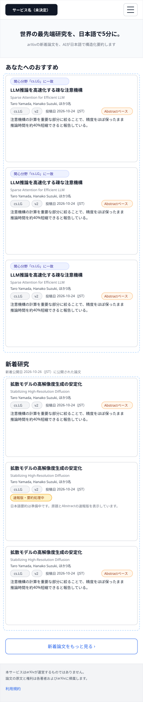
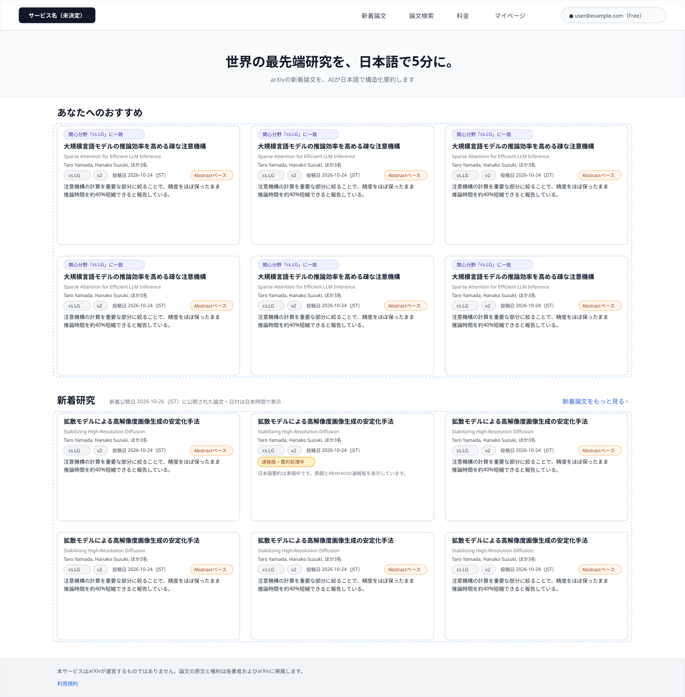
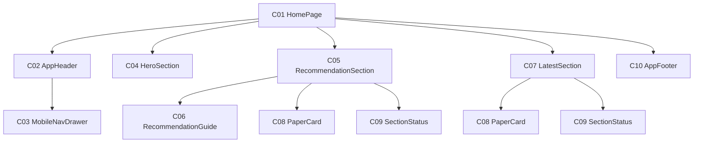

# P101 ホーム

## 0. 文書情報

| 項目 | 値 |
| :--- | :--- |
| 設計書ID | P101 |
| 親設計書 | `基本設計書_概要.md` §3 画面一覧 |
| 版 | 1.0（新規作成） |
| 作成日 | 2026-10-26 |
| 更新日 | 2026-10-26 |
| 作成方法 | `source/` 配下の企画資料と `docs/基本設計書_概要.md` からのリバースエンジニアリング（creating-screen-design v1.9.0 準拠） |
| 対象チャネル | モバイル（幅414）／デスクトップ（幅1440） |
| インプットの性質 | `source/` にあるのは企画・初期設計案のMarkdown 6ファイルだけで、本画面のソースコード（ページ・コンポーネント・ルーティング定義）は存在しない（`source/README.md:5-10`、上流 §前提）。そのため本書の画面項目・イベント・コンポーネントは、企画資料の定義行と上流の基本設計書（概要）の定義（§2 BF08・EX04、§3 共通ルール・レイアウト構造、§7 API01・API05、§11 ARC009）から導いた**計画上の実体**であり、実装済みであることは意味しない。資料に書かれていない値は※推測と明記する |

## 1. 画面概要
| 項目 | 内容 |
| :--- | :--- |
| 画面ID | P101 |
| 画面名 | ホーム |
| パス | `/`（※推測。上流 §3.1・上流 付録 Q03 の仮置きをそのまま引き継ぐ） |
| 概要 | 利用者の関心に合わせたおすすめ論文と新着研究を並べる、サービスの入口の画面（`source/01_企画概要.md:24`）。ログイン中で関心分野を登録済みの利用者には関心との一致と新しさで選んだおすすめ論文を、それ以外の利用者には新着研究と会員登録・関心分野設定への案内を表示する（上流 §2 BF08）。各論文は日本語タイトルと30秒要約で示し、論文詳細（P104）や新着論文一覧（P102）へ進む起点になる |
| アクター | ゲスト（未ログイン）、会員 Free、会員 Pro（上流 §2 ユースケース図。おすすめ表示はFreeの「基本推薦」に含まれるため、FreeとProで表示内容は変わらない — `source/04_収益化とロードマップ.md:4`） |
| 認証要否 | 不要（ゲストも閲覧できる。ログイン中だけおすすめ論文を表示する — 上流 §7 API05「認証: ※推測: 任意」） |
| 前画面 | ブラウザからの直接アクセス（サービスの入口）、全画面共通ヘッダーのサービス名（ロゴ） ※推測（上流 §3 画面遷移図にP101へ入る線は無く、共通ヘッダーの構成から想定） |
| 後画面 | P102 新着論文、P103 論文検索、P104 論文詳細、P106 マイページ、P107 料金（上流 §3 画面遷移図）。ほかにログイン・会員登録画面と利用規約ページ（どちらも※上流未定義。上流 付録 Q04） |
| 対応ソースファイル | なし（実装未着手）。定義の出典は `source/01_企画概要.md:24`、`source/02_機能要求定義.md:13,23-29,32,37-42,45,58`、`source/03_システム構成.md:47,51,58,61`。※推測: 実装時は Next.js の `app/page.tsx` に置く想定 |
| カラーテーマ | default（配色は資料に定義が無い。上流 付録 Q06。UI部品は shadcn/ui、スタイルは Tailwind CSS — `source/03_システム構成.md:6`） |

## 2. ワイヤーフレーム

ワイヤーフレームは、上流 §3 のレイアウト構造（共通ヘッダー＋メインコンテンツ＋共通フッター、※推測）と、API01・API05 の応答項目（上流 §7、※推測）からレイアウトを推定して作図した。図は「ログイン中で関心分野を登録済みの利用者が開き、両方の領域の取得に成功した状態」を描いている。

### 2.1 ワイヤーフレーム（モバイル）

### 2.2 ワイヤーフレーム（デスクトップ）

### 2.3 画面レイアウト説明
* **共通ヘッダー（上端）**: 左にサービス名（H01）を置く。デスクトップでは右側に「新着論文」「論文検索」「料金」「マイページ」の導線（H02〜H05）とログイン状態（H06 または H07）を横並びにする。モバイルではサービス名とメニューボタン（H08）だけを置き、導線とログイン状態はメニューを開いたときに表示するドロワー（C03）へ収める。切り替え幅はTailwind CSS 標準の lg（1024px）を想定する（※推測。上流 §3 カラーテーマ／上流 付録 Q06）。
* **キャッチコピー帯（ヘッダー直下）**: コンセプトの文言（H09）を中央寄せで表示する。
* **おすすめ領域**: 見出し「あなたへのおすすめ」（H10）と論文カードの一覧（H11）。デスクトップは3列のグリッド、モバイルは1列の縦並びにする（※推測）。利用者向けのおすすめが無い利用者（未ログイン・関心分野未登録）には、一覧の代わりに案内文と案内ボタン（H22・H23）を同じ位置に表示する。
* **新着研究領域**: 見出し「新着研究」（H24）と、基準日の種類・タイムゾーンの注記（H25）、論文カードの一覧（H26）、「新着論文をもっと見る」（H27）。デスクトップは見出しの右端に H27 をテキストリンクで置き、モバイルは一覧の下に全幅のボタン形で置く。
* **論文カード（両領域で共通の部品 C08）**: 上から、選ばれた理由（H12、おすすめ領域のカードだけ）、日本語タイトル（H13）、原題（H14）、著者（H15）、カテゴリ・版・投稿日の行（H16〜H18）と解析範囲（H19）、30秒要約（H20）の順に積む。要約が未公開の論文では H19・H20 の代わりに処理状況（H21）と速報版である旨の案内を表示する。
* **取得中・失敗・0件の表示**: おすすめ領域と新着研究領域のそれぞれで、取得中は読み込み中表示（H28）、失敗時はエラーメッセージと再読み込みボタン（H29・H30）、0件のときは該当なし表示（H31）を一覧の位置に出す。失敗は領域ごとに閉じ込め、もう一方の領域とヘッダー・フッターは表示を続ける（上流 §2 EX04、`source/02_機能要求定義.md:58`）。図にはこれらの状態は描いていない。
* **共通フッター（下端）**: arXivとの関係の注記（H32）と利用規約へのリンク（H33）を置く（上流 §3 レイアウト構造 ※推測）。

## 3. UI構成・コンポーネント定義

### 3.1 コンポーネントツリー

### 3.2 コンポーネント一覧

**総件数: 10件。全数である根拠**: 本画面のソースコードは無いため、コンポーネント名はすべて※推測（実装時の命名案）である。数え方は、`source/01_企画概要.md:24` が定める画面の中身（おすすめ・新着研究）を領域ごとに1部品（C05・C07）、上流 §3 レイアウト構造の共通ヘッダー・フッターを1部品ずつ（C02・C10）、モバイル幅での導線の収納先（C03）、キャッチコピー帯（C04）、おすすめが無い利用者への案内（C06、上流 BF08 の分岐）、両領域で共通に使う論文カード（C08）、上流 EX04 が求める領域単位の状態表示（C09）、それらを束ねるページ（C01）とした。C08 と C09 は両領域で再利用するため1件として数える。

| コンポーネントID | コンポーネント名 | 種別 | 含む項目ID | Props | 内部State | 役割・概要 | 定義状況 | 詳細の所在 |
| :--- | :--- | :--- | :--- | :--- | :--- | :--- | :--- | :--- |
| C01 | HomePage | Page | — | - | ログイン状態、おすすめ領域の取得状態と結果、新着研究領域の取得状態と結果（※推測） | ホーム画面全体。開いたときにログイン状態を確かめ、おすすめと新着研究の取得（E01・E02）を並行して起動し、結果を各領域へ渡す | 詳細 | §5 E01・E02、§7 |
| C02 | AppHeader | Layout | H01〜H08 | ログイン状態、利用者の表示名とプラン（※推測） | - | 全画面共通のヘッダー。サービス名と主要画面への導線、ログイン状態を表示する。ログイン状態によってログインボタンと利用者表示を出し分ける | 詳細 | §4 H05〜H08 |
| C03 | MobileNavDrawer | UI | H02〜H07 | 開閉状態、ログイン状態（※推測） | - | モバイル幅でメニューボタン（H08）を押したときに開くドロワー。デスクトップでヘッダーに並ぶ導線とログイン状態を縦並びで表示する | 詳細 | §5 E09 |
| C04 | HeroSection | UI | H09 | - | - | コンセプトの文言を表示し、サービスの趣旨を最初に伝える帯 | 簡易 | §4 H09 |
| C05 | RecommendationSection | UI | H10〜H12 | おすすめ論文の配列、取得状態、ログイン状態（※推測） | - | 利用者向けのおすすめ論文を一覧する領域。おすすめが無い利用者には一覧の代わりに案内（C06）を出し、取得中・失敗・0件のときは状態表示（C09）に置き換える | 詳細 | §4 H10〜H12、§5 E01 |
| C06 | RecommendationGuide | UI | H22,H23 | ログイン状態（未ログインか、関心分野が未登録か） | - | おすすめを出せない利用者に、会員登録・ログインまたは関心分野の設定を促す。未ログインと関心分野未登録で文言と行き先を変える | 詳細 | §4 H22・H23、§5 E11 |
| C07 | LatestSection | UI | H24〜H27 | 新着論文の配列、取得状態、基準日（※推測） | - | 新着研究を新しい順に一覧する領域。利用者の状態によらず論文一覧APIの結果だけを表示し、基準日の種類とタイムゾーンを見出し横に明記し、P102 への導線を置く | 詳細 | §4 H24〜H27、§5 E02 |
| C08 | PaperCard | UI | H12〜H21 | 論文1件の表示データ（arXiv ID、日本語タイトル、原題、著者、カテゴリ、版、投稿日、解析範囲、30秒要約、処理状況、選ばれた理由）、おすすめ用かどうか（※推測） | - | 論文1本を日本語タイトルと30秒要約で示すカード。要約の公開状況と解析範囲によって表示を切り替え、押すと論文詳細（P104）へ進む | 詳細 | §4 H12〜H21、§5 E10 |
| C09 | SectionStatus | UI | H28〜H31 | 取得状態（取得中／失敗／0件）、再読み込み時の処理（※推測） | - | 領域ごとの取得中・失敗・0件の表示。失敗した領域だけに閉じ込め、再読み込みでその領域だけを取り直す | 詳細 | §4 H28〜H31、§5 E13 |
| C10 | AppFooter | Layout | H32,H33 | - | - | 全画面共通のフッター。arXivとの関係を誤解させない注記と利用規約への導線を表示する | 簡易 | §4 H32・H33 |

## 4. 画面項目定義

**総件数: 33件。全数である根拠**: 本画面のソースコードは無いため、次の定義を1要素1項目として数えた。共通ヘッダーの構成（上流 §3 レイアウト構造「サービス名、P102・P103・P106・P107への導線、ログイン状態」→ H01〜H07、モバイル幅の収納先の開閉 → H08）、コンセプト文言（`source/01_企画概要.md:4` → H09）、おすすめ領域（`source/01_企画概要.md:24`、上流 BF08 → H10〜H12、案内 H22・H23）、論文カードの表示項目（上流 §7 API01・API05 の応答「arXiv ID、原題、日本語タイトル、著者、カテゴリ、投稿日、30秒要約、解析範囲、要約の処理状況」と「選ばれた理由」、および上流 §3 共通ルールの「論文の版を表示」→ H12〜H21。arXiv ID は画面に表示せず遷移先の特定にだけ使うため項目に数えない）、新着研究領域（`source/01_企画概要.md:24` → H24〜H27。H25 は上流 §3 共通ルール「日付の意味とタイムゾーンを区別」）、領域単位の状態表示（上流 §2 EX04「処理状況と再読み込みを表示」→ H28〜H31）、共通フッター（上流 §3 レイアウト構造「arXivとの関係の注記、利用規約」→ H32・H33）。入力項目は0件（検索欄・フォームは本画面に置かない。検索はP103の責務）。

| 項目ID | 項目名 | WF | 種別 | 必須 | データ型 | 制約・初期値 | 表示条件 | 備考 | 定義状況 | 詳細の所在 |
| :--- | :--- | :--- | :--- | :--- | :--- | :--- | :--- | :--- | :--- | :--- |
| H01 | サービス名（ロゴ） | D,M | リンク | - | string | 正式名称が未決定のため仮表記（候補: Arclia / Paprism / Curion — `source/05_ネーミング候補.md:4-6`、上流 付録 Q01） | 常時表示 | 押すと本画面の先頭を開き直す（E03）。全画面共通ヘッダーの一部 | 簡易 | 本表 |
| H02 | ナビ「新着論文」 | D | リンク | - | string | 固定文言「新着論文」 | デスクトップ幅では常時表示。モバイル幅ではメニュー（H08）を開いたときだけドロワー内に表示 | 押すと P102 へ（E04） | 簡易 | 本表 |
| H03 | ナビ「論文検索」 | D | リンク | - | string | 固定文言「論文検索」 | デスクトップ幅では常時表示。モバイル幅ではメニュー（H08）を開いたときだけドロワー内に表示 | 押すと P103 へ（E05） | 簡易 | 本表 |
| H04 | ナビ「料金」 | D | リンク | - | string | 固定文言「料金」 | デスクトップ幅では常時表示。モバイル幅ではメニュー（H08）を開いたときだけドロワー内に表示 | 押すと P107 へ（E06） | 簡易 | 本表 |
| H05 | ナビ「マイページ」 | D | リンク | - | string | 固定文言「マイページ」 | ログイン中のときだけ表示（モバイル幅ではメニューを開いたときだけドロワー内に表示）。未ログインのときは出さない ※推測 | 押すと P106 へ（E07）。マイページは本人のデータを扱うため、未ログインでは導線自体を出さない ※推測 | 詳細 | §5 E07 |
| H06 | ログインボタン | — | ボタン | - | string | 固定文言「ログイン」 | 未ログインのときだけ表示（モバイル幅ではドロワー内）。ログイン中は H07 に置き換わる | 押すとログイン・会員登録画面へ（E08）。ログイン画面は※上流未定義（上流 付録 Q04）。図はログイン中の状態のため描いていない | 詳細 | §5 E08 |
| H07 | ログイン中の利用者表示 | D | 表示 | - | string | 利用者を見分ける表示（メールアドレスまたは表示名 ※推測）と、契約プラン（Free / Pro）を並べて表示 | ログイン中のときだけ表示（モバイル幅ではドロワー内）。未ログインのときは H06 に置き換わる | プランは利用者テーブルのプラン区分（T005 users.plan）の値 ※推測 | 詳細 | §5 E01 |
| H08 | メニューボタン | M | ボタン | - | - | 初期状態はドロワーが閉じた状態 | モバイル幅（lg 1024px 未満 ※推測）のときだけ表示。デスクトップ幅では導線がヘッダーに並ぶため出さない | 押すたびにドロワー（C03）を開閉する（E09） | 詳細 | §5 E09 |
| H09 | キャッチコピー | D,M | 表示 | - | string | 固定文言「世界の最先端研究を、日本語で5分に。」（`source/01_企画概要.md:4`）と、補足文「arXivの新着論文を、AIが日本語で構造化要約します」（※推測） | 常時表示 ※推測（ログイン中の利用者にも出し続けるかは資料に定義が無く、§7 の注意事項に挙げた） | — | 簡易 | 本表 |
| H10 | おすすめ見出し | D,M | 表示 | - | string | 固定文言「あなたへのおすすめ」 | 利用者向けのおすすめが返ってきたとき（ログイン中で関心分野が登録済み）に表示する。返ってこなかったときは H22 の案内文に見出しごと置き換える（上流 BF08） | — | 詳細 | §5 E01 |
| H11 | おすすめ論文一覧 | D,M | 一覧 | - | array | 並び順はおすすめAPIの採点順のまま（関心との一致と新しさの点数が高い順 — `source/02_機能要求定義.md:38`）。表示件数はAPIの返却件数のまま（件数指定は上流で未定義） | H10 と同じ条件で表示する。取得中・失敗・0件のときは一覧の位置に H28〜H31 を出す | 各要素は論文カード（C08）で描く | 詳細 | §5 E01、§7 |
| H12 | 選ばれた理由 | D,M | 表示 | - | string | 一致した関心カテゴリ・キーワードを「関心分野「cs.LG」に一致」の形で表示（※推測: 上流 §7 API05 応答の「各論文が選ばれた理由」） | おすすめ一覧のカードにだけ表示し、新着研究のカードには出さない | 推薦の理由を見せることで、関心分野の登録内容とおすすめの結びつきを利用者が確かめられるようにする ※推測 | 詳細 | §5 E01 |
| H13 | 日本語タイトル | D,M | リンク | - | string | AIが生成した日本語タイトル。要約が未公開で日本語タイトルが無い論文では原題を表示する（上流 BF03「未処理なら原題と速報版」） | カード内に常時表示 | 押すとその論文の P104 へ（E10） | 詳細 | §5 E10 |
| H14 | 原題 | D,M | 表示 | - | string | arXiv上の英語タイトルをそのまま表示 | 日本語タイトルがある論文のときだけ H13 の下に併記する。日本語タイトルが無いときは H13 が原題を表示するため重ねて出さない | 日本語タイトルには原題を併記する決まり（`source/02_機能要求定義.md:23`） | 詳細 | 本表 |
| H15 | 著者 | D,M | 表示 | - | string | 先頭から2名までを表示し、残りは「ほか N名」とまとめる（※推測） | カード内に常時表示 | — | 簡易 | 本表 |
| H16 | カテゴリ | D,M | 表示 | - | string | arXivのカテゴリ表記（例 `cs.LG`）。複数カテゴリを持つ論文は主カテゴリ1件だけを表示（※推測） | カード内に常時表示 | — | 簡易 | 本表 |
| H17 | 版 | D,M | 表示 | - | string | 「v」＋版番号（例 v2）。表示中の要約の対象となった版を出す | カード内に常時表示 | 改訂版を区別する決まり（`source/01_企画概要.md:37`、上流 ARC009） | 簡易 | 本表 |
| H18 | 投稿日 | D,M | 表示 | - | date | `YYYY-MM-DD` 形式の日付に、表示タイムゾーン（JST ※推測）を括弧で併記 | カード内に常時表示 | 3種類の日付（投稿日・更新日・新着公開日）のうちカードには投稿日を出す ※推測。どの日付を出すかは上流 付録 Q11 で確認中 | 簡易 | 本表 |
| H19 | 解析範囲表示 | D,M | 表示 | - | string | 固定文言「Abstractベース」 | 要約の材料がAbstractだけの論文のときに表示する。本文を取得して要約した論文では出さない（解析範囲 source_scope が「Abstractのみ」のとき） | Abstractだけで要約した論文を明示する決まり（`source/01_企画概要.md:36`、上流 ARC009） | 詳細 | 本表 |
| H20 | 30秒要約 | D,M | 表示 | - | string | 結論を中心にした短い日本語要約。カード内では2行までを表示し、超える分は末尾を「…」で省略（※推測） | 検証に合格して公開済みの要約がある論文のときに表示する。要約が未公開の論文では H21 に置き換える | 画面表示のたびにLLMは呼ばず、事前に生成した要約を表示する（`source/02_機能要求定義.md:45`） | 詳細 | §7 |
| H21 | 処理状況表示 | D,M | 表示 | - | string | 固定文言「速報版・要約処理中」と案内文「日本語要約は準備中です。原題とAbstractの速報版を表示しています。」（文言は※推測） | 要約がまだ公開されていない論文のときだけ、H19・H20 の代わりに表示する | 未処理の論文は速報版を先に出し処理中であることを示す（`source/03_システム構成.md:58`、上流 F17） | 詳細 | §7 |
| H22 | おすすめ案内文 | — | 表示 | - | string | 未ログインのとき「会員登録すると、関心分野に合わせたおすすめ論文が表示されます」、ログイン中で関心分野が未登録のとき「関心分野を設定すると、あなたに合わせたおすすめ論文が表示されます」（文言は※推測） | 利用者向けのおすすめを出せないときに、H10・H11 の代わりに表示する。具体的には、未ログインのとき（おすすめAPIの成否を問わない）と、ログイン中でおすすめAPIが利用者向けのおすすめではなく代わりの新着論文を返したとき（関心分野が未登録） | おすすめAPIが代わりに返す新着論文は、新着研究領域には流用せず捨てる（新着研究は常に E02 で取得するため、二重表示と並び順の食い違いを避ける）。図はおすすめが返った状態のため描いていない | 詳細 | §5 E01 |
| H23 | おすすめ案内ボタン | — | ボタン | - | string | 未ログインのとき「ログイン・会員登録」、関心分野が未登録のとき「関心分野を設定する」（文言は※推測） | H22 と同じ条件で表示する | 押したときの行き先も文言と同じく出し分ける（E11） | 詳細 | §5 E11 |
| H24 | 新着研究見出し | D,M | 表示 | - | string | 固定文言「新着研究」 | 常時表示 | — | 簡易 | 本表 |
| H25 | 基準日・タイムゾーン注記 | D,M | 表示 | - | string | 一覧の基準にした日付の種類と日付、表示タイムゾーンを「新着公開日 2026-10-26（JST）に公開された論文」の形で表示（日付の種類とタイムゾーンは※推測。上流 付録 Q11） | 常時表示 | 3種類の日付の意味とタイムゾーンを画面で区別する決まり（`source/02_機能要求定義.md:32`、上流 ARC009） | 簡易 | 本表 |
| H26 | 新着論文一覧 | D,M | 一覧 | - | array | 新しい順（投稿日の降順）。表示件数は6件（※推測） | 常時表示する。取得中・失敗・0件のときは一覧の位置に H28〜H31 を出す | 各要素は論文カード（C08）で描く。利用者の状態（未ログイン・ログイン中）によらず、常に論文一覧API（API01）の結果だけを表示する（E02） | 詳細 | §5 E02 |
| H27 | 新着論文をもっと見る | D,M | リンク | - | string | 固定文言「新着論文をもっと見る ›」 | 常時表示 | 押すと P102 へ（E12）。デスクトップは見出し右端のテキストリンク、モバイルは一覧下の全幅ボタン | 簡易 | 本表 |
| H28 | 読み込み中表示 | — | 表示 | - | - | カード形の灰色の枠（スケルトン）を一覧の位置に表示 | おすすめ領域・新着研究領域のそれぞれで、データ取得の応答を待っている間だけ表示する | 領域ごとに独立して出す（片方が取得済みなら、その領域は先に一覧を表示する） | 詳細 | §5 E01・E02 |
| H29 | 領域エラーメッセージ | — | 表示 | - | string | 文言は §5.1 の様式②の詳細のとおり | その領域のデータ取得が失敗したときだけ、その領域の一覧の位置に表示する | 失敗を領域内に閉じ込め、画面全体は落とさない（上流 EX04、`source/02_機能要求定義.md:58`） | 詳細 | §5.1 |
| H30 | 再読み込みボタン | — | ボタン | - | string | 固定文言「再読み込み」 | H29 と同じ条件で、H29 の下に表示する | 押すと失敗した領域のデータだけを取り直す（E13） | 詳細 | §5 E13 |
| H31 | 該当なし表示 | — | 表示 | - | string | 固定文言「表示できる論文がありません」（※推測） | 取得には成功したが、返ってきた論文が0件だったときだけ、その領域の一覧の位置に表示する | — | 詳細 | §5 E01・E02 |
| H32 | arXivとの関係の注記 | D,M | 表示 | - | string | 固定文言「本サービスはarXivが運営するものではありません。論文の原文と権利は各著者およびarXivに帰属します。」（文言は※推測） | 常時表示 | arXivと本サービスの関係を誤解させない表記にする決まり（`source/03_システム構成.md:61`、上流 ARC009） | 簡易 | 本表 |
| H33 | 利用規約リンク | D,M | リンク | - | string | 固定文言「利用規約」 | 常時表示 | 押すと利用規約ページへ（E14）。利用規約ページは※上流未定義 | 簡易 | 本表 |

## 5. イベント定義

**総件数: 15件。全数である根拠**: 画面を開いたときのデータ取得（上流 BF08 の GET /api/recommendations → E01、新着研究の GET /api/papers → E02。2つは並行して実行する）、§4 で種別がリンク・ボタンの項目（H01〜H06、H08、H13、H23、H27、H30、H33 の12項目）それぞれの押下（→ E03〜E14）を1件ずつ数え、操作対象の項目を持たないドロワー外側のタップ（→ E15）を加えた。表示だけの項目（H07、H09〜H12、H14〜H22、H24〜H26、H28、H29、H31、H32）は操作を受け付けないためイベントを持たない。ブックマークの登録・解除は本画面では扱わない（上流 BF07 の起点は P104・P106）。

| イベントID | 発生源 | 対象項目ID | トリガー | 条件 | 処理概要 | 呼び出しAPI | 成功時の挙動 | 失敗時の挙動（様式ID + 説明） | 定義状況 | 詳細の所在 |
| :--- | :--- | :--- | :--- | :--- | :--- | :--- | :--- | :--- | :--- | :--- |
| E01 | ページ | — | ページロード | 本画面を開いたとき（直接アクセス、ロゴ押下、ブラウザの戻る操作） | まずブラウザに残っているログインのセッションから、ログイン中かどうかと利用者の表示名・プランを確かめる（Supabase Auth のセッション取得。取得できなければ未ログインとして扱う ※推測）。続いて、新着研究の取得（E02）と並行しておすすめAPIを呼ぶ（上流 BF08 のとおりログイン状態によらず呼ぶ）。応答が利用者向けのおすすめ（各論文に選ばれた理由が付いている ※推測）ならおすすめ領域に一覧を出す。応答がおすすめの代わりの新着論文（未ログイン、または関心分野が未登録のとき — 上流 BF08）なら、おすすめ領域には案内（H22・H23）を出し、返ってきた論文は表示に使わない | GET /api/recommendations（API05） | 応答の種類に応じておすすめ領域を描画する。利用者向けのおすすめが0件なら該当なし表示（H31） | 様式②: ログイン中のときだけ、おすすめ領域に「おすすめ論文を読み込めませんでした。」と再読み込みボタンを表示する。未ログインのときはおすすめを出す対象ではないため、失敗してもエラーは出さず案内（H22・H23）を表示する。どちらの場合も新着研究領域は E02 の結果で表示を続ける。セッション取得の失敗はエラー表示せず未ログインとして扱う ※推測 | 詳細 | 本表、§5.1 |
| E02 | ページ | — | ページロード | 本画面を開いたとき（E01 と同時に、E01 の結果を待たずに実行） | 新着研究を新しい順で取得し、新着研究領域に表示する。利用者の状態によらず常に実行する（並び順は投稿日の降順 `sort=newest`。日付は指定せずに呼び、基準日はAPIが返す最新の日付とする ※推測） | GET /api/papers（API01） | 新着研究一覧（H26）と基準日の注記（H25）を描画する。0件なら該当なし表示（H31） | 様式②: 新着研究領域だけに「新着研究を読み込めませんでした。」と再読み込みボタンを表示し、おすすめ領域は表示を続ける | 詳細 | 本表、§5.1 |
| E03 | サービス名（ロゴ） | H01 | Click | 常時 | 本画面を開き直す | なし | P101 を先頭から表示し、E01 を再度実行する | 該当様式なし（APIを呼ばない画面遷移のため、本画面で起きるエラーは無い） | 簡易 | 本表 |
| E04 | ナビ「新着論文」 | H02 | Click | 常時（モバイル幅ではドロワーを開いているとき） | 新着論文一覧へ移る。モバイル幅ではドロワーを閉じてから移る | なし | P102 へ遷移 | 該当様式なし（APIを呼ばない画面遷移のため、本画面で起きるエラーは無い） | 簡易 | 本表 |
| E05 | ナビ「論文検索」 | H03 | Click | 常時（モバイル幅ではドロワーを開いているとき） | 論文検索へ移る。モバイル幅ではドロワーを閉じてから移る | なし | P103 へ遷移 | 該当様式なし（APIを呼ばない画面遷移のため、本画面で起きるエラーは無い） | 簡易 | 本表 |
| E06 | ナビ「料金」 | H04 | Click | 常時（モバイル幅ではドロワーを開いているとき） | 料金画面へ移る。モバイル幅ではドロワーを閉じてから移る | なし | P107 へ遷移 | 該当様式なし（APIを呼ばない画面遷移のため、本画面で起きるエラーは無い） | 簡易 | 本表 |
| E07 | ナビ「マイページ」 | H05 | Click | ログイン中のとき（H05 が表示されているとき） | マイページへ移る。モバイル幅ではドロワーを閉じてから移る | なし | P106 へ遷移 | 該当様式なし（APIを呼ばない画面遷移のため、本画面で起きるエラーは無い。セッション切れの扱いは遷移先 P106 の責務） | 簡易 | 本表 |
| E08 | ログインボタン | H06 | Click | 未ログインのとき（H06 が表示されているとき） | ログイン・会員登録の画面へ移る。ログイン後は本画面へ戻す ※推測 | なし（ログイン処理は遷移先で Supabase Auth を使う。上流 IF05） | ログイン・会員登録画面へ遷移（※上流未定義。上流 付録 Q04） | 該当様式なし（APIを呼ばない画面遷移のため、本画面で起きるエラーは無い） | 詳細 | §5 遷移先ロースター |
| E09 | メニューボタン | H08 | Click | モバイル幅のとき | ドロワーが閉じていれば開き、開いていれば閉じる（外側を押して閉じる操作は E15） | なし | ドロワー（C03）に H02〜H07 を表示する／閉じる | 該当様式なし（画面内の表示切替だけで、エラーは起きない） | 詳細 | 本表 |
| E10 | 論文カードの日本語タイトル | H13 | Click | 常時 | 押した論文の詳細画面を、その論文の arXiv ID を付けて開く | なし（取得は遷移先 P104 が API03・API04 で行う） | P104（`/papers/{arxivId}` ※推測）へ遷移 | 該当様式なし（APIを呼ばない画面遷移のため、本画面で起きるエラーは無い。論文が見つからない場合は遷移先 P104 の責務） | 簡易 | 本表 |
| E11 | おすすめ案内ボタン | H23 | Click | H23 が表示されているとき | 未ログインのときはログイン・会員登録の画面へ、ログイン中で関心分野が未登録のときはマイページの関心分野設定へ移る | なし | 未ログイン: ログイン・会員登録画面へ遷移（※上流未定義）／関心分野未登録: P106 へ遷移 | 該当様式なし（APIを呼ばない画面遷移のため、本画面で起きるエラーは無い） | 詳細 | 本表 |
| E12 | 新着論文をもっと見る | H27 | Click | 常時 | 新着論文一覧へ移る。本画面で表示していた基準日を引き継ぐ ※推測 | なし | P102 へ遷移 | 該当様式なし（APIを呼ばない画面遷移のため、本画面で起きるエラーは無い） | 簡易 | 本表 |
| E13 | 再読み込みボタン | H30 | Click | その領域の取得が失敗して H30 が表示されているとき | 失敗した領域のデータだけを取り直す。おすすめ領域なら E01 のおすすめ取得を、新着研究領域なら E02 の新着研究取得をやり直す。取り直している間はその領域に読み込み中表示（H28）を出し、もう一方の領域はそのまま残す | おすすめ領域: GET /api/recommendations（API05）／新着研究領域: GET /api/papers（API01） | その領域の一覧を描画する | 様式②: 再び失敗したときは同じエラーメッセージと再読み込みボタンを表示し直す（回数の上限は設けない ※推測） | 詳細 | 本表、§5.1 |
| E14 | 利用規約リンク | H33 | Click | 常時 | 利用規約のページへ移る | なし | 利用規約ページへ遷移（※上流未定義） | 該当様式なし（APIを呼ばない画面遷移のため、本画面で起きるエラーは無い） | 簡易 | 本表 |
| E15 | ドロワーの外側 | — | Click（タップ） | モバイル幅でドロワー（C03）が開いているとき | ドロワーの外側（半透明の背景部分）を押すと、遷移せずにドロワーを閉じる（※推測） | なし | ドロワーを閉じ、元の画面表示に戻る | 該当様式なし（画面内の表示切替だけで、エラーは起きない） | 簡易 | 本表 |

**遷移先ロースター**（総件数: 8件。全数である根拠: 上表で遷移を伴うイベント E03〜E08・E10〜E12・E14 の遷移先を重複を除いて数えた。上流 §3 画面遷移図の P101 から出る5本 ― P102・P103・P104・P106・P107 ― はすべて含まれ、ほかに本画面の自己遷移と、上流に画面定義の無い2件がある）

| No | 遷移先画面ID | 遷移先画面名 | 契機イベントID | 概要 | 定義状況 | 詳細の所在 |
| :--- | :--- | :--- | :--- | :--- | :--- | :--- |
| 1 | P101 | ホーム（本画面） | E03 | ロゴから本画面の先頭を開き直す | 簡易 | §5 E03 |
| 2 | P102 | 新着論文 | E04, E12 | 日付・カテゴリで新着論文を絞り込む一覧へ移る | 簡易 | `screens/画面.P102.画面基本設計.md`（未作成） |
| 3 | P103 | 論文検索 | E05 | キーワード・著者・カテゴリで検索する画面へ移る | 簡易 | `screens/画面.P103.画面基本設計.md`（未作成） |
| 4 | P104 | 論文詳細 | E10 | 押した論文の要約・実験結果・限界を見る画面へ移る | 簡易 | `screens/画面.P104.画面基本設計.md`（未作成） |
| 5 | P106 | マイページ | E07, E11 | 関心分野・ブックマークを扱う画面へ移る。E11 では関心分野の設定を促す目的で移る | 詳細 | §5 E07・E11 |
| 6 | P107 | 料金 | E06 | Free と Pro を比べる画面へ移る | 簡易 | `screens/画面.P107.画面基本設計.md`（未作成） |
| 7 | — ※上流未定義 | ログイン・会員登録画面 | E08, E11 | Supabase Auth でログイン・会員登録を行う画面へ移る。画面としての定義が上流に無い（上流 付録 Q04） | 詳細 | §5 E08・E11 |
| 8 | — ※上流未定義 | 利用規約ページ | E14 | 利用規約を表示するページへ移る。画面としての定義が上流に無い | 簡易 | - |

**呼出APIロースター**（総件数: 3件。全数である根拠: 上表で「呼び出しAPI」列に現れるAPIと、E01 のセッション取得で使う外部IFを重複を除いて数えた。上流 §7 内部API一覧の全8件のうち、残りの API02〜API04・API06〜API08 は本画面からは呼ばない）

| No | 上流ID | メソッド・対象 | 概要 | 呼び出すイベントID | 認証 | 定義状況 | 詳細の所在 |
| :--- | :--- | :--- | :--- | :--- | :--- | :--- | :--- |
| 1 | API05 | GET /api/recommendations | ログイン中の利用者へのおすすめ論文を取得する。未ログイン・関心分野未登録のときは新着論文を返す | E01, E13 | 任意（※推測。上流 §7 API05） | 詳細 | 上流 `基本設計書_概要.md` §7「GET /api/recommendations」 |
| 2 | API01 | GET /api/papers | 新着研究を新しい順で取得する | E02, E13 | 不要（※推測。上流 §7 API01） | 詳細 | 上流 `基本設計書_概要.md` §7「GET /api/papers」 |
| 3 | IF05 | Supabase Auth（セッション取得） | ブラウザに残るログインのセッションから、ログイン中かどうかと利用者を確かめる | E01 | — | 簡易 | 上流 `基本設計書_概要.md` §7「IF05 Supabase Auth」 |

### 5.1 エラー表示様式定義

| 様式ID | 様式名 | 表示方法 | 使用コンポーネント | 使用場面 | ユーザー操作 |
| :--- | :--- | :--- | :--- | :--- | :--- |
| 様式① | ポップアップ表示 | モーダルダイアログで画面中央にエラーメッセージを表示 | ErrorModal | 該当なし（本画面はAPIの失敗を領域内に閉じ込める方針のため、画面全体を覆うポップアップは使わない — 上流 EX04） | 該当なし |
| 様式② | 画面上部表示 | 【本画面での読み替え】標準の「画面上部（ヘッダー直下）に赤色バー」ではなく、取得に失敗した領域（おすすめ領域または新着研究領域）の上部、一覧を表示する位置に赤色の帯でメッセージと再読み込みボタンを表示する。ヘッダー直下の全幅表示は使わず、失敗していない領域は表示を続ける（上流 EX04「要約欄だけに処理状況と再読み込みを表示し、他の領域は表示を続ける」に合わせた本画面での表示位置） | SectionStatus（C09） | おすすめAPI（API05）・論文一覧API（API01）の通信失敗、サーバーエラー（500） | 「再読み込み」ボタン（H30）でその領域だけ取り直す。成功すればメッセージは消える |
| 様式③ | 全画面エラー | 専用のエラーページに画面全体を切り替えて表示 | ErrorPage / 404ページ | 該当なし（本画面のパスは `/` 固定で、存在しない論文や不正なパラメータを受け取らない。エラー画面自体も上流に定義が無い — 上流 付録 Q04） | 該当なし |
| 様式④ | 入力欄下表示 | 対象の入力フィールド直下に赤文字でインラインエラーを表示 | フォームバリデーション | 該当なし（本画面に入力項目が無い） | 該当なし |

**この画面で使用するエラー様式の詳細**:

| 様式ID | エラー発生条件 | エラーメッセージ文言 | 補足（遷移先・復帰手順） |
| :--- | :--- | :--- | :--- |
| 様式② | ログイン中の利用者で、画面を開いたとき（E01）または再読み込み（E13）に、おすすめAPI（GET /api/recommendations）が通信できない、または 500 を返した場合（未ログインのときはエラーを出さず案内 H22・H23 を表示する） | 「おすすめ論文を読み込めませんでした。時間をおいて再読み込みしてください。」（文言は※推測） | おすすめ領域だけに表示する。新着研究は E02 の結果で表示を続ける。「再読み込み」でおすすめ領域だけを取り直す |
| 様式② | 新着研究の取得（E02）または再読み込み（E13）で、論文一覧API（GET /api/papers）が通信できない、または 500 を返した場合 | 「新着研究を読み込めませんでした。時間をおいて再読み込みしてください。」（文言は※推測） | 新着研究領域だけに表示する。おすすめ領域は表示を続ける。「再読み込み」で新着研究領域だけを取り直す |

## 6. バリデーション・制約定義

該当なし（本画面には入力項目が無い。§4 の33項目は表示・リンク・ボタンだけで構成され、検索語の入力は P103 の責務である）。

| 対象項目ID | 項目名 | ルール | エラーメッセージ |
| :--- | :--- | :--- | :--- |
| — | 該当なし | — | — |

## 7. 画面固有の業務ルール・注意事項

* **事前生成データだけを表示する**: 本画面はおすすめ・新着研究のどちらも事前に生成・検証した要約を表示し、画面を開くたびにLLMを呼ばない（`source/02_機能要求定義.md:45`、上流 ARC001）。30秒要約（H20）は検証に合格して公開済みのものだけを出す（上流 ARC004・B003・B004）。
* **未処理の論文は速報版で先に見せる**: 要約が未公開の論文も一覧から外さず、原題と「速報版・要約処理中」（H21）で表示する（`source/03_システム構成.md:58`、上流 ARC002）。
* **おすすめの出し分け**: 利用者向けのおすすめはログイン中で関心分野を登録済みの利用者にだけ表示する。未ログインまたは関心分野が未登録の利用者には、おすすめ領域に会員登録または関心分野設定への案内を出す。このときおすすめAPIが代わりに返す新着論文（上流 BF08。未ログイン時の挙動は上流でも※推測）は表示に使わず、新着研究領域は利用者の状態によらず常に論文一覧API（API01）の結果を新しい順に表示する。新着研究の並び順・件数・基準日の注記（H25）を利用者の状態で変えないためである。
* **推薦の採点（初期）**: おすすめは関心カテゴリ・キーワードとの一致と新しさによるルールベースの採点で並ぶ（`source/02_機能要求定義.md:38`）。将来の Embedding 照合（類似度50%・新しさ25%・関連性15%・多様性10%、仮）に切り替わっても、本画面はAPIの返却順をそのまま表示するため画面側の変更は要らない（`source/02_機能要求定義.md:40-42`、上流 F08）。
* **プランによる差は無い**: おすすめは Free の「基本推薦」に含まれるため、Free と Pro で本画面の表示内容は変わらない（`source/04_収益化とロードマップ.md:4`）。
* **表示・編集ポリシーの順守**（上流 ARC009）: 論文カードには版（H17）を必ず出す。Abstractだけで要約した論文には「Abstractベース」（H19）を出す。日付には表示タイムゾーンを併記し（H18）、新着研究の基準日の種類を見出し横に明記する（H25）。フッターに arXiv との関係の注記（H32）を常時出す。
* **障害を領域に閉じ込める**: おすすめと新着研究は別々に取得・表示し、片方の失敗でもう片方やヘッダー・フッターを止めない（上流 EX04、`source/02_機能要求定義.md:58`）。※推測: 実装では領域ごとにエラー境界を置く（上流 §8 アプリケーション保護）。
* **閲覧履歴は記録しない**: 本画面で論文カードを表示しただけでは閲覧イベント（T008 view_events）を記録しない。記録するのは論文詳細（P104）を開いたときだけとする（上流 BF05。行動ログを必要最小限にする方針 — `source/02_機能要求定義.md:48`、上流 ARC010）。
* **ブックマークは扱わない**: 本画面のカードにはブックマーク操作を置かない（上流 BF07 の起点は P104・P106）。※推測: ホームのカードから直接ブックマークできるようにするかは要確認。
* **キャッチコピーの表示対象**: H09 をログイン中の利用者にも表示し続けるか、未ログインの利用者だけに表示するかは資料に定義が無い（※推測: 常時表示）。
* **上流への確認事項**（本書で新たに生じたもの）:
  * おすすめAPI（API05）が「利用者向けのおすすめ」と「代わりに返す新着論文」のどちらを返したかを画面が見分ける手段（応答の種別項目、または選ばれた理由の有無）が上流 §7 で未定義（※上流要確認）。本書では選ばれた理由の有無で見分ける想定とした。
  * 新着研究の基準日（H25）にどの日付（投稿日・更新日・新着公開日）を使うかとタイムゾーン（上流 付録 Q11）。
  * ログイン・会員登録画面と利用規約ページの画面定義（上流 付録 Q04。本画面からの遷移先として※上流未定義）。
  * 上流 §11 ARC002・ARC001・ARC010 の適用範囲に P101 の記載が無い（本画面は速報版表示・事前生成データ表示・閲覧記録を行わない方針でこれらに関わる。※上流要確認）。

## 8. 利用する方式（共通基盤）

| 方式ID | 名称 | 本書での利用箇所 |
| :--- | :--- | :--- |
| ARC009 | 表示・編集ポリシー（出典・版・日付・ブランド表記） | 論文カードの版（H17）、Abstractベース表示（H19）、日付とタイムゾーンの併記（H18・H25）、フッターの arXiv との関係の注記（H32）。上流の適用範囲「P101〜P107 全画面」に該当する |
| ARC002 | 段階的生成・公開方式（速報版→詳細版） | 要約が未公開の論文を一覧から外さず、原題と処理状況（H21）で速報版として表示する（※上流要確認: 上流の適用範囲は P102・P104 で P101 の記載が無い） |
| ARC001 | 生成物キャッシュ・重複排除方式 | 本画面の表示は事前生成済みの要約だけを使い、画面を開くたびにLLMを呼ばない（H20、E01・E02）（※上流要確認: 上流の適用範囲に画面の記載が無い） |
| ARC003 | 要約スキーマ（構造化要約の出力仕様） | カードに出す日本語タイトル・原題・30秒要約・解析範囲・対象の版（H13・H14・H17・H19・H20）は、このスキーマで定めた項目を表示する（※上流要確認: 上流の適用範囲は API04 までで、API01・API05 の応答に要約の一部が含まれることは記載が無い） |
| ARC010 | 個人データ最小化・削除方針 | 本画面ではカードを表示しただけでは閲覧を記録しない（§7）。おすすめの採点に使う閲覧履歴は API05 側で必要最小限だけ参照する（上流 F08 が適用範囲に含まれる） |
