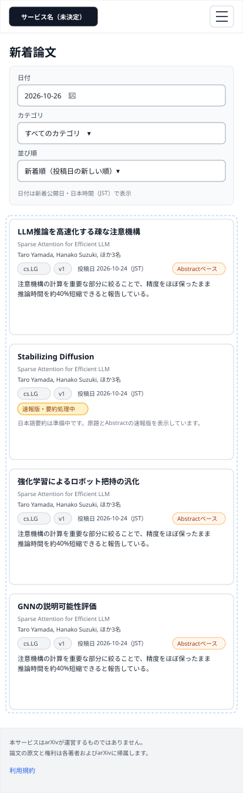
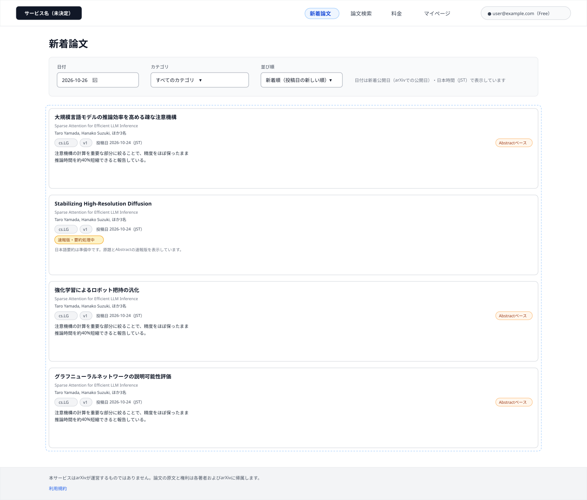
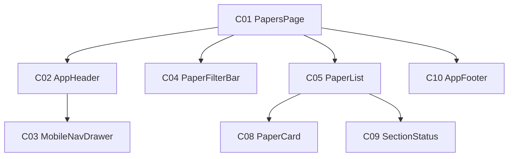

# P102 新着論文

## 0. 文書情報

| 項目 | 値 |
| :--- | :--- |
| 設計書ID | P102 |
| 親設計書 | `基本設計書_概要.md` §3 画面一覧 |
| 版 | 1.0（新規作成） |
| 作成日 | 2026-10-26 |
| 更新日 | 2026-10-26 |
| 作成方法 | `source/` 配下の企画資料と `docs/基本設計書_概要.md` からのリバースエンジニアリング（creating-screen-design v1.9.0 準拠） |
| 対象チャネル | モバイル（幅414）／デスクトップ（幅1440） |
| インプットの性質 | `source/` にあるのは企画・初期設計案のMarkdown 6ファイルだけで、本画面のソースコード（ページ・コンポーネント・ルーティング定義）は存在しない（`source/README.md:5-10`、上流 §前提）。そのため本書の画面項目・イベント・コンポーネントは、企画資料の定義行と上流の基本設計書（概要）の定義（§2 BF03・EX04、§3 共通ルール・レイアウト構造、§4 オンライン処理設計の入力チェック、§7 API01、§11 ARC009）から導いた**計画上の実体**であり、実装済みであることは意味しない。資料に書かれていない値は※推測と明記する。共通ヘッダー・フッター・論文カードの表示仕様は P101 ホームの画面基本設計書と同じ部品を使う前提で、本画面での表示仕様を改めて記述する |

## 1. 画面概要
| 項目 | 内容 |
| :--- | :--- |
| 画面ID | P102 |
| 画面名 | 新着論文 |
| パス | `/papers`（※推測。上流 §3.1・上流 付録 Q03 の仮置きをそのまま引き継ぐ）。絞り込み条件はクエリ `?date=YYYY-MM-DD&category=…&sort=…` で受け渡す（※推測） |
| 概要 | 日付とカテゴリで新着論文を絞り込み、新着順（投稿日の新しい順）または関連度順に並べて一覧する画面（`source/01_企画概要.md:25`、上流 §3.1）。各論文は日本語タイトルと30秒要約で示し、要約がまだ公開されていない論文は原題と速報版である旨を表示する（上流 §2 BF03）。論文を選ぶと論文詳細（P104）へ進む |
| アクター | ゲスト（未ログイン）、会員 Free、会員 Pro（新着検索は Free の提供範囲 — `source/04_収益化とロードマップ.md:4`。ゲストの利用可否は上流 付録 Q08 の仮置き「新着は利用可」に従う） |
| 認証要否 | 不要（上流 §7 API01「認証: 不要（※推測）」） |
| 前画面 | P101 ホーム（ヘッダーの「新着論文」と「新着論文をもっと見る」。後者は P101 で表示していた基準日を引き継ぐ ※推測）、全画面共通ヘッダーの「新着論文」、ブラウザからの直接アクセス（上流 §3 画面遷移図 P101 → P102） |
| 後画面 | P104 論文詳細（上流 §3 画面遷移図 P102 → P104）。ほかに共通ヘッダー・フッターから P101 ホーム、P103 論文検索、P106 マイページ、P107 料金、ログイン・会員登録画面（※上流未定義。上流 付録 Q04）、利用規約ページ（※上流未定義） |
| 対応ソースファイル | なし（実装未着手）。定義の出典は `source/01_企画概要.md:25`、`source/02_機能要求定義.md:7,23-29,32-35,58`、`source/03_システム構成.md:47,58,61`。※推測: 実装時は Next.js の `app/papers/page.tsx` に置く想定 |
| カラーテーマ | default（配色は資料に定義が無い。上流 付録 Q06。UI部品は shadcn/ui、スタイルは Tailwind CSS — `source/03_システム構成.md:6`） |

## 2. ワイヤーフレーム

ワイヤーフレームは、上流 §3 のレイアウト構造（共通ヘッダー＋メインコンテンツ＋共通フッター、※推測）と、上流 §7 API01 のパラメータ・応答項目（※推測）からレイアウトを推定して作図した。図は「ログイン中の利用者が日付だけを指定して開き、一覧の取得に成功した状態」を描いている。

### 2.1 ワイヤーフレーム（モバイル）

### 2.2 ワイヤーフレーム（デスクトップ）

### 2.3 画面レイアウト説明
* **共通ヘッダー（上端）**: 左にサービス名（H01）を置く。デスクトップでは右側に「新着論文」「論文検索」「料金」「マイページ」の導線（H02〜H05）とログイン状態（H06 または H07）を横並びにし、本画面を示す「新着論文」（H02）を選択中の見た目（背景色付き・太字）にする。モバイルではサービス名とメニューボタン（H08）だけを置き、導線とログイン状態はメニューを開いたときに表示するドロワー（C03）へ収める。切り替え幅は Tailwind CSS 標準の lg（1024px）を想定する（※推測。上流 付録 Q06）。
* **ページ見出し**: ヘッダーの下に見出し「新着論文」（H09）を置く。
* **絞り込みバー（見出しの下）**: 日付（H10）、カテゴリ（H12）、並び順（H13）の3つの指定欄と、日付の種類・タイムゾーンの注記（H11）を置く。デスクトップは1行に横並び、モバイルは縦に積む。利用者が入力した日付が不正なときは日付欄の直下に入力エラー（H28）を出す。
* **論文一覧（絞り込みバーの下）**: 論文カード（C08）を1列で縦に並べる（H14）。デスクトップはカードを本文幅（1200px）いっぱいに広げ、モバイルは画面幅いっぱいにする（※推測）。
* **論文カード（C08）**: 上から、日本語タイトル（H15）、原題（H16）、著者（H17）、カテゴリ・版・投稿日の行（H18〜H20）と解析範囲（H21）、30秒要約（H22）の順に積む。要約が未公開の論文では H21・H22 の代わりに処理状況（H23）と速報版である旨の案内を表示する。
* **取得中・失敗・0件の表示**: 一覧の位置に、取得中は読み込み中表示（H24）、失敗時はエラーメッセージと再読み込みボタン（H25・H26）、0件のときは該当なし表示（H27）を出す。ヘッダー・絞り込みバー・フッターは表示を続ける（上流 §2 EX04、`source/02_機能要求定義.md:58`）。図にはこれらの状態は描いていない。
* **共通フッター（下端）**: arXiv との関係の注記（H29）と利用規約へのリンク（H30）を置く（上流 §3 レイアウト構造 ※推測）。

## 3. UI構成・コンポーネント定義

### 3.1 コンポーネントツリー

### 3.2 コンポーネント一覧

**総件数: 8件。全数である根拠**: 本画面のソースコードは無いため、コンポーネント名はすべて※推測（実装時の命名案）である。数え方は、`source/01_企画概要.md:25` が定める画面の中身（日付・カテゴリでの絞り込みと並び替え → C04、一覧 → C05）、上流 §3 レイアウト構造の共通ヘッダー・フッター（C02・C10）、モバイル幅での導線の収納先（C03）、一覧に並べる論文カード（C08）、上流 EX04 が求める取得状態の表示（C09）、それらを束ねるページ（C01）とした。コンポーネントIDは画面ごとの採番である。ただし P101 ホームと同じ部品を使う C02・C03・C08・C09・C10 は、画面をまたいで追いやすいよう P101 と同じ番号にそろえた。C01・C04・C05 は本画面固有の部品で、P101 の同じ番号の部品（HomePage・HeroSection・RecommendationSection）とは別物である。C06・C07 は P101 固有の部品の番号のため本画面では欠番にした。

| コンポーネントID | コンポーネント名 | 種別 | 含む項目ID | Props | 内部State | 役割・概要 | 定義状況 | 詳細の所在 |
| :--- | :--- | :--- | :--- | :--- | :--- | :--- | :--- | :--- |
| C01 | PapersPage | Page | H09 | URLクエリの日付・カテゴリ・並び順（※推測） | 現在の絞り込み条件、一覧の取得状態と結果（※推測） | 新着論文画面全体。開いたときにURLクエリから絞り込み条件を読み、一覧の取得（E01）を起動する。条件が変わるたびに一覧を取り直し、URLクエリにも条件を書き戻す | 詳細 | §5 E01〜E04、§7 |
| C02 | AppHeader | Layout | H01〜H08 | ログイン状態、利用者の表示名とプラン、現在の画面（※推測） | - | 全画面共通のヘッダー。サービス名と主要画面への導線、ログイン状態を表示する。本画面では「新着論文」を選択中の見た目にする | 詳細 | §4 H02・H05〜H08 |
| C03 | MobileNavDrawer | UI | H02〜H07 | 開閉状態、ログイン状態（※推測） | - | モバイル幅でメニューボタン（H08）を押したときに開くドロワー。デスクトップでヘッダーに並ぶ導線とログイン状態を縦並びで表示する | 詳細 | §5 E13・E14 |
| C04 | PaperFilterBar | UI | H10〜H13,H28 | 現在の絞り込み条件、カテゴリの選択肢（※推測） | 入力中の日付と、その入力エラーの有無 | 日付・カテゴリ・並び順の指定欄。日付は形式と実在を確かめてから条件に反映し、不正なら欄の直下にエラーを出して一覧を取り直さない | 詳細 | §4 H10〜H13・H28、§6 |
| C05 | PaperList | UI | H14 | 論文の配列、取得状態（※推測） | - | 絞り込み結果の論文を API の返却順に縦1列で並べる。取得中・失敗・0件のときは状態表示（C09）に置き換える | 詳細 | §4 H14、§5 E01 |
| C08 | PaperCard | UI | H15〜H23 | 論文1件の表示データ（arXiv ID、日本語タイトル、原題、著者、カテゴリ、版、投稿日、解析範囲、30秒要約、処理状況）（※推測） | - | 論文1本を日本語タイトルと30秒要約で示すカード。要約の公開状況と解析範囲によって表示を切り替え、押すと論文詳細（P104）へ進む。本画面では「選ばれた理由」（P101 のおすすめ用の表示）は出さない | 詳細 | §4 H15〜H23、§5 E05 |
| C09 | SectionStatus | UI | H24〜H27 | 取得状態（取得中／失敗／0件）、再読み込み時の処理（※推測） | - | 一覧の位置に出す取得中・失敗・0件の表示。再読み込みで同じ条件の一覧を取り直す | 詳細 | §4 H24〜H27、§5 E06 |
| C10 | AppFooter | Layout | H29,H30 | - | - | 全画面共通のフッター。arXiv との関係を誤解させない注記と利用規約への導線を表示する | 簡易 | §4 H29・H30 |

## 4. 画面項目定義

**総件数: 30件。全数である根拠**: 本画面のソースコードは無いため、次の定義を1要素1項目として数えた。共通ヘッダーの構成（上流 §3 レイアウト構造「サービス名、P102・P103・P106・P107への導線、ログイン状態」→ H01〜H07、モバイル幅の収納先の開閉 → H08）、ページ見出し（`source/01_企画概要.md:25` の画面名 → H09）、絞り込み（上流 §7 API01 のパラメータ `date`・`category`・`sort` → H10・H12・H13、上流 §3 共通ルール「日付の意味とタイムゾーンを区別」→ H11、上流 §4 入力チェック「date は YYYY-MM-DD の実在日付だけ」→ H28）、一覧（上流 BF03 → H14）、論文カードの表示項目（上流 §7 API01 応答「arXiv ID、原題、日本語タイトル、著者、カテゴリ、投稿日、30秒要約、解析範囲、要約の処理状況」と上流 §3 共通ルール「論文の版を表示」→ H15〜H23。arXiv ID は画面に表示せず遷移先の特定にだけ使うため項目に数えない）、取得状態の表示（上流 §2 EX04 → H24〜H27）、共通フッター（上流 §3 レイアウト構造 → H29・H30）。ページ送りの部品は、上流 §7 API01 に件数・ページ指定のパラメータが無いため置いていない（§7 に確認事項として記載）。

| 項目ID | 項目名 | WF | 種別 | 必須 | データ型 | 制約・初期値 | 表示条件 | 備考 | 定義状況 | 詳細の所在 |
| :--- | :--- | :--- | :--- | :--- | :--- | :--- | :--- | :--- | :--- | :--- |
| H01 | サービス名（ロゴ） | D,M | リンク | - | string | 正式名称が未決定のため仮表記（候補: Arclia / Paprism / Curion — `source/05_ネーミング候補.md:4-6`、上流 付録 Q01） | 常時表示 | 押すと P101 ホームへ（E07）。全画面共通ヘッダーの一部 | 簡易 | 本表 |
| H02 | ナビ「新着論文」 | D | リンク | - | string | 固定文言「新着論文」。本画面では選択中の見た目（背景色付き・太字）で表示 | デスクトップ幅では常時表示。モバイル幅ではメニュー（H08）を開いたときだけドロワー内に表示 | 本画面を指す導線。押すと絞り込み条件を初期状態に戻して開き直す（E08 ※推測） | 詳細 | §5 E08 |
| H03 | ナビ「論文検索」 | D | リンク | - | string | 固定文言「論文検索」 | デスクトップ幅では常時表示。モバイル幅ではメニュー（H08）を開いたときだけドロワー内に表示 | 押すと P103 へ（E09） | 簡易 | 本表 |
| H04 | ナビ「料金」 | D | リンク | - | string | 固定文言「料金」 | デスクトップ幅では常時表示。モバイル幅ではメニュー（H08）を開いたときだけドロワー内に表示 | 押すと P107 へ（E10） | 簡易 | 本表 |
| H05 | ナビ「マイページ」 | D | リンク | - | string | 固定文言「マイページ」 | ログイン中のときだけ表示（モバイル幅ではメニューを開いたときだけドロワー内に表示）。未ログインのときは出さない ※推測 | 押すと P106 へ（E11）。マイページは本人のデータを扱うため、未ログインでは導線自体を出さない ※推測 | 詳細 | §5 E11 |
| H06 | ログインボタン | — | ボタン | - | string | 固定文言「ログイン」 | 未ログインのときだけ表示（モバイル幅ではドロワー内）。ログイン中は H07 に置き換わる | 押すとログイン・会員登録画面へ（E12）。ログイン画面は※上流未定義（上流 付録 Q04）。図はログイン中の状態のため描いていない | 詳細 | §5 E12 |
| H07 | ログイン中の利用者表示 | D | 表示 | - | string | 利用者を見分ける表示（メールアドレスまたは表示名 ※推測）と、契約プラン（Free / Pro）を並べて表示 | ログイン中のときだけ表示（モバイル幅ではドロワー内）。未ログインのときは H06 に置き換わる | プランは利用者テーブルのプラン区分（T005 users.plan）の値 ※推測。ログイン状態は画面を開いたときに Supabase Auth のセッションから確かめる（上流 IF05） | 詳細 | §5 E01 |
| H08 | メニューボタン | M | ボタン | - | - | 初期状態はドロワーが閉じた状態 | モバイル幅（lg 1024px 未満 ※推測）のときだけ表示。デスクトップ幅では導線がヘッダーに並ぶため出さない | 押すたびにドロワー（C03）を開閉する（E13） | 詳細 | §5 E13 |
| H09 | ページ見出し | D,M | 表示 | - | string | 固定文言「新着論文」 | 常時表示 | — | 簡易 | 本表 |
| H10 | 日付 | D,M | 入力 | - | date | `YYYY-MM-DD` 形式。カレンダーからの選択と直接入力の両方を受け付ける（※推測）。初期値は、URLクエリに正しい日付（形式・実在・今日以前を満たすもの）があればその日付、無いか不正なら一覧APIが返した最新の公開日（※推測） | 常時表示 | 入力を確定すると形式と実在を確かめ、正しければ一覧を取り直す（E02）。どの日付（投稿日・更新日・新着公開日）で絞り込むかは上流 付録 Q11 で確認中で、本書は新着公開日で絞り込む仮置きとする ※推測 | 詳細 | §5 E02、§6 |
| H11 | 日付の種類・タイムゾーン注記 | D,M | 表示 | - | string | 「日付は新着公開日（arXivでの公開日）・日本時間（JST）で表示しています」の形で、絞り込みに使う日付の種類と表示タイムゾーンを示す（日付の種類とタイムゾーンは※推測。上流 付録 Q11） | 常時表示 | 3種類の日付の意味とタイムゾーンを画面で区別する決まり（`source/02_機能要求定義.md:32`、上流 ARC009）。H10 で絞り込む日付と、カードの投稿日（H20）が別の日付であることを利用者が取り違えないようにする | 簡易 | 本表 |
| H12 | カテゴリ | D,M | 選択 | - | string | 選択肢は「すべてのカテゴリ」と、収集対象の arXiv カテゴリ（例 `cs.LG`）。初期値は、URLクエリにカテゴリがあればその値、無ければ「すべてのカテゴリ」（カテゴリを指定せずに一覧APIを呼ぶ） | 常時表示 | 選び直すと一覧を取り直す（E03）。選択肢に出す収集対象カテゴリの一覧は資料に定義が無い（※上流要確認） | 詳細 | §5 E03 |
| H13 | 並び順 | D,M | 選択 | - | string | 選択肢は「新着順（投稿日の新しい順）」と「関連度順」の2つ（`source/02_機能要求定義.md:34`）。初期値は「新着順」（一覧APIの `sort=newest`） | 常時表示 | 選び直すと一覧を取り直す（E04）。関連度順をAPIに渡す値の名前と、検索語の無い一覧で何に対する関連度かは未定義（上流 付録 Q12。※上流要確認） | 詳細 | §5 E04 |
| H14 | 論文一覧 | D,M | 一覧 | - | array | 並び順は H13 で選んだ順（APIの返却順のまま）。表示件数はAPIの返却件数のまま（件数・ページ指定は上流で未定義） | 一覧の取得に成功し、1件以上返ってきたときに表示する。取得中・失敗・0件のときは一覧の位置に H24〜H27 を出す | 各要素は論文カード（C08）で描く。一覧は自前DBだけから取り、画面表示のたびに arXiv や LLM を呼ばない（上流 §7 API01、`source/02_機能要求定義.md:35,45`） | 詳細 | §5 E01、§7 |
| H15 | 日本語タイトル | D,M | リンク | - | string | AI が生成した日本語タイトル。要約が未公開で日本語タイトルが無い論文では原題を表示する（上流 BF03「未処理なら原題と速報版」） | カード内に常時表示 | 押すとその論文の P104 へ（E05） | 詳細 | §5 E05 |
| H16 | 原題 | D,M | 表示 | - | string | arXiv 上の英語タイトルをそのまま表示 | 日本語タイトルがある論文のときだけ H15 の下に併記する。日本語タイトルが無いときは H15 が原題を表示するため重ねて出さない | 日本語タイトルには原題を併記する決まり（`source/02_機能要求定義.md:23`） | 詳細 | 本表 |
| H17 | 著者 | D,M | 表示 | - | string | 先頭から2名までを表示し、残りは「ほか N名」とまとめる（※推測） | カード内に常時表示 | — | 簡易 | 本表 |
| H18 | カテゴリ（カード） | D,M | 表示 | - | string | arXiv のカテゴリ表記（例 `cs.LG`）。複数カテゴリを持つ論文は主カテゴリ1件だけを表示（※推測） | カード内に常時表示 | — | 簡易 | 本表 |
| H19 | 版 | D,M | 表示 | - | string | 「v」＋版番号（例 v1）。表示中の要約の対象となった版を出す | カード内に常時表示 | 改訂版を区別する決まり（`source/01_企画概要.md:37`、上流 ARC009） | 簡易 | 本表 |
| H20 | 投稿日 | D,M | 表示 | - | date | `YYYY-MM-DD` 形式の日付に、表示タイムゾーン（JST ※推測）を括弧で併記 | カード内に常時表示 | 新着順（H13）の並びの基準になる日付。絞り込みの日付（H10）とは別の日付であることを H11 で示す | 簡易 | 本表 |
| H21 | 解析範囲表示 | D,M | 表示 | - | string | 固定文言「Abstractベース」 | 要約の材料が Abstract だけの論文のときに表示する。本文を取得して要約した論文では出さない（解析範囲 source_scope が「Abstractのみ」のとき） | Abstract だけで要約した論文を明示する決まり（`source/01_企画概要.md:36`、上流 ARC009） | 詳細 | 本表 |
| H22 | 30秒要約 | D,M | 表示 | - | string | 結論を中心にした短い日本語要約。カード内では2行までを表示し、超える分は末尾を「…」で切り詰める（※推測） | 検証に合格して公開済みの要約がある論文のときに表示する。要約が未公開の論文では H23 に置き換える | 事前に生成した要約を表示し、画面表示のたびに LLM は呼ばない（`source/02_機能要求定義.md:45`） | 詳細 | §7 |
| H23 | 処理状況表示 | D,M | 表示 | - | string | 固定文言「速報版・要約処理中」と案内文「日本語要約は準備中です。原題とAbstractの速報版を表示しています。」（文言は※推測） | 要約がまだ公開されていない論文のときだけ、H21・H22 の代わりに表示する | 未処理の論文は速報版を先に出し処理中であることを示す（`source/03_システム構成.md:58`、上流 BF03・F17） | 詳細 | §7 |
| H24 | 読み込み中表示 | — | 表示 | - | - | カード形の灰色の枠（スケルトン）を一覧の位置に表示 | 一覧の取得の応答を待っている間だけ表示する（画面を開いたとき、条件を変えたとき、再読み込みのとき） | 条件を変えたときは前の一覧を消してから表示し、古い条件の結果を新しい条件の結果と取り違えないようにする ※推測 | 詳細 | §5 E01〜E04・E06 |
| H25 | 一覧エラーメッセージ | — | 表示 | - | string | 文言は §5.1 の様式②の詳細のとおり | 一覧の取得が失敗したときだけ、一覧の位置に表示する | 失敗を一覧の領域に閉じ込め、ヘッダー・絞り込みバーは操作できる状態を保つ（上流 EX04、`source/02_機能要求定義.md:58`） | 詳細 | §5.1 |
| H26 | 再読み込みボタン | — | ボタン | - | string | 固定文言「再読み込み」 | H25 と同じ条件で、H25 の下に表示する | 押すと同じ絞り込み条件で一覧を取り直す（E06） | 詳細 | §5 E06 |
| H27 | 該当なし表示 | — | 表示 | - | string | 固定文言「この日付・カテゴリの論文はありません。日付やカテゴリを変えてお試しください。」（※推測） | 取得には成功したが、返ってきた論文が0件だったときだけ、一覧の位置に表示する | 土日のように arXiv の新着公開が無い日を選んだときにも出る ※推測 | 詳細 | §5 E01〜E04 |
| H28 | 日付入力エラー | — | 表示 | - | string | 文言は §6 のとおり。赤字で表示 | 利用者が日付欄（H10）に形式不正・存在しない日付・未来の日付を入力したときだけ、H10 の直下に表示する。正しい日付に直すと消える。URL クエリから不正な日付が渡ったときは出さない（初期値に戻して開く — §5 E01） | エラーの間は一覧を取り直さず、直前の一覧をそのまま残す ※推測 | 詳細 | §6 |
| H29 | arXivとの関係の注記 | D,M | 表示 | - | string | 固定文言「本サービスはarXivが運営するものではありません。論文の原文と権利は各著者およびarXivに帰属します。」（文言は※推測） | 常時表示 | arXiv と本サービスの関係を誤解させない表記にする決まり（`source/03_システム構成.md:61`、上流 ARC009） | 簡易 | 本表 |
| H30 | 利用規約リンク | D,M | リンク | - | string | 固定文言「利用規約」 | 常時表示 | 押すと利用規約ページへ（E15）。利用規約ページは※上流未定義 | 簡易 | 本表 |

## 5. イベント定義

**総件数: 15件。全数である根拠**: 画面を開いたときの一覧の取得（上流 BF03 の GET /api/papers → E01）、§4 で種別が入力・選択の項目（H10・H12・H13）の変更（→ E02〜E04）、種別がリンク・ボタンの項目（H01〜H06、H08、H15、H26、H30 の10項目）それぞれの押下（→ E05〜E13・E15）を1件ずつ数え、操作対象の項目を持たないドロワー外側のタップ（→ E14）を加えた。表示だけの項目（H07、H09、H11、H14、H16〜H25、H27〜H29）は操作を受け付けないためイベントを持たない。ブックマークの登録・解除は本画面では扱わない（上流 BF07 の起点は P104・P106）。

| イベントID | 発生源 | 対象項目ID | トリガー | 条件 | 処理概要 | 呼び出しAPI | 成功時の挙動 | 失敗時の挙動（様式ID + 説明） | 定義状況 | 詳細の所在 |
| :--- | :--- | :--- | :--- | :--- | :--- | :--- | :--- | :--- | :--- | :--- |
| E01 | ページ | — | ページロード | 本画面を開いたとき（ヘッダーの導線、P101 の「新着論文をもっと見る」、直接アクセス、ブラウザの戻る操作） | まずブラウザに残っているログインのセッションから、ログイン中かどうかと利用者の表示名・プランを確かめる（Supabase Auth のセッション取得。取得できなければ未ログインとして扱う ※推測）。次に URL クエリから日付・カテゴリ・並び順を読み、絞り込み欄の初期値にする。クエリの値が不正なときは、エラーを出さずにその値だけを初期値へ戻す。日付が `YYYY-MM-DD` でない・存在しない・未来の日付なら日付を付けずに呼び（最新の公開日になる）、カテゴリ・並び順が選択肢に無い値なら、それぞれ「すべてのカテゴリ」「新着順」に戻す（※推測）。利用者が入力した値ではないため、入力エラー（H28）は出さない。そのうえで一覧APIを呼ぶ | GET /api/papers（API01） | 一覧（H14）を描画し、日付を指定せずに呼んだ場合は API が返した公開日を日付欄（H10）に表示する。0件なら該当なし表示（H27） | 様式②: 一覧の位置に「新着論文を読み込めませんでした。」と再読み込みボタンを表示する。ヘッダー・絞り込みバーは表示を続ける。API が入力不正（400）を返したときも同じ様式で「指定した条件では一覧を表示できません。」を出す（※推測）。セッション取得の失敗はエラー表示せず未ログインとして扱う ※推測 | 詳細 | 本表、§5.1 |
| E02 | 日付 | H10 | Change（カレンダーで選んだとき、または直接入力して欄から離れたとき） | 常時 | 入力された日付の形式・実在・未来日でないことを確かめる。正しければ新しい日付で一覧を取り直し、URL クエリの日付も書き換える（ブラウザの戻る操作で前の日付に戻れるようにする ※推測）。正しくなければ一覧は取り直さない | GET /api/papers（API01）（日付が正しいときだけ） | 一覧を新しい日付の結果に描き替える。0件なら H27 | 様式④: 日付欄の直下に入力エラー（H28）を出す（文言は §6）。API 呼び出しの失敗は様式②（E01 と同じ文言） | 詳細 | 本表、§6 |
| E03 | カテゴリ | H12 | Change | 常時 | 選んだカテゴリで一覧を取り直し、URL クエリのカテゴリも書き換える。「すべてのカテゴリ」を選んだときはカテゴリを付けずに呼ぶ | GET /api/papers（API01） | 一覧を新しいカテゴリの結果に描き替える。0件なら H27 | 様式②: 一覧の位置に「新着論文を読み込めませんでした。」と再読み込みボタンを表示する | 詳細 | 本表 |
| E04 | 並び順 | H13 | Change | 常時 | 選んだ並び順で一覧を取り直し、URL クエリの並び順も書き換える。新着順は投稿日の新しい順（`sort=newest`）。関連度順の値の名前は未定義（上流 付録 Q12） | GET /api/papers（API01） | 一覧を新しい並び順で描き替える | 様式②: 一覧の位置に「新着論文を読み込めませんでした。」と再読み込みボタンを表示する | 詳細 | 本表 |
| E05 | 論文カードの日本語タイトル | H15 | Click | 常時 | 押した論文の詳細画面を、その論文の arXiv ID を付けて開く | なし（取得は遷移先 P104 が API03・API04 で行う） | P104（`/papers/{arxivId}` ※推測）へ遷移 | 該当様式なし（API を呼ばない画面遷移のため、本画面で起きるエラーは無い。論文が見つからない場合は遷移先 P104 の責務） | 簡易 | 本表 |
| E06 | 再読み込みボタン | H26 | Click | 一覧の取得が失敗して H26 が表示されているとき | いまの絞り込み条件のまま一覧を取り直す。取り直している間は読み込み中表示（H24）を出す | GET /api/papers（API01） | 一覧を描画する | 様式②: 再び失敗したときは同じエラーメッセージと再読み込みボタンを表示し直す（回数の上限は設けない ※推測） | 詳細 | 本表、§5.1 |
| E07 | サービス名（ロゴ） | H01 | Click | 常時 | ホーム画面へ移る | なし | P101 へ遷移 | 該当様式なし（API を呼ばない画面遷移のため、本画面で起きるエラーは無い） | 簡易 | 本表 |
| E08 | ナビ「新着論文」 | H02 | Click | 常時（モバイル幅ではドロワーを開いているとき） | 本画面を、URL クエリを付けずに開き直す。絞り込み条件は初期状態（最新の公開日・すべてのカテゴリ・新着順）に戻る（※推測）。モバイル幅ではドロワーを閉じてから開き直す | なし（開き直した後の取得は E01） | P102 を初期条件で表示し、E01 を実行する | 該当様式なし（API を呼ばない画面遷移のため、本画面で起きるエラーは無い） | 簡易 | 本表 |
| E09 | ナビ「論文検索」 | H03 | Click | 常時（モバイル幅ではドロワーを開いているとき） | 論文検索へ移る。モバイル幅ではドロワーを閉じてから移る | なし | P103 へ遷移 | 該当様式なし（API を呼ばない画面遷移のため、本画面で起きるエラーは無い） | 簡易 | 本表 |
| E10 | ナビ「料金」 | H04 | Click | 常時（モバイル幅ではドロワーを開いているとき） | 料金画面へ移る。モバイル幅ではドロワーを閉じてから移る | なし | P107 へ遷移 | 該当様式なし（API を呼ばない画面遷移のため、本画面で起きるエラーは無い） | 簡易 | 本表 |
| E11 | ナビ「マイページ」 | H05 | Click | ログイン中のとき（H05 が表示されているとき） | マイページへ移る。モバイル幅ではドロワーを閉じてから移る | なし | P106 へ遷移 | 該当様式なし（API を呼ばない画面遷移のため、本画面で起きるエラーは無い。セッション切れの扱いは遷移先 P106 の責務） | 簡易 | 本表 |
| E12 | ログインボタン | H06 | Click | 未ログインのとき（H06 が表示されているとき） | ログイン・会員登録の画面へ移る。ログイン後は本画面へ、同じ絞り込み条件のまま戻す ※推測 | なし（ログイン処理は遷移先で Supabase Auth を使う。上流 IF05） | ログイン・会員登録画面へ遷移（※上流未定義。上流 付録 Q04） | 該当様式なし（API を呼ばない画面遷移のため、本画面で起きるエラーは無い） | 詳細 | §5 遷移先ロースター |
| E13 | メニューボタン | H08 | Click | モバイル幅のとき | ドロワーが閉じていれば開き、開いていれば閉じる（外側を押して閉じる操作は E14） | なし | ドロワー（C03）に H02〜H07 を表示する／閉じる | 該当様式なし（画面内の表示切替だけで、エラーは起きない） | 詳細 | 本表 |
| E14 | ページ（モバイルのドロワー表示中） | — | Click（タップ） | モバイル幅でドロワー（C03）が開いているとき | ドロワーの外側（半透明の背景部分）を押すと、遷移せずにドロワーを閉じる（※推測） | なし | ドロワーを閉じ、元の画面表示に戻る | 該当様式なし（画面内の表示切替だけで、エラーは起きない） | 簡易 | 本表 |
| E15 | 利用規約リンク | H30 | Click | 常時 | 利用規約のページへ移る | なし | 利用規約ページへ遷移（※上流未定義） | 該当様式なし（API を呼ばない画面遷移のため、本画面で起きるエラーは無い） | 簡易 | 本表 |

**遷移先ロースター**（総件数: 8件。全数である根拠: 上表で遷移を伴うイベント E05・E07〜E12・E15 の遷移先を重複を除いて数えた。上流 §3 画面遷移図の P102 から出る1本 ― P104 ― を含み、ほかに共通ヘッダー・フッターからの遷移先として、本画面の開き直し、P101・P103・P106・P107、上流に画面定義の無い2件がある）

| No | 遷移先画面ID | 遷移先画面名 | 契機イベントID | 概要 | 定義状況 | 詳細の所在 |
| :--- | :--- | :--- | :--- | :--- | :--- | :--- |
| 1 | P104 | 論文詳細 | E05 | 押した論文の要約・実験結果・限界を見る画面へ移る（上流 §3 画面遷移図 P102 → P104） | 簡易 | `screens/画面.P104.画面基本設計.md`（未作成） |
| 2 | P101 | ホーム | E07 | ロゴからホームへ移る | 簡易 | `screens/画面.P101.画面基本設計.md` |
| 3 | P102 | 新着論文（本画面） | E08 | 絞り込み条件を初期状態に戻して本画面を開き直す | 簡易 | §5 E08 |
| 4 | P103 | 論文検索 | E09 | キーワード・著者・カテゴリで検索する画面へ移る | 簡易 | `screens/画面.P103.画面基本設計.md`（未作成） |
| 5 | P106 | マイページ | E11 | 関心分野・ブックマークを扱う画面へ移る | 簡易 | `screens/画面.P106.画面基本設計.md`（未作成） |
| 6 | P107 | 料金 | E10 | Free と Pro を比べる画面へ移る | 簡易 | `screens/画面.P107.画面基本設計.md`（未作成） |
| 7 | — ※上流未定義 | ログイン・会員登録画面 | E12 | Supabase Auth でログイン・会員登録を行う画面へ移る。画面としての定義が上流に無い（上流 付録 Q04） | 詳細 | §5 E12 |
| 8 | — ※上流未定義 | 利用規約ページ | E15 | 利用規約を表示するページへ移る。画面としての定義が上流に無い | 簡易 | - |

**呼出APIロースター**（総件数: 2件。全数である根拠: 上表で「呼び出しAPI」列に現れる API と、E01 のセッション取得で使う外部IFを重複を除いて数えた。上流 §7 内部API一覧の全8件のうち、API02〜API08 は本画面からは呼ばない）

| No | 上流ID | メソッド・対象 | 概要 | 呼び出すイベントID | 認証 | 定義状況 | 詳細の所在 |
| :--- | :--- | :--- | :--- | :--- | :--- | :--- | :--- |
| 1 | API01 | GET /api/papers | 日付・カテゴリ・並び順を指定して論文一覧を取得する。自前DBだけを検索し arXiv API は呼ばない | E01, E02, E03, E04, E06 | 不要（※推測。上流 §7 API01） | 詳細 | 上流 `基本設計書_概要.md` §7「GET /api/papers」 |
| 2 | IF05 | Supabase Auth（セッション取得） | ブラウザに残るログインのセッションから、ログイン中かどうかと利用者を確かめる | E01 | — | 簡易 | 上流 `基本設計書_概要.md` §7「IF05 Supabase Auth」 |

### 5.1 エラー表示様式定義

| 様式ID | 様式名 | 表示方法 | 使用コンポーネント | 使用場面 | ユーザー操作 |
| :--- | :--- | :--- | :--- | :--- | :--- |
| 様式① | ポップアップ表示 | モーダルダイアログで画面中央にエラーメッセージを表示 | ErrorModal | 該当なし（本画面は一覧の取得失敗を一覧の領域に閉じ込める方針のため、画面全体を覆うポップアップは使わない — 上流 EX04） | 該当なし |
| 様式② | 画面上部表示 | 【本画面での読み替え】標準の「画面上部（ヘッダー直下）に赤色バー」ではなく、一覧の領域の上部（絞り込みバーの直下、一覧を表示する位置）に赤色の帯でメッセージと再読み込みボタンを表示する。ヘッダーと絞り込みバーは表示・操作を続けられる（上流 EX04「要約欄だけに処理状況と再読み込みを表示し、他の領域は表示を続ける」に合わせた本画面での表示位置。P101 ホームと同じ読み替え） | SectionStatus（C09） | 論文一覧API（API01）の通信失敗、サーバーエラー（500）、画面のチェックを経由しない値に対する入力不正（400 ※推測。URL クエリの不正値は E01 で初期値に戻すため通常は起きない） | 「再読み込み」ボタン（H26）で同じ条件のまま取り直す。絞り込み条件を変えても取り直される。成功すればメッセージは消える |
| 様式③ | 全画面エラー | 専用のエラーページに画面全体を切り替えて表示 | ErrorPage / 404ページ | 該当なし（本画面のパスは `/papers` 固定で、パスに論文IDのような可変部分を持たない。不正なクエリは様式②・④で扱う。エラー画面自体も上流に定義が無い — 上流 付録 Q04） | 該当なし |
| 様式④ | 入力欄下表示 | 対象の入力フィールド直下に赤文字でインラインエラーを表示 | フォームバリデーション（PaperFilterBar C04 内の日付入力エラー H28） | 日付（H10）の形式不正・存在しない日付・未来の日付 | 正しい日付に直すと自動で消え、一覧が取り直される |

**この画面で使用するエラー様式の詳細**:

| 様式ID | エラー発生条件 | エラーメッセージ文言 | 補足（遷移先・復帰手順） |
| :--- | :--- | :--- | :--- |
| 様式② | 画面を開いたとき（E01）、条件を変えたとき（E02〜E04）、再読み込み（E06）で、論文一覧API（GET /api/papers）が通信できない、または 500 を返した場合 | 「新着論文を読み込めませんでした。時間をおいて再読み込みしてください。」（文言は※推測） | 一覧の位置だけに表示する。「再読み込み」で同じ条件のまま取り直す |
| 様式② | 論文一覧API が入力不正（400。画面の選択肢や日付チェックを経由しない値を API が受け取った場合。通常は E01 で初期値に戻すため起きない想定 ※推測）を返した場合 | 「指定した条件では一覧を表示できません。日付やカテゴリを選び直してください。」（文言は※推測） | 一覧の位置だけに表示する。絞り込みバーで条件を選び直すと取り直す |
| 様式④ | 日付（H10）が `YYYY-MM-DD` の形式でない場合 | 「日付は YYYY-MM-DD の形式で入力してください」（文言は※推測） | 日付欄の直下に表示する。正しい形式に直すと消える |
| 様式④ | 日付（H10）が存在しない日付（例 2026-02-30）の場合 | 「存在しない日付です」（文言は※推測） | 日付欄の直下に表示する。正しい日付に直すと消える |
| 様式④ | 日付（H10）が今日（日本時間）より後の場合 | 「未来の日付は指定できません」（文言は※推測） | 日付欄の直下に表示する。今日以前の日付に直すと消える |

## 6. バリデーション・制約定義

入力・選択の項目は3件（H10 日付、H12 カテゴリ、H13 並び順）。カテゴリと並び順は選択肢からしか選べないため、画面での入力チェックは日付だけに置く。URL クエリから選択肢に無い値が渡った場合の扱いは §5 E01 に記載した。

| 対象項目ID | 項目名 | ルール | エラーメッセージ |
| :--- | :--- | :--- | :--- |
| H10 | 日付 | `YYYY-MM-DD` の形式であること（上流 §4 入力チェック「date は YYYY-MM-DD 形式の実在日付だけを受け付ける」、形式は `source/03_システム構成.md:47`） | 「日付は YYYY-MM-DD の形式で入力してください」（※推測） |
| H10 | 日付 | 暦の上で存在する日付であること（上流 §4 入力チェック） | 「存在しない日付です」（※推測） |
| H10 | 日付 | 今日（日本時間）以前の日付であること（※推測: 未来の日付には新着が無いため） | 「未来の日付は指定できません」（※推測） |
| H12 | カテゴリ | 選択肢（「すべてのカテゴリ」と収集対象の arXiv カテゴリ）の中から選ぶこと。画面上は選択肢以外を選べないためエラーは出さない | —（URL クエリから選択肢に無い値が来た場合は「すべてのカテゴリ」に戻す。§5 E01） |
| H13 | 並び順 | 「新着順」「関連度順」のどちらかであること。画面上は選択肢以外を選べないためエラーは出さない | —（URL クエリから選択肢に無い値が来た場合は「新着順」に戻す。§5 E01） |

## 7. 画面固有の業務ルール・注意事項

* **自前DBだけから一覧を作る**: 本画面の一覧は自前DBだけを検索し、arXiv API は呼ばない（上流 §7 API01、`source/02_機能要求定義.md:35`）。画面を開くたびに LLM を呼ばず、事前に生成・検証した要約だけを表示する（`source/02_機能要求定義.md:45`、上流 ARC001）。30秒要約（H22）は検証に合格して公開済みのものだけを出す（上流 ARC004・B003・B004）。
* **未処理の論文も一覧に出す**: 要約が未公開の論文も一覧から外さず、原題と「速報版・要約処理中」（H23）で表示する（上流 BF03、`source/03_システム構成.md:58`、上流 ARC002）。
* **3種類の日付を取り違えさせない**: 絞り込みの日付（H10）、カードの投稿日（H20）は別の日付であり、どの日付で絞り込んでいるかとタイムゾーンを H11 で常に示す（`source/02_機能要求定義.md:32`、上流 ARC009）。絞り込みに使う日付の種類とタイムゾーンは上流 付録 Q11 で確認中で、本書は「新着公開日・日本時間」の仮置き（※推測）。
* **条件は URL に持つ**: 日付・カテゴリ・並び順は URL クエリに書き戻し、再読み込み・ブラウザの戻る操作・URL の共有で同じ一覧を開けるようにする（※推測）。P101 の「新着論文をもっと見る」はこの仕組みで基準日を引き継ぐ。
* **古い応答で上書きしない**: 条件を続けて変えたとき、前の条件の応答が後から届いても一覧を上書きしないよう、最後に出した条件の応答だけを表示する（※推測）。
* **表示・編集ポリシーの順守**（上流 ARC009）: 論文カードには版（H19）を必ず出す。Abstract だけで要約した論文には「Abstractベース」（H21）を出す。日付には表示タイムゾーンを併記する（H11・H20）。フッターに arXiv との関係の注記（H29）を常時出す。
* **障害を一覧の領域に閉じ込める**: 一覧の取得に失敗しても、ヘッダー・絞り込みバー・フッターは表示を続け、条件を変えて取り直せる（上流 EX04、`source/02_機能要求定義.md:58`）。※推測: 実装では一覧の領域にエラー境界を置く（上流 §8 アプリケーション保護）。
* **閲覧履歴は記録しない**: 一覧を表示しただけでは閲覧イベント（T008 view_events）を記録しない。記録するのは論文詳細（P104）を開いたときだけとする（上流 BF05、上流 ARC010）。
* **ブックマークは扱わない**: 本画面のカードにはブックマーク操作を置かない（上流 BF07 の起点は P104・P106）。※推測: 一覧から直接ブックマークできるようにするかは要確認。
* **プランによる差は無い**: 新着検索は Free の提供範囲のため、Free と Pro とゲストで本画面の表示内容は変わらない（`source/04_収益化とロードマップ.md:4`、上流 付録 Q08）。
* **上流への確認事項**（本書で新たに生じたもの）:
  * 一覧の件数・ページ送りの指定が上流 §7 API01 に無い（※上流要確認）。1日の新着が多いカテゴリ（例 `cs.LG`）で「すべてのカテゴリ」を選ぶと件数が大きくなり、表示が重くなるおそれがある。本書ではページ送りの部品を置いていない。
  * カテゴリの選択肢に出す「収集対象の arXiv カテゴリ」の一覧が資料に無い（※上流要確認）。
  * 関連度順の値の名前と、検索語の無い一覧での関連度の意味（上流 付録 Q12。※上流要確認）。
  * 絞り込みに使う日付の種類とタイムゾーン（上流 付録 Q11）。
  * 日付を指定せずに一覧APIを呼んだときに「最新の公開日」の論文を返すか（上流 §7 API01 では `date` は任意とあるだけで、未指定時の動作が無い。※上流要確認）。
  * ログイン・会員登録画面と利用規約ページの画面定義（上流 付録 Q04。本画面からの遷移先として※上流未定義）。
  * 上流 §11 ARC001・ARC003 の適用範囲に P102（ARC003 は API01）の記載が無い（※上流要確認）。

## 8. 利用する方式（共通基盤）

| 方式ID | 名称 | 本書での利用箇所 |
| :--- | :--- | :--- |
| ARC009 | 表示・編集ポリシー（出典・版・日付・ブランド表記） | 絞り込み日付の種類とタイムゾーンの注記（H11）、論文カードの版（H19）・投稿日のタイムゾーン併記（H20）・Abstractベース表示（H21）、フッターの arXiv との関係の注記（H29）。上流の適用範囲「P101〜P107 全画面 / API01〜API05」に該当する |
| ARC002 | 段階的生成・公開方式（速報版→詳細版） | 要約が未公開の論文を一覧から外さず、原題と処理状況（H23）で速報版として表示する。上流の適用範囲「P102, P104」に該当する |
| ARC001 | 生成物キャッシュ・重複排除方式 | 本画面の表示は事前生成済みの要約だけを使い、画面を開くたびに LLM を呼ばない（H22、E01〜E04・E06）（※上流要確認: 上流の適用範囲に画面の記載が無い） |
| ARC003 | 要約スキーマ（構造化要約の出力仕様） | カードに出す日本語タイトル・原題・30秒要約・解析範囲・対象の版（H15・H16・H19・H21・H22）は、このスキーマで定めた項目を表示する（※上流要確認: 上流の適用範囲は API04 までで、API01 の応答に要約の一部が含まれることは記載が無い） |
