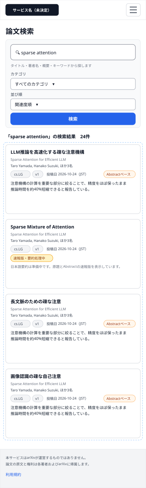
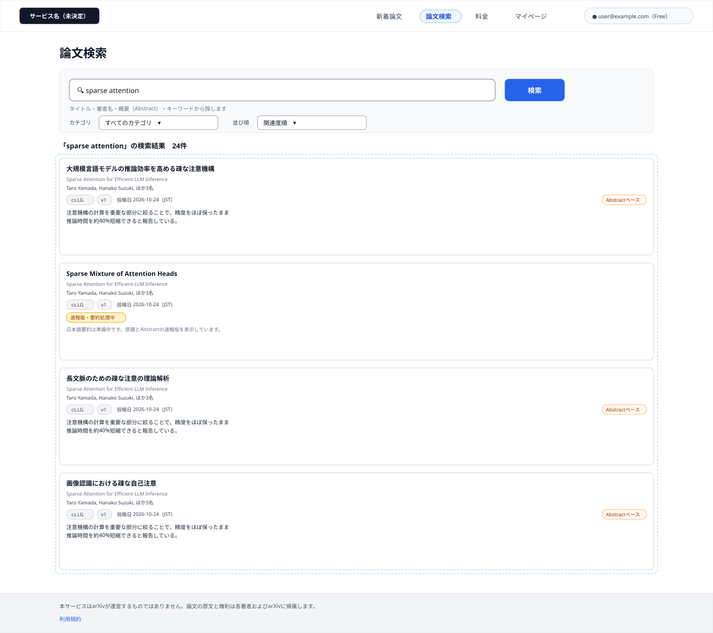
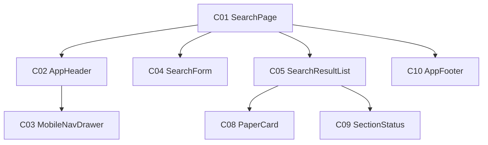

# P103 論文検索

## 0. 文書情報

| 項目 | 値 |
| :--- | :--- |
| 設計書ID | P103 |
| 親設計書 | `基本設計書_概要.md` §3 画面一覧 |
| 版 | 1.0（新規作成） |
| 作成日 | 2026-10-26 |
| 更新日 | 2026-10-26 |
| 作成方法 | `source/` 配下の企画資料と `docs/基本設計書_概要.md` からのリバースエンジニアリング（creating-screen-design v1.9.0 準拠） |
| 対象チャネル | モバイル（幅414）／デスクトップ（幅1440） |
| インプットの性質 | `source/` にあるのは企画・初期設計案のMarkdown 6ファイルだけで、本画面のソースコード（ページ・コンポーネント・ルーティング定義）は存在しない（`source/README.md:5-10`、上流 §前提）。そのため本書の画面項目・イベント・コンポーネントは、企画資料の定義行と上流の基本設計書（概要）の定義（§2 BF04・EX04、§3 共通ルール・レイアウト構造、§4 F03・B006・オンライン処理設計の入力チェック、§7 API02、§11 ARC007・ARC009）から導いた**計画上の実体**であり、実装済みであることは意味しない。資料に書かれていない値は※推測と明記する。共通ヘッダー・フッター・論文カード・状態表示は P101 ホーム・P102 新着論文の画面基本設計書と同じ部品を使う前提で、本画面での表示仕様を改めて記述する |

## 1. 画面概要
| 項目 | 内容 |
| :--- | :--- |
| 画面ID | P103 |
| 画面名 | 論文検索 |
| パス | `/search`（※推測。上流 §3.1・上流 付録 Q03 の仮置きをそのまま引き継ぐ）。検索条件はクエリ `?q=…&category=…&sort=…` で受け渡す（※推測） |
| 概要 | キーワード・著者・カテゴリで論文を検索する画面（`source/01_企画概要.md:26`、上流 §3.1）。入力した語でタイトル・著者・概要（Abstract）・キーワードを探し、カテゴリで絞り込める（`source/02_機能要求定義.md:8,33`）。まず自前DBを検索し、自前DBに該当が無いときはサーバ側が arXiv からの取り込み（B006）を起動し、画面はその旨を案内する（上流 §2 BF04）。論文を選ぶと論文詳細（P104）へ進む |
| アクター | ゲスト（未ログイン）、会員 Free、会員 Pro（新着検索は Free の提供範囲 — `source/04_収益化とロードマップ.md:4`。ゲストの利用可否は上流 付録 Q08 の仮置き「検索は利用可」に従う） |
| 認証要否 | 不要（上流 §7 API02「認証: 不要（※推測）」） |
| 前画面 | P101 ホーム（ヘッダーの「論文検索」。上流 §3 画面遷移図 P101 → P103）、全画面共通ヘッダーの「論文検索」（P102 ほか全画面）、ブラウザからの直接アクセス・検索条件付き URL の共有 ※推測 |
| 後画面 | P104 論文詳細（上流 §3 画面遷移図 P103 → P104）。ほかに共通ヘッダー・フッターから P101 ホーム、P102 新着論文、P106 マイページ、P107 料金、ログイン・会員登録画面（※上流未定義。上流 付録 Q04）、利用規約ページ（※上流未定義） |
| 対応ソースファイル | なし（実装未着手）。定義の出典は `source/01_企画概要.md:26`、`source/02_機能要求定義.md:8,23-29,32-35,45,58`、`source/03_システム構成.md:48,57-58,61`。※推測: 実装時は Next.js の `app/search/page.tsx` に置く想定 |
| カラーテーマ | default（配色は資料に定義が無い。上流 付録 Q06。UI部品は shadcn/ui、スタイルは Tailwind CSS — `source/03_システム構成.md:6`） |

## 2. ワイヤーフレーム

ワイヤーフレームは、上流 §3 のレイアウト構造（共通ヘッダー＋メインコンテンツ＋共通フッター、※推測）と、上流 §7 API02 のパラメータ・応答項目（※推測）からレイアウトを推定して作図した。図は「ログイン中の利用者がキーワードを入れて検索し、自前DBに該当があって結果の取得に成功した状態」を描いている。

### 2.1 ワイヤーフレーム（モバイル）

### 2.2 ワイヤーフレーム（デスクトップ）

### 2.3 画面レイアウト説明
* **共通ヘッダー（上端）**: 左にサービス名（H01）を置く。デスクトップでは右側に「新着論文」「論文検索」「料金」「マイページ」の導線（H02〜H05）とログイン状態（H06 または H07）を横並びにし、本画面を示す「論文検索」（H03）を選択中の見た目（背景色付き・太字）にする。モバイルではサービス名とメニューボタン（H08）だけを置き、導線とログイン状態はメニューを開いたときに表示するドロワー（C03）へ収める。切り替え幅は Tailwind CSS 標準の lg（1024px）を想定する（※推測。上流 付録 Q06）。
* **ページ見出し**: ヘッダーの下に見出し「論文検索」（H09）を置く。
* **検索フォーム（見出しの下）**: キーワード入力欄（H10）と検索ボタン（H14）を横に並べ、その下に検索対象の説明（H11）、カテゴリ（H12）、並び順（H13）を置く。モバイルでは入力欄・説明・カテゴリ・並び順・検索ボタンを縦に積み、検索ボタンを全幅にする。キーワードが空・長すぎるときは入力欄の直下に入力エラー（H15）を出す。
* **検索結果（フォームの下）**: 見出しとして検索語と件数（H16）を出し、その下に論文カード（C08）を1列で縦に並べる（H17）。デスクトップはカードを本文幅（1200px）いっぱいに広げ、モバイルは画面幅いっぱいにする（※推測）。
* **論文カード（C08）**: 上から、日本語タイトル（H18）、原題（H19）、著者（H20）、カテゴリ・版・投稿日の行（H21〜H23）と解析範囲（H24）、30秒要約（H25）の順に積む。要約が未公開の論文では H24・H25 の代わりに処理状況（H26）と速報版である旨の案内を表示する。
* **検索前・取得中・失敗・0件の表示**: 結果の位置に、まだ検索していないときは初期案内（H27）、取得中は読み込み中表示（H28）、失敗時はエラーメッセージと再読み込みボタン（H29・H30）、自前DBに0件で arXiv からの取り込みを起動しなかったときは該当なし表示（H31）、起動したときは取り込み中の案内（H32）を出す。ヘッダー・検索フォーム・フッターは表示を続ける（上流 §2 EX04、`source/02_機能要求定義.md:58`）。図にはこれらの状態は描いていない。
* **共通フッター（下端）**: arXiv との関係の注記（H33）と利用規約へのリンク（H34）を置く（上流 §3 レイアウト構造 ※推測）。

## 3. UI構成・コンポーネント定義

### 3.1 コンポーネントツリー

### 3.2 コンポーネント一覧

**総件数: 8件。全数である根拠**: 本画面のソースコードは無いため、コンポーネント名はすべて※推測（実装時の命名案）である。数え方は、`source/01_企画概要.md:26` が定める画面の中身（キーワード・著者・カテゴリでの検索 → C04、結果の一覧 → C05）、上流 §3 レイアウト構造の共通ヘッダー・フッター（C02・C10）、モバイル幅での導線の収納先（C03）、結果に並べる論文カード（C08）、上流 EX04 と BF04 の分岐が求める状態表示（C09）、それらを束ねるページ（C01）とした。コンポーネントIDは画面ごとの採番である。ただし P101・P102 と同じ部品を使う C02・C03・C08・C09・C10 は、画面をまたいで追いやすいよう同じ番号にそろえた。C01・C04・C05 は本画面固有の部品で、P101・P102 の同じ番号の部品とは別物である。C06・C07 は P101 固有の部品の番号のため本画面では欠番にした。

| コンポーネントID | コンポーネント名 | 種別 | 含む項目ID | Props | 内部State | 役割・概要 | 定義状況 | 詳細の所在 |
| :--- | :--- | :--- | :--- | :--- | :--- | :--- | :--- | :--- |
| C01 | SearchPage | Page | H09 | URLクエリの検索語・カテゴリ・並び順（※推測） | 実行済みの検索条件、結果の取得状態と結果、取り込みを起動したかどうか（※推測） | 論文検索画面全体。開いたときに URL クエリに検索語があれば検索（E01）を起動し、無ければ初期案内を出す。検索を実行するたびに URL クエリへ条件を書き戻す | 詳細 | §5 E01・E03〜E06、§7 |
| C02 | AppHeader | Layout | H01〜H08 | ログイン状態、利用者の表示名とプラン、現在の画面（※推測） | - | 全画面共通のヘッダー。サービス名と主要画面への導線、ログイン状態を表示する。本画面では「論文検索」を選択中の見た目にする | 詳細 | §4 H03・H05〜H08 |
| C03 | MobileNavDrawer | UI | H02〜H07 | 開閉状態、ログイン状態（※推測） | - | モバイル幅でメニューボタン（H08）を押したときに開くドロワー。デスクトップでヘッダーに並ぶ導線とログイン状態を縦並びで表示する | 詳細 | §5 E15・E16 |
| C04 | SearchForm | UI | H10〜H15 | 実行済みの検索条件、カテゴリの選択肢（※推測） | 入力中の検索語、入力エラーの有無 | 検索語・カテゴリ・並び順の指定欄と検索ボタン。検索語が空・長すぎるときは欄の直下にエラーを出して検索しない | 詳細 | §4 H10〜H15、§6 |
| C05 | SearchResultList | UI | H16,H17 | 検索結果の論文の配列、検索語、取得状態、取り込みを起動したかどうか（※推測） | - | 検索結果を件数付きで縦1列に並べる。検索前・取得中・失敗・0件・取り込み中のときは状態表示（C09）に置き換える | 詳細 | §4 H16・H17、§5 E01 |
| C08 | PaperCard | UI | H18〜H26 | 論文1件の表示データ（arXiv ID、日本語タイトル、原題、著者、カテゴリ、版、投稿日、解析範囲、30秒要約、処理状況）（※推測） | - | 論文1本を日本語タイトルと30秒要約で示すカード。要約の公開状況と解析範囲によって表示を切り替え、押すと論文詳細（P104）へ進む。本画面では「選ばれた理由」（P101 のおすすめ用の表示）は出さない | 詳細 | §4 H18〜H26、§5 E07 |
| C09 | SectionStatus | UI | H27〜H32 | 取得状態（検索前／取得中／失敗／0件／取り込み中）、再読み込み時の処理（※推測） | - | 結果の位置に出す状態表示。本画面では P101・P102 の取得中・失敗・0件に加えて、検索前の初期案内と arXiv から取り込み中の案内を出す | 詳細 | §4 H27〜H32、§5 E08 |
| C10 | AppFooter | Layout | H33,H34 | - | - | 全画面共通のフッター。arXiv との関係を誤解させない注記と利用規約への導線を表示する | 簡易 | §4 H33・H34 |

## 4. 画面項目定義

**総件数: 34件。全数である根拠**: 本画面のソースコードは無いため、次の定義を1要素1項目として数えた。共通ヘッダーの構成（上流 §3 レイアウト構造「サービス名、P102・P103・P106・P107への導線、ログイン状態」→ H01〜H07、モバイル幅の収納先の開閉 → H08）、ページ見出し（`source/01_企画概要.md:26` の画面名 → H09）、検索フォーム（上流 §7 API02 のパラメータ `q`・`category` → H10・H12、`source/02_機能要求定義.md:8` の検索対象「タイトル、著者、概要、キーワード」→ H11、`source/02_機能要求定義.md:34` と上流 BF04「投稿日降順または関連度順」→ H13、検索の実行 → H14、上流 §4 入力チェック「検索語 q が空のときは検索を実行せず、入力を促す」→ H15）、結果（上流 BF04 → H16・H17）、論文カードの表示項目（上流 §7 API02 応答「GET /api/papers と同じ要素構成」＝arXiv ID、原題、日本語タイトル、著者、カテゴリ、投稿日、30秒要約、解析範囲、要約の処理状況、および上流 §3 共通ルール「論文の版を表示」→ H18〜H26。arXiv ID は画面に表示せず遷移先の特定にだけ使うため項目に数えない）、状態の表示（上流 EX04 → H28〜H31、上流 BF04 の「該当なしと同期中の案内」と API02 応答「arXivとの同期を起動したかどうか」→ H32、検索前の状態 → H27）、共通フッター（上流 §3 レイアウト構造 → H33・H34）。著者専用の入力欄は置かない（上流 §7 API02 に著者のパラメータが無く、著者名はキーワード `q` で探す。§7 に確認事項として記載）。ページ送りの部品は上流 §7 API02 に件数・ページ指定が無いため置いていない。

| 項目ID | 項目名 | WF | 種別 | 必須 | データ型 | 制約・初期値 | 表示条件 | 備考 | 定義状況 | 詳細の所在 |
| :--- | :--- | :--- | :--- | :--- | :--- | :--- | :--- | :--- | :--- | :--- |
| H01 | サービス名（ロゴ） | D,M | リンク | - | string | 正式名称が未決定のため仮表記（候補: Arclia / Paprism / Curion — `source/05_ネーミング候補.md:4-6`、上流 付録 Q01） | 常時表示 | 押すと P101 ホームへ（E09）。全画面共通ヘッダーの一部 | 簡易 | 本表 |
| H02 | ナビ「新着論文」 | D | リンク | - | string | 固定文言「新着論文」 | デスクトップ幅では常時表示。モバイル幅ではメニュー（H08）を開いたときだけドロワー内に表示 | 押すと P102 へ（E10） | 簡易 | 本表 |
| H03 | ナビ「論文検索」 | D | リンク | - | string | 固定文言「論文検索」。本画面では選択中の見た目（背景色付き・太字）で表示 | デスクトップ幅では常時表示。モバイル幅ではメニュー（H08）を開いたときだけドロワー内に表示 | 本画面を指す導線。押すと検索条件を消して検索前の状態で開き直す（E11 ※推測） | 詳細 | §5 E11 |
| H04 | ナビ「料金」 | D | リンク | - | string | 固定文言「料金」 | デスクトップ幅では常時表示。モバイル幅ではメニュー（H08）を開いたときだけドロワー内に表示 | 押すと P107 へ（E12） | 簡易 | 本表 |
| H05 | ナビ「マイページ」 | D | リンク | - | string | 固定文言「マイページ」 | ログイン中のときだけ表示（モバイル幅ではメニューを開いたときだけドロワー内に表示）。未ログインのときは出さない ※推測 | 押すと P106 へ（E13）。マイページは本人のデータを扱うため、未ログインでは導線自体を出さない ※推測 | 詳細 | §5 E13 |
| H06 | ログインボタン | — | ボタン | - | string | 固定文言「ログイン」 | 未ログインのときだけ表示（モバイル幅ではドロワー内）。ログイン中は H07 に置き換わる | 押すとログイン・会員登録画面へ（E14）。ログイン画面は※上流未定義（上流 付録 Q04）。図はログイン中の状態のため描いていない | 詳細 | §5 E14 |
| H07 | ログイン中の利用者表示 | D | 表示 | - | string | 利用者を見分ける表示（メールアドレスまたは表示名 ※推測）と、契約プラン（Free / Pro）を並べて表示 | ログイン中のときだけ表示（モバイル幅ではドロワー内）。未ログインのときは H06 に置き換わる | プランは利用者テーブルのプラン区分（T005 users.plan）の値 ※推測。ログイン状態は画面を開いたときに Supabase Auth のセッションから確かめる（上流 IF05） | 詳細 | §5 E01 |
| H08 | メニューボタン | M | ボタン | - | - | 初期状態はドロワーが閉じた状態 | モバイル幅（lg 1024px 未満 ※推測）のときだけ表示。デスクトップ幅では導線がヘッダーに並ぶため出さない | 押すたびにドロワー（C03）を開閉する（E15） | 詳細 | §5 E15 |
| H09 | ページ見出し | D,M | 表示 | - | string | 固定文言「論文検索」 | 常時表示 | — | 簡易 | 本表 |
| H10 | 検索キーワード | D,M | 入力 | ○ | string | 1文字以上200文字以内（上限値は※推測）。前後の空白は取り除いてから扱う（※推測）。初期値は、URL クエリに正しい検索語（前後の空白を除いて1〜200文字）があればその語、無いか不正なら空（不正な語は入力欄に入れない — §5 E01） | 常時表示 | 入力した語でタイトル・著者・概要・キーワードをまとめて探す（API02 の `q`）。著者名もこの欄に入れて探す | 詳細 | §5 E02〜E04、§6 |
| H11 | 検索対象の説明 | D,M | 表示 | - | string | 固定文言「タイトル・著者名・概要（Abstract）・キーワードから探します」 | 常時表示 | 著者専用の欄が無いため、著者名もこの欄で探せることを利用者に伝える（`source/02_機能要求定義.md:8`） | 簡易 | 本表 |
| H12 | カテゴリ | D,M | 選択 | - | string | 選択肢は「すべてのカテゴリ」と、収集対象の arXiv カテゴリ（例 `cs.LG`）。初期値は、URL クエリに選択肢と一致するカテゴリがあればその値、無ければ「すべてのカテゴリ」（カテゴリを指定せずに検索する） | 常時表示 | 検索を一度実行した後に選び直すと、同じ検索語で検索し直す（E05）。選択肢に出す収集対象カテゴリの一覧は資料に定義が無い（※上流要確認。P102 H12 と同じ確認事項） | 詳細 | §5 E05 |
| H13 | 並び順 | D,M | 選択 | - | string | 選択肢は「関連度順」と「新着順（投稿日の新しい順）」の2つ（`source/02_機能要求定義.md:34`、上流 BF04）。初期値は「関連度順」（※推測: 検索語に近い論文を先に見せるため） | 常時表示 | 検索を一度実行した後に選び直すと、同じ検索語で検索し直す（E06）。上流 §7 API02 には並び順のパラメータが無い（※上流要確認） | 詳細 | §5 E06、§7 |
| H14 | 検索ボタン | D,M | ボタン | - | string | 固定文言「検索」 | 常時表示 | 押すと検索語を確かめてから検索する（E04）。キーワード欄で、日本語入力の変換を確定した後に Enter キーを押したときも同じ動き（E03。変換中の Enter では検索しない） | 詳細 | §5 E04 |
| H15 | キーワード入力エラー | — | 表示 | - | string | 文言は §6 のとおり。赤字で表示 | 検索を実行しようとした（Enter キーまたは検索ボタン）ときに、検索語が空・空白だけ・200文字を超える場合だけ、H10 の直下に表示する。キーワード欄に入力し直すと消える（E02） | エラーの間は検索せず、直前の結果をそのまま残す ※推測 | 詳細 | §6 |
| H16 | 検索結果見出し | D,M | 表示 | - | string | 「「（検索語）」の検索結果　N件」の形。N は返ってきた論文の件数（※推測） | 検索の結果が1件以上返ってきたときに表示する | どの語で検索した結果かを示し、入力欄を書き換えた後でも表示中の結果の条件を取り違えないようにする ※推測 | 詳細 | §5 E01・E03〜E06 |
| H17 | 検索結果一覧 | D,M | 一覧 | - | array | 並び順は H13 で選んだ順（API の返却順のまま）。表示件数は API の返却件数のまま（件数・ページ指定は上流で未定義） | 検索の結果が1件以上返ってきたときに表示する。検索前・取得中・失敗・0件のときは結果の位置に H27〜H32 を出す | 各要素は論文カード（C08）で描く。自前DBを先に検索し、画面表示のたびに LLM を呼ばない（上流 F03、`source/02_機能要求定義.md:35,45`） | 詳細 | §5 E01・E03〜E06、§7 |
| H18 | 日本語タイトル | D,M | リンク | - | string | AI が生成した日本語タイトル。要約が未公開で日本語タイトルが無い論文では原題を表示する（上流 BF03「未処理なら原題と速報版」と同じ扱い） | カード内に常時表示 | 押すとその論文の P104 へ（E07） | 詳細 | §5 E07 |
| H19 | 原題 | D,M | 表示 | - | string | arXiv 上の英語タイトルをそのまま表示 | 日本語タイトルがある論文のときだけ H18 の下に併記する。日本語タイトルが無いときは H18 が原題を表示するため重ねて出さない | 日本語タイトルには原題を併記する決まり（`source/02_機能要求定義.md:23`） | 詳細 | 本表 |
| H20 | 著者 | D,M | 表示 | - | string | 先頭から2名までを表示し、残りは「ほか N名」とまとめる（※推測） | カード内に常時表示 | 著者名で検索した場合、3人目以降の著者が一致していてもカードには名前が出ないことがある ※推測 | 簡易 | 本表 |
| H21 | カテゴリ（カード） | D,M | 表示 | - | string | arXiv のカテゴリ表記（例 `cs.LG`）。複数カテゴリを持つ論文は主カテゴリ1件だけを表示（※推測） | カード内に常時表示 | — | 簡易 | 本表 |
| H22 | 版 | D,M | 表示 | - | string | 「v」＋版番号（例 v1）。表示中の要約の対象となった版を出す | カード内に常時表示 | 改訂版を区別する決まり（`source/01_企画概要.md:37`、上流 ARC009） | 簡易 | 本表 |
| H23 | 投稿日 | D,M | 表示 | - | date | `YYYY-MM-DD` 形式の日付に、表示タイムゾーン（JST ※推測）を括弧で併記 | カード内に常時表示 | 新着順（H13）の並びの基準になる日付。どの日付かを日付の前に「投稿日」と明記し、更新日・新着公開日と取り違えさせない（`source/02_機能要求定義.md:32`、上流 ARC009） | 簡易 | 本表 |
| H24 | 解析範囲表示 | D,M | 表示 | - | string | 固定文言「Abstractベース」 | 要約の材料が Abstract だけの論文のときに表示する。本文を取得して要約した論文では出さない（解析範囲 source_scope が「Abstractのみ」のとき） | Abstract だけで要約した論文を明示する決まり（`source/01_企画概要.md:36`、上流 ARC009） | 詳細 | 本表 |
| H25 | 30秒要約 | D,M | 表示 | - | string | 結論を中心にした短い日本語要約。カード内では2行までを表示し、超える分は末尾を「…」で切り詰める（※推測） | 検証に合格して公開済みの要約がある論文のときに表示する。要約が未公開の論文では H26 に置き換える | 事前に生成した要約を表示し、画面表示のたびに LLM は呼ばない（`source/02_機能要求定義.md:45`） | 詳細 | §7 |
| H26 | 処理状況表示 | D,M | 表示 | - | string | 固定文言「速報版・要約処理中」と案内文「日本語要約は準備中です。原題とAbstractの速報版を表示しています。」（文言は※推測） | 要約がまだ公開されていない論文のときだけ、H24・H25 の代わりに表示する | 未処理の論文は速報版を先に出し処理中であることを示す（`source/03_システム構成.md:58`、上流 F17） | 詳細 | §7 |
| H27 | 初期案内 | — | 表示 | - | string | 固定文言「キーワードを入力して論文を検索してください。タイトル・著者名・概要から探せます。」（※推測） | URL クエリに検索語が無い状態で開いたとき（まだ一度も検索していないとき）だけ、結果の位置に表示する | 検索前に空の一覧や「該当なし」を出さないための表示 ※推測 | 詳細 | §5 E01 |
| H28 | 読み込み中表示 | — | 表示 | - | - | カード形の灰色の枠（スケルトン）を結果の位置に表示 | 検索の応答を待っている間だけ表示する（開いたとき、検索を実行したとき、カテゴリ・並び順を変えたとき、再読み込みのとき） | 検索をやり直すときは前の結果を消してから表示し、古い条件の結果を新しい条件の結果と取り違えないようにする ※推測 | 詳細 | §5 E01・E03〜E06・E08 |
| H29 | 検索エラーメッセージ | — | 表示 | - | string | 文言は §5.1 の様式②の詳細のとおり | 検索の取得が失敗したときだけ、結果の位置に表示する | 失敗を結果の領域に閉じ込め、ヘッダー・検索フォームは操作できる状態を保つ（上流 EX04、`source/02_機能要求定義.md:58`） | 詳細 | §5.1 |
| H30 | 再読み込みボタン | — | ボタン | - | string | 固定文言「再読み込み」 | H29 と同じ条件で、H29 の下に表示する | 押すと同じ検索条件で検索し直す（E08） | 詳細 | §5 E08 |
| H31 | 該当なし表示 | — | 表示 | - | string | 固定文言「「（検索語）」に一致する論文は見つかりませんでした。別のキーワードやカテゴリでお試しください。」（※推測） | 検索に成功し、返ってきた論文が0件で、サーバが arXiv からの取り込みを起動しなかったときだけ、結果の位置に表示する | — | 詳細 | §5 E01・E03〜E06 |
| H32 | 取り込み中の案内 | — | 表示 | - | string | 固定文言「自前の論文データには見つかりませんでした。arXiv から該当する論文を取り込んでいます。しばらくしてから、もう一度検索してください。」（※推測） | 検索に成功し、返ってきた論文が0件で、サーバが arXiv からの取り込み（B006）を起動したと応答したときだけ、H31 の代わりに結果の位置に表示する | 上流 BF04 の「該当なしと同期中の案内」。取り込みが終わっても画面は自動で検索し直さない（※推測。取り込みの完了を画面に知らせる手段が上流に無い） | 詳細 | §5 E01・E03〜E06、§7 |
| H33 | arXivとの関係の注記 | D,M | 表示 | - | string | 固定文言「本サービスはarXivが運営するものではありません。論文の原文と権利は各著者およびarXivに帰属します。」（文言は※推測） | 常時表示 | arXiv と本サービスの関係を誤解させない表記にする決まり（`source/03_システム構成.md:61`、上流 ARC009） | 簡易 | 本表 |
| H34 | 利用規約リンク | D,M | リンク | - | string | 固定文言「利用規約」 | 常時表示 | 押すと利用規約ページへ（E17）。利用規約ページは※上流未定義 | 簡易 | 本表 |

## 5. イベント定義

**総件数: 17件。全数である根拠**: 画面を開いたときの検索（URL クエリに検索語がある場合の GET /api/papers/search → E01）、§4 で種別が入力の項目 H10 の文字入力と Enter キー（→ E02・E03）、種別が選択の項目 H12・H13 の変更（→ E05・E06）、種別がリンク・ボタンの項目（H01〜H06、H08、H14、H18、H30、H34 の11項目）それぞれの押下（→ E04・E07〜E15・E17）を1件ずつ数え、操作対象の項目を持たないドロワー外側のタップ（→ E16）を加えた。表示だけの項目（H07、H09、H11、H15〜H17、H19〜H29、H31〜H33）は操作を受け付けないためイベントを持たない。ブックマークの登録・解除は本画面では扱わない（上流 BF07 の起点は P104・P106）。

| イベントID | 発生源 | 対象項目ID | トリガー | 条件 | 処理概要 | 呼び出しAPI | 成功時の挙動 | 失敗時の挙動（様式ID + 説明） | 定義状況 | 詳細の所在 |
| :--- | :--- | :--- | :--- | :--- | :--- | :--- | :--- | :--- | :--- | :--- |
| E01 | ページ | — | ページロード | 本画面を開いたとき（ヘッダーの導線、直接アクセス、ブラウザの戻る操作、検索条件付き URL） | まずブラウザに残っているログインのセッションから、ログイン中かどうかと利用者の表示名・プランを確かめる（Supabase Auth のセッション取得。取得できなければ未ログインとして扱う ※推測）。次に URL クエリから検索語・カテゴリ・並び順を読み、検索フォームの初期値にする。カテゴリ・並び順が選択肢に無い値なら、それぞれ「すべてのカテゴリ」「関連度順」に戻す（※推測）。検索語が空、または前後の空白を除いて200文字を超えるときは、検索語を入力欄に入れずに空のままにし、検索せずに初期案内（H27）を出す（利用者が入力した値ではないため入力エラー H15 は出さない）。検索語が正しければ検索APIを呼ぶ | GET /api/papers/search（API02）（検索語が正しいときだけ） | 結果が1件以上なら検索結果見出し（H16）と一覧（H17）を描画する。0件で取り込みを起動しなかったときは該当なし表示（H31）、起動したときは取り込み中の案内（H32） | 様式②: 結果の位置に「検索結果を読み込めませんでした。」と再読み込みボタンを表示する。ヘッダー・検索フォームは表示を続ける。セッション取得の失敗はエラー表示せず未ログインとして扱う ※推測 | 詳細 | 本表、§5.1 |
| E02 | 検索キーワード | H10 | Input（文字を入力・削除したとき） | キーワード入力エラー（H15）を表示しているとき | 入力し直したことを受けて、入力エラー（H15）を消す。検索はしない | なし | H15 を消す | 該当様式なし（画面内の表示切替だけで、エラーは起きない） | 簡易 | 本表 |
| E03 | 検索キーワード | H10 | Enter キー | キーワード欄に入力カーソルがあり、日本語入力の変換が確定しているとき（未確定の文字が無いとき）。変換中の Enter は変換の確定だけを行い、検索はしない | 検索ボタン（E04）と同じく、検索語を確かめてから検索する。日本語で検索語を入れる利用者が、変換を確定しただけで検索が走らないようにする（変換中かどうかは入力欄の変換状態で判断する ※推測: ブラウザの isComposing） | GET /api/papers/search（API02）（検索語が正しいときだけ） | E04 と同じ動きで結果を描画する | 様式④: 検索語が空・空白だけ・200文字超のときは H10 の直下に H15 を出し検索しない（文言は §6）。API の失敗は様式②（E01 と同じ文言） | 詳細 | 本表、§6 |
| E04 | 検索ボタン | H14 | Click | 常時 | 検索語の前後の空白を取り除き、空でないことと200文字以内であることを確かめる。正しければ、検索語・カテゴリ・並び順で検索APIを呼び、URL クエリにも条件を書き戻す（ブラウザの戻る操作で前の検索結果に戻れるようにする ※推測）。正しくなければ検索しない | GET /api/papers/search（API02）（検索語が正しいときだけ） | 結果が1件以上なら H16・H17 を描画する。0件で取り込みを起動しなかったときは H31、起動したときは H32 | 様式④: 検索語が空・空白だけ・200文字超のときは H10 の直下に H15 を出す（文言は §6）。API の失敗は様式②: 結果の位置に「検索結果を読み込めませんでした。」と再読み込みボタン | 詳細 | 本表、§6 |
| E05 | カテゴリ | H12 | Change | 常時 | 一度検索を実行した後（結果・該当なし・取り込み中の案内・エラーのどれかを表示しているとき）なら、表示中の結果の検索語と新しいカテゴリで検索し直し、URL クエリも書き換える。まだ検索していないときは選んだ値を覚えておくだけで検索しない。「すべてのカテゴリ」を選んだときはカテゴリを付けずに呼ぶ | GET /api/papers/search（API02）（検索済みのときだけ） | 結果を新しいカテゴリの結果に描き替える | 様式②: 結果の位置に「検索結果を読み込めませんでした。」と再読み込みボタンを表示する | 詳細 | 本表 |
| E06 | 並び順 | H13 | Change | 常時 | 一度検索を実行した後なら、表示中の結果の検索語と新しい並び順で検索し直し、URL クエリも書き換える。まだ検索していないときは選んだ値を覚えておくだけで検索しない。並び順を API に渡す方法は上流で未定義（※上流要確認。§7） | GET /api/papers/search（API02）（検索済みのときだけ） | 結果を新しい並び順で描き替える | 様式②: 結果の位置に「検索結果を読み込めませんでした。」と再読み込みボタンを表示する | 詳細 | 本表 |
| E07 | 論文カードの日本語タイトル | H18 | Click | 常時 | 押した論文の詳細画面を、その論文の arXiv ID を付けて開く | なし（取得は遷移先 P104 が API03・API04 で行う） | P104（`/papers/{arxivId}` ※推測）へ遷移 | 該当様式なし（API を呼ばない画面遷移のため、本画面で起きるエラーは無い。論文が見つからない場合は遷移先 P104 の責務） | 簡易 | 本表 |
| E08 | 再読み込みボタン | H30 | Click | 検索の取得が失敗して H30 が表示されているとき | 失敗したときと同じ検索語・カテゴリ・並び順で検索し直す。取り直している間は読み込み中表示（H28）を出す | GET /api/papers/search（API02） | 結果を描画する | 様式②: 再び失敗したときは同じエラーメッセージと再読み込みボタンを表示し直す（回数の上限は設けない ※推測） | 詳細 | 本表、§5.1 |
| E09 | サービス名（ロゴ） | H01 | Click | 常時 | ホーム画面へ移る | なし | P101 へ遷移 | 該当様式なし（API を呼ばない画面遷移のため、本画面で起きるエラーは無い） | 簡易 | 本表 |
| E10 | ナビ「新着論文」 | H02 | Click | 常時（モバイル幅ではドロワーを開いているとき） | 新着論文一覧へ移る。モバイル幅ではドロワーを閉じてから移る | なし | P102 へ遷移 | 該当様式なし（API を呼ばない画面遷移のため、本画面で起きるエラーは無い） | 簡易 | 本表 |
| E11 | ナビ「論文検索」 | H03 | Click | 常時（モバイル幅ではドロワーを開いているとき） | 本画面を、URL クエリを付けずに開き直す。検索条件は消え、検索前の状態（初期案内 H27）に戻る（※推測）。モバイル幅ではドロワーを閉じてから開き直す | なし（開き直した後の処理は E01） | P103 を検索前の状態で表示する | 該当様式なし（API を呼ばない画面遷移のため、本画面で起きるエラーは無い） | 簡易 | 本表 |
| E12 | ナビ「料金」 | H04 | Click | 常時（モバイル幅ではドロワーを開いているとき） | 料金画面へ移る。モバイル幅ではドロワーを閉じてから移る | なし | P107 へ遷移 | 該当様式なし（API を呼ばない画面遷移のため、本画面で起きるエラーは無い） | 簡易 | 本表 |
| E13 | ナビ「マイページ」 | H05 | Click | ログイン中のとき（H05 が表示されているとき） | マイページへ移る。モバイル幅ではドロワーを閉じてから移る | なし | P106 へ遷移 | 該当様式なし（API を呼ばない画面遷移のため、本画面で起きるエラーは無い。セッション切れの扱いは遷移先 P106 の責務） | 簡易 | 本表 |
| E14 | ログインボタン | H06 | Click | 未ログインのとき（H06 が表示されているとき） | ログイン・会員登録の画面へ移る。ログイン後は本画面へ、同じ検索条件のまま戻す ※推測 | なし（ログイン処理は遷移先で Supabase Auth を使う。上流 IF05） | ログイン・会員登録画面へ遷移（※上流未定義。上流 付録 Q04） | 該当様式なし（API を呼ばない画面遷移のため、本画面で起きるエラーは無い） | 詳細 | §5 遷移先ロースター |
| E15 | メニューボタン | H08 | Click | モバイル幅のとき | ドロワーが閉じていれば開き、開いていれば閉じる（外側を押して閉じる操作は E16） | なし | ドロワー（C03）に H02〜H07 を表示する／閉じる | 該当様式なし（画面内の表示切替だけで、エラーは起きない） | 詳細 | 本表 |
| E16 | ページ（モバイルのドロワー表示中） | — | Click（タップ） | モバイル幅でドロワー（C03）が開いているとき | ドロワーの外側（半透明の背景部分）を押すと、遷移せずにドロワーを閉じる（※推測） | なし | ドロワーを閉じ、元の画面表示に戻る | 該当様式なし（画面内の表示切替だけで、エラーは起きない） | 簡易 | 本表 |
| E17 | 利用規約リンク | H34 | Click | 常時 | 利用規約のページへ移る | なし | 利用規約ページへ遷移（※上流未定義） | 該当様式なし（API を呼ばない画面遷移のため、本画面で起きるエラーは無い） | 簡易 | 本表 |

**遷移先ロースター**（総件数: 8件。全数である根拠: 上表で遷移を伴うイベント E07・E09〜E14・E17 の遷移先を重複を除いて数えた。上流 §3 画面遷移図の P103 から出る1本 ― P104 ― を含み、ほかに共通ヘッダー・フッターからの遷移先として、本画面の開き直し、P101・P102・P106・P107、上流に画面定義の無い2件がある）

| No | 遷移先画面ID | 遷移先画面名 | 契機イベントID | 概要 | 定義状況 | 詳細の所在 |
| :--- | :--- | :--- | :--- | :--- | :--- | :--- |
| 1 | P104 | 論文詳細 | E07 | 押した論文の要約・実験結果・限界を見る画面へ移る（上流 §3 画面遷移図 P103 → P104） | 簡易 | `screens/画面.P104.画面基本設計.md`（未作成） |
| 2 | P101 | ホーム | E09 | ロゴからホームへ移る | 簡易 | `screens/画面.P101.画面基本設計.md` |
| 3 | P102 | 新着論文 | E10 | 日付・カテゴリで新着論文を絞り込む一覧へ移る | 簡易 | `screens/画面.P102.画面基本設計.md` |
| 4 | P103 | 論文検索（本画面） | E11 | 検索条件を消して本画面を開き直す | 簡易 | §5 E11 |
| 5 | P106 | マイページ | E13 | 関心分野・ブックマークを扱う画面へ移る | 簡易 | `screens/画面.P106.画面基本設計.md`（未作成） |
| 6 | P107 | 料金 | E12 | Free と Pro を比べる画面へ移る | 簡易 | `screens/画面.P107.画面基本設計.md`（未作成） |
| 7 | — ※上流未定義 | ログイン・会員登録画面 | E14 | Supabase Auth でログイン・会員登録を行う画面へ移る。画面としての定義が上流に無い（上流 付録 Q04） | 詳細 | §5 E14 |
| 8 | — ※上流未定義 | 利用規約ページ | E17 | 利用規約を表示するページへ移る。画面としての定義が上流に無い | 簡易 | - |

**呼出APIロースター**（総件数: 2件。全数である根拠: 上表で「呼び出しAPI」列に現れる API と、E01 のセッション取得で使う外部IFを重複を除いて数えた。上流 §7 内部API一覧の全8件のうち、API01・API03〜API08 は本画面からは呼ばない。arXiv からの取り込み（B006）は API02 がサーバ側で起動するもので、画面からは呼ばない）

| No | 上流ID | メソッド・対象 | 概要 | 呼び出すイベントID | 認証 | 定義状況 | 詳細の所在 |
| :--- | :--- | :--- | :--- | :--- | :--- | :--- | :--- |
| 1 | API02 | GET /api/papers/search | 検索語とカテゴリで論文を検索する。自前DBを先に検索し、該当が無いときはサーバ側で arXiv からの取り込み（B006）を起動し、起動したかどうかを応答に含める | E01, E03, E04, E05, E06, E08 | 不要（※推測。上流 §7 API02） | 詳細 | 上流 `基本設計書_概要.md` §7「GET /api/papers/search」 |
| 2 | IF05 | Supabase Auth（セッション取得） | ブラウザに残るログインのセッションから、ログイン中かどうかと利用者を確かめる | E01 | — | 簡易 | 上流 `基本設計書_概要.md` §7「IF05 Supabase Auth」 |

### 5.1 エラー表示様式定義

| 様式ID | 様式名 | 表示方法 | 使用コンポーネント | 使用場面 | ユーザー操作 |
| :--- | :--- | :--- | :--- | :--- | :--- |
| 様式① | ポップアップ表示 | モーダルダイアログで画面中央にエラーメッセージを表示 | ErrorModal | 該当なし（本画面は検索の失敗を結果の領域に閉じ込める方針のため、画面全体を覆うポップアップは使わない — 上流 EX04） | 該当なし |
| 様式② | 画面上部表示 | 【本画面での読み替え】標準の「画面上部（ヘッダー直下）に赤色バー」ではなく、結果の領域の上部（検索フォームの直下、結果を表示する位置）に赤色の帯でメッセージと再読み込みボタンを表示する。ヘッダーと検索フォームは表示・操作を続けられる（上流 EX04「要約欄だけに処理状況と再読み込みを表示し、他の領域は表示を続ける」に合わせた本画面での表示位置。P101・P102 と同じ読み替え） | SectionStatus（C09） | 検索API（API02）の通信失敗、サーバーエラー（500）、画面のチェックを経由しない値に対する入力不正（400 ※推測。検索語は画面で確かめてから送るため通常は起きない） | 「再読み込み」ボタン（H30）で同じ条件のまま検索し直す。検索語・カテゴリ・並び順を変えて検索しても取り直される。成功すればメッセージは消える |
| 様式③ | 全画面エラー | 専用のエラーページに画面全体を切り替えて表示 | ErrorPage / 404ページ | 該当なし（本画面のパスは `/search` 固定で、パスに論文IDのような可変部分を持たない。不正なクエリは E01 で初期値に戻す。エラー画面自体も上流に定義が無い — 上流 付録 Q04） | 該当なし |
| 様式④ | 入力欄下表示 | 対象の入力フィールド直下に赤文字でインラインエラーを表示 | フォームバリデーション（SearchForm C04 内のキーワード入力エラー H15） | 検索語（H10）が空・空白だけ・200文字超のまま検索を実行しようとしたとき | キーワード欄に入力し直すと消える（E02）。正しい検索語で検索し直す |

**この画面で使用するエラー様式の詳細**:

| 様式ID | エラー発生条件 | エラーメッセージ文言 | 補足（遷移先・復帰手順） |
| :--- | :--- | :--- | :--- |
| 様式② | 画面を開いたとき（E01）、検索を実行したとき（E03・E04）、カテゴリ・並び順を変えたとき（E05・E06）、再読み込み（E08）で、検索API（GET /api/papers/search）が通信できない、または 500 を返した場合 | 「検索結果を読み込めませんでした。時間をおいて再読み込みしてください。」（文言は※推測） | 結果の位置だけに表示する。「再読み込み」で同じ条件のまま検索し直す |
| 様式② | 検索API が入力不正（400）を返した場合 | 「指定した条件では検索できません。キーワードやカテゴリを見直してください。」（文言は※推測） | 結果の位置だけに表示する。検索フォームで条件を直して検索し直す |
| 様式④ | 検索語（H10）が空、または空白だけのまま検索を実行した場合（上流 §4 入力チェック「検索語 q が空のときは検索を実行せず、入力を促す」） | 「検索キーワードを入力してください」（文言は※推測） | キーワード欄の直下に表示する。入力し直すと消える |
| 様式④ | 検索語（H10）が前後の空白を除いて200文字を超えたまま検索を実行した場合（上限値は※推測） | 「キーワードは200文字以内で入力してください」（文言は※推測） | キーワード欄の直下に表示する。入力し直すと消える |

## 6. バリデーション・制約定義

入力・選択の項目は3件（H10 検索キーワード、H12 カテゴリ、H13 並び順）。カテゴリと並び順は選択肢からしか選べないため、画面での入力チェックは検索語だけに置く。URL クエリから不正な値が渡った場合の扱いは §5 E01 に記載した。

| 対象項目ID | 項目名 | ルール | エラーメッセージ |
| :--- | :--- | :--- | :--- |
| H10 | 検索キーワード | 前後の空白を取り除いたうえで1文字以上であること（上流 §4 入力チェック「検索語 q が空のときは検索を実行せず、入力を促す」、上流 §7 API02「q 必須」） | 「検索キーワードを入力してください」（※推測） |
| H10 | 検索キーワード | 前後の空白を取り除いたうえで200文字以内であること（※推測: 上限値は資料に定義が無い） | 「キーワードは200文字以内で入力してください」（※推測） |
| H12 | カテゴリ | 選択肢（「すべてのカテゴリ」と収集対象の arXiv カテゴリ）の中から選ぶこと。画面上は選択肢以外を選べないためエラーは出さない | —（URL クエリから選択肢に無い値が来た場合は「すべてのカテゴリ」に戻す。§5 E01） |
| H13 | 並び順 | 「関連度順」「新着順」のどちらかであること。画面上は選択肢以外を選べないためエラーは出さない | —（URL クエリから選択肢に無い値が来た場合は「関連度順」に戻す。§5 E01） |

## 7. 画面固有の業務ルール・注意事項

* **自前DBを先に検索する**: 検索はまず自前DBで行い、arXiv API へは画面から直接問い合わせない。自前DBに該当が無いときだけ、サーバ側が arXiv からの取り込み（B006）を起動する（`source/02_機能要求定義.md:35`、上流 F03・BF04・ARC007）。arXiv の推奨間隔を守るため、画面から取り込みを繰り返し起動させる操作は置かない（`source/03_システム構成.md:57`）。取り込みを起動する条件は上流 付録 Q10 で確認中（仮置き: 自前DBに該当が無いとき）。
* **取り込み中は自動で検索し直さない**: 取り込み中の案内（H32）を出した後、画面は取り込みの完了を待って自動で検索し直さない。利用者に時間をおいて検索し直すよう案内する（※推測。取り込みの完了を画面に知らせる手段が上流 §7 に無い）。
* **画面表示のたびに LLM を呼ばない**: 検索結果は事前に生成・検証した要約だけを表示する（`source/02_機能要求定義.md:45`、上流 ARC001）。30秒要約（H25）は検証に合格して公開済みのものだけを出す（上流 ARC004・B003・B004）。
* **未処理の論文も結果に出す**: 要約が未公開の論文も結果から外さず、原題と「速報版・要約処理中」（H26）で表示する（`source/03_システム構成.md:58`、上流 ARC002）。
* **著者はキーワード欄で探す**: 企画では「キーワード、著者、カテゴリ」での検索を挙げている（`source/01_企画概要.md:26`）が、上流 §7 API02 のパラメータは `q` と `category` だけで、著者名はタイトル・概要・キーワードと同じ `q` で探す（`source/02_機能要求定義.md:8`）。そのため著者専用の欄は置かず、H11 で著者名も探せることを示す。
* **条件は URL に持つ**: 検索語・カテゴリ・並び順は検索を実行したときに URL クエリへ書き戻し、再読み込み・ブラウザの戻る操作・URL の共有で同じ検索結果を開けるようにする（※推測）。
* **古い応答で上書きしない**: 条件を続けて変えたとき、前の条件の応答が後から届いても結果を上書きしないよう、最後に出した条件の応答だけを表示する（※推測）。
* **表示・編集ポリシーの順守**（上流 ARC009）: 論文カードには版（H22）を必ず出す。Abstract だけで要約した論文には「Abstractベース」（H24）を出す。投稿日には「投稿日」の語とタイムゾーンを併記する（H23）。フッターに arXiv との関係の注記（H33）を常時出す。
* **障害を結果の領域に閉じ込める**: 検索に失敗しても、ヘッダー・検索フォーム・フッターは表示を続け、条件を変えて検索し直せる（上流 EX04、`source/02_機能要求定義.md:58`）。※推測: 実装では結果の領域にエラー境界を置く（上流 §8 アプリケーション保護）。
* **閲覧履歴・検索語は記録しない**: 検索結果を表示しただけでは閲覧イベント（T008 view_events）を記録しない。記録するのは論文詳細（P104）を開いたときだけとする（上流 BF05）。検索語を利用者に紐づけて保存する定義も上流に無いため、本画面では保存しない（行動ログを必要最小限にする方針 — `source/02_機能要求定義.md:48`、上流 ARC010。※推測）。
* **ブックマークは扱わない**: 本画面のカードにはブックマーク操作を置かない（上流 BF07 の起点は P104・P106）。※推測: 検索結果から直接ブックマークできるようにするかは要確認。
* **プランによる差は無い**: 検索は Free の提供範囲（「新着検索」— `source/04_収益化とロードマップ.md:4`）に含まれるものとし、Free と Pro とゲストで本画面の表示内容は変わらない（上流 付録 Q08 の仮置き）。
* **上流への確認事項**（本書で新たに生じたもの）:
  * 上流 §7 API02 に並び順のパラメータが無い。`source/02_機能要求定義.md:34` と上流 BF04 は検索結果を「投稿日降順または関連度順」に並べるとしているため、API02 に並び順（API01 の `sort` と同じ値）を追加するか、並び順を固定するかの判断が要る（※上流要確認）。
  * 著者で検索する方法（キーワード `q` に含めるか、著者専用のパラメータを設けるか）。本書は `q` に含める仮置き（※上流要確認）。
  * 検索語の最大長（本書は200文字の仮置き）と、検索結果の件数・ページ送りの指定（上流 §7 API02 に無い。※上流要確認）。
  * arXiv からの取り込みを起動する条件（上流 付録 Q10）と、取り込みの完了を画面に知らせる手段の要否。
  * カテゴリの選択肢に出す収集対象の arXiv カテゴリの一覧（P102 と同じ確認事項。※上流要確認）。
  * ログイン・会員登録画面と利用規約ページの画面定義（上流 付録 Q04。本画面からの遷移先として※上流未定義）。
  * 上流 §11 ARC001・ARC002・ARC003 の適用範囲に P103（ARC003 は API02）の記載が無い（※上流要確認）。

## 8. 利用する方式（共通基盤）

| 方式ID | 名称 | 本書での利用箇所 |
| :--- | :--- | :--- |
| ARC009 | 表示・編集ポリシー（出典・版・日付・ブランド表記） | 論文カードの版（H22）・投稿日の種類とタイムゾーンの併記（H23）・Abstractベース表示（H24）、フッターの arXiv との関係の注記（H33）。上流の適用範囲「P101〜P107 全画面 / API01〜API05」に該当する |
| ARC007 | 外部APIアクセス制御（レート制限遵守・同期キャッシュ） | 検索は自前DBを先に引き、該当が無いときだけサーバ側が arXiv からの取り込み（B006）を起動する。その結果を取り込み中の案内（H32）で示し、画面から arXiv へ直接問い合わせたり取り込みを繰り返し起動したりはしない（§7）。上流の適用範囲「B006 / F03」に該当する |
| ARC001 | 生成物キャッシュ・重複排除方式 | 本画面の表示は事前生成済みの要約だけを使い、画面を開くたびに LLM を呼ばない（H25、E01・E03〜E06・E08）（※上流要確認: 上流の適用範囲に画面の記載が無い） |
| ARC002 | 段階的生成・公開方式（速報版→詳細版） | 要約が未公開の論文を結果から外さず、原題と処理状況（H26）で速報版として表示する（※上流要確認: 上流の適用範囲は P102・P104 で P103 の記載が無い） |
| ARC003 | 要約スキーマ（構造化要約の出力仕様） | カードに出す日本語タイトル・原題・30秒要約・解析範囲・対象の版（H18・H19・H22・H24・H25）は、このスキーマで定めた項目を表示する（※上流要確認: 上流の適用範囲は API04 までで、API02 の応答に要約の一部が含まれることは記載が無い） |
| ARC010 | 個人データ最小化・削除方針 | 検索語を利用者に紐づけて保存せず、検索結果の表示だけでは閲覧を記録しない（§7）（※上流要確認: 上流の適用範囲は F08・F15・F16 で F03 の記載が無い） |
