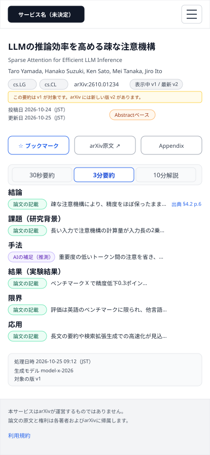
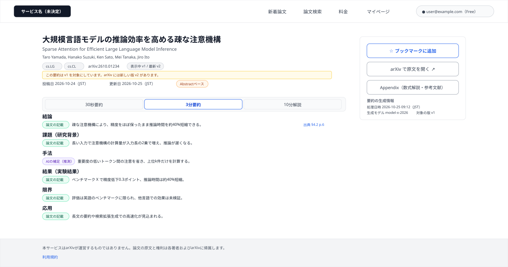
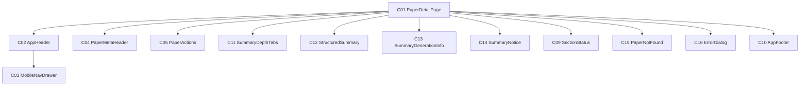

# P104 論文詳細

## 0. 文書情報

| 項目 | 値 |
| :--- | :--- |
| 設計書ID | P104 |
| 親設計書 | `基本設計書_概要.md` §3 画面一覧 |
| 版 | 1.0（新規作成） |
| 作成日 | 2026-10-26 |
| 更新日 | 2026-10-26 |
| 作成方法 | `source/` 配下の企画資料と `docs/基本設計書_概要.md` からのリバースエンジニアリング（creating-screen-design v1.9.0 準拠） |
| 対象チャネル | モバイル（幅414）／デスクトップ（幅1440） |
| インプットの性質 | `source/` にあるのは企画・初期設計案のMarkdown 6ファイルだけで、本画面のソースコード（ページ・コンポーネント・ルーティング定義）は存在しない（`source/README.md:5-10`、上流 §前提）。そのため本書の画面項目・イベント・コンポーネントは、企画資料の定義行と上流の基本設計書（概要）の定義（§2 BF05・BF07・EX04・EX05、§3 共通ルール・レイアウト構造、§6 T003・T004、§7 API03・API04・API06・API07・IF03、§11 ARC002〜ARC005・ARC008・ARC009）から導いた**計画上の実体**であり、実装済みであることは意味しない。資料に書かれていない値は※推測と明記する。共通ヘッダー・フッター・状態表示は P101〜P103 の画面基本設計書と同じ部品を使う前提で、本画面での表示仕様を改めて記述する |

## 1. 画面概要
| 項目 | 内容 |
| :--- | :--- |
| 画面ID | P104 |
| 画面名 | 論文詳細 |
| パス | `/papers/{arxivId}`（※推測。上流 §3.1・上流 付録 Q03 の仮置きをそのまま引き継ぐ）。`{arxivId}` は arXiv が論文ごとに付ける識別子 |
| 概要 | 1本の論文について、30秒要約・3分要約・10分解説の3段階の日本語要約と、実験結果・研究の限界を表示する画面（`source/01_企画概要.md:27`、上流 §3.1）。要約は結論・課題・手法・結果・限界・応用の項目に分け、主張ごとに論文の記載か AI の推測かを区別し、原文の章・ページへの出典を添える（`source/01_企画概要.md:33-35`、`source/02_機能要求定義.md:9,21-29`）。ブックマークの登録・解除、arXiv の原文と Appendix（P105）への導線を持つ（上流 BF05・BF07） |
| アクター | ゲスト（未ログイン）、会員 Free、会員 Pro（上流 §2 ユースケース図。ゲストの閲覧可否は上流 付録 Q08 の仮置き「詳細は利用可」に従う。ブックマークは会員だけ — 上流 §7 API06・API07「認証: 必要」。10分解説を Pro 限定にするかは上流 付録 Q09 で確認中） |
| 認証要否 | 不要（閲覧は上流 §7 API03・API04「認証: 不要」）。ブックマークの操作だけログインが要る |
| 前画面 | P101 ホーム、P102 新着論文、P103 論文検索、P106 マイページ（それぞれの論文カード・一覧から。上流 §3 画面遷移図 P101・P102・P103・P106 → P104）、ブラウザからの直接アクセス・URL の共有 ※推測 |
| 後画面 | P105 Appendix、arXiv 原文ページ（外部。上流 §3 画面遷移図 P104 → P105・ARX、上流 IF03）。ほかに、要約の出典リンク先（外部の原文ページ ※推測）、P107 料金（10分解説が Pro 限定だった場合の案内から。※上流要確認: 上流の画面遷移図に P104 → P107 の線は無い）、共通ヘッダー・フッターから P101・P102・P103・P106・P107、ログイン・会員登録画面（※上流未定義。上流 付録 Q04）、利用規約ページ（※上流未定義） |
| 対応ソースファイル | なし（実装未着手）。定義の出典は `source/01_企画概要.md:27,33-37`、`source/02_機能要求定義.md:9-12,21-29,32,45,58`、`source/03_システム構成.md:36-38,41-42,49-53,58-61`。※推測: 実装時は Next.js の `app/papers/[arxivId]/page.tsx` に置く想定 |
| カラーテーマ | default（配色は資料に定義が無い。上流 付録 Q06。UI部品は shadcn/ui、スタイルは Tailwind CSS、数式は KaTeX — `source/03_システム構成.md:6,14`） |

## 2. ワイヤーフレーム

ワイヤーフレームは、上流 §3 のレイアウト構造（共通ヘッダー＋メインコンテンツ＋共通フッター、※推測）と、上流 §7 API03・API04 の応答項目、上流 §6 T003・T004 の列（※推測を含む）からレイアウトを推定して作図した。図は「ログイン中の Free 会員が、Abstract ベースで要約済み・まだブックマークしていない論文を開き、3分要約を表示している状態」を描いている。要約は v1 を対象にしており、arXiv に新しい版 v2 がある例にしている。

### 2.1 ワイヤーフレーム（モバイル）

### 2.2 ワイヤーフレーム（デスクトップ）

### 2.3 画面レイアウト説明
* **共通ヘッダー（上端）**: 左にサービス名（H01）を置く。デスクトップでは右側に「新着論文」「論文検索」「料金」「マイページ」の導線（H02〜H05）とログイン状態（H06 または H07）を横並びにする（本画面に対応する導線は無いため、どれも選択中の見た目にしない）。モバイルではサービス名とメニューボタン（H08）だけを置き、導線とログイン状態はドロワー（C03）へ収める。切り替え幅は Tailwind CSS 標準の lg（1024px）を想定する（※推測。上流 付録 Q06）。
* **論文の基本情報（ヘッダーの下）**: 日本語タイトル（H09）、原題（H10）、著者（H11）、カテゴリ・arXiv ID・版の行（H12〜H14）、新しい版の注記（H15）、投稿日・更新日と解析範囲（H16〜H18）を上から積む。
* **操作（デスクトップは右サイド、モバイルは基本情報の下）**: ブックマーク（H19）、arXiv で原文を開く（H20）、Appendix（H21）の3つ。デスクトップは本文の右に幅300pxのサイド領域を置いて縦に並べ、その下に要約の生成情報（H31〜H33）を出す。モバイルは3つを横一列に並べ、生成情報は要約の下に置く（※推測）。
* **要約（基本情報の下）**: 30秒要約・3分要約・10分解説を切り替えるタブ（H22）と、その下に選んだ深さの要約を項目ごとに表示する（結論 H23、課題 H24、手法 H25、結果 H26、限界 H27、応用 H28）。各主張の先頭に「論文の記載」か「AIの補足（推測）」かの区分（H29）を付け、根拠のある主張の末尾に出典（H30）を付ける。デスクトップは本文幅860px、モバイルは画面幅いっぱいにする（※推測）。
* **要約欄の切り替え表示**: 選んだ深さの要約が無い・見られないときは、要約の項目の代わりに、10分解説が無い旨（H34）、Pro 案内（H35・H36）、要約の処理状況（H37）のどれかを要約欄に出す。要約の取得中は読み込み中表示（H38）、失敗時はエラーメッセージと再読み込みボタン（H39・H40）を要約欄に出し、基本情報・操作・ヘッダー・フッターは表示を続ける（上流 §2 EX04、`source/02_機能要求定義.md:58`）。
* **論文が見つからないとき**: 論文情報そのものが取れないときは、ヘッダー・フッターの間のメインコンテンツ全体を「論文が見つからない」表示（H41・H42）に置き換える。
* **ダイアログ**: ブックマークの操作でログインが必要なとき・更新に失敗したときは、画面中央にダイアログ（H43〜H45）を重ねる。
* **共通フッター（下端）**: arXiv との関係の注記（H46）と利用規約へのリンク（H47）を置く（上流 §3 レイアウト構造 ※推測）。
* 図には、H06・H34〜H45 が出る状態は描いていない。

## 3. UI構成・コンポーネント定義

### 3.1 コンポーネントツリー

### 3.2 コンポーネント一覧

**総件数: 13件。全数である根拠**: 本画面のソースコードは無いため、コンポーネント名はすべて※推測（実装時の命名案）である。数え方は、上流 §7 API03 の応答（論文の基本情報）を表示する部品（C04）、上流 BF05・BF07・IF03 の利用者操作（ブックマーク・原文・Appendix）を束ねる部品（C05）、`source/01_企画概要.md:27` の「30秒/3分/10分」の切替（C11）、`source/02_機能要求定義.md:9,28` と上流 T003・T004 の構造化要約と出典（C12）、`source/02_機能要求定義.md:29` の処理日時・モデル・版（C13）、上流 BF05 の分岐（10分解説なし）と上流 付録 Q09・API04 の 403、`source/03_システム構成.md:58` の未処理論文の表示をまとめた案内（C14）、上流 EX04 の要約欄の状態表示（C09）、API03 の 404（C15）、上流 EX05 のログイン案内とブックマーク失敗の通知（C16）、上流 §3 レイアウト構造の共通ヘッダー・フッター（C02・C10）とモバイル幅の導線の収納先（C03）、それらを束ねるページ（C01）とした。コンポーネントIDは画面ごとの採番である。P101〜P103 と同じ部品を使う C02・C03・C09・C10 は同じ番号にそろえ、本画面固有の部品は C01・C04・C05 と C11 以降に振った（C04・C05 は P101〜P103 の同じ番号の部品とは別物）。C06〜C08 は他画面の部品の番号のため本画面では欠番にした（論文カード C08 は本画面では使わない）。

| コンポーネントID | コンポーネント名 | 種別 | 含む項目ID | Props | 内部State | 役割・概要 | 定義状況 | 詳細の所在 |
| :--- | :--- | :--- | :--- | :--- | :--- | :--- | :--- | :--- |
| C01 | PaperDetailPage | Page | — | パスの arXiv ID（※推測） | 論文情報の取得状態と結果、選択中の要約の深さ、要約の取得状態と結果、ブックマーク状態、ダイアログの表示状態（※推測） | 論文詳細画面全体。開いたときに論文情報と標準の深さの要約を並行して取得し（E01）、結果を各部品へ渡す。論文情報が取れなければメインコンテンツ全体を C15 に置き換える | 詳細 | §5 E01・E02、§7 |
| C02 | AppHeader | Layout | H01〜H08 | ログイン状態、利用者の表示名とプラン（※推測） | - | 全画面共通のヘッダー。サービス名と主要画面への導線、ログイン状態を表示する。本画面ではどの導線も選択中の見た目にしない | 詳細 | §4 H05〜H08 |
| C03 | MobileNavDrawer | UI | H02〜H07 | 開閉状態、ログイン状態（※推測） | - | モバイル幅でメニューボタン（H08）を押したときに開くドロワー。デスクトップでヘッダーに並ぶ導線とログイン状態を縦並びで表示する | 詳細 | §5 E18・E19 |
| C04 | PaperMetaHeader | UI | H09〜H18 | 論文情報（日本語タイトル、原題、著者、カテゴリ、arXiv ID、表示中の版、最新版、投稿日、更新日、本文取得状況）（※推測） | 著者一覧を展開しているかどうか | 論文の基本情報を示す。表示中の要約が古い版を対象にしているときは新しい版がある旨を出し、Abstract だけで要約した論文には「Abstractベース」を出す | 詳細 | §4 H09〜H18 |
| C05 | PaperActions | UI | H19〜H21 | arXiv ID、原文URL、ブックマーク状態、ログイン状態（※推測） | 登録・解除の処理中かどうか | ブックマークの登録・解除、arXiv の原文ページ、Appendix（P105）への導線を並べる。未ログインでブックマークを押すとログイン案内のダイアログを出す | 詳細 | §5 E03〜E05 |
| C11 | SummaryDepthTabs | UI | H22 | 選択中の深さ（※推測） | - | 30秒要約・3分要約・10分解説を切り替えるタブ。切り替えるたびにその深さの要約を取り直す | 詳細 | §5 E02 |
| C12 | StructuredSummary | UI | H23〜H30 | 要約JSONの各項目と、主張ごとの区分・出典参照（※推測） | - | 選んだ深さの要約を結論・課題・手法・結果・限界・応用の項目に分けて表示する。各主張に論文の記載か AI の推測かの区分を付け、根拠のある主張に原文の章・ページへの出典を付ける。数式は KaTeX で描画する | 詳細 | §4 H23〜H30、§7 |
| C13 | SummaryGenerationInfo | UI | H31〜H33 | 処理日時、生成モデル、対象の版（※推測） | - | 表示中の要約がいつ・どのモデルで・どの版を対象に作られたかを示す | 簡易 | §4 H31〜H33 |
| C14 | SummaryNotice | UI | H34〜H37 | 要約欄に出す案内の種類（10分解説なし／Pro 案内／処理中）（※推測） | - | 選んだ深さの要約が無い・見られない理由を要約欄に示す。Pro 案内のときは料金画面への導線を出す | 詳細 | §4 H34〜H37、§5 E02 |
| C09 | SectionStatus | UI | H38〜H40 | 取得状態（取得中／失敗）、再読み込み時の処理（※推測） | - | 要約欄に出す取得中・失敗の表示。再読み込みで同じ深さの要約を取り直す。本画面では0件の表示は使わない（要約が無いときは C14 で理由を示すため） | 詳細 | §4 H38〜H40、§5 E08 |
| C15 | PaperNotFound | UI | H41,H42 | 失敗の種類（論文なし／取得失敗）（※推測） | - | 論文情報が取れないときに、メインコンテンツ全体を置き換えて理由とホームへの導線を示す | 詳細 | §4 H41・H42、§5.1 様式③ |
| C16 | ErrorDialog | UI | H43〜H45 | ダイアログの種類（ログインが必要／更新失敗）、文言（※推測） | - | ブックマークの操作でログインが必要なとき・更新に失敗したときに画面中央に重ねるダイアログ。ログインが必要なときだけログインボタンを出す | 詳細 | §4 H43〜H45、§5.1 様式① |
| C10 | AppFooter | Layout | H46,H47 | - | - | 全画面共通のフッター。arXiv との関係を誤解させない注記と利用規約への導線を表示する | 簡易 | §4 H46・H47 |

## 4. 画面項目定義

**総件数: 47件。全数である根拠**: 本画面のソースコードは無いため、次の定義を1要素1項目として数えた。共通ヘッダーの構成（上流 §3 レイアウト構造 → H01〜H07、モバイル幅の収納先の開閉 → H08）、論文の基本情報（上流 §7 API03 応答「arXiv ID、原題、日本語タイトル、著者、カテゴリ、投稿日、更新日、最新版、表示中の版、原文URL、ライセンス種別、本文取得状況」→ H09〜H18。原文URL は H20 の行き先、ライセンス種別は画面に表示せず 10分解説・Appendix の可否の判断にだけ使うため項目に数えない。新しい版の注記 H15 は上流 §3 共通ルール「論文の版を表示」と「最新版・表示中の版」の両方を持つ応答から）、操作（上流 BF07・API06・API07 → H19、上流 IF03 → H20、上流 BF05・画面遷移図 P104 → P105 → H21）、要約（`source/01_企画概要.md:27` → H22、`source/02_機能要求定義.md:9` の「結論、課題、手法、結果、限界、応用」→ H23〜H28、`source/01_企画概要.md:33` と上流 ARC004「事実と推測の区別」→ H29、`source/01_企画概要.md:35` と上流 T004 → H30、`source/02_機能要求定義.md:29` の「処理日時、モデル、対象論文バージョン」→ H31〜H33）、要約欄の案内（上流 BF05「deep で本文未取得なら Abstract ベースである旨」→ H34、上流 §7 API04 の 403 と付録 Q09 → H35・H36、`source/03_システム構成.md:58` と上流 F17 → H37）、要約欄の状態（上流 EX04 → H38〜H40）、論文情報が取れない場合（上流 §7 API03 の 404・500 → H41・H42）、ブックマークのダイアログ（上流 EX05「ログインを促す」と API06・API07 の失敗 → H43〜H45）、共通フッター（上流 §3 レイアウト構造 → H46・H47）。入力項目は0件。AIチャット（上流 BF09）と複数論文比較（上流 BF11）の部品は置いていない（どちらも Later の機能で、起点画面が上流でも※推測、API も未定義のため。§7 に記載）。

| 項目ID | 項目名 | WF | 種別 | 必須 | データ型 | 制約・初期値 | 表示条件 | 備考 | 定義状況 | 詳細の所在 |
| :--- | :--- | :--- | :--- | :--- | :--- | :--- | :--- | :--- | :--- | :--- |
| H01 | サービス名（ロゴ） | D,M | リンク | - | string | 正式名称が未決定のため仮表記（候補: Arclia / Paprism / Curion — `source/05_ネーミング候補.md:4-6`、上流 付録 Q01） | 常時表示 | 押すと P101 ホームへ（E12）。全画面共通ヘッダーの一部 | 簡易 | 本表 |
| H02 | ナビ「新着論文」 | D | リンク | - | string | 固定文言「新着論文」 | デスクトップ幅では常時表示。モバイル幅ではメニュー（H08）を開いたときだけドロワー内に表示 | 押すと P102 へ（E13） | 簡易 | 本表 |
| H03 | ナビ「論文検索」 | D | リンク | - | string | 固定文言「論文検索」 | デスクトップ幅では常時表示。モバイル幅ではメニュー（H08）を開いたときだけドロワー内に表示 | 押すと P103 へ（E14） | 簡易 | 本表 |
| H04 | ナビ「料金」 | D | リンク | - | string | 固定文言「料金」 | デスクトップ幅では常時表示。モバイル幅ではメニュー（H08）を開いたときだけドロワー内に表示 | 押すと P107 へ（E15） | 簡易 | 本表 |
| H05 | ナビ「マイページ」 | D | リンク | - | string | 固定文言「マイページ」 | ログイン中のときだけ表示（モバイル幅ではメニューを開いたときだけドロワー内に表示）。未ログインのときは出さない ※推測 | 押すと P106 へ（E16）。マイページは本人のデータを扱うため、未ログインでは導線自体を出さない ※推測 | 詳細 | §5 E16 |
| H06 | ログインボタン | — | ボタン | - | string | 固定文言「ログイン」 | 未ログインのときだけ表示（モバイル幅ではドロワー内）。ログイン中は H07 に置き換わる | 押すとログイン・会員登録画面へ（E17）。ログイン画面は※上流未定義（上流 付録 Q04）。図はログイン中の状態のため描いていない | 詳細 | §5 E17 |
| H07 | ログイン中の利用者表示 | D | 表示 | - | string | 利用者を見分ける表示（メールアドレスまたは表示名 ※推測）と、契約プラン（Free / Pro）を並べて表示 | ログイン中のときだけ表示（モバイル幅ではドロワー内）。未ログインのときは H06 に置き換わる | プランは利用者テーブルのプラン区分（T005 users.plan）の値 ※推測。ログイン状態は画面を開いたときに Supabase Auth のセッションから確かめる（上流 IF05） | 詳細 | §5 E01 |
| H08 | メニューボタン | M | ボタン | - | - | 初期状態はドロワーが閉じた状態 | モバイル幅（lg 1024px 未満 ※推測）のときだけ表示。デスクトップ幅では導線がヘッダーに並ぶため出さない | 押すたびにドロワー（C03）を開閉する（E18） | 詳細 | §5 E18 |
| H09 | 日本語タイトル | D,M | 表示 | - | string | AI が生成した日本語タイトルを見出しとして表示。要約が未公開で日本語タイトルが無い論文では原題を見出しにする（上流 BF03「未処理なら原題と速報版」と同じ扱い） | 論文情報が取れたときに常時表示 | ブラウザのタブに出すページタイトルにも使う ※推測 | 詳細 | 本表 |
| H10 | 原題 | D,M | 表示 | - | string | arXiv 上の英語タイトルをそのまま表示 | 日本語タイトルがある論文のときだけ H09 の下に併記する。日本語タイトルが無いときは H09 が原題を表示するため重ねて出さない | 日本語タイトルには原題を併記する決まり（`source/02_機能要求定義.md:23`） | 詳細 | 本表 |
| H11 | 著者 | D,M | 表示（展開操作あり） | - | string | 全員の氏名をカンマ区切りで表示する。11名以上のときは先頭10名を表示し、残りは「ほか N名」の押せる文字にして、押すと全員を展開する（10名の境目は※推測）。初期状態は折りたたみ | 論文情報が取れたときに常時表示する。「ほか N名」は著者が11名以上のときだけ出す | 一覧のカード（P101〜P103）では2名までだが、詳細では著者を確かめられるよう全員を出す ※推測。展開は E21 | 詳細 | §5 E21 |
| H12 | カテゴリ | D,M | 表示 | - | string | arXiv のカテゴリ表記（例 `cs.LG`）を、論文が持つすべてについてラベルで表示 | 論文情報が取れたときに常時表示 | — | 簡易 | 本表 |
| H13 | arXiv ID | D,M | 表示 | - | string | 「arXiv:」に続けて arXiv ID を表示（例 arXiv:2610.01234） | 論文情報が取れたときに常時表示 | arXiv 上の論文を利用者が自分で特定できるようにする（`source/03_システム構成.md:22`） | 簡易 | 本表 |
| H14 | 版 | D,M | 表示 | - | string | 「表示中 vN / 最新 vM」の形。表示中の版は表示中の要約が対象にした版、最新版は arXiv 上の最新の版 | 論文情報が取れたときに常時表示する。表示中の版と最新版が同じときは「v N（最新）」とだけ出す ※推測 | 改訂版を区別する決まり（`source/01_企画概要.md:37`、上流 ARC009） | 詳細 | 本表 |
| H15 | 新しい版の注記 | D,M | 表示 | - | string | 固定文言「この要約は vN を対象にしています。arXiv には新しい版 vM があります。」（N・M は版番号。文言は※推測） | 表示中の版が最新版より古いときだけ、H14 の下に表示する。同じ版のときは出さない | 古い版の要約を最新の内容と取り違えさせないための表示（上流 ARC009）。新しい版の要約は B001 が版ごとに作る（上流 BF01） | 詳細 | 本表 |
| H16 | 投稿日 | D,M | 表示 | - | date | 「投稿日」の語に続けて `YYYY-MM-DD` 形式の日付と表示タイムゾーン（JST ※推測）を表示 | 論文情報が取れたときに常時表示 | 3種類の日付の意味とタイムゾーンを区別する決まり（`source/02_機能要求定義.md:32`、上流 ARC009） | 簡易 | 本表 |
| H17 | 更新日 | D,M | 表示 | - | date | 「更新日」の語に続けて `YYYY-MM-DD` 形式の日付と表示タイムゾーン（JST ※推測）を表示 | 論文情報が取れたときに常時表示する。更新日が投稿日と同じ（改訂が無い）ときも出す ※推測 | 新着公開日は上流 §7 API03 の応答に無いため本画面では出さない（上流 付録 Q11 の確認に合わせて見直す） | 簡易 | 本表 |
| H18 | 解析範囲表示 | D,M | 表示 | - | string | 本文を取得していない論文は「Abstractベース」、本文を取得して要約した論文は「本文取得済み」と表示 | 論文情報が取れたときに常時表示する（本文取得状況に応じて文言だけを切り替える） | Abstract だけで要約した論文を明示する決まり（`source/01_企画概要.md:36`、`source/02_機能要求定義.md:27`、上流 ARC009）。一覧のカードと違い、本文取得済みの論文にも表示する ※推測 | 詳細 | 本表 |
| H19 | ブックマークボタン | D,M | ボタン | - | string | 未登録のとき「☆ ブックマークに追加」、登録済みのとき「★ ブックマーク済み」（文言は※推測）。初期状態は論文情報の応答に含まれるブックマーク状態に従い、応答に無い場合は未登録として表示する（※上流要確認: 上流 §7 API03 の応答にブックマーク状態が無い） | 論文情報が取れたときに常時表示する（未ログインでも表示し、押すとログインを促す） | 押すと登録・解除を切り替える（E03）。処理中は押せない状態にして二重送信を防ぐ ※推測 | 詳細 | §5 E03、§7 |
| H20 | arXiv で原文を開く | D,M | リンク | - | string | 固定文言「arXiv で原文を開く ↗」。行き先は論文情報の原文URL | 論文情報が取れたときに常時表示 | arXiv の原文ページを新しいタブで開く（E04、上流 IF03）。MVP 完了基準「arXiv の原文リンクが開ける」の画面側（`source/02_機能要求定義.md:56`） | 簡易 | 本表 |
| H21 | Appendix リンク | D,M | リンク | - | string | 固定文言「Appendix（数式解説・参考文献）」 | 論文情報が取れたときに常時表示 | 押すと P105 へ（E05）。日本語全文を見られるかはライセンス次第で、その判断は P105 の責務（上流 ARC005） | 簡易 | 本表 |
| H22 | 要約の深さタブ | D,M | 選択 | - | string | 選択肢は「30秒要約」「3分要約」「10分解説」の3つ（API04 の `depth` の short・standard・deep に対応。上流 §1 用語集）。初期値は「3分要約」（※推測: 上流 §7 API04「未指定時は standard」に合わせる） | 論文情報が取れたときに常時表示する。10分解説のタブも常に出し、見られないときは理由を要約欄（H34・H35）で示す ※推測 | 押すとその深さの要約を取り直す（E02）。選んでいるタブは背景色付き・太字にする | 詳細 | §5 E02 |
| H23 | 結論 | D,M | 表示 | - | string | 見出し「結論」と本文。本文中の主張ごとに H29・H30 を付ける | 選んだ深さの要約が取れたとき、すべての深さで表示する（30秒要約はこの項目だけを出す — `source/02_機能要求定義.md:24`「結論中心」 ※推測） | — | 詳細 | §7 |
| H24 | 課題（研究背景） | D,M | 表示 | - | string | 見出し「課題（研究背景）」と本文 | 選んだ深さが3分要約または10分解説で、要約にこの項目があるときに表示する。30秒要約では出さない ※推測 | 3分要約の「研究背景」（`source/02_機能要求定義.md:25`）と構造化要約の「課題」（`source/02_機能要求定義.md:9`）を同じ項目として扱う ※推測 | 詳細 | §7 |
| H25 | 手法 | D,M | 表示 | - | string | 見出し「手法」と本文。10分解説では技術的詳細と数式を含み、数式は KaTeX で描画する（`source/02_機能要求定義.md:26`、`source/03_システム構成.md:14`） | 選んだ深さが3分要約または10分解説で、要約にこの項目があるときに表示する。30秒要約では出さない ※推測 | 数式は HTML として埋め込まず KaTeX で描画し、外部由来の文字列からスクリプトが動かないようにする（上流 §8 XSS 対策 ※推測） | 詳細 | §7 |
| H26 | 結果（実験結果） | D,M | 表示 | - | string | 見出し「結果（実験結果）」と本文。数値・比較対象・ベンチマーク名を要約のまま表示する。10分解説では比較実験の詳細を含む | 選んだ深さが3分要約または10分解説で、要約にこの項目があるときに表示する。30秒要約では出さない ※推測 | 数値・比較対象・ベンチマーク名を保持する編集方針（`source/01_企画概要.md:34`）。画面の主目的の一つ「実験結果」（`source/01_企画概要.md:27`） | 詳細 | §7 |
| H27 | 限界 | D,M | 表示 | - | string | 見出し「限界」と本文 | 選んだ深さが3分要約または10分解説で、要約にこの項目があるときに表示する。30秒要約では出さない ※推測 | 研究の限界を見失わずに読めるようにする（`source/01_企画概要.md:12,27`） | 詳細 | §7 |
| H28 | 応用 | D,M | 表示 | - | string | 見出し「応用」と本文 | 選んだ深さが3分要約または10分解説で、要約にこの項目があるときに表示する。30秒要約では出さない ※推測 | 3分要約の構成（`source/02_機能要求定義.md:25`）に「応用」は無いが、構造化要約の項目（`source/02_機能要求定義.md:9`）にあるため、要約に含まれていれば表示する ※推測 | 詳細 | §7 |
| H29 | 主張の区分ラベル | D,M | 表示 | - | string | 主張ごとに「論文の記載」（緑）か「AIの補足（推測）」（紫）のどちらかのラベルを付ける（文言・配色は※推測） | H23〜H28 の各主張の先頭に常に付ける | 研究で実証された事実と AI の推測を明確に区別する編集方針（`source/01_企画概要.md:33`、`source/03_システム構成.md:60`、上流 ARC004）。区分の値を要約JSONのどこに持つかは上流で未定義（※上流要確認） | 詳細 | §7 |
| H30 | 出典参照リンク | D,M | リンク | - | string | 「出典 §章 p.ページ」の形（例「出典 §4.2 p.6」）。Abstract ベースの要約でページが無いときは「出典 Abstract」とだけ出す ※推測 | 出典参照（T004）がある主張の末尾にだけ表示する。出典の無い主張（AI の補足）には出さない | 押すと出典URL の原文を新しいタブで開く（E06）。主張ごとに原文の章・ページ・URL を示せるようにする編集方針（`source/01_企画概要.md:35`、上流 T004） | 詳細 | §5 E06 |
| H31 | 処理日時 | D,M | 表示 | - | datetime | 「処理日時」の語に続けて `YYYY-MM-DD HH:mm` と表示タイムゾーン（JST ※推測） | 選んだ深さの要約が取れたときに表示する | 要約を作った日時（T003 generated_at。`source/02_機能要求定義.md:29`） | 簡易 | 本表 |
| H32 | 生成モデル | D,M | 表示 | - | string | 「生成モデル」の語に続けてモデル名を表示 | 選んだ深さの要約が取れたときに表示する | 要約を作った LLM のモデル（T003 model_id。`source/02_機能要求定義.md:29`）。どのモデル名を利用者に見せるかは上流 付録 Q29 の決定に合わせる | 簡易 | 本表 |
| H33 | 要約の対象の版 | D,M | 表示 | - | string | 「対象の版」の語に続けて「v」＋版番号 | 選んだ深さの要約が取れたときに表示する | 深さごとに要約の対象の版が異なる場合がある（たとえば10分解説だけが新しい版で作られている場合）ため、要約ごとに示す ※推測（`source/02_機能要求定義.md:29`） | 簡易 | 本表 |
| H34 | 10分解説なしの案内 | — | 表示 | - | string | 固定文言「この論文は本文を取得していないため、10分解説はありません。Abstract をもとにした3分要約をご覧ください。」（文言は※推測） | 10分解説のタブを選び、論文の本文が未取得で10分解説が無い（API04 が該当なしを返した）ときだけ、要約欄に表示する | 上流 BF05「depth が deep で本文未取得なら Abstract ベースである旨を表示」。本文の解析はライセンスで許された人気論文・リクエストされた論文だけが対象（上流 ARC002・ARC005、B005） | 詳細 | §5 E02 |
| H35 | Pro 案内文 | — | 表示 | - | string | 固定文言「10分解説は Pro プランでご利用いただけます。」（文言は※推測） | 10分解説のタブを選び、API04 が Pro 限定のため見られない（403）と返したときだけ、要約欄に表示する | 10分解説を Pro 限定にするかは未確定（上流 付録 Q09）。Pro 限定にしない決定になれば、この項目と H36 は不要になる | 詳細 | §5 E02 |
| H36 | 料金を見るリンク | — | リンク | - | string | 固定文言「料金プランを見る」 | H35 と同じ条件で、H35 の下に表示する | 押すと P107 へ（E07。※上流要確認: 上流の画面遷移図に P104 → P107 の線は無い） | 詳細 | §5 E07 |
| H37 | 要約の処理状況表示 | — | 表示 | - | string | 固定文言「速報版・要約処理中」と案内文「この論文の日本語要約は準備中です。原文は「arXiv で原文を開く」から確認できます。」（文言は※推測） | 30秒要約または3分要約のタブで、選んだ深さの要約がまだ公開されていない（API04 が該当なしを返した）ときだけ、要約欄に表示する | 処理状況を画面で確認できるようにする MVP 完了基準（`source/02_機能要求定義.md:58`、上流 F17）。速報版の Abstract 本文は API03 の応答に無いため、本画面では原文への導線で補う（※上流要確認） | 詳細 | §5 E01・E02、§7 |
| H38 | 読み込み中表示 | — | 表示 | - | - | 要約の項目の形をした灰色の枠（スケルトン）を要約欄に表示 | 要約の取得の応答を待っている間だけ、要約欄に表示する（開いたとき、深さを切り替えたとき、再読み込みのとき）。論文情報の取得中は基本情報の位置にも同じ形の枠を出す ※推測 | 深さを切り替えたときは前の深さの要約を消してから表示し、取り違えさせない ※推測 | 詳細 | §5 E01・E02・E08 |
| H39 | 要約エラーメッセージ | — | 表示 | - | string | 文言は §5.1 の様式②の詳細のとおり | 要約の取得が失敗したときだけ、要約欄に表示する | 失敗を要約欄に閉じ込め、基本情報・操作は使える状態を保つ（上流 EX04） | 詳細 | §5.1 |
| H40 | 再読み込みボタン | — | ボタン | - | string | 固定文言「再読み込み」 | H39 と同じ条件で、H39 の下に表示する | 押すと同じ深さの要約を取り直す（E08） | 詳細 | §5 E08 |
| H41 | 論文が見つからない表示 | — | 表示 | - | string | 論文が無いとき「お探しの論文は見つかりませんでした。URL をご確認ください。」、論文情報の取得に失敗したとき「論文の情報を読み込めませんでした。時間をおいて再度お試しください。」（文言は※推測） | 論文情報の取得で、該当論文なし（404）または失敗（500・通信失敗）が返ったときだけ、メインコンテンツ全体の代わりに表示する | 様式③。ヘッダーとフッターは表示を続ける | 詳細 | §5.1 |
| H42 | ホームへ戻るリンク | — | リンク | - | string | 固定文言「ホームに戻る」 | H41 と同じ条件で、H41 の下に表示する | 押すと P101 へ（E09） | 簡易 | 本表 |
| H43 | ダイアログのメッセージ | — | 表示 | - | string | ログインが必要なとき「ブックマークするにはログインが必要です。」、更新に失敗したとき「ブックマークを更新できませんでした。時間をおいて再度お試しください。」（文言は※推測） | 未ログインでブックマークボタンを押したとき、またはブックマークの登録・解除が失敗したときだけ、画面中央のダイアログに表示する | 様式①。上流 EX05「未ログインで会員向け操作を実行したらログインを促す」 | 詳細 | §5.1 |
| H44 | ダイアログのログインボタン | — | ボタン | - | string | 固定文言「ログイン」 | ログインが必要な旨のダイアログのときだけ表示する。更新失敗のダイアログでは出さない | 押すとログイン・会員登録画面へ（E10） | 詳細 | §5 E10 |
| H45 | ダイアログの閉じるボタン | — | ボタン | - | string | ログインが必要なときは「閉じる」、更新失敗のときは「OK」 | ダイアログを表示している間は常に表示する | 押すとダイアログを閉じる（E11） | 簡易 | 本表 |
| H46 | arXivとの関係の注記 | D,M | 表示 | - | string | 固定文言「本サービスはarXivが運営するものではありません。論文の原文と権利は各著者およびarXivに帰属します。」（文言は※推測） | 常時表示 | arXiv と本サービスの関係を誤解させない表記にする決まり（`source/03_システム構成.md:61`、上流 ARC009） | 簡易 | 本表 |
| H47 | 利用規約リンク | D,M | リンク | - | string | 固定文言「利用規約」 | 常時表示 | 押すと利用規約ページへ（E20）。利用規約ページは※上流未定義 | 簡易 | 本表 |

## 5. イベント定義

**総件数: 21件。全数である根拠**: 画面を開いたときの論文情報と要約の取得（上流 BF05 の GET /api/papers/{arxivId} と GET /api/papers/{arxivId}/summary → E01）、§4 で種別が選択・リンク・ボタンの項目（H01〜H06、H08、H19〜H22、H30、H36、H40、H42、H44、H45、H47 の18項目）それぞれの操作（→ E02〜E18・E20）と、表示項目のうち展開操作を持つ著者（H11）の「ほか N名」の押下（→ E21）を1件ずつ数え、操作対象の項目を持たないドロワー外側のタップ（→ E19）を加えた。表示だけの項目（H07、H09、H10、H12〜H18、H23〜H29、H31〜H35、H37〜H39、H41、H43、H46）は操作を受け付けないためイベントを持たない。閲覧イベントの記録（上流 BF05 の「ログイン中なら view_events に閲覧を記録」）はサーバ側で行い、画面から別の API は呼ばない。

| イベントID | 発生源 | 対象項目ID | トリガー | 条件 | 処理概要 | 呼び出しAPI | 成功時の挙動 | 失敗時の挙動（様式ID + 説明） | 定義状況 | 詳細の所在 |
| :--- | :--- | :--- | :--- | :--- | :--- | :--- | :--- | :--- | :--- | :--- |
| E01 | ページ | — | ページロード | 本画面を開いたとき（P101〜P103・P106 のカード、直接アクセス、ブラウザの戻る操作） | まずブラウザに残っているログインのセッションから、ログイン中かどうかと利用者の表示名・プランを確かめる（Supabase Auth のセッション取得。取得できなければ未ログインとして扱う ※推測）。続いて、パスの arXiv ID で論文情報の取得と、3分要約（標準の深さ）の取得を並行して行う。ログイン中であれば、サーバは要約の取得を受けて閲覧イベントを記録する（上流 BF05。画面は記録用の API を呼ばない） | GET /api/papers/{arxivId}（API03）、GET /api/papers/{arxivId}/summary（API04、深さは3分要約） | 論文情報で基本情報（H09〜H18）と操作（H19〜H21）を描画し、要約で要約欄（H23〜H33）を描画する。要約がまだ公開されていなければ要約欄に処理状況（H37） | 様式③: 論文情報が該当なし（404）または失敗（500・通信失敗）のときは、メインコンテンツ全体を H41・H42 に置き換え、要約の結果は捨てる。様式②: 論文情報は取れて要約だけが失敗（500・通信失敗）したときは、要約欄だけに「要約を読み込めませんでした。」と再読み込みボタンを表示する。セッション取得の失敗はエラー表示せず未ログインとして扱う ※推測 | 詳細 | 本表、§5.1 |
| E02 | 要約の深さタブ | H22 | Click | 論文情報が取れているとき。選択中のタブを押したときは何もしない | 選んだ深さで要約を取り直す。取り直している間は要約欄に読み込み中表示（H38）を出す。応答に応じて、要約の項目を出すか、10分解説なし（H34）・Pro 案内（H35・H36）・処理状況（H37）のどれかを出す | GET /api/papers/{arxivId}/summary（API04、`depth` は short・standard・deep のどれか） | 要約が返れば、深さに応じた項目（H23〜H28。30秒要約は H23 だけ）と生成情報（H31〜H33）を描画する。10分解説で該当なし（404）なら H34、Pro 限定（403）なら H35・H36、30秒・3分で該当なし（404）なら H37 を出す | 様式②: 要約欄だけに「要約を読み込めませんでした。」と再読み込みボタンを表示する（500・通信失敗）。基本情報・操作・タブはそのまま使える | 詳細 | 本表、§5.1 |
| E03 | ブックマークボタン | H19 | Click | 論文情報が取れているとき。登録・解除の処理中は受け付けない | 未ログインなら API を呼ばずにログインが必要な旨のダイアログ（H43・H44・H45）を出す（上流 EX05 を画面側で先回りする ※推測）。ログイン中で未登録なら登録 API を、登録済みなら解除 API を呼ぶ。処理中はボタンを押せない状態にする | 未登録: POST /api/bookmarks（API06）／登録済み: DELETE /api/bookmarks/{arxivId}（API07） | ボタンの表示を「★ ブックマーク済み」または「☆ ブックマークに追加」に切り替える。登録済みの論文への登録（API06 は成功扱い）・未登録の論文の解除（API07 が 404）は、どちらも目的の状態になったものとして表示を合わせる ※推測 | 様式①: ログインのセッションが切れていて 401 が返ったときは、ログインが必要な旨のダイアログを出す。500・通信失敗のときは「ブックマークを更新できませんでした。」のダイアログを出し、ボタンの表示は操作前の状態に戻す | 詳細 | 本表、§5.1 |
| E04 | arXiv で原文を開く | H20 | Click | 論文情報が取れているとき | 論文情報の原文URL（arXiv の論文ページ）を新しいタブで開く。本画面はそのまま残す | なし（上流 IF03。利用者のブラウザが直接開く） | arXiv の原文ページが新しいタブで開く | 該当様式なし（API を呼ばない外部リンクのため、本画面で起きるエラーは無い） | 簡易 | 本表 |
| E05 | Appendix リンク | H21 | Click | 論文情報が取れているとき | その論文の Appendix 画面へ移る | なし | P105（`/papers/{arxivId}/appendix` ※推測）へ遷移 | 該当様式なし（API を呼ばない画面遷移のため、本画面で起きるエラーは無い） | 簡易 | 本表 |
| E06 | 出典参照リンク | H30 | Click | H30 が表示されているとき | 主張の根拠となる原文（出典URL）を新しいタブで開く。本画面はそのまま残す | なし（利用者のブラウザが直接開く） | 出典の原文ページが新しいタブで開く | 該当様式なし（API を呼ばない外部リンクのため、本画面で起きるエラーは無い） | 簡易 | 本表 |
| E07 | 料金を見るリンク | H36 | Click | H36 が表示されているとき | 料金画面へ移る | なし | P107 へ遷移（※上流要確認: 上流の画面遷移図に P104 → P107 の線は無い） | 該当様式なし（API を呼ばない画面遷移のため、本画面で起きるエラーは無い） | 簡易 | 本表 |
| E08 | 再読み込みボタン | H40 | Click | 要約の取得が失敗して H40 が表示されているとき | 選んでいる深さのまま要約を取り直す。取り直している間は読み込み中表示（H38）を出す | GET /api/papers/{arxivId}/summary（API04） | E02 と同じく応答に応じて要約欄を描画する | 様式②: 再び失敗したときは同じエラーメッセージと再読み込みボタンを表示し直す（回数の上限は設けない ※推測） | 詳細 | 本表、§5.1 |
| E09 | ホームへ戻るリンク | H42 | Click | H42 が表示されているとき | ホーム画面へ移る | なし | P101 へ遷移 | 該当様式なし（API を呼ばない画面遷移のため、本画面で起きるエラーは無い） | 簡易 | 本表 |
| E10 | ダイアログのログインボタン | H44 | Click | ログインが必要な旨のダイアログを表示しているとき | ダイアログを閉じて、ログイン・会員登録の画面へ移る。ログイン後は本画面へ戻す ※推測 | なし（ログイン処理は遷移先で Supabase Auth を使う。上流 IF05） | ログイン・会員登録画面へ遷移（※上流未定義。上流 付録 Q04） | 該当様式なし（API を呼ばない画面遷移のため、本画面で起きるエラーは無い） | 詳細 | §5 遷移先ロースター |
| E11 | ダイアログの閉じるボタン | H45 | Click | ダイアログを表示しているとき | ダイアログを閉じて本画面に戻る | なし | ダイアログが消え、操作前の画面に戻る | 該当様式なし（画面内の表示切替だけで、エラーは起きない） | 簡易 | 本表 |
| E12 | サービス名（ロゴ） | H01 | Click | 常時 | ホーム画面へ移る | なし | P101 へ遷移 | 該当様式なし（API を呼ばない画面遷移のため、本画面で起きるエラーは無い） | 簡易 | 本表 |
| E13 | ナビ「新着論文」 | H02 | Click | 常時（モバイル幅ではドロワーを開いているとき） | 新着論文一覧へ移る。モバイル幅ではドロワーを閉じてから移る | なし | P102 へ遷移 | 該当様式なし（API を呼ばない画面遷移のため、本画面で起きるエラーは無い） | 簡易 | 本表 |
| E14 | ナビ「論文検索」 | H03 | Click | 常時（モバイル幅ではドロワーを開いているとき） | 論文検索へ移る。モバイル幅ではドロワーを閉じてから移る | なし | P103 へ遷移 | 該当様式なし（API を呼ばない画面遷移のため、本画面で起きるエラーは無い） | 簡易 | 本表 |
| E15 | ナビ「料金」 | H04 | Click | 常時（モバイル幅ではドロワーを開いているとき） | 料金画面へ移る。モバイル幅ではドロワーを閉じてから移る | なし | P107 へ遷移 | 該当様式なし（API を呼ばない画面遷移のため、本画面で起きるエラーは無い） | 簡易 | 本表 |
| E16 | ナビ「マイページ」 | H05 | Click | ログイン中のとき（H05 が表示されているとき） | マイページへ移る。モバイル幅ではドロワーを閉じてから移る | なし | P106 へ遷移 | 該当様式なし（API を呼ばない画面遷移のため、本画面で起きるエラーは無い。セッション切れの扱いは遷移先 P106 の責務） | 簡易 | 本表 |
| E17 | ログインボタン | H06 | Click | 未ログインのとき（H06 が表示されているとき） | ログイン・会員登録の画面へ移る。ログイン後は本画面へ戻す ※推測 | なし（ログイン処理は遷移先で Supabase Auth を使う。上流 IF05） | ログイン・会員登録画面へ遷移（※上流未定義。上流 付録 Q04） | 該当様式なし（API を呼ばない画面遷移のため、本画面で起きるエラーは無い） | 詳細 | §5 遷移先ロースター |
| E18 | メニューボタン | H08 | Click | モバイル幅のとき | ドロワーが閉じていれば開き、開いていれば閉じる（外側を押して閉じる操作は E19） | なし | ドロワー（C03）に H02〜H07 を表示する／閉じる | 該当様式なし（画面内の表示切替だけで、エラーは起きない） | 詳細 | 本表 |
| E19 | ページ（モバイルのドロワー表示中） | — | Click（タップ） | モバイル幅でドロワー（C03）が開いているとき | ドロワーの外側（半透明の背景部分）を押すと、遷移せずにドロワーを閉じる（※推測） | なし | ドロワーを閉じ、元の画面表示に戻る | 該当様式なし（画面内の表示切替だけで、エラーは起きない） | 簡易 | 本表 |
| E20 | 利用規約リンク | H47 | Click | 常時 | 利用規約のページへ移る | なし | 利用規約ページへ遷移（※上流未定義） | 該当様式なし（API を呼ばない画面遷移のため、本画面で起きるエラーは無い） | 簡易 | 本表 |
| E21 | 著者の「ほか N名」 | H11 | Click | 著者が11名以上で、著者一覧を折りたたんでいるとき | 折りたたんでいた11人目以降の著者を表示し、「ほか N名」を「閉じる」に置き換える。「閉じる」を押すと先頭10名の表示に戻す（※推測） | なし | 著者一覧を展開する／折りたたむ | 該当様式なし（画面内の表示切替だけで、エラーは起きない） | 簡易 | 本表 |

**遷移先ロースター**（総件数: 10件。全数である根拠: 上表で遷移・外部リンクを伴うイベント E04〜E07・E09・E10・E12〜E17・E20 の行き先を重複を除いて数えた。上流 §3 画面遷移図の P104 から出る2本 ― P105・arXiv 原文ページ ― を含み、ほかに出典の原文ページ、Pro 案内からの P107、共通ヘッダー・フッターからの P101・P102・P103・P106、上流に画面定義の無い2件がある。P107 は Pro 案内とヘッダーの両方から行けるが1件として数える。本画面から別の版の要約へ切り替える導線は置いていない — §7）

| No | 遷移先画面ID | 遷移先画面名 | 契機イベントID | 概要 | 定義状況 | 詳細の所在 |
| :--- | :--- | :--- | :--- | :--- | :--- | :--- |
| 1 | P105 | Appendix | E05 | その論文の原文リンク・数式解説・参考文献・許諾に応じた日本語全文を見る画面へ移る（上流 §3 画面遷移図 P104 → P105） | 簡易 | `screens/画面.P105.画面基本設計.md`（未作成） |
| 2 | IF03 | arXiv 原文ページ（外部） | E04 | arXiv の論文ページを新しいタブで開く（上流 §3 画面遷移図 P104 → ARX、上流 IF03） | 簡易 | 上流 `基本設計書_概要.md` §7「IF03 arXiv 原文ページ」 |
| 3 | — ※上流未定義 | 出典の原文ページ（外部） | E06 | 主張の根拠となる原文（出典URL）を新しいタブで開く。行き先は T004 の出典URL で、arXiv の原文ページを想定するが上流の外部IF一覧に定義が無い ※推測 | 簡易 | - |
| 4 | P107 | 料金 | E07, E15 | Free と Pro を比べる画面へ移る。E07（Pro 案内から）の線は上流の画面遷移図に無い（※上流要確認） | 詳細 | §5 E07 |
| 5 | P101 | ホーム | E09, E12 | ロゴ、または論文が見つからないときの「ホームに戻る」からホームへ移る | 簡易 | `screens/画面.P101.画面基本設計.md` |
| 6 | P102 | 新着論文 | E13 | 日付・カテゴリで新着論文を絞り込む一覧へ移る | 簡易 | `screens/画面.P102.画面基本設計.md` |
| 7 | P103 | 論文検索 | E14 | キーワード・著者・カテゴリで検索する画面へ移る | 簡易 | `screens/画面.P103.画面基本設計.md` |
| 8 | P106 | マイページ | E16 | 関心分野・ブックマークを扱う画面へ移る | 簡易 | `screens/画面.P106.画面基本設計.md`（未作成） |
| 9 | — ※上流未定義 | ログイン・会員登録画面 | E10, E17 | Supabase Auth でログイン・会員登録を行う画面へ移る。画面としての定義が上流に無い（上流 付録 Q04） | 詳細 | §5 E10・E17 |
| 10 | — ※上流未定義 | 利用規約ページ | E20 | 利用規約を表示するページへ移る。画面としての定義が上流に無い | 簡易 | - |

**呼出APIロースター**（総件数: 5件。全数である根拠: 上表で「呼び出しAPI」列に現れる API と、E01 のセッション取得で使う外部IFを重複を除いて数えた。上流 §7 内部API一覧の全8件のうち、API01・API02・API05・API08 は本画面からは呼ばない。外部リンクの IF03 は API 呼び出しではないため遷移先ロースターに載せた）

| No | 上流ID | メソッド・対象 | 概要 | 呼び出すイベントID | 認証 | 定義状況 | 詳細の所在 |
| :--- | :--- | :--- | :--- | :--- | :--- | :--- | :--- |
| 1 | API03 | GET /api/papers/{arxivId} | 論文1本のメタデータ・最新版・表示中の版・原文URL・ライセンス・本文取得状況を取得する | E01 | 不要（※推測。上流 §7 API03） | 詳細 | 上流 `基本設計書_概要.md` §7「GET /api/papers/{arxivId}」 |
| 2 | API04 | GET /api/papers/{arxivId}/summary | 指定した深さの日本語構造化要約と出典参照を取得する。検証に合格した要約だけが返る | E01, E02, E08 | 不要。10分解説は Pro 限定の可能性あり（※推測。上流 §7 API04・付録 Q09） | 詳細 | 上流 `基本設計書_概要.md` §7「GET /api/papers/{arxivId}/summary」 |
| 3 | API06 | POST /api/bookmarks | ログイン中の利用者のブックマークに論文を加える | E03 | 必要 | 詳細 | 上流 `基本設計書_概要.md` §7「POST /api/bookmarks」 |
| 4 | API07 | DELETE /api/bookmarks/{arxivId} | ログイン中の利用者のブックマークから論文を外す | E03 | 必要 | 詳細 | 上流 `基本設計書_概要.md` §7「DELETE /api/bookmarks/{arxivId}」 |
| 5 | IF05 | Supabase Auth（セッション取得） | ブラウザに残るログインのセッションから、ログイン中かどうかと利用者を確かめる | E01 | — | 簡易 | 上流 `基本設計書_概要.md` §7「IF05 Supabase Auth」 |

### 5.1 エラー表示様式定義

| 様式ID | 様式名 | 表示方法 | 使用コンポーネント | 使用場面 | ユーザー操作 |
| :--- | :--- | :--- | :--- | :--- | :--- |
| 様式① | ポップアップ表示 | モーダルダイアログで画面中央にエラーメッセージを表示 | ErrorDialog（C16） | ブックマークの操作でログインが必要なとき（未ログイン、またはセッション切れの 401。上流 EX05）、ブックマークの登録・解除が失敗したとき（500・通信失敗） | ログインが必要なときは「ログイン」でログイン画面へ、「閉じる」で閉じる。更新失敗のときは「OK」で閉じる |
| 様式② | 画面上部表示 | 【本画面での読み替え】標準の「画面上部（ヘッダー直下）に赤色バー」ではなく、要約欄の上部（深さタブの直下、要約を表示する位置）に赤色の帯でメッセージと再読み込みボタンを表示する。基本情報・操作・タブは表示・操作を続けられる（上流 EX04「要約欄だけに処理状況と再読み込みを表示し、他の領域は表示を続ける」に合わせた本画面での表示位置。P101〜P103 と同じ読み替え） | SectionStatus（C09） | 要約API（API04）の通信失敗、サーバーエラー（500）。400（深さの値が不正）は画面のタブからは起きない想定 ※推測 | 「再読み込み」ボタン（H40）で同じ深さの要約を取り直す。別の深さのタブを押しても取り直される。成功すればメッセージは消える |
| 様式③ | 全画面エラー | 専用のエラーページに画面全体を切り替えて表示。本画面では、エラーページが上流に定義されていないため（上流 付録 Q04）、ヘッダーとフッターを残したままメインコンテンツ全体を置き換えて表示する ※推測 | PaperNotFound（C15） | 論文情報API（API03）が該当なし（404。存在しない arXiv ID の URL）、またはサーバーエラー（500）・通信失敗を返したとき | 「ホームに戻る」（H42）でホームへ移る。ブラウザの再読み込みで開き直せる |
| 様式④ | 入力欄下表示 | 対象の入力フィールド直下に赤文字でインラインエラーを表示 | フォームバリデーション | 該当なし（本画面に入力項目が無い） | 該当なし |

**この画面で使用するエラー様式の詳細**:

| 様式ID | エラー発生条件 | エラーメッセージ文言 | 補足（遷移先・復帰手順） |
| :--- | :--- | :--- | :--- |
| 様式① | 未ログインでブックマークボタンを押したとき（E03）、またはブックマークAPI（POST /api/bookmarks・DELETE /api/bookmarks/{arxivId}）が 401 を返したとき | 「ブックマークするにはログインが必要です。」（文言は※推測） | 「ログイン」でログイン・会員登録画面へ（E10。※上流未定義）。「閉じる」でダイアログを閉じる（E11） |
| 様式① | ブックマークAPI が 500 を返した、または通信できなかったとき | 「ブックマークを更新できませんでした。時間をおいて再度お試しください。」（文言は※推測） | 「OK」で閉じる（E11）。ボタンの表示は操作前の状態に戻っている |
| 様式② | 画面を開いたとき（E01）、深さを切り替えたとき（E02）、再読み込み（E08）で、要約API（GET /api/papers/{arxivId}/summary）が 500 を返した、または通信できなかったとき | 「要約を読み込めませんでした。時間をおいて再読み込みしてください。」（文言は※推測） | 要約欄だけに表示する。「再読み込み」で同じ深さの要約を取り直す |
| 様式③ | 画面を開いたとき（E01）に、論文情報API（GET /api/papers/{arxivId}）が 404 を返したとき | 「お探しの論文は見つかりませんでした。URL をご確認ください。」（文言は※推測） | 「ホームに戻る」でホームへ（E09） |
| 様式③ | 画面を開いたとき（E01）に、論文情報API が 500 を返した、または通信できなかったとき | 「論文の情報を読み込めませんでした。時間をおいて再度お試しください。」（文言は※推測） | 「ホームに戻る」でホームへ（E09）。ブラウザの再読み込みで開き直せる |

## 6. バリデーション・制約定義

該当なし（本画面には入力項目が無い。§4 の47項目は表示・選択（深さのタブ）・リンク・ボタンだけで構成される。深さのタブは3つの選択肢からしか選べず、パスの arXiv ID の正しさはサーバ側が判断し、存在しないときは様式③で扱う）。

| 対象項目ID | 項目名 | ルール | エラーメッセージ |
| :--- | :--- | :--- | :--- |
| — | 該当なし | — | — |

## 7. 画面固有の業務ルール・注意事項

* **事前生成データだけを表示する**: 本画面は事前に生成・検証した要約だけを表示し、画面を開くたび・深さを切り替えるたびに LLM を呼ばない（`source/02_機能要求定義.md:45`、上流 ARC001）。API04 は検証に合格した要約だけを返す（上流 §7 API04、ARC004、B003・B004）。
* **深さごとの表示項目**（`source/02_機能要求定義.md:24-26`。項目と深さの対応は※推測）:
  * 30秒要約: 結論（H23）だけ。
  * 3分要約: 結論・課題（研究背景）・手法・結果・限界（H23〜H27）。要約に含まれていれば応用（H28）も出す。
  * 10分解説: すべての項目。手法・結果には技術的詳細・数式・比較実験を含み、数式は KaTeX で描画する。本文を取得できた論文だけにあり、本文の解析はライセンスで許された人気論文・リクエストされた論文に限られる（上流 ARC002・ARC005、B005）。
* **10分解説が見られない2つの理由を分けて示す**: 本文が未取得で10分解説そのものが無いとき（H34）と、Pro 限定で Free・ゲストには見せないとき（H35・H36）を、API04 の応答（該当なし／403）で見分けて別の案内にする。Pro 限定にするかは上流 付録 Q09 で確認中で、Pro 限定にしないと決まれば H35・H36・E07 は不要になる（上流 ARC008）。
* **事実と推測を見分けられるようにする**: 要約の主張ごとに「論文の記載」か「AIの補足（推測）」かのラベル（H29）を付け、根拠のある主張には原文の章・ページへの出典（H30）を付ける（`source/01_企画概要.md:33-35`、`source/03_システム構成.md:38,60`、上流 ARC003・ARC004、T004）。区分の値を要約JSONのどこに持つかは上流で未定義（※上流要確認）。
* **版を取り違えさせない**: 表示中の要約が古い版を対象にしているときは、新しい版がある旨（H15）を出す。本画面から別の版の要約へ切り替える導線は置かない（版ごとの要約の取得方法が上流 §7 API04 に無いため。※上流要確認）。要約ごとに対象の版（H33）も示す（`source/01_企画概要.md:37`、上流 ARC009）。
* **未処理の論文**: 要約がまだ公開されていない論文は、要約欄に処理状況（H37）を出し、基本情報と原文への導線はそのまま使えるようにする（`source/03_システム構成.md:58`、`source/02_機能要求定義.md:58`、上流 F17）。速報版として Abstract の原文を本画面に出すには API03 の応答に Abstract が必要だが、上流 §7 API03 の応答項目に無い（※上流要確認）。
* **ブックマーク**: 未ログインでボタンを押したときは API を呼ばずにログインを促す（上流 EX05）。ブックマーク状態の初期表示には API03 の応答にブックマーク状態が要るが、上流 §7 API03 に無い（※上流要確認）。それまでは未登録として表示し、登録済みの論文を登録しても API06 が成功扱いにするため不整合は起きない。
* **閲覧履歴の記録**: ログイン中の利用者が本画面を開くと、サーバが閲覧イベント（T008 view_events）を記録する（上流 BF05・F15）。記録は必要最小限にとどめ、退会時に削除される（`source/02_機能要求定義.md:48`、上流 ARC010）。画面から記録用の API は呼ばない。
* **外部リンクは新しいタブで開く**: arXiv の原文（H20）と出典（H30）は新しいタブで開き、本画面の表示を保つ ※推測。
* **表示・編集ポリシーの順守**（上流 ARC009）: 版（H14・H15・H33）、解析範囲（H18）、日付の種類とタイムゾーン（H16・H17・H31）、arXiv との関係の注記（H46）を必ず出す。
* **障害を要約欄に閉じ込める**: 要約の取得に失敗しても、基本情報・操作・ヘッダー・フッターは表示を続ける（上流 EX04、`source/02_機能要求定義.md:58`）。論文情報そのものが取れないときだけ、メインコンテンツ全体を様式③に置き換える。※推測: 実装では要約欄にエラー境界を置く（上流 §8 アプリケーション保護）。
* **本書で扱わない機能**: AIチャット（上流 BF09、F09）と複数論文比較（上流 BF11、F11）は Later の機能で、起点を本画面とするのは上流でも※推測、API も未定義のため、本書には部品を置いていない。Phase 3 で着手するときに本書を改版する。処理状況の確認（上流 BF16、F17）は H37 で扱う。
* **上流への確認事項**（本書で新たに生じたもの）:
  * API03 の応答にブックマーク状態（ログイン中の利用者がその論文を登録済みか）を含めるか（※上流要確認）。
  * API03 の応答に Abstract を含めるか（未処理論文で速報版を出すため。※上流要確認）。
  * 要約の主張ごとの区分（論文の記載／AI の推測）を要約JSONのどこに持つか（上流 ARC003・ARC004。※上流要確認）。
  * 版ごとの要約を取得する方法と、本画面で版を切り替えられるようにするか（上流 §7 API04 に版の指定が無い。※上流要確認）。
  * 10分解説を Pro 限定にするか（上流 付録 Q09）と、そのときの P104 → P107 の遷移を上流の画面遷移図に加えるか（※上流要確認）。
  * 出典URL の行き先（arXiv の原文ページに限るか）を外部IF一覧に載せるか（※上流要確認）。
  * ログイン・会員登録画面と利用規約ページの画面定義（上流 付録 Q04。本画面からの遷移先として※上流未定義）。
  * 上流 §11 ARC001・ARC005 の適用範囲に P104 の記載が無い（※上流要確認）。

## 8. 利用する方式（共通基盤）

| 方式ID | 名称 | 本書での利用箇所 |
| :--- | :--- | :--- |
| ARC009 | 表示・編集ポリシー（出典・版・日付・ブランド表記） | 版（H14・H15・H33）、解析範囲（H18）、投稿日・更新日・処理日時のタイムゾーン併記（H16・H17・H31）、出典の表示（H30）、フッターの arXiv との関係の注記（H46）。上流の適用範囲「P101〜P107 全画面 / API01〜API05」に該当する |
| ARC003 | 要約スキーマ（構造化要約の出力仕様） | 要約の深さタブ（H22）と、結論・課題・手法・結果・限界・応用の項目（H23〜H28）、出典参照（H30）、処理日時・生成モデル・対象の版（H31〜H33）は、このスキーマで定めた項目をそのまま表示する。上流の適用範囲「F04, F05 / API04」に該当する |
| ARC004 | LLM出力検証方式（事実と推測の区別） | 検証に合格した要約だけを表示し（E01・E02）、主張ごとに論文の記載か AI の推測かのラベル（H29）を付ける。上流の適用範囲「F04」に該当する |
| ARC002 | 段階的生成・公開方式（速報版→詳細版） | 要約が未公開の論文は処理状況（H37）を出し、10分解説は本文を解析した論文だけにある旨（H34）を示す。上流の適用範囲「P102, P104」に該当する |
| ARC005 | ライセンス・権利ゲート | 本文の利用が許された論文だけに10分解説があるため、無いときは H34 で理由を示す。日本語全文の公開可否は P105 の責務（※上流要確認: 上流の適用範囲は P105 で P104 の記載が無い） |
| ARC008 | プラン別機能制御・利用量上限 | 10分解説が Pro 限定のとき、API04 の 403 を受けて Pro 案内（H35・H36）を出す（上流 付録 Q09 の決定待ち）。上流の適用範囲「API04」に該当する |
| ARC001 | 生成物キャッシュ・重複排除方式 | 本画面の表示は事前生成済みの要約だけを使い、画面を開くたび・深さを切り替えるたびに LLM を呼ばない（E01・E02・E08）（※上流要確認: 上流の適用範囲に画面の記載が無い） |
| ARC010 | 個人データ最小化・削除方針 | ログイン中に本画面を開いたときの閲覧記録（T008 view_events）を必要最小限にとどめる（§7）。上流の適用範囲「F15」に該当する |
