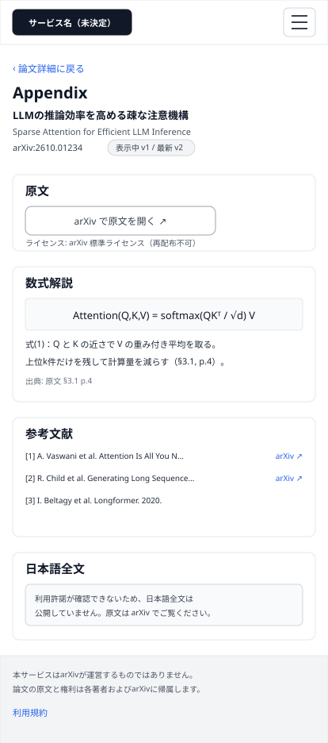
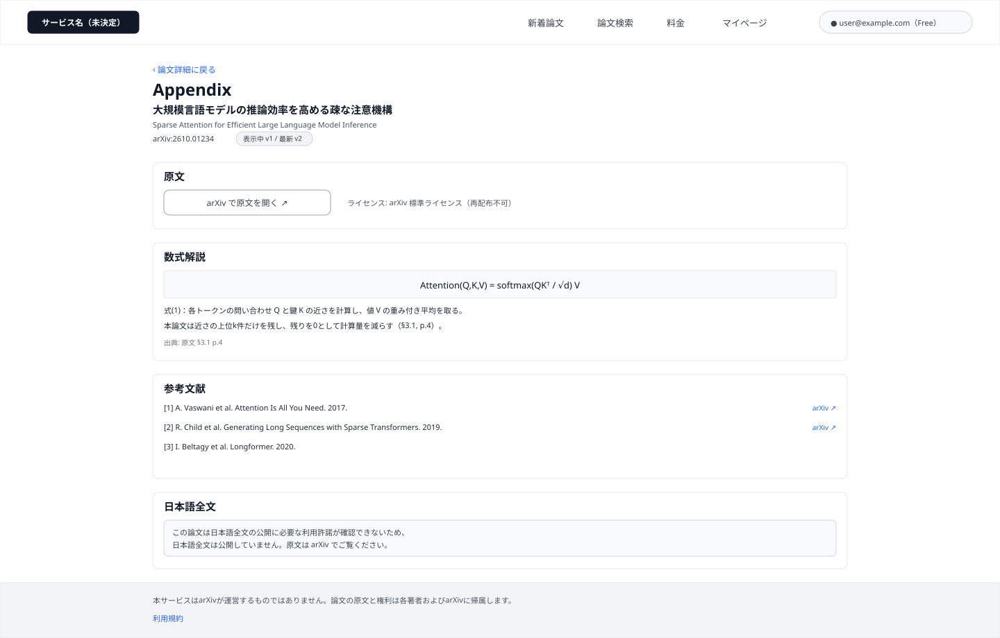
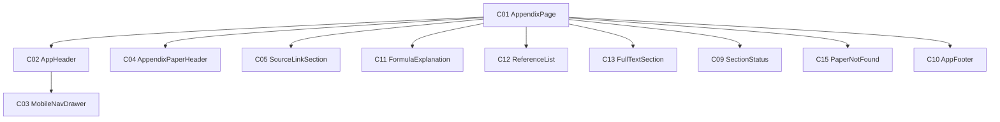

# P105 Appendix

## 0. 文書情報

| 項目 | 値 |
| :--- | :--- |
| 設計書ID | P105 |
| 親設計書 | `基本設計書_概要.md` §3 画面一覧 |
| 版 | 1.0（新規作成） |
| 作成日 | 2026-10-26 |
| 更新日 | 2026-10-26 |
| 作成方法 | `source/` 配下の企画資料と `docs/基本設計書_概要.md` からのリバースエンジニアリング（creating-screen-design v1.9.0 準拠） |
| 対象チャネル | モバイル（幅414）／デスクトップ（幅1440） |
| インプットの性質 | `source/` にあるのは企画・初期設計案のMarkdown 6ファイルだけで、本画面のソースコード（ページ・コンポーネント・ルーティング定義）は存在しない（`source/README.md:5-10`、上流 §前提）。そのため本書の画面項目・イベント・コンポーネントは、企画資料の定義行（`source/01_企画概要.md:28`）と上流の基本設計書（概要）の定義（§1 用語集「Appendix」、§2 BF02・BF05・EX03・EX04、§3 共通ルール・レイアウト構造、§4 F05、§6 T002、§7 API03・IF03、§11 ARC005・ARC009）から導いた**計画上の実体**であり、実装済みであることは意味しない。資料に書かれていない値は※推測と明記する。本画面の主な中身（数式解説・参考文献・日本語全文）を返す API と保存先のテーブルは上流に定義が無く、本書ではそれを※上流未定義として扱う。共通ヘッダー・フッター・状態表示・論文が見つからない表示は P101〜P104 の画面基本設計書と同じ部品を使う前提で、本画面での表示仕様を改めて記述する |

## 1. 画面概要
| 項目 | 内容 |
| :--- | :--- |
| 画面ID | P105 |
| 画面名 | Appendix |
| パス | `/papers/{arxivId}/appendix`（※推測。上流 §3.1・上流 付録 Q03 の仮置きをそのまま引き継ぐ）。`{arxivId}` は arXiv が論文ごとに付ける識別子 |
| 概要 | 1本の論文について、原文へのリンク、数式解説、参考文献、利用許諾が確認できた論文に限った日本語全文をまとめて表示する詳細ページ（`source/01_企画概要.md:28`、上流 §1 用語集・§3.1）。要約（P104）より深く読みたい利用者が、必要なときだけ原文や数式・実験条件まで掘り下げられるようにする（`source/01_企画概要.md:13`）。日本語全文は論文ごとのライセンスで公開の可否を決め、許諾が確認できない論文では公開しない（`source/02_機能要求定義.md:50`、`source/03_システム構成.md:59`、上流 ARC005） |
| アクター | ゲスト（未ログイン）、会員 Free、会員 Pro（上流 §2 ユースケース図。ゲストの閲覧可否は上流 付録 Q08 の仮置き「Appendix は利用可」に従う。プランで内容を変える定義は無い） |
| 認証要否 | 不要（上流 付録 Q08 の仮置き。上流 §7 API03「認証: 不要（※推測）」） |
| 前画面 | P104 論文詳細（「Appendix（数式解説・参考文献）」から。上流 §3 画面遷移図 P104 → P105）、ブラウザからの直接アクセス・URL の共有 ※推測 |
| 後画面 | arXiv 原文ページ（外部。上流 §3 画面遷移図 P105 → ARX、上流 IF03）、P104 論文詳細（「論文詳細に戻る」から ※推測。上流の画面遷移図に P105 → P104 の線は無いが、戻る導線として置く）。ほかに、参考文献のリンク先（外部 ※上流未定義）、共通ヘッダー・フッターから P101・P102・P103・P106・P107、ログイン・会員登録画面（※上流未定義。上流 付録 Q04）、利用規約ページ（※上流未定義） |
| 対応ソースファイル | なし（実装未着手）。定義の出典は `source/01_企画概要.md:13,28,33-37`、`source/02_機能要求定義.md:10,26,45,50,58`、`source/03_システム構成.md:13-14,29-31,36,59,61`。※推測: 実装時は Next.js の `app/papers/[arxivId]/appendix/page.tsx` に置く想定 |
| カラーテーマ | default（配色は資料に定義が無い。上流 付録 Q06。UI部品は shadcn/ui、スタイルは Tailwind CSS、数式は KaTeX — `source/03_システム構成.md:6,14`） |

## 2. ワイヤーフレーム

ワイヤーフレームは、上流 §3 のレイアウト構造（共通ヘッダー＋メインコンテンツ＋共通フッター、※推測）と、`source/01_企画概要.md:28` の4つの中身（原文リンク・数式解説・参考文献・日本語全文）、上流 §7 API03 の応答項目からレイアウトを推定して作図した。図は「ログイン中の Free 会員が、本文の解析は済んでいて数式解説・参考文献はあるが、利用許諾が確認できないため日本語全文は公開していない論文を開いた状態」を描いている。

### 2.1 ワイヤーフレーム（モバイル）

### 2.2 ワイヤーフレーム（デスクトップ）

### 2.3 画面レイアウト説明
* **共通ヘッダー（上端）**: 左にサービス名（H01）を置く。デスクトップでは右側に「新着論文」「論文検索」「料金」「マイページ」の導線（H02〜H05）とログイン状態（H06 または H07）を横並びにする（本画面に対応する導線は無いため、どれも選択中の見た目にしない）。モバイルではサービス名とメニューボタン（H08）だけを置き、導線とログイン状態はドロワー（C03）へ収める。切り替え幅は Tailwind CSS 標準の lg（1024px）を想定する（※推測。上流 付録 Q06）。
* **論文の見出し（ヘッダーの下）**: 「論文詳細に戻る」（H11）、ページ見出し「Appendix」（H09）、対象論文の日本語タイトル（H10）・原題（H12）・arXiv ID（H13）・版（H14）を上から積む。
* **4つの区画（見出しの下）**: 「原文」→「数式解説」→「参考文献」→「日本語全文」の順に、上から縦に積む。各区画は固定の見出し（「原文」「数式解説」「参考文献」「日本語全文」）を持つ枠で、本文幅はデスクトップ1000px、モバイルは画面幅いっぱいにする（※推測）。
  * 原文: arXiv で原文を開くボタン（H15）とライセンス表示（H16）。デスクトップは横並び、モバイルは縦に積む。
  * 数式解説: 数式を KaTeX で描画し、その下に日本語の説明と原文の章・ページを示す（H17）。数式解説が無い論文では理由（H18）を出す。
  * 参考文献: 番号付きの一覧（H19）と、各文献の右端に原文へのリンク（H20）。参考文献が無い論文では理由（H21）を出す。
  * 日本語全文: 公開できる論文では章ごとの日本語全文（H22）と AI 翻訳である旨の注記（H23）、公開できない論文では理由（H24）を出す。
* **取得中・失敗の表示**: Appendix の中身（数式解説・参考文献・日本語全文）の取得中は3つの区画をまとめて読み込み中表示（H25）にし、失敗時はエラーメッセージと再読み込みボタン（H26・H27）を出す。論文の見出しと「原文」の区画は論文情報から作るため表示を続ける（上流 EX04、`source/02_機能要求定義.md:58`）。
* **論文が見つからないとき**: 論文情報そのものが取れないときは、メインコンテンツ全体を「論文が見つからない」表示（H28・H29）に置き換える。
* **共通フッター（下端）**: arXiv との関係の注記（H30）と利用規約へのリンク（H31）を置く（上流 §3 レイアウト構造 ※推測）。
* 図には、H06・H18・H21〜H23・H25〜H29 が出る状態は描いていない。

## 3. UI構成・コンポーネント定義

### 3.1 コンポーネントツリー

### 3.2 コンポーネント一覧

**総件数: 11件。全数である根拠**: 本画面のソースコードは無いため、コンポーネント名はすべて※推測（実装時の命名案）である。数え方は、`source/01_企画概要.md:28` の4つの中身を1区画1部品（原文 → C05、数式解説 → C11、参考文献 → C12、日本語全文 → C13）、対象論文を示す見出し（C04）、上流 EX04 が求める状態表示（C09）、上流 §7 API03 の 404 に対応する表示（C15）、上流 §3 レイアウト構造の共通ヘッダー・フッター（C02・C10）とモバイル幅の導線の収納先（C03）、それらを束ねるページ（C01）とした。コンポーネントIDは画面ごとの採番である。P101〜P104 と同じ部品を使う C02・C03・C09・C10 と、P104 と同じ部品を使う C15（論文が見つからない表示）は同じ番号にそろえた。C01・C04・C05・C11〜C13 は本画面固有の部品で、他画面の同じ番号の部品とは別物である。C06〜C08・C14・C16 は他画面の部品の番号のため本画面では欠番にした。

| コンポーネントID | コンポーネント名 | 種別 | 含む項目ID | Props | 内部State | 役割・概要 | 定義状況 | 詳細の所在 |
| :--- | :--- | :--- | :--- | :--- | :--- | :--- | :--- | :--- |
| C01 | AppendixPage | Page | — | パスの arXiv ID（※推測） | 論文情報の取得状態と結果、Appendix の中身の取得状態と結果（※推測） | Appendix 画面全体。開いたときに論文情報と Appendix の中身を並行して取得し（E01）、結果を各区画へ渡す。論文情報が取れなければメインコンテンツ全体を C15 に置き換える | 詳細 | §5 E01、§7 |
| C02 | AppHeader | Layout | H01〜H08 | ログイン状態、利用者の表示名とプラン（※推測） | - | 全画面共通のヘッダー。サービス名と主要画面への導線、ログイン状態を表示する。本画面ではどの導線も選択中の見た目にしない | 詳細 | §4 H05〜H08 |
| C03 | MobileNavDrawer | UI | H02〜H07 | 開閉状態、ログイン状態（※推測） | - | モバイル幅でメニューボタン（H08）を押したときに開くドロワー。デスクトップでヘッダーに並ぶ導線とログイン状態を縦並びで表示する | 詳細 | §5 E13・E14 |
| C04 | AppendixPaperHeader | UI | H09〜H14 | 論文情報（日本語タイトル、原題、arXiv ID、表示中の版、最新版）（※推測） | - | どの論文の Appendix かを示す見出し。論文詳細へ戻る導線を持つ | 簡易 | §4 H09〜H14 |
| C05 | SourceLinkSection | UI | H15,H16 | 原文URL、ライセンス種別（※推測） | - | 「原文」の区画。arXiv の原文ページへの導線と、日本語全文の公開可否を決めるライセンスを示す | 詳細 | §4 H15・H16、§5 E03 |
| C11 | FormulaExplanation | UI | H17,H18 | 数式解説の配列（数式、日本語の説明、出典の章・ページ）、本文取得状況（※推測） | - | 「数式解説」の区画。数式を KaTeX で描画し、日本語の説明と原文の章・ページを添える。数式解説が無い論文では理由を示す | 詳細 | §4 H17・H18、§7 |
| C12 | ReferenceList | UI | H19〜H21 | 参考文献の配列（番号、著者、タイトル、年、リンク先）、本文取得状況（※推測） | - | 「参考文献」の区画。原文の参考文献を番号付きで並べ、リンク先がある文献には原文へのリンクを付ける。参考文献が無い論文では理由を示す | 詳細 | §4 H19〜H21、§5 E04 |
| C13 | FullTextSection | UI | H22〜H24 | 日本語全文（章ごとの見出しと本文）、公開できるかどうかとその理由（※推測） | - | 「日本語全文」の区画。利用許諾が確認でき、翻訳が済んでいる論文だけ全文を出し、AI 翻訳である旨を添える。公開できない論文では理由を示す | 詳細 | §4 H22〜H24、§7 |
| C09 | SectionStatus | UI | H25〜H27 | 取得状態（取得中／失敗）、再読み込み時の処理（※推測） | - | Appendix の中身（数式解説・参考文献・日本語全文）の位置に出す取得中・失敗の表示。再読み込みで中身だけを取り直す | 詳細 | §4 H25〜H27、§5 E05 |
| C15 | PaperNotFound | UI | H28,H29 | 失敗の種類（論文なし／取得失敗）（※推測） | - | 論文情報が取れないときに、メインコンテンツ全体を置き換えて理由とホームへの導線を示す（P104 と同じ部品） | 詳細 | §4 H28・H29、§5.1 様式③ |
| C10 | AppFooter | Layout | H30,H31 | - | - | 全画面共通のフッター。arXiv との関係を誤解させない注記と利用規約への導線を表示する | 簡易 | §4 H30・H31 |

## 4. 画面項目定義

**総件数: 31件。全数である根拠**: 本画面のソースコードは無いため、次の定義を1要素1項目として数えた。共通ヘッダーの構成（上流 §3 レイアウト構造 → H01〜H07、モバイル幅の収納先の開閉 → H08）、論文の見出し（ページ名 → H09、上流 §7 API03 応答の日本語タイトル・原題・arXiv ID・表示中の版・最新版 → H10・H12〜H14、P104 へ戻る導線 → H11）、原文（`source/01_企画概要.md:28`「原文へのリンク」と上流 IF03 → H15、上流 §7 API03 応答のライセンス種別と ARC005 → H16）、数式解説（`source/01_企画概要.md:28`「数式解説」→ H17、上流 BF02 の「本文の利用が許可されていなければ解析しない」→ H18）、参考文献（`source/01_企画概要.md:28`「参考文献」→ H19・H20、同じく H21）、日本語全文（`source/01_企画概要.md:28`「許諾に応じた日本語全文」→ H22、`source/01_企画概要.md:33` の事実と AI の区別 → H23、`source/02_機能要求定義.md:50` と上流 EX03 → H24）、状態の表示（上流 EX04 → H25〜H27、上流 §7 API03 の 404・500 → H28・H29）、共通フッター（上流 §3 レイアウト構造 → H30・H31）。区画の見出し（「原文」「数式解説」「参考文献」「日本語全文」）は固定文言で、それぞれの区画の項目の一部として扱い、別の項目に数えない。入力項目は0件。

| 項目ID | 項目名 | WF | 種別 | 必須 | データ型 | 制約・初期値 | 表示条件 | 備考 | 定義状況 | 詳細の所在 |
| :--- | :--- | :--- | :--- | :--- | :--- | :--- | :--- | :--- | :--- | :--- |
| H01 | サービス名（ロゴ） | D,M | リンク | - | string | 正式名称が未決定のため仮表記（候補: Arclia / Paprism / Curion — `source/05_ネーミング候補.md:4-6`、上流 付録 Q01） | 常時表示 | 押すと P101 ホームへ（E07）。全画面共通ヘッダーの一部 | 簡易 | 本表 |
| H02 | ナビ「新着論文」 | D | リンク | - | string | 固定文言「新着論文」 | デスクトップ幅では常時表示。モバイル幅ではメニュー（H08）を開いたときだけドロワー内に表示 | 押すと P102 へ（E08） | 簡易 | 本表 |
| H03 | ナビ「論文検索」 | D | リンク | - | string | 固定文言「論文検索」 | デスクトップ幅では常時表示。モバイル幅ではメニュー（H08）を開いたときだけドロワー内に表示 | 押すと P103 へ（E09） | 簡易 | 本表 |
| H04 | ナビ「料金」 | D | リンク | - | string | 固定文言「料金」 | デスクトップ幅では常時表示。モバイル幅ではメニュー（H08）を開いたときだけドロワー内に表示 | 押すと P107 へ（E10） | 簡易 | 本表 |
| H05 | ナビ「マイページ」 | D | リンク | - | string | 固定文言「マイページ」 | ログイン中のときだけ表示（モバイル幅ではメニューを開いたときだけドロワー内に表示）。未ログインのときは出さない ※推測 | 押すと P106 へ（E11）。マイページは本人のデータを扱うため、未ログインでは導線自体を出さない ※推測 | 詳細 | §5 E11 |
| H06 | ログインボタン | — | ボタン | - | string | 固定文言「ログイン」 | 未ログインのときだけ表示（モバイル幅ではドロワー内）。ログイン中は H07 に置き換わる | 押すとログイン・会員登録画面へ（E12）。ログイン画面は※上流未定義（上流 付録 Q04）。図はログイン中の状態のため描いていない | 詳細 | §5 E12 |
| H07 | ログイン中の利用者表示 | D | 表示 | - | string | 利用者を見分ける表示（メールアドレスまたは表示名 ※推測）と、契約プラン（Free / Pro）を並べて表示 | ログイン中のときだけ表示（モバイル幅ではドロワー内）。未ログインのときは H06 に置き換わる | プランは利用者テーブルのプラン区分（T005 users.plan）の値 ※推測。ログイン状態は画面を開いたときに Supabase Auth のセッションから確かめる（上流 IF05） | 詳細 | §5 E01 |
| H08 | メニューボタン | M | ボタン | - | - | 初期状態はドロワーが閉じた状態 | モバイル幅（lg 1024px 未満 ※推測）のときだけ表示。デスクトップ幅では導線がヘッダーに並ぶため出さない | 押すたびにドロワー（C03）を開閉する（E13） | 詳細 | §5 E13 |
| H09 | ページ見出し | D,M | 表示 | - | string | 固定文言「Appendix」 | 論文情報が取れたときに表示 | — | 簡易 | 本表 |
| H10 | 日本語タイトル | D,M | 表示 | - | string | AI が生成した日本語タイトル。要約が未公開で日本語タイトルが無い論文では原題を表示する（P104 H09 と同じ扱い） | 論文情報が取れたときに表示 | どの論文の Appendix かを示す | 詳細 | 本表 |
| H11 | 論文詳細に戻る | D,M | リンク | - | string | 固定文言「‹ 論文詳細に戻る」 | 論文情報が取れたときに表示 | 押すと同じ論文の P104 へ（E02）。上流の画面遷移図に P105 → P104 の線は無いが、要約と行き来するための導線として置く ※推測 | 簡易 | 本表 |
| H12 | 原題 | D,M | 表示 | - | string | arXiv 上の英語タイトルをそのまま表示 | 日本語タイトルがある論文のときだけ H10 の下に併記する。日本語タイトルが無いときは H10 が原題を表示するため重ねて出さない | 日本語タイトルには原題を併記する決まり（`source/02_機能要求定義.md:23`） | 詳細 | 本表 |
| H13 | arXiv ID | D,M | 表示 | - | string | 「arXiv:」に続けて arXiv ID を表示（例 arXiv:2610.01234） | 論文情報が取れたときに表示 | — | 簡易 | 本表 |
| H14 | 版 | D,M | 表示 | - | string | 「表示中 vN / 最新 vM」の形。同じ版のときは「v N（最新）」とだけ出す ※推測 | 論文情報が取れたときに表示 | 数式解説・参考文献・日本語全文がどの版の本文から作られたかを示す。改訂版を区別する決まり（`source/01_企画概要.md:37`、上流 ARC009） | 詳細 | 本表 |
| H15 | arXiv で原文を開く | D,M | リンク | - | string | 固定文言「arXiv で原文を開く ↗」。行き先は論文情報の原文URL | 論文情報が取れたときに表示（日本語全文の公開可否にかかわらず常に出す） | arXiv の原文ページを新しいタブで開く（E03、上流 IF03、上流 §3 画面遷移図 P105 → ARX）。日本語全文を公開できない論文では、原文を読む唯一の導線になる | 簡易 | 本表 |
| H16 | ライセンス表示 | D,M | 表示 | - | string | 「ライセンス:」に続けて論文のライセンス種別を利用者向けの名称で表示する（例「arXiv 標準ライセンス（再配布不可）」「CC BY 4.0」。名称と値の対応は※推測）。ライセンス種別が空のときは「ライセンス: 確認中」 | 論文情報が取れたときに表示 | 日本語全文の公開可否を決める根拠を利用者に示す（上流 T002 license_type、ARC005）。ライセンス種別の取りうる値は上流で未定義（※上流要確認） | 詳細 | §7 |
| H17 | 数式解説 | D,M | 表示 | - | array | 区画の見出し「数式解説」の下に、論文の主要な数式ごとに、KaTeX で描画した数式、日本語の説明、「出典: 原文 §章 p.ページ」を1組として並べる。並び順は原文に出てくる順（※推測） | Appendix の中身が取れ、その論文に数式解説が1件以上あるときに表示する | 数式は HTML として埋め込まず KaTeX で描画し、外部由来の文字列からスクリプトが動かないようにする（上流 §8 XSS 対策 ※推測）。数式解説は本文を解析した論文だけにある（上流 BF02・B005）。中身を返す API と保存先は※上流未定義 | 詳細 | §7 |
| H18 | 数式解説なしの案内 | — | 表示 | - | string | 本文が未取得の論文は「この論文は本文を取得していないため、数式解説はありません。」、本文は取得済みで数式が無い論文は「この論文には解説の対象となる数式がありません。」（文言は※推測） | Appendix の中身が取れ、数式解説が0件のときだけ、H17 の代わりに表示する | 本文の解析は、ライセンスで許された人気論文・リクエストされた論文だけが対象（上流 ARC002・ARC005、B005） | 詳細 | §7 |
| H19 | 参考文献一覧 | D,M | 一覧 | - | array | 区画の見出し「参考文献」の下に、原文の参考文献を「[番号] 著者. タイトル. 年.」の形で原文と同じ順に並べる。著者が4名以上のときは「先頭の著者 et al.」とまとめる（※推測） | Appendix の中身が取れ、その論文の参考文献が1件以上あるときに表示する | 参考文献は本文を解析した論文だけにある（上流 BF02「章・ページ・数式・参考文献を抽出」、`source/03_システム構成.md:13`）。中身を返す API と保存先は※上流未定義 | 詳細 | §7 |
| H20 | 参考文献のリンク | D,M | リンク | - | string | 「arXiv ↗」（参考文献が arXiv の論文のとき）または「原文 ↗」（それ以外でリンク先があるとき）（※推測） | H19 の各文献のうち、リンク先（arXiv ID または URL）が分かった文献の右端にだけ表示する | 押すとリンク先を新しいタブで開く（E04）。リンク先の出どころ（PDF 解析で取れるか）は上流で未定義（※上流未定義） | 詳細 | §5 E04 |
| H21 | 参考文献なしの案内 | — | 表示 | - | string | 本文が未取得の論文は「この論文は本文を取得していないため、参考文献を表示できません。原文でご確認ください。」、本文は取得済みで参考文献が取れなかった論文は「参考文献を取り出せませんでした。原文でご確認ください。」（文言は※推測） | Appendix の中身が取れ、参考文献が0件のときだけ、H19 の代わりに表示する | — | 詳細 | §7 |
| H22 | 日本語全文 | — | 表示 | - | array | 区画の見出し「日本語全文」の下に、原文の章ごとに日本語の章見出しと本文を並べる。数式は KaTeX で描画する | ライセンスで全文翻訳の公開が許されていて、かつ日本語全文の翻訳が済んでいる論文のときだけ表示する | 全文翻訳は Phase 3 の機能（上流 §4 F05「全文翻訳は Phase 3」、`source/04_収益化とロードマップ.md:38`）。それまではすべての論文で H24 を出す。中身を返す API と保存先は※上流未定義。図は非公開の状態のため描いていない | 詳細 | §7 |
| H23 | AI 翻訳の注記 | — | 表示 | - | string | 固定文言「この日本語全文は AI が翻訳したものです。内容の正確さは原文をご確認ください。」（文言は※推測） | H22 と同じ条件で、H22 の先頭に表示する | 研究の事実と AI の手による内容を取り違えさせない編集方針（`source/01_企画概要.md:33`）を全文にも当てはめる ※推測 | 詳細 | §7 |
| H24 | 日本語全文の非公開案内 | D,M | 表示 | - | string | 利用許諾が確認できない論文は「この論文は日本語全文の公開に必要な利用許諾が確認できないため、日本語全文は公開していません。原文は arXiv でご覧ください。」、許諾はあるが翻訳がまだの論文は「この論文の日本語全文は準備中です。原文は arXiv でご覧ください。」（文言は※推測） | Appendix の中身が取れ、H22 を出す条件を満たさないときだけ、H22 の代わりに表示する | 利用可能な権利の確認なしに全文翻訳を一般公開しない（`source/03_システム構成.md:59`、`source/02_機能要求定義.md:50`、上流 EX03・ARC005） | 詳細 | §7 |
| H25 | 読み込み中表示 | — | 表示 | - | - | 区画の形をした灰色の枠（スケルトン）を、数式解説・参考文献・日本語全文の3区画の位置に表示 | Appendix の中身の取得の応答を待っている間だけ表示する（開いたとき、再読み込みのとき）。論文情報の取得中は見出しと原文の区画の位置にも同じ形の枠を出す ※推測 | — | 詳細 | §5 E01・E05 |
| H26 | Appendix エラーメッセージ | — | 表示 | - | string | 文言は §5.1 の様式②の詳細のとおり | Appendix の中身の取得が失敗したときだけ、数式解説・参考文献・日本語全文の3区画の代わりに表示する | 失敗を中身の領域に閉じ込め、論文の見出しと原文への導線は使える状態を保つ（上流 EX04） | 詳細 | §5.1 |
| H27 | 再読み込みボタン | — | ボタン | - | string | 固定文言「再読み込み」 | H26 と同じ条件で、H26 の下に表示する | 押すと Appendix の中身だけを取り直す（E05） | 詳細 | §5 E05 |
| H28 | 論文が見つからない表示 | — | 表示 | - | string | 論文が無いとき「お探しの論文は見つかりませんでした。URL をご確認ください。」、論文情報の取得に失敗したとき「論文の情報を読み込めませんでした。時間をおいて再度お試しください。」（文言は※推測。P104 H41 と同じ） | 論文情報の取得で、該当論文なし（404）または失敗（500・通信失敗）が返ったときだけ、メインコンテンツ全体の代わりに表示する | 様式③。ヘッダーとフッターは表示を続ける | 詳細 | §5.1 |
| H29 | ホームへ戻るリンク | — | リンク | - | string | 固定文言「ホームに戻る」 | H28 と同じ条件で、H28 の下に表示する | 押すと P101 へ（E06） | 簡易 | 本表 |
| H30 | arXivとの関係の注記 | D,M | 表示 | - | string | 固定文言「本サービスはarXivが運営するものではありません。論文の原文と権利は各著者およびarXivに帰属します。」（文言は※推測） | 常時表示 | arXiv と本サービスの関係を誤解させない表記にする決まり（`source/03_システム構成.md:61`、上流 ARC009）。日本語全文を載せる本画面では、原文の権利が著者と arXiv にあることを示す意味も持つ | 簡易 | 本表 |
| H31 | 利用規約リンク | D,M | リンク | - | string | 固定文言「利用規約」 | 常時表示 | 押すと利用規約ページへ（E15）。利用規約ページは※上流未定義 | 簡易 | 本表 |

## 5. イベント定義

**総件数: 15件。全数である根拠**: 画面を開いたときの論文情報と Appendix の中身の取得（上流 BF05「Appendix を開く → 原文リンク・数式解説・参考文献を表示」→ E01）、§4 で種別がリンク・ボタンの項目（H01〜H06、H08、H11、H15、H20、H27、H29、H31 の13項目）それぞれの押下（→ E02〜E13・E15）を1件ずつ数え、操作対象の項目を持たないドロワー外側のタップ（→ E14）を加えた。表示だけの項目（H07、H09、H10、H12〜H14、H16〜H19、H21〜H26、H28、H30）は操作を受け付けないためイベントを持たない。本画面では閲覧イベント（T008 view_events）を記録しない（上流 BF05 で記録するのは論文詳細の要約の取得時）。

| イベントID | 発生源 | 対象項目ID | トリガー | 条件 | 処理概要 | 呼び出しAPI | 成功時の挙動 | 失敗時の挙動（様式ID + 説明） | 定義状況 | 詳細の所在 |
| :--- | :--- | :--- | :--- | :--- | :--- | :--- | :--- | :--- | :--- | :--- |
| E01 | ページ | — | ページロード | 本画面を開いたとき（P104 の「Appendix」、直接アクセス、ブラウザの戻る操作） | まずブラウザに残っているログインのセッションから、ログイン中かどうかと利用者の表示名・プランを確かめる（Supabase Auth のセッション取得。取得できなければ未ログインとして扱う ※推測）。続いて、パスの arXiv ID で論文情報の取得と、Appendix の中身（数式解説・参考文献・日本語全文と、全文を公開できるかどうか）の取得を並行して行う。全文を公開してよいかはサーバ側がライセンスで判断し、許されない論文の全文は応答に含めない（上流 ARC005 ※推測） | GET /api/papers/{arxivId}（API03）、Appendix の中身の取得（※上流未定義。上流 §7 に API が無い） | 論文情報で見出し（H09〜H14）と原文の区画（H15・H16）を描画し、中身で数式解説（H17 または H18）、参考文献（H19・H20 または H21）、日本語全文（H22・H23 または H24）を描画する | 様式③: 論文情報が該当なし（404）または失敗（500・通信失敗）のときは、メインコンテンツ全体を H28・H29 に置き換え、中身の結果は捨てる。様式②: 論文情報は取れて中身だけが失敗したときは、3区画の位置に「Appendix を読み込めませんでした。」と再読み込みボタンを表示する。セッション取得の失敗はエラー表示せず未ログインとして扱う ※推測 | 詳細 | 本表、§5.1 |
| E02 | 論文詳細に戻る | H11 | Click | 論文情報が取れているとき | 同じ論文の詳細画面へ移る | なし | P104（`/papers/{arxivId}` ※推測）へ遷移 | 該当様式なし（API を呼ばない画面遷移のため、本画面で起きるエラーは無い） | 簡易 | 本表 |
| E03 | arXiv で原文を開く | H15 | Click | 論文情報が取れているとき | 論文情報の原文URL（arXiv の論文ページ）を新しいタブで開く。本画面はそのまま残す | なし（上流 IF03。利用者のブラウザが直接開く） | arXiv の原文ページが新しいタブで開く | 該当様式なし（API を呼ばない外部リンクのため、本画面で起きるエラーは無い） | 簡易 | 本表 |
| E04 | 参考文献のリンク | H20 | Click | H20 が表示されているとき | 参考文献のリンク先（arXiv の論文ページ、または文献の URL）を新しいタブで開く。本画面はそのまま残す | なし（利用者のブラウザが直接開く） | 参考文献の原文ページが新しいタブで開く | 該当様式なし（API を呼ばない外部リンクのため、本画面で起きるエラーは無い） | 簡易 | 本表 |
| E05 | 再読み込みボタン | H27 | Click | Appendix の中身の取得が失敗して H27 が表示されているとき | Appendix の中身だけを取り直す。取り直している間は3区画の位置に読み込み中表示（H25）を出す。論文の見出しと原文の区画はそのまま残す | Appendix の中身の取得（※上流未定義） | 数式解説・参考文献・日本語全文を描画する | 様式②: 再び失敗したときは同じエラーメッセージと再読み込みボタンを表示し直す（回数の上限は設けない ※推測） | 詳細 | 本表、§5.1 |
| E06 | ホームへ戻るリンク | H29 | Click | H29 が表示されているとき | ホーム画面へ移る | なし | P101 へ遷移 | 該当様式なし（API を呼ばない画面遷移のため、本画面で起きるエラーは無い） | 簡易 | 本表 |
| E07 | サービス名（ロゴ） | H01 | Click | 常時 | ホーム画面へ移る | なし | P101 へ遷移 | 該当様式なし（API を呼ばない画面遷移のため、本画面で起きるエラーは無い） | 簡易 | 本表 |
| E08 | ナビ「新着論文」 | H02 | Click | 常時（モバイル幅ではドロワーを開いているとき） | 新着論文一覧へ移る。モバイル幅ではドロワーを閉じてから移る | なし | P102 へ遷移 | 該当様式なし（API を呼ばない画面遷移のため、本画面で起きるエラーは無い） | 簡易 | 本表 |
| E09 | ナビ「論文検索」 | H03 | Click | 常時（モバイル幅ではドロワーを開いているとき） | 論文検索へ移る。モバイル幅ではドロワーを閉じてから移る | なし | P103 へ遷移 | 該当様式なし（API を呼ばない画面遷移のため、本画面で起きるエラーは無い） | 簡易 | 本表 |
| E10 | ナビ「料金」 | H04 | Click | 常時（モバイル幅ではドロワーを開いているとき） | 料金画面へ移る。モバイル幅ではドロワーを閉じてから移る | なし | P107 へ遷移 | 該当様式なし（API を呼ばない画面遷移のため、本画面で起きるエラーは無い） | 簡易 | 本表 |
| E11 | ナビ「マイページ」 | H05 | Click | ログイン中のとき（H05 が表示されているとき） | マイページへ移る。モバイル幅ではドロワーを閉じてから移る | なし | P106 へ遷移 | 該当様式なし（API を呼ばない画面遷移のため、本画面で起きるエラーは無い。セッション切れの扱いは遷移先 P106 の責務） | 簡易 | 本表 |
| E12 | ログインボタン | H06 | Click | 未ログインのとき（H06 が表示されているとき） | ログイン・会員登録の画面へ移る。ログイン後は本画面へ戻す ※推測 | なし（ログイン処理は遷移先で Supabase Auth を使う。上流 IF05） | ログイン・会員登録画面へ遷移（※上流未定義。上流 付録 Q04） | 該当様式なし（API を呼ばない画面遷移のため、本画面で起きるエラーは無い） | 詳細 | §5 遷移先ロースター |
| E13 | メニューボタン | H08 | Click | モバイル幅のとき | ドロワーが閉じていれば開き、開いていれば閉じる（外側を押して閉じる操作は E14） | なし | ドロワー（C03）に H02〜H07 を表示する／閉じる | 該当様式なし（画面内の表示切替だけで、エラーは起きない） | 詳細 | 本表 |
| E14 | ページ（モバイルのドロワー表示中） | — | Click（タップ） | モバイル幅でドロワー（C03）が開いているとき | ドロワーの外側（半透明の背景部分）を押すと、遷移せずにドロワーを閉じる（※推測） | なし | ドロワーを閉じ、元の画面表示に戻る | 該当様式なし（画面内の表示切替だけで、エラーは起きない） | 簡易 | 本表 |
| E15 | 利用規約リンク | H31 | Click | 常時 | 利用規約のページへ移る | なし | 利用規約ページへ遷移（※上流未定義） | 該当様式なし（API を呼ばない画面遷移のため、本画面で起きるエラーは無い） | 簡易 | 本表 |

**遷移先ロースター**（総件数: 10件。全数である根拠: 上表で遷移・外部リンクを伴うイベント E02〜E04・E06〜E12・E15 の行き先を重複を除いて数えた。上流 §3 画面遷移図の P105 から出る1本 ― arXiv 原文ページ ― を含み、ほかに論文詳細へ戻る P104、参考文献のリンク先、共通ヘッダー・フッターからの P101・P102・P103・P106・P107、上流に画面定義の無い2件がある。P101 はロゴと「ホームに戻る」の両方から行けるが1件として数える）

| No | 遷移先画面ID | 遷移先画面名 | 契機イベントID | 概要 | 定義状況 | 詳細の所在 |
| :--- | :--- | :--- | :--- | :--- | :--- | :--- |
| 1 | IF03 | arXiv 原文ページ（外部） | E03 | arXiv の論文ページを新しいタブで開く（上流 §3 画面遷移図 P105 → ARX、上流 IF03） | 簡易 | 上流 `基本設計書_概要.md` §7「IF03 arXiv 原文ページ」 |
| 2 | P104 | 論文詳細 | E02 | 同じ論文の要約へ戻る（※上流要確認: 上流の画面遷移図に P105 → P104 の線は無い） | 簡易 | `screens/画面.P104.画面基本設計.md` |
| 3 | — ※上流未定義 | 参考文献のリンク先（外部） | E04 | 参考文献の arXiv ページまたは文献の URL を新しいタブで開く。上流の外部IF一覧に定義が無い | 簡易 | - |
| 4 | P101 | ホーム | E06, E07 | ロゴ、または論文が見つからないときの「ホームに戻る」からホームへ移る | 簡易 | `screens/画面.P101.画面基本設計.md` |
| 5 | P102 | 新着論文 | E08 | 日付・カテゴリで新着論文を絞り込む一覧へ移る | 簡易 | `screens/画面.P102.画面基本設計.md` |
| 6 | P103 | 論文検索 | E09 | キーワード・著者・カテゴリで検索する画面へ移る | 簡易 | `screens/画面.P103.画面基本設計.md` |
| 7 | P107 | 料金 | E10 | Free と Pro を比べる画面へ移る | 簡易 | `screens/画面.P107.画面基本設計.md`（未作成） |
| 8 | P106 | マイページ | E11 | 関心分野・ブックマークを扱う画面へ移る | 簡易 | `screens/画面.P106.画面基本設計.md`（未作成） |
| 9 | — ※上流未定義 | ログイン・会員登録画面 | E12 | Supabase Auth でログイン・会員登録を行う画面へ移る。画面としての定義が上流に無い（上流 付録 Q04） | 詳細 | §5 E12 |
| 10 | — ※上流未定義 | 利用規約ページ | E15 | 利用規約を表示するページへ移る。画面としての定義が上流に無い | 簡易 | - |

**呼出APIロースター**（総件数: 3件。全数である根拠: 上表で「呼び出しAPI」列に現れる API と、E01 のセッション取得で使う外部IFを重複を除いて数えた。上流 §7 内部API一覧の全8件のうち、API03 以外は本画面からは呼ばない。外部リンクの IF03 は API 呼び出しではないため遷移先ロースターに載せた）

| No | 上流ID | メソッド・対象 | 概要 | 呼び出すイベントID | 認証 | 定義状況 | 詳細の所在 |
| :--- | :--- | :--- | :--- | :--- | :--- | :--- | :--- |
| 1 | API03 | GET /api/papers/{arxivId} | 論文1本のメタデータ・表示中の版・最新版・原文URL・ライセンス種別・本文取得状況を取得する | E01 | 不要（※推測。上流 §7 API03） | 詳細 | 上流 `基本設計書_概要.md` §7「GET /api/papers/{arxivId}」 |
| 2 | — ※上流未定義 | Appendix の中身の取得（メソッド・パスは上流で未定義。本書では仮のパスを置かない） | 数式解説・参考文献・日本語全文と、日本語全文を公開できるかどうか（できないときはその理由）を取得する。全文の公開可否はサーバ側がライセンスで判断する | E01, E05 | 不要（※推測） | 詳細 | -（上流 §7 に追加が必要。§7 確認事項） |
| 3 | IF05 | Supabase Auth（セッション取得） | ブラウザに残るログインのセッションから、ログイン中かどうかと利用者を確かめる | E01 | — | 簡易 | 上流 `基本設計書_概要.md` §7「IF05 Supabase Auth」 |

### 5.1 エラー表示様式定義

| 様式ID | 様式名 | 表示方法 | 使用コンポーネント | 使用場面 | ユーザー操作 |
| :--- | :--- | :--- | :--- | :--- | :--- |
| 様式① | ポップアップ表示 | モーダルダイアログで画面中央にエラーメッセージを表示 | ErrorModal | 該当なし（本画面には会員向けの操作や状態を変える操作が無く、失敗は中身の領域に閉じ込めるため、ポップアップは使わない） | 該当なし |
| 様式② | 画面上部表示 | 【本画面での読み替え】標準の「画面上部（ヘッダー直下）に赤色バー」ではなく、Appendix の中身の位置（原文の区画の直下、数式解説・参考文献・日本語全文の3区画を表示する位置）に赤色の帯でメッセージと再読み込みボタンを表示する。論文の見出しと原文の区画は表示・操作を続けられる（上流 EX04「要約欄だけに処理状況と再読み込みを表示し、他の領域は表示を続ける」に合わせた本画面での表示位置。P101〜P104 と同じ読み替え） | SectionStatus（C09） | Appendix の中身の取得（※上流未定義の API）の通信失敗、サーバーエラー（500） | 「再読み込み」ボタン（H27）で中身だけを取り直す。成功すればメッセージは消える |
| 様式③ | 全画面エラー | 専用のエラーページに画面全体を切り替えて表示。本画面では、エラーページが上流に定義されていないため（上流 付録 Q04）、ヘッダーとフッターを残したままメインコンテンツ全体を置き換えて表示する ※推測（P104 と同じ扱い） | PaperNotFound（C15） | 論文情報API（API03）が該当なし（404。存在しない arXiv ID の URL）、またはサーバーエラー（500）・通信失敗を返したとき | 「ホームに戻る」（H29）でホームへ移る。ブラウザの再読み込みで開き直せる |
| 様式④ | 入力欄下表示 | 対象の入力フィールド直下に赤文字でインラインエラーを表示 | フォームバリデーション | 該当なし（本画面に入力項目が無い） | 該当なし |

**この画面で使用するエラー様式の詳細**:

| 様式ID | エラー発生条件 | エラーメッセージ文言 | 補足（遷移先・復帰手順） |
| :--- | :--- | :--- | :--- |
| 様式② | 画面を開いたとき（E01）または再読み込み（E05）で、Appendix の中身の取得が 500 を返した、または通信できなかったとき | 「Appendix を読み込めませんでした。時間をおいて再読み込みしてください。」（文言は※推測） | 3区画の位置だけに表示する。原文への導線（H15）は使える。「再読み込み」で中身だけを取り直す |
| 様式③ | 画面を開いたとき（E01）に、論文情報API（GET /api/papers/{arxivId}）が 404 を返したとき | 「お探しの論文は見つかりませんでした。URL をご確認ください。」（文言は※推測） | 「ホームに戻る」でホームへ（E06） |
| 様式③ | 画面を開いたとき（E01）に、論文情報API が 500 を返した、または通信できなかったとき | 「論文の情報を読み込めませんでした。時間をおいて再度お試しください。」（文言は※推測） | 「ホームに戻る」でホームへ（E06）。ブラウザの再読み込みで開き直せる |

## 6. バリデーション・制約定義

該当なし（本画面には入力項目が無い。§4 の31項目は表示・リンク・ボタンだけで構成される。パスの arXiv ID の正しさはサーバ側が判断し、存在しないときは様式③で扱う）。

| 対象項目ID | 項目名 | ルール | エラーメッセージ |
| :--- | :--- | :--- | :--- |
| — | 該当なし | — | — |

## 7. 画面固有の業務ルール・注意事項

* **日本語全文はライセンスで公開を決める**: 日本語全文（H22）は、ライセンスで全文翻訳の公開が許されている論文だけに出す。許諾が無い・不明な論文では本文の解析も全文翻訳も行わず（上流 EX03）、本画面では非公開の理由（H24）と原文への導線（H15）を出す（`source/02_機能要求定義.md:50`、`source/03_システム構成.md:59`、上流 ARC005、T002 license_type）。公開してよいかの判断はサーバ側で行い、許されない論文の全文を画面に送らない（※推測: 画面側の出し分けだけに頼ると、応答を直接見れば全文が読めてしまうため）。
* **全文翻訳は Phase 3**: 日本語全文は Phase 3（AI 高機能化）の機能であり（上流 §4 F05、§10 フェーズ表）、それまでは許諾がある論文でも「準備中」の案内（H24）を出す。
* **数式解説・参考文献は本文を解析した論文だけ**: どちらも本文 PDF の解析（上流 BF02・B005）で取り出すため、本文を取得していない論文では理由（H18・H21）を出す。本文の解析は人気論文・リクエストされた論文に限ってコストを抑える（`source/04_収益化とロードマップ.md:26`、上流 ARC002）。
* **画面表示のたびに LLM を呼ばない**: 数式解説・日本語全文は事前に生成したものを表示し、画面を開くたびに LLM を呼ばない（`source/02_機能要求定義.md:45`、上流 ARC001 ※推測: 数式解説・全文翻訳も生成物として保存し使い回す前提）。
* **AI 翻訳であることを示す**: 日本語全文には AI 翻訳である旨（H23）を必ず添え、原文（H15）を正とする（`source/01_企画概要.md:33` の事実と AI の区別を全文に当てはめる ※推測）。
* **数式は KaTeX で描画する**: 数式解説・日本語全文の数式は KaTeX で描画し、HTML として直接埋め込まない（`source/03_システム構成.md:14`、上流 §8 XSS 対策 ※推測）。
* **版を取り違えさせない**: 数式解説・参考文献・日本語全文がどの版の本文から作られたかを版の表示（H14）で示す（`source/01_企画概要.md:37`、上流 ARC009）。
* **障害を中身の領域に閉じ込める**: Appendix の中身の取得に失敗しても、論文の見出しと原文への導線は表示を続ける（上流 EX04、`source/02_機能要求定義.md:58`）。論文情報そのものが取れないときだけ、メインコンテンツ全体を様式③に置き換える。
* **閲覧履歴は記録しない**: 本画面を開いただけでは閲覧イベント（T008 view_events）を記録しない（上流 BF05 で記録するのは論文詳細の要約の取得時。上流 ARC010 の最小化方針）。
* **プランによる差は無い**: 上流に Appendix をプランで制限する定義は無く、ゲスト・Free・Pro で表示内容は変わらない（上流 付録 Q08 の仮置き）。
* **上流への確認事項**（本書で新たに生じたもの）:
  * Appendix の中身（数式解説・参考文献・日本語全文と、全文を公開できるかどうか）を返す API が上流 §7 に無い（※上流未定義）。上流 付録 Q27 の追加候補にも挙がっていない。
  * 数式解説・参考文献・日本語全文の保存先テーブルが上流 §6 に無い（上流 付録 Q23 と同種の確認事項。※上流要確認）。
  * ライセンス種別（T002 license_type）の取りうる値と、どの値なら本文解析・全文翻訳の公開を許すかの対応（※上流要確認）。
  * 参考文献のリンク先（arXiv ID・URL）を本文解析で取り出すか、取り出した外部リンクを外部IF一覧に載せるか（※上流要確認）。
  * P105 → P104 の戻る導線を上流の画面遷移図に加えるか（※上流要確認）。
  * ログイン・会員登録画面と利用規約ページの画面定義（上流 付録 Q04。本画面からの遷移先として※上流未定義）。
  * 上流 §11 ARC001・ARC002・ARC004 の適用範囲に P105（ARC004 は F05）の記載が無い（※上流要確認）。

## 8. 利用する方式（共通基盤）

| 方式ID | 名称 | 本書での利用箇所 |
| :--- | :--- | :--- |
| ARC005 | ライセンス・権利ゲート | 日本語全文（H22）をライセンスで許された論文だけに出し、それ以外では非公開の理由（H24）を出す。ライセンス表示（H16）で判断の根拠を示す（E01）。上流の適用範囲「F04, F05 / B005 / T002.license_type / P105」に該当する |
| ARC009 | 表示・編集ポリシー（出典・版・日付・ブランド表記） | 版（H14）、数式解説の出典の章・ページ（H17）、フッターの arXiv との関係の注記（H30）。上流の適用範囲「P101〜P107 全画面 / API01〜API05」に該当する |
| ARC002 | 段階的生成・公開方式（速報版→詳細版） | 数式解説・参考文献は本文を解析した論文だけにあるため、無いときは理由（H18・H21）を示す（※上流要確認: 上流の適用範囲は P102・P104 で P105 の記載が無い） |
| ARC001 | 生成物キャッシュ・重複排除方式 | 数式解説・日本語全文は事前生成したものを表示し、画面を開くたびに LLM を呼ばない（E01・E05）（※上流要確認: 上流の適用範囲に画面の記載が無い） |
| ARC004 | LLM出力検証方式（事実と推測の区別） | 日本語全文に AI 翻訳である旨（H23）を添え、原文を正とする（※上流要確認: 上流の適用範囲は F04・F09・F11 で F05 の全文翻訳の記載が無い） |
