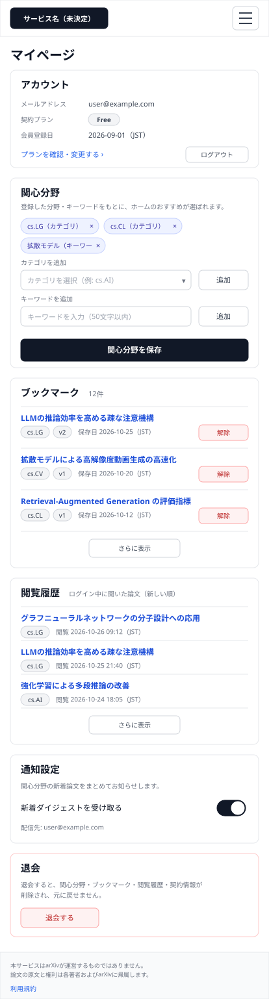
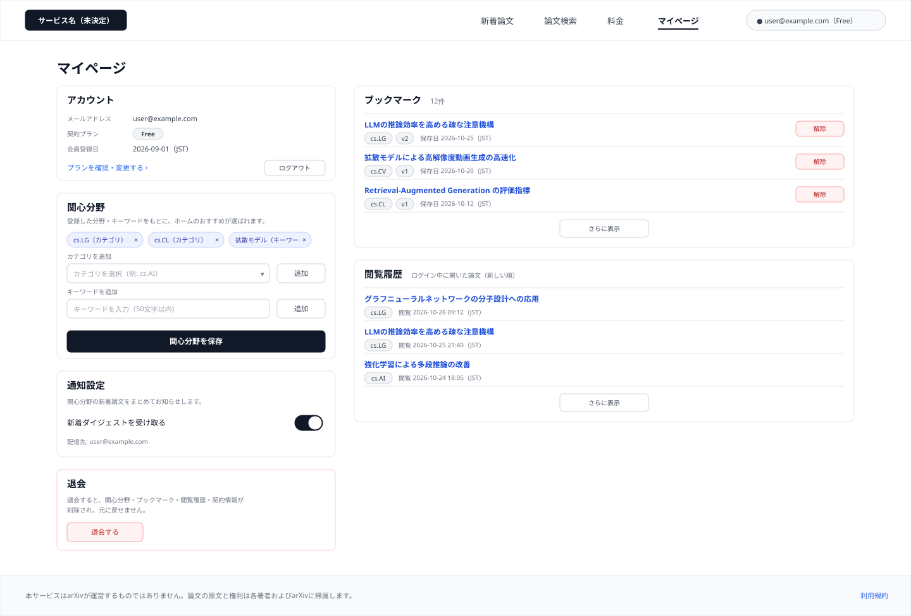
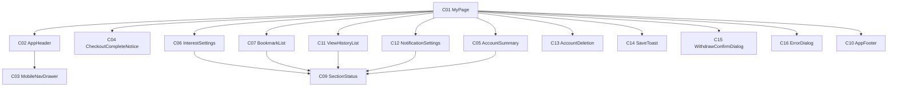

# P106 マイページ

## 0. 文書情報

| 項目 | 値 |
| :--- | :--- |
| 設計書ID | P106 |
| 親設計書 | `基本設計書_概要.md` §3 画面一覧 |
| 版 | 1.0（新規作成。`docs/screens/` に P106 の既存版は無い） |
| 作成日 | 2026-10-26 |
| 更新日 | 2026-10-26 |
| 作成方法 | `source/` 配下の企画資料と `docs/基本設計書_概要.md` からのリバースエンジニアリング（creating-screen-design v1.9.0 準拠） |
| 対象チャネル | モバイル（幅414）／デスクトップ（幅1440） |
| インプットの性質 | `source/` にあるのは企画・初期設計案のMarkdown 6ファイルだけで、本画面のソースコード（ページ・コンポーネント・ルーティング定義）は存在しない（`source/README.md:5-10`、上流 §前提）。そのため本書の画面項目・イベント・コンポーネントは、企画資料の定義行（`source/01_企画概要.md:29` の「関心分野、ブックマーク、閲覧履歴、通知設定」ほか）と上流の基本設計書（概要）の定義（§2 BF06・BF07・BF10・BF12・BF13・EX05、§3 画面一覧・画面遷移図・共通ルール・レイアウト構造、§4 F06・F07・F10・F15・F16、§6 T005〜T008・T010、§7 API07・IF05、§8 認証・認可、§11 ARC008〜ARC010）から導いた**計画上の実体**であり、実装済みであることは意味しない。本画面で使うデータの取得・保存APIは、ブックマーク解除（API07）を除いて上流で定義されていない（上流 §7 内部API一覧の注記、付録 Q27）。資料に書かれていない値は※推測と明記する。共通ヘッダー・フッター・状態表示は P101〜P104 の画面基本設計書と同じ部品を使う前提で、本画面での表示仕様を改めて記述する |

## 1. 画面概要
| 項目 | 内容 |
| :--- | :--- |
| 画面ID | P106 |
| 画面名 | マイページ |
| パス | `/mypage`（※推測。上流 §3.1・上流 付録 Q03 の仮置きをそのまま引き継ぐ） |
| 概要 | ログイン中の会員が、自分の関心分野・ブックマーク・閲覧履歴・通知設定を確認・変更する画面（`source/01_企画概要.md:29`、上流 §3.1）。関心分野はホームのおすすめ（P101）の材料になり（上流 BF06・BF08）、ブックマークと閲覧履歴からは論文詳細（P104）へ戻れる（上流 BF07・F15）。あわせて契約プランの確認と料金画面（P107）への導線、ログアウト、退会（個人データの削除）の入口を置く（上流 BF13・F16 ※推測） |
| アクター | 会員 Free、会員 Pro（上流 §2 ユースケース図。ゲストは使えない — 本人のデータだけを扱う画面のため。上流 §8「ブックマーク・関心分野・閲覧履歴は本人だけが読み書きできる」※推測） |
| 認証要否 | 要（未ログインで開いたときはログイン・会員登録画面へ移し、ログイン後に本画面へ戻す ※推測。ログイン・会員登録画面は※上流未定義、上流 付録 Q04） |
| 前画面 | P101 ホーム（上流 §3 画面遷移図 P101 → P106。共通ヘッダーの「マイページ」と、おすすめ欄の関心分野設定の案内から）、Stripe 決済画面（外部。Pro 申込みの完了後に戻る — 上流 §3 画面遷移図 STR → P106、上流 BF12）、P102〜P104 の共通ヘッダーの「マイページ」、ログイン・会員登録画面（未ログインで本画面を開いた場合のログイン後の戻り先 ※推測） |
| 後画面 | P104 論文詳細（ブックマーク・閲覧履歴の論文から。上流 §3 画面遷移図 P106 → P104）。ほかに P107 料金（プランの確認・変更から。※上流要確認: 上流の画面遷移図に P106 → P107 の線は無い）、P101 ホーム（ログアウト後・退会後 ※推測）、共通ヘッダー・フッターから P101・P102・P103・P107、ログイン・会員登録画面（※上流未定義。上流 付録 Q04）、利用規約ページ（※上流未定義） |
| 対応ソースファイル | なし（実装未着手）。定義の出典は `source/01_企画概要.md:29`、`source/02_機能要求定義.md:11-12,15,48`、`source/03_システム構成.md:10,39-44,53`、`source/04_収益化とロードマップ.md:4-5,35`。※推測: 実装時は Next.js の `app/mypage/page.tsx` に置く想定 |
| カラーテーマ | default（配色は資料に定義が無い。上流 付録 Q06。UI部品は shadcn/ui、スタイルは Tailwind CSS — `source/03_システム構成.md:6`） |

## 2. ワイヤーフレーム

ワイヤーフレームは、上流 §3 のレイアウト構造（共通ヘッダー＋メインコンテンツ＋共通フッター、※推測）と、`source/01_企画概要.md:29` の4つの内容、上流 §6 T005〜T008 の列（※推測を含む）からレイアウトを推定して作図した。図は「ログイン中の Free 会員が、関心分野を3件（カテゴリ2件・キーワード1件）登録し、ブックマークが12件・閲覧履歴が複数件あり、通知を受け取る設定にしている状態」を描いている。ブックマーク・閲覧履歴は先頭の数件だけを描き、「さらに表示」で続きを出す。

### 2.1 ワイヤーフレーム（モバイル）

### 2.2 ワイヤーフレーム（デスクトップ）

### 2.3 画面レイアウト説明
* **共通ヘッダー（上端）**: 左にサービス名（H01）を置く。デスクトップでは右側に「新着論文」「論文検索」「料金」「マイページ」の導線（H02〜H05）とログイン状態（H07）を横並びにし、本画面に対応する「マイページ」（H05）を選択中の見た目（太字・下線）にする。モバイルではサービス名とメニューボタン（H08）だけを置き、導線とログイン状態はドロワー（C03）へ収める。切り替え幅は Tailwind CSS 標準の lg（1024px）を想定する（※推測。上流 付録 Q06）。
* **ページ見出し（ヘッダーの下）**: 「マイページ」（H09）。Pro 申込みを終えて Stripe から戻ったときだけ、見出しの下に申込み完了の案内（H10）を出す。
* **デスクトップの2列構成**: 左列（幅440px）に設定系の節を上から「アカウント」（H11〜H16）、「関心分野」（H17〜H26）、「通知設定」（H40〜H43）、「退会」（H44〜H46）の順に積む。右列（幅790px）に一覧系の節を「ブックマーク」（H27〜H34）、「閲覧履歴」（H35〜H39）の順に積む（※推測）。
* **モバイルの1列構成**: 画面幅いっぱいに「アカウント」「関心分野」「ブックマーク」「閲覧履歴」「通知設定」「退会」の順で縦に積む。よく使う関心分野とブックマークを上に置き、取り消せない退会を最下部に置く（※推測）。
* **節ごとの状態表示**: 各節のデータは別々に取得するため、取得中は節の中身の位置に読み込み中表示（H47）を、失敗したときはその節だけにエラーメッセージと再読み込みボタン（H48・H49）を出し、他の節は表示・操作を続ける（上流 §2 EX04 の考え方を本画面にも適用。`source/02_機能要求定義.md:58`）。ブックマーク・閲覧履歴・関心分野が0件のときは、一覧の代わりに0件表示（H50）または未登録の案内（H18）を出す。
* **通知・ダイアログ**: 関心分野・通知設定の保存に成功したときは画面下部に完了メッセージ（H51）を短時間出す。操作の失敗やログイン切れのときは画面中央にダイアログ（H52〜H54）を、退会の前には確認ダイアログ（H55〜H57）を重ねる。
* **共通フッター（下端）**: arXiv との関係の注記（H58）と利用規約へのリンク（H59）を置く（上流 §3 レイアウト構造 ※推測）。
* 図には、H06・H10・H18・H25・H47〜H57 が出る状態は描いていない。

## 3. UI構成・コンポーネント定義

### 3.1 コンポーネントツリー

### 3.2 コンポーネント一覧

**総件数: 15件。全数である根拠**: 本画面のソースコードは無いため、コンポーネント名はすべて※推測（実装時の命名案）である。数え方は、`source/01_企画概要.md:29` の4つの内容をそれぞれ1部品とし（関心分野 C06、ブックマーク C07、閲覧履歴 C11、通知設定 C12）、上流 T005 users（プラン・登録日時）と上流 §3.1 P107 の「プラン管理」への導線を表示する部品（C05）、上流 BF13 の退会の入口（C13）と確認（C15）、上流 §3 画面遷移図 STR → P106 の戻り先としての申込み完了の案内（C04）、保存の成功を知らせる部品（C14）、上流 EX04 にならった節ごとの状態表示（C09）、上流 EX05 のログイン案内と操作の失敗の通知（C16）、上流 §3 レイアウト構造の共通ヘッダー・フッター（C02・C10）とモバイル幅の導線の収納先（C03）、それらを束ねるページ（C01）とした。コンポーネントIDは画面ごとの採番である。P101〜P104 と同じ部品を使う C02・C03・C09・C10・C16 は同じ番号にそろえ、本画面固有の部品は C01・C04〜C07 と C11〜C15 に振った（C04〜C07・C11〜C15 は他画面の同じ番号の部品とは別物）。論文カード C08（P101〜P103 の PaperCard）は本画面では使わないため欠番にした（ブックマーク・閲覧履歴は30秒要約を出さない1行の表示にするため ※推測）。

| コンポーネントID | コンポーネント名 | 種別 | 含む項目ID | Props | 内部State | 役割・概要 | 定義状況 | 詳細の所在 |
| :--- | :--- | :--- | :--- | :--- | :--- | :--- | :--- | :--- |
| C01 | MyPage | Page | H09 | URL の決済完了の印、ページ内の移動先（関心分野の節）（※推測） | ログイン状態、節ごとの取得状態と結果、関心分野の編集中の内容と未保存かどうか、表示中のダイアログ（※推測） | マイページ全体。開いたときにログインを確かめ、未ログインならログイン画面へ移す。ログイン中なら各節のデータを並行して取得し（E01）、結果を各部品へ渡す。関心分野に未保存の変更がある状態で離れようとしたときは確認を出す（E31） | 詳細 | §5 E01・E31、§7 |
| C02 | AppHeader | Layout | H01〜H08 | ログイン状態、利用者の表示名とプラン、現在の画面（※推測） | - | 全画面共通のヘッダー。サービス名と主要画面への導線、ログイン状態を表示する。本画面では「マイページ」を選択中の見た目にする | 詳細 | §4 H05〜H08 |
| C03 | MobileNavDrawer | UI | H02〜H07 | 開閉状態、ログイン状態（※推測） | - | モバイル幅でメニューボタン（H08）を押したときに開くドロワー。デスクトップでヘッダーに並ぶ導線とログイン状態を縦並びで表示する | 詳細 | §5 E28・E29 |
| C04 | CheckoutCompleteNotice | UI | H10 | 決済完了の印があるかどうか（※推測） | - | Pro 申込みを終えて Stripe の決済画面から戻ったときに、申込みを受け付けた旨と、プランの反映に時間がかかる場合がある旨を示す | 詳細 | §4 H10 |
| C05 | AccountSummary | UI | H11〜H16 | メールアドレス、契約プラン、会員登録日（※推測） | - | 登録情報と契約プランを示し、料金画面への導線とログアウトを置く。プランの変更・解約そのものは P107 の責務 | 詳細 | §4 H11〜H16、§5 E18・E19 |
| C06 | InterestSettings | UI | H17〜H26 | 登録済みの関心分野、カテゴリの選択肢（※推測） | 編集中の関心分野、カテゴリ欄・キーワード欄の入力値、入力エラー、保存の処理中かどうか | 関心のあるカテゴリ・キーワードを追加・削除し、保存ボタンでまとめて保存する。保存した内容はホームのおすすめに使われる | 詳細 | §4 H17〜H26、§5 E02〜E07、§6 |
| C07 | BookmarkList | UI | H27〜H34 | ブックマークの配列、総件数、続きがあるかどうか（※推測） | 解除の処理中の論文、続きの取得中かどうか | 保存した論文を保存日の新しい順に並べ、論文詳細への導線と解除ボタンを置く。続きは「さらに表示」で追加取得する | 詳細 | §4 H27〜H34、§5 E08〜E10 |
| C09 | SectionStatus | UI | H47〜H50 | 取得状態（取得中／失敗／0件）、0件時の文言、再読み込み時の処理（※推測） | - | 節ごとの取得中・失敗・0件の表示。失敗した節だけに閉じ込め、再読み込みでその節だけを取り直す | 詳細 | §4 H47〜H50、§5 E17 |
| C10 | AppFooter | Layout | H58,H59 | - | - | 全画面共通のフッター。arXiv との関係を誤解させない注記と利用規約への導線を表示する | 簡易 | §4 H58・H59 |
| C11 | ViewHistoryList | UI | H35〜H39 | 閲覧履歴の配列、続きがあるかどうか（※推測） | 続きの取得中かどうか | ログイン中に開いた論文を閲覧日時の新しい順に並べ、論文詳細への導線を置く。続きは「さらに表示」で追加取得する | 詳細 | §4 H35〜H39、§5 E11・E12 |
| C12 | NotificationSettings | UI | H40〜H43 | 通知の受け取り設定、配信先（※推測） | 保存の処理中かどうか | 関心分野の新着論文のお知らせを受け取るかどうかを切り替える。切り替えた時点で保存する | 詳細 | §4 H40〜H43、§5 E13 |
| C13 | AccountDeletion | UI | H44〜H46 | 契約プラン（※推測） | - | 退会で削除されるデータを示し、退会の確認ダイアログを開く入口を置く | 詳細 | §4 H44〜H46、§5 E14 |
| C14 | SaveToast | UI | H51 | 表示する文言（※推測） | 表示中かどうか | 関心分野・通知設定の保存に成功したことを画面下部に短時間示す | 簡易 | §4 H51 |
| C15 | WithdrawConfirmDialog | UI | H55〜H57 | 契約プラン（※推測） | 退会の処理中かどうか | 退会すると元に戻せないことと削除されるデータを示し、確定かキャンセルを選ばせるダイアログ | 詳細 | §4 H55〜H57、§5 E15・E16 |
| C16 | ErrorDialog | UI | H52〜H54 | ダイアログの種類（ログインが必要／操作の失敗）、文言（※推測） | - | ログインが切れていたとき・保存や解除や退会が失敗したときに画面中央に重ねるダイアログ。ログインが必要なときだけログインボタンを出す | 詳細 | §4 H52〜H54、§5.1 様式① |

## 4. 画面項目定義

**総件数: 59件。全数である根拠**: 本画面のソースコードは無いため、次の定義を1要素1項目として数えた。共通ヘッダーの構成（上流 §3 レイアウト構造「サービス名、P102・P103・P106・P107への導線、ログイン状態」→ H01〜H07、モバイル幅の収納先の開閉 → H08）、ページ見出し（`source/01_企画概要.md:29` の画面名 → H09）、Stripe からの戻り（上流 §3 画面遷移図 STR → P106、BF12 → H10）、アカウント（上流 T005 users の plan・created_at と、上流 IF05 のログイン情報 → H11〜H14、上流 §3.1 P107「課金・プラン管理」への導線 → H15、ログイン状態の解除 → H16）、関心分野（`source/01_企画概要.md:29`、`source/02_機能要求定義.md:11`、上流 BF06・T006 の topic「関心のあるカテゴリまたはキーワード」→ 見出し H17、未登録の案内 H18、登録済みの一覧と削除 H19・H20、カテゴリの追加 H21・H22、キーワードの追加 H23・H24、入力エラー H25、保存 H26）、ブックマーク（`source/02_機能要求定義.md:12`、上流 BF07・T007・API07 → 見出し H27、件数 H28、1件ごとのタイトル・カテゴリ・版・保存日・解除 H29〜H33、続きの表示 H34）、閲覧履歴（上流 F15・T008 → 見出し H35、1件ごとのタイトル・カテゴリ・閲覧日時 H36〜H38、続きの表示 H39）、通知設定（`source/02_機能要求定義.md:15`、上流 F10・BF10 → 見出し H40、説明 H41、受け取りの切替 H42、配信先 H43）、退会（`source/02_機能要求定義.md:48`、上流 BF13・F16 → 見出し H44、説明 H45、退会ボタン H46）、節ごとの状態（上流 EX04 にならう → H47〜H50）、保存の完了（→ H51）、ダイアログ（上流 EX05「ログインを促す」と保存・解除・退会の失敗 → H52〜H54、退会の確認 → H55〜H57）、共通フッター（上流 §3 レイアウト構造 → H58・H59）。ブックマーク・閲覧履歴の1件ごとの項目は、行の数だけ繰り返す同じ項目として1回だけ数えた。入力・選択の項目は H21・H23・H42 の3件。ブックマークの「整理」（`source/02_機能要求定義.md:12`）のうちフォルダ分け・タグ付けは、保存先の列が上流 T007 に無いため項目を置いていない（§7 に記載）。

| 項目ID | 項目名 | WF | 種別 | 必須 | データ型 | 制約・初期値 | 表示条件 | 備考 | 定義状況 | 詳細の所在 |
| :--- | :--- | :--- | :--- | :--- | :--- | :--- | :--- | :--- | :--- | :--- |
| H01 | サービス名（ロゴ） | D,M | リンク | - | string | 正式名称が未決定のため仮表記（候補: Arclia / Paprism / Curion — `source/05_ネーミング候補.md:4-6`、上流 付録 Q01） | 常時表示 | 押すと P101 ホームへ（E22）。全画面共通ヘッダーの一部 | 簡易 | 本表 |
| H02 | ナビ「新着論文」 | D | リンク | - | string | 固定文言「新着論文」 | デスクトップ幅では常時表示。モバイル幅ではメニュー（H08）を開いたときだけドロワー内に表示 | 押すと P102 へ（E23） | 簡易 | 本表 |
| H03 | ナビ「論文検索」 | D | リンク | - | string | 固定文言「論文検索」 | デスクトップ幅では常時表示。モバイル幅ではメニュー（H08）を開いたときだけドロワー内に表示 | 押すと P103 へ（E24） | 簡易 | 本表 |
| H04 | ナビ「料金」 | D | リンク | - | string | 固定文言「料金」 | デスクトップ幅では常時表示。モバイル幅ではメニュー（H08）を開いたときだけドロワー内に表示 | 押すと P107 へ（E25） | 簡易 | 本表 |
| H05 | ナビ「マイページ」 | D | リンク | - | string | 固定文言「マイページ」。本画面では選択中の見た目（太字・下線）にする | ログイン中のときだけ表示（モバイル幅ではメニューを開いたときだけドロワー内に表示）。本画面はログイン中にしか表示されないため、本画面では常に表示される | 押すと本画面を開き直す（E26） | 詳細 | §5 E26 |
| H06 | ログインボタン | — | ボタン | - | string | 固定文言「ログイン」 | 未ログインのときだけ表示（モバイル幅ではドロワー内）。本画面は未ログインで開くとログイン画面へ移すため、本画面で表示されるのは、表示中にログアウトを終えた直後の一瞬だけ | 押すとログイン・会員登録画面へ（E27）。ログイン画面は※上流未定義（上流 付録 Q04）。図はログイン中の状態のため描いていない | 詳細 | §5 E27 |
| H07 | ログイン中の利用者表示 | D | 表示 | - | string | 利用者を見分ける表示（メールアドレスまたは表示名 ※推測）と、契約プラン（Free / Pro）を並べて表示 | ログイン中のときだけ表示（モバイル幅ではドロワー内） | プランは利用者テーブルのプラン区分（T005 users.plan）の値 ※推測。ログイン状態は画面を開いたときに Supabase Auth のセッションから確かめる（上流 IF05） | 詳細 | §5 E01 |
| H08 | メニューボタン | M | ボタン | - | - | 初期状態はドロワーが閉じた状態 | モバイル幅（lg 1024px 未満 ※推測）のときだけ表示。デスクトップ幅では導線がヘッダーに並ぶため出さない | 押すたびにドロワー（C03）を開閉する（E28） | 詳細 | §5 E28 |
| H09 | ページ見出し | D,M | 表示 | - | string | 固定文言「マイページ」 | 常時表示 | ブラウザのタブに出すページタイトルにも使う ※推測 | 簡易 | 本表 |
| H10 | Pro 申込み完了の案内 | — | 表示 | - | string | 固定文言「Pro プランのお申し込みを受け付けました。プランの反映まで少し時間がかかる場合があります。」（文言は※推測） | Stripe の決済画面で支払いを終えて本画面に戻ってきたとき（戻り先URLに決済完了の印が付いているとき ※推測）だけ、ページ見出しの下に表示する。本画面を開き直したときは出さない | 契約状態は Stripe からの通知を受けてサーバ側で更新されるため（上流 BF12、IF07 ※推測: Webhook）、戻った直後はプラン表示（H13）がまだ Free のことがある。そのずれで利用者を不安にさせないための案内。決済に失敗したときの戻り先は上流で未定義（※上流要確認。上流 EX06） | 詳細 | 本表、§7 |
| H11 | 節見出し「アカウント」 | D,M | 表示 | - | string | 固定文言「アカウント」 | 常時表示 | — | 簡易 | 本表 |
| H12 | メールアドレス | D,M | 表示 | - | string | ログインに使っているメールアドレスを表示する（ログイン方式が未定義のため、メールアドレスを持たないログイン方式では表示名に置き換える ※推測。上流 付録 Q32） | 常時表示 | ログイン情報は Supabase Auth のセッションから得る（上流 IF05）。本画面では変更させない（変更の手段が上流で未定義のため ※推測） | 簡易 | 本表 |
| H13 | 契約プラン | D,M | 表示 | - | string | 「Free」または「Pro」のラベル | アカウント情報が取れたときに表示する | 利用者テーブルのプラン区分（T005 users.plan）の値。Free と Pro で使える機能が分かれる（`source/04_収益化とロードマップ.md:4-5`、上流 ARC008） | 簡易 | 本表 |
| H14 | 会員登録日 | D,M | 表示 | - | date | 「会員登録日」の語に続けて `YYYY-MM-DD` 形式の日付と表示タイムゾーン（JST ※推測）を表示 | アカウント情報が取れたときに表示する | 利用者テーブルの登録日時（T005 users.created_at） | 簡易 | 本表 |
| H15 | プランを確認・変更するリンク | D,M | リンク | - | string | 固定文言「プランを確認・変更する ›」 | 常時表示 | 押すと P107 へ（E18）。プランの比較・申込み・管理は P107 の責務（上流 §3.1 P107）。※上流要確認: 上流の画面遷移図に P106 → P107 の線は無い | 詳細 | §5 E18 |
| H16 | ログアウトボタン | D,M | ボタン | - | string | 固定文言「ログアウト」 | 常時表示 | 押すとログインを解除してホームへ移る（E19）。ログアウトの導線は上流のどの画面にも定義が無い（※上流未定義。ログインの導線と対になるものとして本画面に置く ※推測） | 詳細 | §5 E19 |
| H17 | 節見出し「関心分野」 | D,M | 表示 | - | string | 固定文言「関心分野」と、その下に説明文「登録した分野・キーワードをもとに、ホームのおすすめが選ばれます。」（説明文は※推測） | 常時表示 | 関心分野がホームのおすすめの材料になることを示す（上流 BF08、F08） | 簡易 | 本表 |
| H18 | 関心分野の未登録の案内 | — | 表示 | - | string | 固定文言「まだ関心分野が登録されていません。カテゴリやキーワードを追加すると、ホームにおすすめ論文が表示されます。」（文言は※推測） | 登録済みの関心分野が0件のとき（編集中の内容も0件のとき）だけ、関心分野の一覧（H19）の位置に表示する | ホームの「関心分野を設定する」案内（P101 E11）から来た利用者が、最初に目にする説明になる | 詳細 | 本表 |
| H19 | 登録済みの関心分野 | D,M | 表示 | - | string | 関心分野1件ごとに「名称（カテゴリ／キーワード）」の形のチップを並べる（例「cs.LG（カテゴリ）」「拡散モデル（キーワード）」）。並び順は追加した順 ※推測 | 関心分野が1件以上あるときに表示する。追加・削除した直後は、保存前でも編集中の内容を表示する | 利用者関心分野テーブルのトピック（T006 user_interests.topic）。カテゴリかキーワードかの区別を持つ列は上流 T006 に無い（※上流要確認）。推薦の重み（T006 weight）は画面に出さず、編集もさせない ※推測（§7） | 詳細 | §7 |
| H20 | 関心分野の削除ボタン | D,M | ボタン | - | - | 各チップの右端の「×」 | 関心分野のチップ1件ごとに常に表示する | 押すとそのチップを編集中の内容から外す（E02）。保存ボタン（H26）を押すまでは保存されない | 詳細 | §5 E02 |
| H21 | カテゴリ選択 | D,M | 選択 | - | string | arXiv のカテゴリ表記（例 `cs.AI`）の選択肢から1つ選ぶ。初期値は未選択（「カテゴリを選択」の表示）。登録済みのカテゴリは選択肢から外す ※推測 | 常時表示 | 選択肢の一覧（どのカテゴリを出すか）は上流で未定義（※上流要確認。上流 §4 入力チェック「category は arXiv のカテゴリ表記だけを受け付ける」） | 詳細 | §5 E03、§6 |
| H22 | カテゴリ追加ボタン | D,M | ボタン | - | string | 固定文言「追加」 | 常時表示する。カテゴリが未選択のときは押せない状態にする | 押すと選んだカテゴリを編集中の内容に加える（E04） | 詳細 | §5 E04、§6 |
| H23 | キーワード入力 | D,M | 入力 | - | string | 1〜50文字（※推測）。前後の空白は取り除く。初期値は空。プレースホルダー「キーワードを入力（50文字以内）」 | 常時表示 | 入力するとエラー表示（H25）を消す（E05）。Enter キーでも追加できる（E06） | 詳細 | §5 E05・E06、§6 |
| H24 | キーワード追加ボタン | D,M | ボタン | - | string | 固定文言「追加」 | 常時表示 | 押すと入力したキーワードを確かめてから編集中の内容に加える（E06） | 詳細 | §5 E06、§6 |
| H25 | 関心分野の入力エラー | — | 表示 | - | string | 文言は §6 のとおり（赤文字） | カテゴリ・キーワードの追加でルール（§6）に反したときだけ、キーワード入力欄（H23）の直下に表示する。入力を直す（E05）か、追加に成功すると消える | 様式④ | 詳細 | §6 |
| H26 | 関心分野の保存ボタン | D,M | ボタン | - | string | 固定文言「関心分野を保存」。保存中は「保存中…」にして押せない状態にする | 常時表示する。編集中の内容が保存済みの内容と同じとき（未保存の変更が無いとき）は押せない状態にする ※推測 | 押すと編集中の関心分野をまとめて保存する（E07） | 詳細 | §5 E07 |
| H27 | 節見出し「ブックマーク」 | D,M | 表示 | - | string | 固定文言「ブックマーク」 | 常時表示 | — | 簡易 | 本表 |
| H28 | ブックマーク件数 | D,M | 表示 | - | number | 「N件」の形（3桁カンマ区切り） | ブックマークの取得に成功したときに表示する（0件のときも「0件」と出す） | 保存した論文の総数。解除するたびに1減らす | 簡易 | 本表 |
| H29 | ブックマークした論文のタイトル | D,M | リンク | - | string | AI が生成した日本語タイトルを表示する。日本語タイトルがまだ無い論文は原題を表示する（P101〜P103 の論文カードと同じ扱い）。長いときは2行で切って末尾を「…」にする ※推測 | ブックマーク1件ごとに表示する | 押すとその論文の P104 へ（E08） | 詳細 | §5 E08 |
| H30 | ブックマークした論文のカテゴリ | D,M | 表示 | - | string | arXiv のカテゴリ表記（例 `cs.LG`）のラベル。複数あるときは先頭の1つだけ ※推測 | ブックマーク1件ごとに表示する | — | 簡易 | 本表 |
| H31 | ブックマークした論文の版 | D,M | 表示 | - | string | 「v」＋版番号のラベル。arXiv 上の最新版を表示する ※推測 | ブックマーク1件ごとに表示する | 論文の版を表示する共通ルール（`source/01_企画概要.md:37`、上流 ARC009）。ブックマークは版ではなく論文単位で保存するため（上流 T007 は paper_id だけを持つ）、保存時ではなく現時点の最新版を出す ※推測 | 簡易 | 本表 |
| H32 | 保存日 | D,M | 表示 | - | date | 「保存日」の語に続けて `YYYY-MM-DD` 形式の日付と表示タイムゾーン（JST ※推測） | ブックマーク1件ごとに表示する | ブックマークテーブルの登録日時（T007 bookmarks.created_at）。この日時の新しい順に並べる（上流 T007「マイページでの並び順に使う」） | 簡易 | 本表 |
| H33 | ブックマーク解除ボタン | D,M | ボタン | - | string | 固定文言「解除」。処理中は押せない状態にする | ブックマーク1件ごとに表示する | 押すとその論文をブックマークから外し、一覧から取り除く（E09）。解除の前に確認は出さない（P104 から再登録できるため ※推測） | 詳細 | §5 E09 |
| H34 | ブックマーク「さらに表示」 | D,M | ボタン | - | string | 固定文言「さらに表示」。取得中は「読み込み中…」にして押せない状態にする | まだ表示していないブックマークが残っているときだけ、一覧の下に表示する | 押すと続きの20件（※推測）を一覧の下に加える（E10）。最初に表示するのも20件 ※推測 | 詳細 | §5 E10 |
| H35 | 節見出し「閲覧履歴」 | D,M | 表示 | - | string | 固定文言「閲覧履歴」と、補足「ログイン中に開いた論文（新しい順）」 | 常時表示 | 記録されるのはログイン中に論文詳細（P104）を開いたときだけであることを示す（上流 BF05・F15） | 簡易 | 本表 |
| H36 | 閲覧した論文のタイトル | D,M | リンク | - | string | AI が生成した日本語タイトルを表示する。日本語タイトルがまだ無い論文は原題を表示する。長いときは2行で切って末尾を「…」にする ※推測 | 閲覧履歴1件ごとに表示する | 押すとその論文の P104 へ（E11）。同じ論文を何度も開いたときは、最後に開いた1件だけを出す ※推測 | 詳細 | §5 E11 |
| H37 | 閲覧した論文のカテゴリ | D,M | 表示 | - | string | arXiv のカテゴリ表記のラベル。複数あるときは先頭の1つだけ ※推測 | 閲覧履歴1件ごとに表示する | — | 簡易 | 本表 |
| H38 | 閲覧日時 | D,M | 表示 | - | datetime | 「閲覧」の語に続けて `YYYY-MM-DD HH:mm` と表示タイムゾーン（JST ※推測） | 閲覧履歴1件ごとに表示する | 閲覧イベントテーブルの閲覧日時（T008 view_events.viewed_at）。この日時の新しい順に並べる。閲覧イベントは版を持たないため、閲覧履歴には版を出さない | 簡易 | 本表 |
| H39 | 閲覧履歴「さらに表示」 | D,M | ボタン | - | string | 固定文言「さらに表示」。取得中は「読み込み中…」にして押せない状態にする | まだ表示していない閲覧履歴が残っているときだけ、一覧の下に表示する | 押すと続きの20件（※推測）を一覧の下に加える（E12）。最初に表示するのも20件 ※推測。どこまで古い履歴を残すかは上流で未定義（上流 付録 Q25） | 詳細 | §5 E12 |
| H40 | 節見出し「通知設定」 | D,M | 表示 | - | string | 固定文言「通知設定」 | 通知・ダイジェスト機能（F10、Later）の提供を始めた後だけ節ごと表示する。提供前は通知設定の節（H40〜H43）全体を出さない ※推測 | 本画面は Phase 2 の機能（上流 F06・F07・F15）が中心で、通知は Later のため、提供時期がずれる | 詳細 | §7 |
| H41 | 通知の説明文 | D,M | 表示 | - | string | 固定文言「関心分野の新着論文をまとめてお知らせします。」（文言は※推測） | H40 と同じ条件で表示する | 配信の頻度と手段は上流で未定義（上流 付録 Q15。仮置きは1日1回のメール） | 簡易 | 本表 |
| H42 | 新着ダイジェストの受け取り切替 | D,M | 選択（トグル） | - | boolean | 「受け取る」「受け取らない」の2値。初期値は保存済みの設定に従う。設定がまだ無い利用者は「受け取らない」 ※推測 | H40 と同じ条件で表示する。保存中は押せない状態にする | 切り替えた時点で保存する（E13）。設定の保存先テーブルは上流で未定義（上流 付録 Q15・Q23）。Pro の「カスタム通知」（`source/04_収益化とロードマップ.md:5`）の設定項目は上流に定義が無いため置いていない（※上流要確認） | 詳細 | §5 E13 |
| H43 | 通知の配信先 | D,M | 表示 | - | string | 「配信先:」に続けてメールアドレスを表示（配信手段をメールとする仮置き ※推測） | H40 と同じ条件で表示する | 配信先を本画面で変える手段は置かない ※推測 | 簡易 | 本表 |
| H44 | 節見出し「退会」 | D,M | 表示 | - | string | 固定文言「退会」 | 常時表示 | — | 簡易 | 本表 |
| H45 | 退会の説明文 | D,M | 表示 | - | string | 固定文言「退会すると、関心分野・ブックマーク・閲覧履歴・契約情報が削除され、元に戻せません。」（文言は※推測） | 常時表示 | 削除するデータの範囲は上流 BF13（view_events・bookmarks・user_interests・subscriptions・users）に合わせる。Stripe 側の顧客情報を消すかは上流 付録 Q17 で確認中 | 簡易 | 本表 |
| H46 | 退会するボタン | D,M | ボタン | - | string | 固定文言「退会する」（赤系の見た目） | 常時表示 | 押すと退会の確認ダイアログ（H55〜H57）を開く（E14）。このボタンだけでは退会しない | 詳細 | §5 E14 |
| H47 | 読み込み中表示 | — | 表示 | - | - | 節の中身の形をした灰色の枠（スケルトン）を表示 | アカウント・関心分野・ブックマーク・閲覧履歴・通知設定の各節で、その節のデータの応答を待っている間だけ、その節の中身の位置に表示する（開いたとき、再読み込みのとき） | 節ごとに別々に表示し、早く取れた節から中身を出す | 詳細 | §5 E01・E17 |
| H48 | 節のエラーメッセージ | — | 表示 | - | string | 文言は §5.1 の様式②の詳細のとおり | 各節のデータの取得が失敗したときだけ、その節の中身の位置に表示する | 失敗をその節に閉じ込め、他の節は使える状態を保つ（上流 EX04 の考え方） | 詳細 | §5.1 |
| H49 | 再読み込みボタン | — | ボタン | - | string | 固定文言「再読み込み」 | H48 と同じ条件で、H48 の下に表示する | 押すとその節のデータだけを取り直す（E17） | 詳細 | §5 E17 |
| H50 | 0件表示 | — | 表示 | - | string | ブックマークのとき「まだブックマークした論文はありません。論文詳細の「☆ ブックマークに追加」で保存できます。」、閲覧履歴のとき「まだ閲覧した論文はありません。」（文言は※推測） | ブックマークまたは閲覧履歴の取得に成功し、件数が0件のときだけ、その節の一覧の位置に表示する。解除で最後の1件を外したときも表示する | 関心分野の0件は H18 で案内するため、この項目は使わない | 詳細 | 本表 |
| H51 | 保存完了メッセージ | — | 表示 | - | string | 関心分野のとき「関心分野を保存しました。」、通知設定のとき「通知設定を保存しました。」（文言は※推測） | 関心分野の保存（E07）または通知設定の保存（E13）が成功したときだけ、画面下部に3秒間（※推測）表示して自動で消す | — | 簡易 | 本表 |
| H52 | ダイアログのメッセージ | — | 表示 | - | string | 文言は §5.1 の様式①の詳細のとおり | 保存・解除・続きの取得・退会の操作で、ログインが切れていた（401）とき、または失敗した（500・通信失敗）ときだけ、画面中央のダイアログに表示する | 様式①。上流 EX05「未ログインで会員向け操作を実行したらログインを促す」 | 詳細 | §5.1 |
| H53 | ダイアログのログインボタン | — | ボタン | - | string | 固定文言「ログイン」 | ログインが切れていた旨のダイアログのときだけ表示する。操作の失敗のダイアログでは出さない | 押すとログイン・会員登録画面へ（E20） | 詳細 | §5 E20 |
| H54 | ダイアログの閉じるボタン | — | ボタン | - | string | ログインが切れていたときは「閉じる」、操作の失敗のときは「OK」 | ダイアログを表示している間は常に表示する | 押すとダイアログを閉じる（E21） | 簡易 | 本表 |
| H55 | 退会確認メッセージ | — | 表示 | - | string | 固定文言「本当に退会しますか？関心分野・ブックマーク・閲覧履歴・契約情報はすべて削除され、元に戻せません。」。Pro 契約中の利用者には「Pro プランの定期課金も解約されます。」を加える（文言は※推測） | 退会するボタン（H46）を押したときだけ、画面中央のダイアログに表示する | Pro 契約中は退会と同時に定期課金を解約する（上流 BF13「Pro契約中なら定期課金を解約」） | 詳細 | §5 E14 |
| H56 | 退会確定ボタン | — | ボタン | - | string | 固定文言「退会する」（赤系の見た目）。処理中は「処理中…」にして押せない状態にする | 退会の確認ダイアログを表示している間は常に表示する | 押すと退会の処理を依頼する（E15） | 詳細 | §5 E15 |
| H57 | 退会キャンセルボタン | — | ボタン | - | string | 固定文言「キャンセル」。退会の処理中は押せない状態にする | 退会の確認ダイアログを表示している間は常に表示する | 押すと何もせずにダイアログを閉じる（E16） | 簡易 | 本表 |
| H58 | arXivとの関係の注記 | D,M | 表示 | - | string | 固定文言「本サービスはarXivが運営するものではありません。論文の原文と権利は各著者およびarXivに帰属します。」（文言は※推測） | 常時表示 | arXiv と本サービスの関係を誤解させない表記にする決まり（`source/03_システム構成.md:61`、上流 ARC009） | 簡易 | 本表 |
| H59 | 利用規約リンク | D,M | リンク | - | string | 固定文言「利用規約」 | 常時表示 | 押すと利用規約ページへ（E30）。利用規約ページは※上流未定義 | 簡易 | 本表 |

## 5. イベント定義

**総件数: 31件。全数である根拠**: 画面を開いたときのログインの確認と各節のデータ取得（→ E01）、§4 で種別が入力・選択の項目（H21・H23・H42）の変更（→ E03・E05・E13）、種別がリンク・ボタンの項目（H01〜H06、H08、H15、H16、H20、H22、H24、H26、H29、H33、H34、H36、H39、H46、H49、H53、H54、H56、H57、H59 の25項目）それぞれの押下（→ E02・E04・E06〜E12・E14〜E28・E30）を1件ずつ数え、操作対象の項目を持たないドロワー外側のタップ（→ E29）と、関心分野に未保存の変更があるまま画面を離れようとしたとき（→ E31）を加えた。キーワード入力の Enter キーは追加ボタンと同じ処理のため E06 に含めた。表示だけの項目（H07、H09〜H14、H17〜H19、H25、H27、H28、H30〜H32、H35、H37、H38、H40、H41、H43〜H45、H47、H48、H50〜H52、H55、H58）は操作を受け付けないためイベントを持たない。

本画面で使うデータの取得・保存APIは、ブックマーク解除（API07）を除いて上流で定義されていない（上流 §7 内部API一覧の注記、付録 Q27）。下表の「呼び出しAPI」列では、上流に無いAPIを「（※上流未定義）」と書き、処理の内容だけを示す。本書でAPIのパスやIDは決めない。

| イベントID | 発生源 | 対象項目ID | トリガー | 条件 | 処理概要 | 呼び出しAPI | 成功時の挙動 | 失敗時の挙動（様式ID + 説明） | 定義状況 | 詳細の所在 |
| :--- | :--- | :--- | :--- | :--- | :--- | :--- | :--- | :--- | :--- | :--- |
| E01 | ページ | — | ページロード | 本画面を開いたとき（ヘッダーの「マイページ」、P101 の関心分野設定の案内、Stripe 決済画面からの戻り、直接アクセス、ブラウザの戻る操作） | まずブラウザに残っているログインのセッションから、ログイン中かどうかと利用者を確かめる。未ログインなら何も取得せずに、ログイン後に本画面へ戻る指定を付けてログイン・会員登録画面へ移す ※推測。ログイン中なら、アカウント情報（プラン・登録日）、関心分野、ブックマーク（先頭20件と総件数）、閲覧履歴（先頭20件）、通知設定（提供開始後のみ）の取得を並行して行う。URL に関心分野の節を指す印があれば、その節まで画面を送る（P101 の案内から来た場合 ※推測）。URL に決済完了の印があれば申込み完了の案内（H10）を出す ※推測 | Supabase Auth のセッション取得（IF05）、アカウント情報の取得・関心分野の取得・ブックマーク一覧の取得・閲覧履歴の取得・通知設定の取得（いずれも※上流未定義。上流 付録 Q27・Q15） | 各節を取れた順に描画する。関心分野が0件なら H18、ブックマーク・閲覧履歴が0件なら H50 を出す | 様式②: 取得に失敗した節（500・通信失敗）だけに「読み込めませんでした。」と再読み込みボタンを表示し、他の節は表示を続ける。どれかの取得で 401（ログイン切れ）が返ったときは、様式①: ログインが切れた旨のダイアログを出す。セッション取得そのものの失敗は未ログインとして扱い、ログイン画面へ移す ※推測 | 詳細 | 本表、§5.1 |
| E02 | 関心分野の削除ボタン | H20 | Click | 関心分野の取得に成功しているとき。保存の処理中は受け付けない | 押したチップを編集中の関心分野から外す。サーバにはまだ送らない | なし | チップが消える。保存ボタン（H26）が押せる状態になる。最後の1件を外したときは未登録の案内（H18）を出す | 該当様式なし（画面内の編集だけで、エラーは起きない） | 詳細 | 本表 |
| E03 | カテゴリ選択 | H21 | Change | 関心分野の取得に成功しているとき | 選んだカテゴリを追加の候補として持ち、追加ボタン（H22）を押せる状態にする。入力エラー（H25）が出ていれば消す | なし | カテゴリ追加ボタンが押せる状態になる | 該当様式なし（画面内の表示切替だけで、エラーは起きない） | 簡易 | 本表 |
| E04 | カテゴリ追加ボタン | H22 | Click | カテゴリが選ばれているとき | 選んだカテゴリが登録済みでないこと、関心分野が上限（20件 ※推測）に達していないことを確かめてから、編集中の関心分野の末尾に加える | なし | チップが増え、カテゴリ選択は未選択に戻る。保存ボタンが押せる状態になる | 様式④: 重複・上限超過のときは追加せず、入力欄の下に §6 の文言を出す | 詳細 | 本表、§6 |
| E05 | キーワード入力 | H23 | Input | 常時 | 入力値を保持し、入力エラー（H25）が出ていれば消す | なし | 入力した文字が欄に表示される | 該当様式なし（画面内の表示切替だけで、エラーは起きない） | 簡易 | 本表 |
| E06 | キーワード追加ボタン | H24 | Click / キーワード入力欄で Enter キー | 関心分野の取得に成功しているとき | 入力したキーワードの前後の空白を取り除き、空でないこと・50文字以内であること・登録済みと重複しないこと・上限（20件）に達していないことを確かめてから（※推測）、編集中の関心分野の末尾に加える | なし | チップが増え、キーワード入力欄は空に戻る。保存ボタンが押せる状態になる | 様式④: ルールに反したときは追加せず、入力値を残したまま入力欄の下に §6 の文言を出す | 詳細 | 本表、§6 |
| E07 | 関心分野の保存ボタン | H26 | Click | 未保存の変更があるとき。保存の処理中は受け付けない | 編集中の関心分野の一式を送り、保存済みの内容をまるごと置き換える ※推測。新しく加えたものの重みは初期値（1.0 ※推測。上流 T006）とし、残したものの重みは変えない。処理中はボタンを押せない状態にする | 関心分野の保存（※上流未定義。上流 BF06「関心分野の保存（※推測: APIは未定義）」、付録 Q27） | 保存完了メッセージ（H51）を出し、保存済みの内容を編集中の内容に合わせる（未保存の変更が無い状態にする）。保存した内容は次にホームを開いたときのおすすめに反映される | 様式①: 401 のときはログインが切れた旨のダイアログを、500・通信失敗のときは「関心分野を保存できませんでした。」のダイアログを出す。どちらも編集中の内容は消さずに残し、もう一度保存できるようにする。400（サーバ側のルール違反）のときも「関心分野を保存できませんでした。」のダイアログを出す ※推測 | 詳細 | 本表、§5.1 |
| E08 | ブックマークした論文のタイトル | H29 | Click | 常時 | 押した論文の詳細画面を、その論文の arXiv ID を付けて開く。関心分野に未保存の変更があれば、先に E31 の確認を出す | なし（取得は遷移先 P104 が API03・API04 で行う） | P104（`/papers/{arxivId}` ※推測）へ遷移 | 該当様式なし（API を呼ばない画面遷移のため、本画面で起きるエラーは無い。論文が見つからないときの扱いは遷移先 P104 の責務） | 簡易 | 本表 |
| E09 | ブックマーク解除ボタン | H33 | Click | その論文の解除の処理中は受け付けない | その論文をブックマークから外す。処理中はその行の解除ボタンを押せない状態にする | DELETE /api/bookmarks/{arxivId}（API07） | その行を一覧から取り除き、件数（H28）を1減らす。最後の1件なら0件表示（H50）を出す。すでに外れていた（404）ときも、目的の状態になったものとして同じ表示にする ※推測 | 様式①: 401 のときはログインが切れた旨のダイアログを、500・通信失敗のときは「ブックマークを解除できませんでした。」のダイアログを出し、その行は一覧に残す | 詳細 | 本表、§5.1 |
| E10 | ブックマーク「さらに表示」 | H34 | Click | 続きがあるとき。取得中は受け付けない | 表示済みの件数の続きから20件（※推測）を取得する | ブックマーク一覧の取得（※上流未定義。上流 付録 Q27） | 取得した論文を一覧の下に加える。続きが無くなれば H34 を消す | 様式①: 401 のときはログインが切れた旨のダイアログを、500・通信失敗のときは「続きを読み込めませんでした。」のダイアログを出す。表示済みの一覧は残し、H34 をもう一度押せるようにする | 詳細 | 本表、§5.1 |
| E11 | 閲覧した論文のタイトル | H36 | Click | 常時 | 押した論文の詳細画面を、その論文の arXiv ID を付けて開く。関心分野に未保存の変更があれば、先に E31 の確認を出す | なし（取得は遷移先 P104 が API03・API04 で行う） | P104（`/papers/{arxivId}` ※推測）へ遷移。遷移先で開いた記録が新しい閲覧履歴になる（上流 BF05） | 該当様式なし（API を呼ばない画面遷移のため、本画面で起きるエラーは無い） | 簡易 | 本表 |
| E12 | 閲覧履歴「さらに表示」 | H39 | Click | 続きがあるとき。取得中は受け付けない | 表示済みの件数の続きから20件（※推測）を取得する | 閲覧履歴の取得（※上流未定義。上流 付録 Q27） | 取得した論文を一覧の下に加える。続きが無くなれば H39 を消す | 様式①: 401 のときはログインが切れた旨のダイアログを、500・通信失敗のときは「続きを読み込めませんでした。」のダイアログを出す。表示済みの一覧は残し、H39 をもう一度押せるようにする | 詳細 | 本表、§5.1 |
| E13 | 新着ダイジェストの受け取り切替 | H42 | Change | 通知設定の取得に成功しているとき。保存の処理中は受け付けない | 切り替えた値をすぐに保存する。処理中はトグルを押せない状態にする | 通知設定の保存（※上流未定義。上流 付録 Q15・Q27） | 保存完了メッセージ（H51）を出す。次回以降のダイジェスト配信（B007）がこの設定に従う | 様式①: 401 のときはログインが切れた旨のダイアログを、500・通信失敗のときは「通知設定を保存できませんでした。」のダイアログを出し、トグルを切り替える前の値に戻す | 詳細 | 本表、§5.1 |
| E14 | 退会するボタン | H46 | Click | 常時 | 退会の確認ダイアログ（H55〜H57）を開く。Pro 契約中なら定期課金も解約される旨を加える | なし | 確認ダイアログが開く | 該当様式なし（画面内の表示切替だけで、エラーは起きない） | 詳細 | 本表 |
| E15 | 退会確定ボタン | H56 | Click | 退会の確認ダイアログを表示しているとき。処理中は受け付けない | 退会の処理を依頼する。サーバは Pro 契約中なら Stripe の定期課金を解約し、閲覧履歴・ブックマーク・関心分野・契約情報・利用者情報を削除し、認証アカウントを削除する（上流 BF13）。処理中は確定ボタンとキャンセルボタンを押せない状態にする | 退会（※上流未定義。上流 BF13「退会の依頼（※推測: APIは未定義）」、付録 Q17・Q27） | ブラウザに残るログインのセッションを破棄し、P101 ホームへ移る ※推測。退会が完了した旨はホームでは出さない（※推測。完了の伝え方は上流で未定義） | 様式①: 確認ダイアログを閉じて、401 のときはログインが切れた旨のダイアログを、500・通信失敗のときは「退会の処理ができませんでした。時間をおいて再度お試しください。」のダイアログを出す。どこまで削除が済んだかは利用者に見せず、サーバ側でやり直せるようにする（※上流要確認: 途中で失敗したときの扱いは上流で未定義） | 詳細 | 本表、§5.1、§7 |
| E16 | 退会キャンセルボタン | H57 | Click | 退会の確認ダイアログを表示していて、処理中でないとき | 何もせずに確認ダイアログを閉じる | なし | ダイアログが消え、操作前の画面に戻る | 該当様式なし（画面内の表示切替だけで、エラーは起きない） | 簡易 | 本表 |
| E17 | 再読み込みボタン | H49 | Click | いずれかの節の取得が失敗して H49 が表示されているとき | 失敗した節のデータだけを取り直す。取り直している間はその節に読み込み中表示（H47）を出す | 失敗した節に対応する取得（アカウント情報・関心分野・ブックマーク一覧・閲覧履歴・通知設定のどれか。いずれも※上流未定義） | その節を描画し直す | 様式②: 再び失敗したときは同じエラーメッセージと再読み込みボタンを表示し直す（回数の上限は設けない ※推測）。401 のときは様式①のログインが切れた旨のダイアログを出す | 詳細 | 本表、§5.1 |
| E18 | プランを確認・変更するリンク | H15 | Click | 常時 | 料金画面へ移る。関心分野に未保存の変更があれば、先に E31 の確認を出す | なし | P107 へ遷移（※上流要確認: 上流の画面遷移図に P106 → P107 の線は無い） | 該当様式なし（API を呼ばない画面遷移のため、本画面で起きるエラーは無い） | 詳細 | §5 遷移先ロースター |
| E19 | ログアウトボタン | H16 | Click | 常時 | ブラウザに残るログインのセッションを破棄し、ホームへ移る ※推測。関心分野に未保存の変更があれば、先に E31 の確認を出す | Supabase Auth のログアウト（IF05。ログアウトの手順は上流で未定義 ※上流未定義） | P101 へ遷移し、ヘッダーはログインボタンの表示になる | 該当様式なし（セッションの破棄はブラウザ内で完了し、本画面に表示するエラーは無い ※推測） | 詳細 | 本表 |
| E20 | ダイアログのログインボタン | H53 | Click | ログインが切れた旨のダイアログを表示しているとき | ダイアログを閉じて、ログイン・会員登録の画面へ移る。関心分野に未保存の変更があれば、先に E31 の確認を出す。ログイン後は本画面へ戻す ※推測 | なし（ログイン処理は遷移先で Supabase Auth を使う。上流 IF05） | ログイン・会員登録画面へ遷移（※上流未定義。上流 付録 Q04） | 該当様式なし（API を呼ばない画面遷移のため、本画面で起きるエラーは無い） | 詳細 | §5 遷移先ロースター |
| E21 | ダイアログの閉じるボタン | H54 | Click | ダイアログを表示しているとき | ダイアログを閉じて本画面に戻る | なし | ダイアログが消え、操作前の画面に戻る（関心分野の編集中の内容は残っている） | 該当様式なし（画面内の表示切替だけで、エラーは起きない） | 簡易 | 本表 |
| E22 | サービス名（ロゴ） | H01 | Click | 常時 | ホーム画面へ移る。関心分野に未保存の変更があれば、先に E31 の確認を出す | なし | P101 へ遷移 | 該当様式なし（API を呼ばない画面遷移のため、本画面で起きるエラーは無い） | 簡易 | 本表 |
| E23 | ナビ「新着論文」 | H02 | Click | 常時（モバイル幅ではドロワーを開いているとき） | 新着論文一覧へ移る。モバイル幅ではドロワーを閉じてから移る。未保存の変更があれば先に E31 の確認を出す | なし | P102 へ遷移 | 該当様式なし（API を呼ばない画面遷移のため、本画面で起きるエラーは無い） | 簡易 | 本表 |
| E24 | ナビ「論文検索」 | H03 | Click | 常時（モバイル幅ではドロワーを開いているとき） | 論文検索へ移る。モバイル幅ではドロワーを閉じてから移る。未保存の変更があれば先に E31 の確認を出す | なし | P103 へ遷移 | 該当様式なし（API を呼ばない画面遷移のため、本画面で起きるエラーは無い） | 簡易 | 本表 |
| E25 | ナビ「料金」 | H04 | Click | 常時（モバイル幅ではドロワーを開いているとき） | 料金画面へ移る。モバイル幅ではドロワーを閉じてから移る。未保存の変更があれば先に E31 の確認を出す | なし | P107 へ遷移 | 該当様式なし（API を呼ばない画面遷移のため、本画面で起きるエラーは無い） | 簡易 | 本表 |
| E26 | ナビ「マイページ」 | H05 | Click | 常時（モバイル幅ではドロワーを開いているとき） | 本画面を開き直す。モバイル幅ではドロワーを閉じる。未保存の変更があれば先に E31 の確認を出す | なし（開き直した後の取得は E01 で行う） | 本画面（P106）を開き直し、E01 から実行する | 該当様式なし（API を呼ばない画面遷移のため、本画面で起きるエラーは無い） | 簡易 | 本表 |
| E27 | ログインボタン | H06 | Click | 未ログインのとき（H06 が表示されているとき） | ログイン・会員登録の画面へ移る。ログイン後は本画面へ戻す ※推測 | なし（ログイン処理は遷移先で Supabase Auth を使う。上流 IF05） | ログイン・会員登録画面へ遷移（※上流未定義。上流 付録 Q04） | 該当様式なし（API を呼ばない画面遷移のため、本画面で起きるエラーは無い） | 詳細 | §5 遷移先ロースター |
| E28 | メニューボタン | H08 | Click | モバイル幅のとき | ドロワーが閉じていれば開き、開いていれば閉じる（外側を押して閉じる操作は E29） | なし | ドロワー（C03）に H02〜H07 を表示する／閉じる | 該当様式なし（画面内の表示切替だけで、エラーは起きない） | 詳細 | 本表 |
| E29 | ページ（モバイルのドロワー表示中） | — | Click（タップ） | モバイル幅でドロワー（C03）が開いているとき | ドロワーの外側（半透明の背景部分）を押すと、遷移せずにドロワーを閉じる（※推測） | なし | ドロワーを閉じ、元の画面表示に戻る | 該当様式なし（画面内の表示切替だけで、エラーは起きない） | 簡易 | 本表 |
| E30 | 利用規約リンク | H59 | Click | 常時 | 利用規約のページへ移る。未保存の変更があれば先に E31 の確認を出す | なし | 利用規約ページへ遷移（※上流未定義） | 該当様式なし（API を呼ばない画面遷移のため、本画面で起きるエラーは無い） | 簡易 | 本表 |
| E31 | ページ | — | 画面離脱（画面内リンクでの遷移、ブラウザの戻る・再読み込み・タブを閉じる） | 関心分野に未保存の変更があるとき | 「関心分野の変更が保存されていません。このページを離れますか？」と確認を出す（画面内リンクのときは本画面の確認ダイアログ、ブラウザ操作のときはブラウザ標準の確認 ※推測） | なし | 「離れる」を選べば変更を捨てて遷移する。「とどまる」を選べば本画面に残り、編集中の内容はそのまま | 該当様式なし（確認を出すだけで、エラーは起きない） | 詳細 | 本表、§7 |

**遷移先ロースター**（総件数: 8件。全数である根拠: 上表で遷移を伴うイベント E01（未ログイン時）・E08・E11・E15・E18〜E20・E22〜E27・E30 の行き先を重複を除いて数えた。上流 §3 画面遷移図の P106 から出る1本 ― P104 ― を含み、ほかにプランの確認と共通ヘッダーからの P107、ログアウト・退会後とロゴからの P101、共通ヘッダーからの P102・P103 と本画面の開き直し、上流に画面定義の無い2件がある。P101・P107 は複数のイベントから行けるが1件として数える）

| No | 遷移先画面ID | 遷移先画面名 | 契機イベントID | 概要 | 定義状況 | 詳細の所在 |
| :--- | :--- | :--- | :--- | :--- | :--- | :--- |
| 1 | P104 | 論文詳細 | E08, E11 | ブックマーク・閲覧履歴の論文の詳細画面へ移る（上流 §3 画面遷移図 P106 → P104） | 簡易 | `screens/画面.P104.画面基本設計.md` |
| 2 | P107 | 料金 | E18, E25 | Free と Pro を比べ、プランの申込み・管理を行う画面へ移る。E18（プランの確認・変更から）の線は上流の画面遷移図に無い（※上流要確認） | 詳細 | §5 E18 |
| 3 | P101 | ホーム | E15, E19, E22 | 退会後・ログアウト後（※推測）、またはロゴからホームへ移る | 詳細 | §5 E15・E19 |
| 4 | P102 | 新着論文 | E23 | 日付・カテゴリで新着論文を絞り込む一覧へ移る | 簡易 | `screens/画面.P102.画面基本設計.md` |
| 5 | P103 | 論文検索 | E24 | キーワード・著者・カテゴリで検索する画面へ移る | 簡易 | `screens/画面.P103.画面基本設計.md` |
| 6 | P106 | マイページ（本画面） | E26 | 本画面を開き直し、各節を取り直す | 簡易 | 本書 §5 E01 |
| 7 | — ※上流未定義 | ログイン・会員登録画面 | E01, E20, E27 | Supabase Auth でログイン・会員登録を行う画面へ移る。ログイン後は本画面へ戻す ※推測。画面としての定義が上流に無い（上流 付録 Q04） | 詳細 | §5 E01・E20・E27 |
| 8 | — ※上流未定義 | 利用規約ページ | E30 | 利用規約を表示するページへ移る。画面としての定義が上流に無い | 簡易 | - |

**呼出APIロースター**（総件数: 10件。全数である根拠: 上表で「呼び出しAPI」列に現れる API・外部IF・上流未定義の処理を重複を除いて数えた。上流 §7 内部API一覧の全8件のうち、本画面から呼ぶのは API07 だけで、API01〜API06・API08 は呼ばない（ブックマークの登録 API06 は P104 の責務）。上流に定義の無い8件は、上流 §7 内部API一覧の注記「関心分野の保存、ブックマーク一覧の取得、閲覧履歴の取得、プランの変更・解約、退会…は機能として必要ですがAPIが定義されていない」と付録 Q27 に挙がっているもの（アカウント情報の取得、関心分野の取得、通知設定の取得・保存は同注記に無いため本書で新たに挙げた。同注記にあるのは関心分野の保存・ブックマーク一覧の取得・閲覧履歴の取得・退会の4件）。本書ではIDを振らない）

| No | 上流ID | メソッド・対象 | 概要 | 呼び出すイベントID | 認証 | 定義状況 | 詳細の所在 |
| :--- | :--- | :--- | :--- | :--- | :--- | :--- | :--- |
| 1 | API07 | DELETE /api/bookmarks/{arxivId} | ログイン中の利用者のブックマークから論文を外す | E09 | 必要 | 詳細 | 上流 `基本設計書_概要.md` §7「DELETE /api/bookmarks/{arxivId}」 |
| 2 | IF05 | Supabase Auth（セッション取得・ログアウト） | ブラウザに残るログインのセッションから、ログイン中かどうかと利用者を確かめる。ログアウトと退会後にセッションを破棄する | E01, E15, E19 | — | 詳細 | 上流 `基本設計書_概要.md` §7「IF05 Supabase Auth」 |
| 3 | — ※上流未定義 | アカウント情報の取得 | 契約プラン（T005 users.plan）と会員登録日（T005 users.created_at）を取得する | E01, E17 | 必要（※推測） | 詳細 | - |
| 4 | — ※上流未定義 | 関心分野の取得 | 本人の関心分野（T006 user_interests）を取得する | E01, E17 | 必要（※推測） | 詳細 | - |
| 5 | — ※上流未定義 | 関心分野の保存 | 本人の関心分野の一式を保存し、保存済みの内容を置き換える（上流 BF06） | E07 | 必要（※推測） | 詳細 | - |
| 6 | — ※上流未定義 | ブックマーク一覧の取得 | 本人のブックマーク（T007 bookmarks）を保存日の新しい順に、件数を指定して取得する。総件数も返す ※推測 | E01, E10, E17 | 必要（※推測） | 詳細 | - |
| 7 | — ※上流未定義 | 閲覧履歴の取得 | 本人の閲覧イベント（T008 view_events）を閲覧日時の新しい順に、論文ごとに最新の1件にまとめて取得する ※推測 | E01, E12, E17 | 必要（※推測） | 詳細 | - |
| 8 | — ※上流未定義 | 通知設定の取得 | 本人の通知の受け取り設定と配信先を取得する（保存先テーブルは上流で未定義。上流 付録 Q23） | E01, E17 | 必要（※推測） | 詳細 | - |
| 9 | — ※上流未定義 | 通知設定の保存 | 本人の通知の受け取り設定を保存する | E13 | 必要（※推測） | 詳細 | - |
| 10 | — ※上流未定義 | 退会 | Pro 契約中なら定期課金を解約し、本人のデータと認証アカウントを削除する（上流 BF13） | E15 | 必要（※推測） | 詳細 | - |

### 5.1 エラー表示様式定義

| 様式ID | 様式名 | 表示方法 | 使用コンポーネント | 使用場面 | ユーザー操作 |
| :--- | :--- | :--- | :--- | :--- | :--- |
| 様式① | ポップアップ表示 | モーダルダイアログで画面中央にエラーメッセージを表示 | ErrorDialog（C16） | 操作の途中でログインが切れていたとき（401。上流 EX05）、関心分野の保存・ブックマークの解除・続きの取得・通知設定の保存・退会が失敗したとき（500・通信失敗。関心分野の保存ではサーバ側のルール違反の 400 も含む） | ログインが切れていたときは「ログイン」でログイン画面へ、「閉じる」で閉じる。操作の失敗のときは「OK」で閉じ、同じ操作をやり直せる |
| 様式② | 画面上部表示 | 【本画面での読み替え】標準の「画面上部（ヘッダー直下）に赤色バー」ではなく、取得に失敗した節の中身の位置（節見出しの直下）に赤色の帯でメッセージと再読み込みボタンを表示する。他の節は表示・操作を続けられる（上流 EX04「失敗した領域だけに処理状況と再読み込みを表示し、他の領域は表示を続ける」の考え方を本画面の節に当てはめた表示位置。P101〜P104 と同じ読み替え） | SectionStatus（C09） | アカウント情報・関心分野・ブックマーク一覧・閲覧履歴・通知設定の取得（E01・E17）の通信失敗、サーバーエラー（500） | 「再読み込み」ボタン（H49）でその節だけを取り直す。成功すればメッセージは消える |
| 様式③ | 全画面エラー | 専用のエラーページに画面全体を切り替えて表示 | ErrorPage | 該当なし（本画面は節ごとに失敗を閉じ込めるため、画面全体を切り替えるエラーは無い。未ログインで開いたときはエラーではなくログイン画面へ移す ※推測） | 該当なし |
| 様式④ | 入力欄下表示 | 対象の入力フィールド直下に赤文字でインラインエラーを表示 | フォームバリデーション（InterestSettings C06 内の H25） | 関心分野の追加で、キーワードが空・50文字超過、カテゴリ・キーワードの重複、関心分野の上限超過のとき（§6） | 入力を直すか、別のカテゴリを選ぶと自動で消える |

**この画面で使用するエラー様式の詳細**:

| 様式ID | エラー発生条件 | エラーメッセージ文言 | 補足（遷移先・復帰手順） |
| :--- | :--- | :--- | :--- |
| 様式① | 画面を開いたとき（E01）の各節の取得、関心分野の保存（E07）、ブックマークの解除（E09）、続きの取得（E10・E12）、通知設定の保存（E13）、退会（E15）、再読み込み（E17）で、API が 401 を返したとき | 「ログインの有効期限が切れました。もう一度ログインしてください。」（文言は※推測） | 「ログイン」でログイン・会員登録画面へ（E20。※上流未定義）。ログイン後は本画面へ戻る ※推測。関心分野に未保存の変更があるときは、ログイン画面へ移る前に E31 の確認を出す。移ると未保存の変更は失われる |
| 様式① | 関心分野の保存（E07）が 400・500 を返した、または通信できなかったとき | 「関心分野を保存できませんでした。時間をおいて再度お試しください。」（文言は※推測） | 「OK」で閉じる（E21）。編集中の内容は残っているため、保存ボタンでやり直せる |
| 様式① | ブックマークの解除（DELETE /api/bookmarks/{arxivId}）が 500 を返した、または通信できなかったとき | 「ブックマークを解除できませんでした。時間をおいて再度お試しください。」（文言は※推測） | 「OK」で閉じる（E21）。その論文は一覧に残っている |
| 様式① | ブックマーク・閲覧履歴の続きの取得（E10・E12）が 500 を返した、または通信できなかったとき | 「続きを読み込めませんでした。時間をおいて再度お試しください。」（文言は※推測） | 「OK」で閉じる（E21）。「さらに表示」をもう一度押せる |
| 様式① | 通知設定の保存（E13）が 500 を返した、または通信できなかったとき | 「通知設定を保存できませんでした。時間をおいて再度お試しください。」（文言は※推測） | 「OK」で閉じる（E21）。トグルは切り替える前の値に戻っている |
| 様式① | 退会（E15）が 500 を返した、または通信できなかったとき | 「退会の処理ができませんでした。時間をおいて再度お試しください。」（文言は※推測） | 「OK」で閉じる（E21）。ログイン状態とデータの表示はそのまま。退会するボタンからやり直せる |
| 様式② | 画面を開いたとき（E01）・再読み込み（E17）で、いずれかの節の取得が 500 を返した、または通信できなかったとき | 「読み込めませんでした。時間をおいて再読み込みしてください。」（文言は※推測） | 失敗した節だけに表示する。「再読み込み」でその節を取り直す |
| 様式④ | キーワードが空（空白だけを含む）の状態で追加したとき（E06） | 「キーワードを入力してください。」（文言は※推測） | 入力すると消える（E05） |
| 様式④ | キーワードが50文字を超えた状態で追加したとき（E06） | 「キーワードは50文字以内で入力してください。」（文言は※推測） | 入力を直すと消える（E05） |
| 様式④ | すでに登録してあるカテゴリ・キーワードを追加したとき（E04・E06） | 「すでに登録されています。」（文言は※推測） | 入力を直すか、別のカテゴリを選ぶと消える（E03・E05） |
| 様式④ | 関心分野が20件ある状態で追加したとき（E04・E06） | 「関心分野は20件まで登録できます。不要なものを削除してから追加してください。」（文言は※推測） | チップを削除する（E02）と追加できるようになる。エラーは入力を直したときに消える |

## 6. バリデーション・制約定義

入力・選択の項目は、カテゴリ選択（H21）、キーワード入力（H23）、新着ダイジェストの受け取り切替（H42）の3件。H42 は2値の切替しかできないためルールを持たない。ルールはどれも資料に定義が無く※推測で、サーバ側でも同じルールで確かめる前提とする（上流 §4 入力チェック）。

| 対象項目ID | 項目名 | ルール | エラーメッセージ |
| :--- | :--- | :--- | :--- |
| H21 | カテゴリ選択 | 選択肢（arXiv のカテゴリ表記）からしか選べない。未選択のときは追加ボタン（H22）を押せない。登録済み（編集中の内容を含む）のカテゴリは選択肢から外すため、画面の操作では重複は起きない。ただし画面の表示が古いまま追加した場合に備え、追加時にも重複を確かめて拒否する（※推測） | 「すでに登録されています。」 |
| H23 | キーワード入力 | 前後の空白を取り除いた後で1文字以上であること（※推測） | 「キーワードを入力してください。」 |
| H23 | キーワード入力 | 前後の空白を取り除いた後で50文字以内であること（上流 T006 topic は varchar(128) ※推測で、それより短く抑える ※推測） | 「キーワードは50文字以内で入力してください。」 |
| H23 | キーワード入力 | 登録済み（編集中の内容を含む）のキーワードと同じものは追加できない。英字の大文字・小文字の違いは同じものとして扱う（※推測） | 「すでに登録されています。」 |
| H21, H23 | カテゴリ選択・キーワード入力 | 関心分野（カテゴリとキーワードの合計）は20件まで（※推測） | 「関心分野は20件まで登録できます。不要なものを削除してから追加してください。」 |

## 7. 画面固有の業務ルール・注意事項

* **本人だけが使える画面**: 本画面は本人のデータだけを扱うため、未ログインでは表示せずログイン画面へ移す ※推測。取得・保存はどれもログイン中の利用者を対象にし、他人のデータは扱わない（上流 §8「ブックマーク・関心分野・閲覧履歴は本人だけが読み書きできる」、Row Level Security ※推測）。
* **関心分野はまとめて保存する**: 追加・削除は画面の中で行い、保存ボタン（H26）でまとめて保存する ※推測。保存前に画面を離れようとしたときは確認を出す（E31）。保存した内容はホームのおすすめ（上流 BF08・F08・API05）の材料になる。おすすめはホームを開いたときに計算されるため、本画面から直接ホームを更新することはない。
* **関心分野の重みは画面に出さない**: 上流 T006 の重み（weight）は推薦での関心の強さに使うが、利用者が値を決める手段は資料に無い。本画面では重みを見せず、新しく加えた関心分野は初期値（1.0 ※推測）で保存し、残したものの重みは変えない ※推測。行動履歴から重みを自動で変えるかは上流 F08 の責務。
* **カテゴリとキーワードの区別**: 関心分野は「カテゴリ」と「キーワード」の2種類を同じ一覧で扱う（`source/02_機能要求定義.md:38`「興味カテゴリ・キーワード」）。上流 T006 にはどちらの種類かを持つ列が無い（※上流要確認）。
* **ブックマークの「整理」**: 企画資料の F-07 は「論文の保存・整理」（`source/02_機能要求定義.md:12`）だが、整理の中身（フォルダ・タグ・並べ替え）の定義が無く、上流 T007 にもその列が無い。本書では、保存日の新しい順の一覧と解除だけを置く（※上流要確認）。ブックマークの登録は P104 の責務（上流 BF07）。
* **閲覧履歴は必要最小限**: 閲覧履歴は、ログイン中に論文詳細（P104）を開いたときにサーバが記録したもの（上流 BF05・F15・T008）を表示するだけで、本画面では記録しない。行動ログを集めすぎない方針（`source/02_機能要求定義.md:48`、上流 ARC010）に沿って、同じ論文の閲覧は最新の1件にまとめて見せる ※推測。保持期間（上流 付録 Q25）と、利用者が閲覧履歴だけを消せるようにするか（退会以外の削除手段）は上流で未定義（※上流要確認）。
* **通知設定は提供開始後に出す**: 通知・ダイジェスト（F10）は Later の機能で、本画面の他の機能（Phase 2）より後に提供される。提供を始めるまでは通知設定の節を出さない ※推測。配信の手段・頻度・保存先は上流 付録 Q15・Q23 で確認中。Pro の「カスタム通知」（`source/04_収益化とロードマップ.md:5`、上流 ARC008）の設定項目は定義が無いため置いていない（※上流要確認）。
* **プランの表示と管理の分担**: 本画面は契約プラン（H13）を表示するだけで、申込み・変更・解約は P107 で行う（上流 §3.1 P107「課金・プラン管理」）。Pro 申込みの決済を終えて Stripe から戻る先は本画面（上流 §3 画面遷移図 STR → P106）で、契約状態は Stripe からの通知を受けて非同期に更新されるため（上流 BF12）、戻った直後にプランがまだ Free と表示されることがある。その旨を H10 で案内する ※推測。
* **退会は確認してから行う**: 退会は取り消せないため、必ず確認ダイアログ（H55〜H57）を挟む。Pro 契約中は定期課金の解約も同時に行う（上流 BF13）。退会の導線を本画面に置くことは上流でも※推測（上流 BF13、付録 Q17）。削除の途中で失敗したときにどこまで消すか・やり直すかは上流で未定義（※上流要確認）。
* **障害を節に閉じ込める**: 各節のデータは別々に取得し、1つの節の取得に失敗しても他の節は表示・操作を続ける（`source/02_機能要求定義.md:58` と上流 EX04 の考え方を本画面に当てはめたもの）。※推測: 実装では節ごとにエラー境界を置く（上流 §8 アプリケーション保護）。
* **表示・編集ポリシーの順守**（上流 ARC009）: ブックマークした論文の版（H31）、日付・日時とタイムゾーン（H14・H32・H38）、arXiv との関係の注記（H58）を必ず出す。
* **上流への確認事項**（本書で新たに生じたもの）:
  * 本画面で使う取得・保存APIの定義（アカウント情報の取得、関心分野の取得・保存、ブックマーク一覧の取得、閲覧履歴の取得、通知設定の取得・保存、退会）。アカウント情報の取得、関心分野の取得、通知設定の取得・保存は上流 §7 の注記にも挙がっていない（※上流未定義。上流 付録 Q27）。
  * 上流 T006 に、関心分野がカテゴリかキーワードかを区別する列を設けるか（※上流要確認）。
  * ブックマークの「整理」の中身と、そのための列を上流 T007 に設けるか（※上流要確認）。
  * 閲覧履歴を利用者が個別に、または一括で消せるようにするか（※上流要確認。上流 ARC010）。
  * Pro の「カスタム通知」の設定内容（※上流要確認。上流 付録 Q15）。
  * 決済に失敗・中断したときの Stripe からの戻り先（※上流要確認。上流 EX06）と、本画面に戻ったことを見分ける方法。
  * 本画面から P107 への線を上流の画面遷移図に加えるか（※上流要確認）。
  * ログアウトの導線をどの画面に置くか（※上流未定義）。
  * 退会が途中で失敗したときの扱い（※上流要確認。上流 BF13）。
  * ログイン・会員登録画面と利用規約ページの画面定義（上流 付録 Q04。本画面からの遷移先として※上流未定義）。

## 8. 利用する方式（共通基盤）

| 方式ID | 名称 | 本書での利用箇所 |
| :--- | :--- | :--- |
| ARC009 | 表示・編集ポリシー（出典・版・日付・ブランド表記） | ブックマークした論文の版（H31）、会員登録日・保存日・閲覧日時のタイムゾーン併記（H14・H32・H38）、フッターの arXiv との関係の注記（H58）。上流の適用範囲「P101〜P107 全画面」に該当する |
| ARC010 | 個人データ最小化・削除方針 | 閲覧履歴（H35〜H39）は記録済みのものを表示するだけで、同じ論文を最新の1件にまとめて見せる。退会（H44〜H46、E15）で、利用者に紐づく閲覧履歴・ブックマーク・関心分野・契約情報・利用者情報を削除する。上流の適用範囲「F15, F16 / T005〜T008, T010」に該当する |
| ARC008 | プラン別機能制御・利用量上限 | 契約プラン（H13）の表示と料金画面への導線（H15）、退会時に Pro 契約中なら定期課金を解約する旨の表示（H55）、Pro の「カスタム通知」の扱い（§7。定義待ち）。上流の適用範囲「F10, F12 / T005, T010」に該当する |
