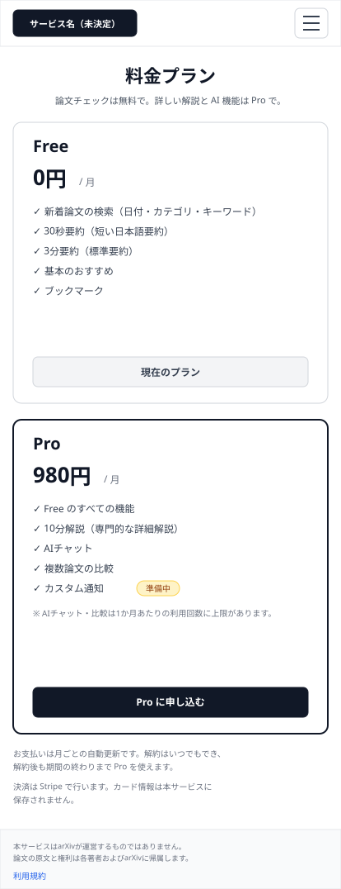
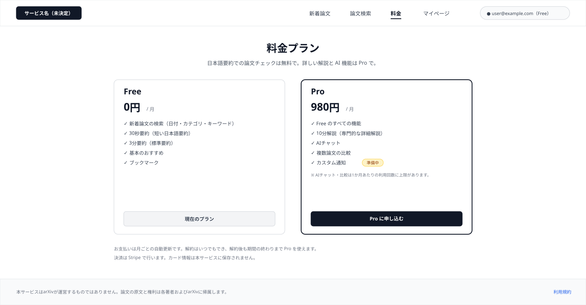
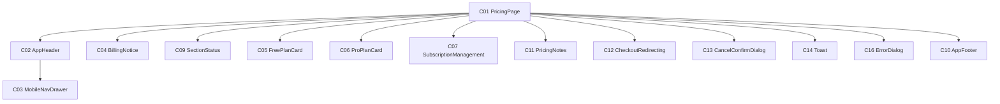

# P107 料金

## 0. 文書情報

| 項目 | 値 |
| :--- | :--- |
| 設計書ID | P107 |
| 親設計書 | `基本設計書_概要.md` §3 画面一覧 |
| 版 | 1.0（新規作成。`docs/screens/` に P107 の既存版は無い） |
| 作成日 | 2026-10-26 |
| 更新日 | 2026-10-26 |
| 作成方法 | `source/` 配下の企画資料と `docs/基本設計書_概要.md` からのリバースエンジニアリング（creating-screen-design v1.9.0 準拠） |
| 対象チャネル | モバイル（幅414）／デスクトップ（幅1440） |
| インプットの性質 | `source/` にあるのは企画・初期設計案のMarkdown 6ファイルだけで、本画面のソースコード（ページ・コンポーネント・ルーティング定義）は存在しない（`source/README.md:5-10`、上流 §前提）。そのため本書の画面項目・イベント・コンポーネントは、企画資料の定義行（`source/01_企画概要.md:30` の「Free/Proの比較、課金・プラン管理」、`source/04_収益化とロードマップ.md:4-8` のプランの中身と価格案ほか）と上流の基本設計書（概要）の定義（§2 BF12・EX05・EX06・EX07、§3 画面一覧・画面遷移図・共通ルール・レイアウト構造、§4 F12・F18、§6 T005・T010、§7 API08・IF05・IF06・IF07、§8 認証・認可、§11 ARC008・ARC009）から導いた**計画上の実体**であり、実装済みであることは意味しない。契約状態の取得と解約のAPIは上流で定義されていない（上流 §7 内部API一覧の注記、付録 Q27）。資料に書かれていない値は※推測と明記する。共通ヘッダー・フッター・状態表示・ダイアログは P101〜P106 の画面基本設計書と同じ部品を使う前提で、本画面での表示仕様を改めて記述する |

## 1. 画面概要
| 項目 | 内容 |
| :--- | :--- |
| 画面ID | P107 |
| 画面名 | 料金 |
| パス | `/pricing`（※推測。上流 §3.1・上流 付録 Q03 の仮置きをそのまま引き継ぐ） |
| 概要 | Free と Pro の違いを並べて比べ、Pro の申込み（課金）と、契約中のプランの管理を行う画面（`source/01_企画概要.md:30`、上流 §3.1）。Pro に申し込むと Stripe の決済画面へ移り（上流 BF12・IF06）、支払いを終えるとマイページ（P106）へ戻る（上流 §3 画面遷移図 STR → P106）。Pro 契約中の利用者には契約状態と解約の入口を示す（※推測） |
| アクター | ゲスト（未ログイン）、会員 Free、会員 Pro（上流 §2 ユースケース図。ゲストは比較を見られるが申込みはできない — 上流 §7 API08「認証: 必要」。ゲストの閲覧可否は上流 付録 Q08 の仮置き「料金は利用可」に従う） |
| 認証要否 | 不要（プランの比較は誰でも見られる）。Pro の申込みと解約だけログインが要る |
| 前画面 | P101 ホーム（上流 §3 画面遷移図 P101 → P107）、P102〜P104 と P106 の共通ヘッダーの「料金」、P104 の Pro 案内（※上流要確認: 上流の画面遷移図に線は無い。`screens/画面.P104.画面基本設計.md` E07）、P106 の「プランを確認・変更する」（※上流要確認: 同。`screens/画面.P106.画面基本設計.md` E18）、Stripe 決済画面で申込みを中断したときの戻り（※推測。上流 EX06 は戻り先を定義していない） |
| 後画面 | Stripe 決済画面（外部。上流 §3 画面遷移図 P107 → STR、上流 IF06）。ほかに共通ヘッダー・フッターから P101・P102・P103・P106、ログイン・会員登録画面（※上流未定義。上流 付録 Q04）、利用規約ページ（※上流未定義） |
| 対応ソースファイル | なし（実装未着手）。定義の出典は `source/01_企画概要.md:30`、`source/02_機能要求定義.md:17`、`source/03_システム構成.md:15,39,44,54`、`source/04_収益化とロードマップ.md:4-8,28,41`。※推測: 実装時は Next.js の `app/pricing/page.tsx` に置く想定 |
| カラーテーマ | default（配色は資料に定義が無い。上流 付録 Q06。UI部品は shadcn/ui、スタイルは Tailwind CSS — `source/03_システム構成.md:6`） |

## 2. ワイヤーフレーム

ワイヤーフレームは、上流 §3 のレイアウト構造（共通ヘッダー＋メインコンテンツ＋共通フッター、※推測）と、`source/04_収益化とロードマップ.md:4-5` の Free・Pro の中身からレイアウトを推定して作図した。図は「ログイン中の Free 会員が本画面を開いた状態」を描いている。Free のカードに「現在のプラン」、Pro のカードに申込みボタンが出ている。カスタム通知はまだ提供していない例にしている。

### 2.1 ワイヤーフレーム（モバイル）

### 2.2 ワイヤーフレーム（デスクトップ）

### 2.3 画面レイアウト説明
* **共通ヘッダー（上端）**: 左にサービス名（H01）を置く。デスクトップでは右側に「新着論文」「論文検索」「料金」「マイページ」の導線（H02〜H05）とログイン状態（H06 または H07）を横並びにし、本画面に対応する「料金」（H04）を選択中の見た目（太字・下線）にする。モバイルではサービス名とメニューボタン（H08）だけを置き、導線とログイン状態はドロワー（C03）へ収める。切り替え幅は Tailwind CSS 標準の lg（1024px）を想定する（※推測。上流 付録 Q06）。
* **ページ見出し（ヘッダーの下・中央寄せ）**: 「料金プラン」（H09）と、プランの違いを1文で示すリード文（H10）。Stripe から申込みを中断して戻ったとき（H11）、Pro 契約の支払いが遅れているとき（H12）は、リード文の下に案内の帯を出す。
* **プランのカード（見出しの下）**: デスクトップは Free（H13〜H17）と Pro（H18〜H24）のカードを幅420pxで横に2枚並べ、中央に寄せる。モバイルは画面幅いっぱいに Free、Pro の順で縦に積む（※推測）。各カードの下端に、利用者の状態に応じたボタンかラベル（H16・H17・H23・H24）を1つだけ出す。
* **ご契約中のプラン（カードの下）**: Pro 契約中の利用者にだけ、契約状態（H26）・次回更新日（H27）・解約ボタン（H28）の節（H25）を出す。
* **注記（カードの下）**: 支払いと解約の扱い（H29）、決済を Stripe で行う旨（H30）を小さな文字で置く。
* **状態表示**: 契約状態の取得中は、カード下端のボタン・ラベルの位置に読み込み中表示（H31）を出す。取得に失敗したときは、カードの上にエラーメッセージと再読み込みボタン（H32・H33）を出し、カードの比較は表示を続ける（上流 §2 EX04 の考え方を本画面にも適用）。
* **重ねて出すもの**: 申込みで Stripe へ移る間は画面全体に移動中表示（H40）を、解約を受け付けたときは画面下部に完了メッセージ（H41）を出す。ログインが要るとき・操作に失敗したときは画面中央にダイアログ（H34〜H36）を、解約の前には確認ダイアログ（H37〜H39）を重ねる。
* **共通フッター（下端）**: arXiv との関係の注記（H42）と利用規約へのリンク（H43）を置く（上流 §3 レイアウト構造 ※推測）。
* 図には、H06・H11・H12・H17・H24〜H28・H31〜H41 が出る状態は描いていない。

## 3. UI構成・コンポーネント定義

### 3.1 コンポーネントツリー

### 3.2 コンポーネント一覧

**総件数: 14件。全数である根拠**: 本画面のソースコードは無いため、コンポーネント名はすべて※推測（実装時の命名案）である。数え方は、`source/01_企画概要.md:30` の「Free/Proの比較」をプランごとのカード2部品とし（`source/04_収益化とロードマップ.md:4` → C05、`:5` → C06）、同じ行の「課金・プラン管理」を申込みボタン（C06 内）と契約中のプランの節（C07）、上流 BF12 の決済画面への移動中の表示（C12）、上流 EX06（決済の失敗）と Stripe からの戻りの案内（C04）、`source/04_収益化とロードマップ.md:8` の価格が仮である点と決済手段の注記（C11）、解約の確認（C13）と受付完了の通知（C14）、上流 EX04 にならった契約状態の取得の状態表示（C09）、上流 EX05 のログイン案内と操作の失敗の通知（C16）、上流 §3 レイアウト構造の共通ヘッダー・フッター（C02・C10）とモバイル幅の導線の収納先（C03）、それらを束ねるページ（C01）とした。コンポーネントIDは画面ごとの採番である。P101〜P106 と同じ部品を使う C02・C03・C09・C10・C16 は同じ番号にそろえ、本画面固有の部品は C01・C04〜C07 と C11〜C14 に振った（他画面の同じ番号の部品とは別物）。論文カード C08 は本画面では使わず、C15 は本画面に該当する部品が無いため、どちらも欠番にした。

| コンポーネントID | コンポーネント名 | 種別 | 含む項目ID | Props | 内部State | 役割・概要 | 定義状況 | 詳細の所在 |
| :--- | :--- | :--- | :--- | :--- | :--- | :--- | :--- | :--- |
| C01 | PricingPage | Page | H09,H10 | URL の申込み中断の印（※推測） | ログイン状態、契約状態の取得状態と結果、申込み・解約の処理中かどうか、表示中のダイアログ（※推測） | 料金画面全体。開いたときにログインを確かめ、ログイン中なら契約状態を取得し（E01）、結果に応じて各カードのボタン・ラベルを出し分ける | 詳細 | §5 E01、§7 |
| C02 | AppHeader | Layout | H01〜H08 | ログイン状態、利用者の表示名とプラン、現在の画面（※推測） | - | 全画面共通のヘッダー。サービス名と主要画面への導線、ログイン状態を表示する。本画面では「料金」を選択中の見た目にする | 詳細 | §4 H04〜H08 |
| C03 | MobileNavDrawer | UI | H02〜H07 | 開閉状態、ログイン状態（※推測） | - | モバイル幅でメニューボタン（H08）を押したときに開くドロワー。デスクトップでヘッダーに並ぶ導線とログイン状態を縦並びで表示する | 詳細 | §5 E16・E17 |
| C04 | BillingNotice | UI | H11,H12 | 申込み中断の印があるかどうか、契約状態（※推測） | - | Stripe の決済画面で申込みを中断して戻ったとき、または Pro 契約の支払いが遅れているときに、リード文の下へ案内の帯を出す | 詳細 | §4 H11・H12 |
| C05 | FreePlanCard | UI | H13〜H17 | ログイン状態、契約プラン（※推測） | - | Free プランの名称・価格・使える機能を示す。カードの下端には、Free 会員なら「現在のプラン」、ゲストなら「無料で会員登録」を出し、Pro 会員には何も出さない | 詳細 | §4 H13〜H17、§5 E02 |
| C06 | ProPlanCard | UI | H18〜H24 | ログイン状態、契約プラン、機能ごとの提供状況（※推測） | - | Pro プランの名称・価格・使える機能を示し、まだ提供していない機能に「準備中」を付け、利用量の上限を注記する。カードの下端には、ゲスト・Free 会員なら申込みボタン、Pro 会員なら「現在のプラン」を出す | 詳細 | §4 H18〜H24、§5 E03 |
| C07 | SubscriptionManagement | UI | H25〜H28 | 契約状態、次回更新日（※推測） | - | Pro 契約中の利用者に、契約状態と次回更新日を示し、解約の入口を置く。解約を受け付けた後は解約予定である旨を示し、解約ボタンを出さない | 詳細 | §4 H25〜H28、§5 E04 |
| C09 | SectionStatus | UI | H31〜H33 | 取得状態（取得中／失敗）、再読み込み時の処理（※推測） | - | 契約状態の取得中・失敗の表示。失敗してもカードの比較は表示を続け、再読み込みで契約状態だけを取り直す。本画面では0件の表示は使わない | 詳細 | §4 H31〜H33、§5 E07 |
| C10 | AppFooter | Layout | H42,H43 | - | - | 全画面共通のフッター。arXiv との関係を誤解させない注記と利用規約への導線を表示する | 簡易 | §4 H42・H43 |
| C11 | PricingNotes | UI | H29,H30 | - | - | 支払いが月ごとの自動更新であること、解約の扱い、決済を Stripe で行うことを注記する | 簡易 | §4 H29・H30 |
| C12 | CheckoutRedirecting | UI | H40 | 表示中かどうか（※推測） | - | 申込みボタンを押してから Stripe の決済画面へ移るまでの間、画面全体を覆って移動中であることを示し、二重の申込みを防ぐ | 詳細 | §4 H40、§5 E03 |
| C13 | CancelConfirmDialog | UI | H37〜H39 | 次回更新日（※推測） | 解約の処理中かどうか | 解約すると何が起きるか（期間の終わりまでは Pro を使えること）を示し、確定かキャンセルを選ばせるダイアログ | 詳細 | §4 H37〜H39、§5 E05・E06 |
| C14 | Toast | UI | H41 | 表示する文言（※推測） | 表示中かどうか | 解約を受け付けたことを画面下部に短時間示す | 簡易 | §4 H41 |
| C16 | ErrorDialog | UI | H34〜H36 | ダイアログの種類（ログインが必要／操作の失敗）、文言（※推測） | - | 未ログインで申し込もうとしたとき・ログインが切れていたとき・申込みや解約が失敗したときに画面中央に重ねるダイアログ。ログインが必要なときだけログインボタンを出す | 詳細 | §4 H34〜H36、§5.1 様式① |

## 4. 画面項目定義

**総件数: 43件。全数である根拠**: 本画面のソースコードは無いため、次の定義を1要素1項目として数えた。共通ヘッダーの構成（上流 §3 レイアウト構造「サービス名、P102・P103・P106・P107への導線、ログイン状態」→ H01〜H07、モバイル幅の収納先の開閉 → H08）、ページ見出しとリード文（`source/01_企画概要.md:30` の画面名と「Free/Proの比較」→ H09・H10）、Stripe からの戻りと支払いの遅れ（上流 EX06、T010 status → H11・H12）、Free のカード（`source/04_収益化とロードマップ.md:4` → 名称 H13、価格 H14、機能 H15、状態に応じた下端の表示 H16・H17）、Pro のカード（`source/04_収益化とロードマップ.md:5` → 名称 H18、価格 H19、機能 H20、提供前の機能の印 H21、`source/04_収益化とロードマップ.md:28` と上流 EX07・F18 の利用量上限 → H22、上流 BF12・API08 の申込み → H23、状態に応じた下端の表示 H24）、プラン管理（`source/01_企画概要.md:30`「プラン管理」、上流 T010 → 見出し H25、契約状態 H26、次回更新日 H27、解約 H28）、注記（`source/04_収益化とロードマップ.md:5,8` と上流 IF06 → H29・H30）、契約状態の取得の状態（上流 EX04 にならう → H31〜H33）、ダイアログ（上流 EX05「ログインを促す」と申込み・解約の失敗 → H34〜H36、解約の確認 → H37〜H39）、申込み時の移動中表示（上流 BF12 の決済画面への遷移 → H40）、解約の受付完了（→ H41）、共通フッター（上流 §3 レイアウト構造 → H42・H43）。入力項目は0件。Free・Pro の機能の一覧（H15・H20）は、1行ずつではなく一覧1件として数え、行の中身は「制約・初期値」列に全行を挙げた。支払い方法の変更・領収書の表示は、手段が上流に定義されていないため項目を置いていない（§7 に記載）。

| 項目ID | 項目名 | WF | 種別 | 必須 | データ型 | 制約・初期値 | 表示条件 | 備考 | 定義状況 | 詳細の所在 |
| :--- | :--- | :--- | :--- | :--- | :--- | :--- | :--- | :--- | :--- | :--- |
| H01 | サービス名（ロゴ） | D,M | リンク | - | string | 正式名称が未決定のため仮表記（候補: Arclia / Paprism / Curion — `source/05_ネーミング候補.md:4-6`、上流 付録 Q01） | 常時表示 | 押すと P101 ホームへ（E10）。全画面共通ヘッダーの一部 | 簡易 | 本表 |
| H02 | ナビ「新着論文」 | D | リンク | - | string | 固定文言「新着論文」 | デスクトップ幅では常時表示。モバイル幅ではメニュー（H08）を開いたときだけドロワー内に表示 | 押すと P102 へ（E11） | 簡易 | 本表 |
| H03 | ナビ「論文検索」 | D | リンク | - | string | 固定文言「論文検索」 | デスクトップ幅では常時表示。モバイル幅ではメニュー（H08）を開いたときだけドロワー内に表示 | 押すと P103 へ（E12） | 簡易 | 本表 |
| H04 | ナビ「料金」 | D | リンク | - | string | 固定文言「料金」。本画面では選択中の見た目（太字・下線）にする | デスクトップ幅では常時表示。モバイル幅ではメニュー（H08）を開いたときだけドロワー内に表示 | 押すと本画面を開き直す（E13） | 簡易 | 本表 |
| H05 | ナビ「マイページ」 | D | リンク | - | string | 固定文言「マイページ」 | ログイン中のときだけ表示（モバイル幅ではメニューを開いたときだけドロワー内に表示）。未ログインのときは出さない ※推測 | 押すと P106 へ（E14）。マイページは本人のデータを扱うため、未ログインでは導線自体を出さない ※推測 | 詳細 | §5 E14 |
| H06 | ログインボタン | — | ボタン | - | string | 固定文言「ログイン」 | 未ログインのときだけ表示（モバイル幅ではドロワー内）。ログイン中は H07 に置き換わる | 押すとログイン・会員登録画面へ（E15）。ログイン画面は※上流未定義（上流 付録 Q04）。図はログイン中の状態のため描いていない | 詳細 | §5 E15 |
| H07 | ログイン中の利用者表示 | D | 表示 | - | string | 利用者を見分ける表示（メールアドレスまたは表示名 ※推測）と、契約プラン（Free / Pro）を並べて表示 | ログイン中のときだけ表示（モバイル幅ではドロワー内）。未ログインのときは H06 に置き換わる | プランは利用者テーブルのプラン区分（T005 users.plan）の値 ※推測。ログイン状態は画面を開いたときに Supabase Auth のセッションから確かめる（上流 IF05） | 詳細 | §5 E01 |
| H08 | メニューボタン | M | ボタン | - | - | 初期状態はドロワーが閉じた状態 | モバイル幅（lg 1024px 未満 ※推測）のときだけ表示。デスクトップ幅では導線がヘッダーに並ぶため出さない | 押すたびにドロワー（C03）を開閉する（E16） | 詳細 | §5 E16 |
| H09 | ページ見出し | D,M | 表示 | - | string | 固定文言「料金プラン」 | 常時表示 | ブラウザのタブに出すページタイトルにも使う ※推測 | 簡易 | 本表 |
| H10 | リード文 | D,M | 表示 | - | string | 固定文言「日本語要約での論文チェックは無料で。詳しい解説と AI 機能は Pro で。」（文言は※推測）。モバイルでは1行に収めるため「論文チェックは無料で。詳しい解説と AI 機能は Pro で。」とする ※推測 | 常時表示 | Free と Pro の分け方（`source/04_収益化とロードマップ.md:4-5`）を1文で示す | 簡易 | 本表 |
| H11 | 申込み中断の案内 | — | 表示 | - | string | 固定文言「Pro のお申し込みは完了していません。もう一度お申し込みいただけます。」（文言は※推測） | Stripe の決済画面で申込みを中断して本画面に戻ってきたとき（戻り先URLに中断の印が付いているとき ※推測）だけ、リード文の下に表示する。本画面を開き直したときは出さない | 申込みを中断したときの戻り先は上流で未定義（※上流要確認。上流 EX06。本書では本画面に戻す仮置き）。決済の成功時はマイページ（P106）へ戻る（上流 §3 画面遷移図 STR → P106） | 詳細 | 本表、§7 |
| H12 | 支払い遅延の案内 | — | 表示 | - | string | 固定文言「お支払いが確認できていません。Stripe から届くメールの案内に沿ってお支払い方法をご確認ください。」（文言は※推測） | ログイン中の Pro 会員で、契約状態が支払い遅延のとき（Stripe の定期課金の状態が支払い待ち・失敗を示すとき ※推測。上流 T010 status）だけ、リード文の下に表示する | 上流 T010 の契約状態のうち「支払い遅延」（Pro 契約の更新時に支払いが失敗した状態）に当たる。申込み時の決済の失敗（上流 EX06）は plan が Free のまま残るため、この案内の対象外（申込みのやり直しは H11 と同じく本画面から行う）。支払い方法を本画面で変える手段は上流に無いため、案内だけを出す（※上流要確認） | 詳細 | 本表、§7 |
| H13 | Free のプラン名 | D,M | 表示 | - | string | 固定文言「Free」 | 常時表示 | — | 簡易 | 本表 |
| H14 | Free の価格 | D,M | 表示 | - | string | 固定文言「0円 / 月」 | 常時表示 | — | 簡易 | 本表 |
| H15 | Free の機能一覧 | D,M | 表示 | - | string | 次の5行を「✓」付きで縦に並べる: 「新着論文の検索（日付・カテゴリ・キーワード）」「30秒要約（短い日本語要約）」「3分要約（標準要約）」「基本のおすすめ」「ブックマーク」（`source/04_収益化とロードマップ.md:4`。各行の言い換えは※推測） | 常時表示 | 対応する機能は F02・F03・F04（30秒・3分）・F08・F07。会員登録が要る機能（おすすめ・ブックマーク）とゲストでも使える機能を本画面では分けて示さない ※推測（上流 付録 Q08） | 簡易 | 本表 |
| H16 | Free の「現在のプラン」表示 | D,M | 表示 | - | string | 固定文言「現在のプラン」（灰色の押せない枠） | ログイン中の Free 会員のときだけ、Free のカードの下端に表示する。ゲストのときは H17、Pro 会員のときは何も出さない。契約状態の取得中・失敗時は出さない | 利用者が自分のプランをひと目で分かるようにする | 詳細 | 本表 |
| H17 | 無料で会員登録ボタン | — | ボタン | - | string | 固定文言「無料で会員登録」 | 未ログインのときだけ、Free のカードの下端に表示する | 押すとログイン・会員登録画面へ（E02）。図はログイン中の状態のため描いていない | 詳細 | §5 E02 |
| H18 | Pro のプラン名 | D,M | 表示 | - | string | 固定文言「Pro」 | 常時表示 | — | 簡易 | 本表 |
| H19 | Pro の価格 | D,M | 表示 | - | string | 「980円 / 月」（`source/04_収益化とロードマップ.md:5` の月額980円。税込か税抜かは資料に無い ※上流要確認） | 常時表示 | 料金は仮説で、ユーザー調査と原価検証の後に決める（`source/04_収益化とロードマップ.md:8`）。決まった価格に差し替える前提で、価格は画面に固定で書かず設定値から表示する ※推測 | 詳細 | §7 |
| H20 | Pro の機能一覧 | D,M | 表示 | - | string | 次の5行を「✓」付きで縦に並べる: 「Free のすべての機能」「10分解説（専門的な詳細解説）」「AIチャット」「複数論文の比較」「カスタム通知」（`source/04_収益化とロードマップ.md:5`。資料の「カスタム通知ほか」の「ほか」の中身は定義が無いため載せない。「Free のすべての機能」と、「専門的な詳細解説」を10分解説とする対応は※推測） | 常時表示 | 対応する機能は F04（10分解説）・F09・F11・F10。10分解説を Pro 限定にするかは上流 付録 Q09 で確認中 | 詳細 | §7 |
| H21 | 準備中ラベル | D,M | 表示 | - | string | 固定文言「準備中」（黄色のラベル） | H20 の各行のうち、まだ提供を始めていない機能の行末にだけ表示する（AIチャット・複数論文比較・10分解説は Phase 3、カスタム通知は Later — 上流 §4 機能一覧）。提供を始めた機能には出さない ※推測 | 課金（F12）は Phase 4 で、AI 機能（Phase 3）より後に始まる計画のため、本画面の公開時点では準備中の機能が残らない見込み。計画が前後したときに、まだ使えない機能を売らないための表示 ※推測 | 詳細 | §7 |
| H22 | 利用量上限の注記 | D,M | 表示 | - | string | 固定文言「※ AIチャット・比較は1か月あたりの利用回数に上限があります。」（文言と「1か月あたり」は※推測。上限の値は上流 付録 Q14 で確認中） | 常時表示 | Pro の高コスト機能には利用量上限を設ける（`source/04_収益化とロードマップ.md:28`、上流 F18・EX07・ARC008）。申し込む前に上限があることを知らせる | 簡易 | 本表 |
| H23 | Pro に申し込むボタン | D,M | ボタン | - | string | 固定文言「Pro に申し込む」。申込みの処理中は押せない状態にする | ゲスト、またはログイン中の Free 会員のときに、Pro のカードの下端に表示する。Pro 会員のときは H24 に置き換わる。契約状態の取得中は出さない（取得に失敗したときは表示する） | 押すと、ログイン中なら決済セッションを作って Stripe の決済画面へ移る。未ログインならログインを促す（E03） | 詳細 | §5 E03 |
| H24 | Pro の「現在のプラン」表示 | — | 表示 | - | string | 固定文言「現在のプラン」（灰色の押せない枠） | ログイン中の Pro 会員のときだけ、Pro のカードの下端に表示する | 図は Free 会員の状態のため描いていない | 詳細 | 本表 |
| H25 | 節見出し「ご契約中のプラン」 | — | 表示 | - | string | 固定文言「ご契約中のプラン」 | ログイン中の Pro 会員のときだけ、カードの下に節ごと表示する（H26〜H28 も同じ） | プラン管理（`source/01_企画概要.md:30`）の入口。図は Free 会員の状態のため描いていない | 詳細 | 本表 |
| H26 | 契約状態 | — | 表示 | - | string | 「有効」「支払い遅延」「解約予定」のどれかのラベル（Stripe の定期課金の状態値を3つの表示に読み替える ※推測。上流 付録 Q24） | H25 と同じ条件で表示する | 契約状態はサブスクリプションテーブルの契約状態（T010 subscriptions.status）。「解約予定」は解約を受け付け、期間の終わりを待っている状態 ※推測 | 詳細 | §7 |
| H27 | 次回更新日 | — | 表示 | - | date | 「次回更新日」の語に続けて `YYYY-MM-DD` 形式の日付と表示タイムゾーン（JST ※推測）。解約予定のときは語を「ご利用期限」に替える | H25 と同じ条件で表示する | 更新日・期限の列は上流 T010 に無い（※上流要確認。Stripe 側の定期課金の期間から得る想定 ※推測） | 詳細 | §7 |
| H28 | 解約するボタン | — | ボタン | - | string | 固定文言「解約する」 | 契約状態が「有効」または「支払い遅延」のときだけ表示する。「解約予定」のときは出さない | 押すと解約の確認ダイアログ（H37〜H39）を開く（E04）。このボタンだけでは解約しない | 詳細 | §5 E04 |
| H29 | 支払いと解約の注記 | D,M | 表示 | - | string | 固定文言「お支払いは月ごとの自動更新です。解約はいつでもでき、解約後も期間の終わりまで Pro を使えます。」（文言と解約の扱いは※推測） | 常時表示 | 解約を期間の終わりで反映する扱いは資料に無い（※上流要確認。§7） | 簡易 | 本表 |
| H30 | 決済手段の注記 | D,M | 表示 | - | string | 固定文言「決済は Stripe で行います。カード情報は本サービスに保存されません。」（文言は※推測） | 常時表示 | 決済は Stripe を使う（`source/03_システム構成.md:15`、上流 IF06）。本サービスが持つのは Stripe の顧客IDと定期課金IDだけ（上流 T010） | 簡易 | 本表 |
| H31 | 読み込み中表示 | — | 表示 | - | - | ボタンの形をした灰色の枠（スケルトン） | ログイン中で、契約状態の応答を待っている間だけ、Free・Pro のカードの下端の位置に表示する（開いたとき、再読み込みのとき） | カードの名称・価格・機能は契約状態に関係なく先に表示する | 詳細 | §5 E01・E07 |
| H32 | 契約状態のエラーメッセージ | — | 表示 | - | string | 文言は §5.1 の様式②の詳細のとおり | 契約状態の取得が失敗したときだけ、カードの上に表示する | 失敗してもカードの比較と申込みボタンは使える状態を保つ。すでに Pro の利用者が申し込んでもサーバが拒む（上流 API08 の 409）ため、二重契約にはならない | 詳細 | §5.1 |
| H33 | 再読み込みボタン | — | ボタン | - | string | 固定文言「再読み込み」 | H32 と同じ条件で、H32 の横に表示する | 押すと契約状態だけを取り直す（E07） | 詳細 | §5 E07 |
| H34 | ダイアログのメッセージ | — | 表示 | - | string | 文言は §5.1 の様式①の詳細のとおり | 未ログインで申込みボタンを押したとき、契約状態の取得・申込み・解約でログインが切れていた（401）とき、申込み・解約が失敗したときだけ、画面中央のダイアログに表示する | 様式①。上流 EX05「未ログインで会員向け操作を実行したらログインを促す」 | 詳細 | §5.1 |
| H35 | ダイアログのログインボタン | — | ボタン | - | string | 固定文言「ログイン」 | ログインが必要な旨のダイアログのときだけ表示する。操作の失敗のダイアログでは出さない | 押すとログイン・会員登録画面へ（E08） | 詳細 | §5 E08 |
| H36 | ダイアログの閉じるボタン | — | ボタン | - | string | ログインが必要なときは「閉じる」、操作の失敗のときは「OK」 | ダイアログを表示している間は常に表示する | 押すとダイアログを閉じる（E09） | 簡易 | 本表 |
| H37 | 解約確認メッセージ | — | 表示 | - | string | 固定文言「Pro プランを解約しますか？ YYYY-MM-DD まで Pro の機能を使えます。その後は Free プランになります。」（日付は H27 の次回更新日。文言は※推測） | 解約するボタン（H28）を押したときだけ、画面中央のダイアログに表示する | 解約の扱い（期間の終わりで Free に戻す）は※推測（§7） | 詳細 | §5 E04 |
| H38 | 解約確定ボタン | — | ボタン | - | string | 固定文言「解約する」（赤系の見た目）。処理中は「処理中…」にして押せない状態にする | 解約の確認ダイアログを表示している間は常に表示する | 押すと解約を依頼する（E05） | 詳細 | §5 E05 |
| H39 | 解約キャンセルボタン | — | ボタン | - | string | 固定文言「キャンセル」。解約の処理中は押せない状態にする | 解約の確認ダイアログを表示している間は常に表示する | 押すと何もせずにダイアログを閉じる（E06） | 簡易 | 本表 |
| H40 | 決済画面への移動中表示 | — | 表示 | - | string | 画面全体を半透明で覆い、中央に「決済画面へ移動しています…」（文言は※推測） | 申込みボタン（H23）を押して決済セッションを作ってから、Stripe の決済画面へ移るまでの間だけ表示する。失敗したときは消す | 移動中に再び押されて決済セッションが2つできるのを防ぐ ※推測 | 詳細 | §5 E03 |
| H41 | 解約受付完了メッセージ | — | 表示 | - | string | 固定文言「解約を受け付けました。ご利用期限まで Pro の機能を使えます。」（文言は※推測） | 解約（E05）が成功したときだけ、画面下部に3秒間（※推測）表示して自動で消す | — | 簡易 | 本表 |
| H42 | arXivとの関係の注記 | D,M | 表示 | - | string | 固定文言「本サービスはarXivが運営するものではありません。論文の原文と権利は各著者およびarXivに帰属します。」（文言は※推測） | 常時表示 | arXiv と本サービスの関係を誤解させない表記にする決まり（`source/03_システム構成.md:61`、上流 ARC009） | 簡易 | 本表 |
| H43 | 利用規約リンク | D,M | リンク | - | string | 固定文言「利用規約」 | 常時表示 | 押すと利用規約ページへ（E18）。利用規約ページは※上流未定義 | 簡易 | 本表 |

## 5. イベント定義

**総件数: 18件。全数である根拠**: 画面を開いたときのログインの確認と契約状態の取得（→ E01）、§4 で種別がリンク・ボタンの項目（H01〜H06、H08、H17、H23、H28、H33、H35、H36、H38、H39、H43 の16項目）それぞれの押下（→ E02〜E16・E18）を1件ずつ数え、操作対象の項目を持たないドロワー外側のタップ（→ E17）を加えた。表示だけの項目（H07、H09〜H16、H18〜H22、H24〜H27、H29〜H32、H34、H37、H40〜H42）は操作を受け付けないためイベントを持たない。入力・選択の項目は無い。

契約状態の取得と解約のAPIは上流で定義されていない（上流 §7 内部API一覧の注記「プランの変更・解約…は機能として必要ですがAPIが定義されていない」、付録 Q27）。下表の「呼び出しAPI」列では、上流に無いAPIを「（※上流未定義）」と書き、処理の内容だけを示す。本書でAPIのパスやIDは決めない。

| イベントID | 発生源 | 対象項目ID | トリガー | 条件 | 処理概要 | 呼び出しAPI | 成功時の挙動 | 失敗時の挙動（様式ID + 説明） | 定義状況 | 詳細の所在 |
| :--- | :--- | :--- | :--- | :--- | :--- | :--- | :--- | :--- | :--- | :--- |
| E01 | ページ | — | ページロード | 本画面を開いたとき（ヘッダーの「料金」、P101 からの導線、P104 の Pro 案内、P106 のプランの確認、Stripe 決済画面からの中断の戻り、直接アクセス、ブラウザの戻る操作） | まずブラウザに残っているログインのセッションから、ログイン中かどうかと利用者を確かめる（取得できなければ未ログインとして扱う ※推測）。Free・Pro のカードの名称・価格・機能は、ログイン状態に関係なくすぐに表示する。ログイン中なら契約状態（プラン、Stripe の定期課金の状態、次回更新日）を取得し、結果に応じてカード下端の表示（H16・H23・H24）と、ご契約中のプランの節（H25〜H28）、支払い遅延の案内（H12）を出し分ける。URL に申込み中断の印があれば H11 を出す ※推測 | Supabase Auth のセッション取得（IF05）、契約状態の取得（※上流未定義。上流 付録 Q27） | 未ログイン: Free のカードに H17、Pro のカードに H23 を出す。Free 会員: H16 と H23 を出す。Pro 会員: H24 とご契約中のプランの節を出し、支払い遅延なら H12 も出す | 様式②: 契約状態の取得が 500 を返した、または通信できなかったときは、カードの上に「契約状態を読み込めませんでした。」と再読み込みボタンを出し、カード下端には H23 だけを出す。401（ログイン切れ）のときは、様式①: ログインが切れた旨のダイアログ（H34〜H36）を出し、カード下端はゲストと同じ表示（H17・H23）にする ※推測。セッション取得そのものの失敗は未ログインとして扱う ※推測 | 詳細 | 本表、§5.1 |
| E02 | 無料で会員登録ボタン | H17 | Click | 未ログインのとき（H17 が表示されているとき） | ログイン・会員登録の画面へ移る。登録後は本画面へ戻す ※推測 | なし（会員登録は遷移先で Supabase Auth を使う。上流 BF06・IF05） | ログイン・会員登録画面へ遷移（※上流未定義。上流 付録 Q04） | 該当様式なし（API を呼ばない画面遷移のため、本画面で起きるエラーは無い） | 簡易 | 本表 |
| E03 | Pro に申し込むボタン | H23 | Click | H23 が表示されているとき。申込みの処理中は受け付けない | 未ログインなら API を呼ばずにログインが必要な旨のダイアログ（H34〜H36）を出す（上流 EX05 を画面側で先回りする ※推測）。ログイン中なら、移動中表示（H40）を出して Pro の決済セッションの作成を依頼し、返ってきた Stripe の決済画面のURLへ移る（上流 BF12）。決済画面からの戻り先は、成功時はマイページ（P106）、中断時は本画面とする（※推測。上流 §3 画面遷移図 STR → P106、EX06） | POST /api/billing/checkout（API08。本文のプランは pro ※推測） | Stripe の決済画面へ遷移する（上流 IF06）。契約の成立はその後 Stripe からの通知でサーバが反映する（上流 IF07・BF12） | 様式①: 401 のときはログインが切れた旨のダイアログを出す。409（すでに Pro 契約中）のときは「すでに Pro プランをご契約中です。」のダイアログを出し、閉じた後に契約状態を取り直す（E01 の契約状態の取得を再実行）。502（Stripe との通信失敗）・500・通信失敗のときは「お申し込みを開始できませんでした。」のダイアログを出す。どれも H40 を消し、本画面に残る | 詳細 | 本表、§5.1 |
| E04 | 解約するボタン | H28 | Click | H28 が表示されているとき | 解約の確認ダイアログ（H37〜H39）を開く。メッセージには次回更新日（H27）を入れ、その日まで Pro を使える旨を示す | なし | 確認ダイアログが開く | 該当様式なし（画面内の表示切替だけで、エラーは起きない） | 詳細 | 本表 |
| E05 | 解約確定ボタン | H38 | Click | 解約の確認ダイアログを表示しているとき。処理中は受け付けない | 定期課金の解約を依頼する。サーバは Stripe の定期課金を期間の終わりで止める設定にし、契約状態を解約予定として返す ※推測。処理中は確定ボタンとキャンセルボタンを押せない状態にする | 解約（※上流未定義。上流 §7 注記「プランの変更・解約」、付録 Q27。Stripe への解約の依頼は上流 IF06 の範囲外 ※上流要確認） | 確認ダイアログを閉じ、解約受付完了メッセージ（H41）を出す。契約状態（H26）を「解約予定」、H27 の語を「ご利用期限」にし、解約するボタン（H28）を消す。プラン（T005 users.plan）が Free に戻るのは期間の終わりに Stripe から届く通知による（上流 IF07 ※推測） | 様式①: 確認ダイアログを閉じて、401 のときはログインが切れた旨のダイアログを、500・通信失敗のときは「解約の手続きができませんでした。時間をおいて再度お試しください。」のダイアログを出す。契約状態の表示は変えない | 詳細 | 本表、§5.1、§7 |
| E06 | 解約キャンセルボタン | H39 | Click | 解約の確認ダイアログを表示していて、処理中でないとき | 何もせずに確認ダイアログを閉じる | なし | ダイアログが消え、操作前の画面に戻る | 該当様式なし（画面内の表示切替だけで、エラーは起きない） | 簡易 | 本表 |
| E07 | 再読み込みボタン | H33 | Click | 契約状態の取得が失敗して H33 が表示されているとき | 契約状態だけを取り直す。取り直している間はカード下端に読み込み中表示（H31）を出す | 契約状態の取得（※上流未定義） | E01 と同じく、契約状態に応じてカード下端とご契約中のプランの節を出し分ける | 様式②: 再び失敗したときは同じエラーメッセージと再読み込みボタンを表示し直す（回数の上限は設けない ※推測） | 詳細 | 本表、§5.1 |
| E08 | ダイアログのログインボタン | H35 | Click | ログインが必要な旨のダイアログを表示しているとき | ダイアログを閉じて、ログイン・会員登録の画面へ移る。ログイン後は本画面へ戻す ※推測 | なし（ログイン処理は遷移先で Supabase Auth を使う。上流 IF05） | ログイン・会員登録画面へ遷移（※上流未定義。上流 付録 Q04） | 該当様式なし（API を呼ばない画面遷移のため、本画面で起きるエラーは無い） | 詳細 | §5 遷移先ロースター |
| E09 | ダイアログの閉じるボタン | H36 | Click | ダイアログを表示しているとき | ダイアログを閉じて本画面に戻る。申込みで 409 が返った後のダイアログのときは、閉じた後に契約状態を取り直す | 409 の後だけ契約状態の取得（※上流未定義） | ダイアログが消え、操作前の画面に戻る（409 の後は Pro 会員の表示に切り替わる） | 様式②: 409 の後の契約状態の取り直しが失敗したときは E01 と同じエラーメッセージと再読み込みボタンを出す。それ以外は画面内の表示切替だけで、エラーは起きない | 詳細 | 本表 |
| E10 | サービス名（ロゴ） | H01 | Click | 常時 | ホーム画面へ移る | なし | P101 へ遷移 | 該当様式なし（API を呼ばない画面遷移のため、本画面で起きるエラーは無い） | 簡易 | 本表 |
| E11 | ナビ「新着論文」 | H02 | Click | 常時（モバイル幅ではドロワーを開いているとき） | 新着論文一覧へ移る。モバイル幅ではドロワーを閉じてから移る | なし | P102 へ遷移 | 該当様式なし（API を呼ばない画面遷移のため、本画面で起きるエラーは無い） | 簡易 | 本表 |
| E12 | ナビ「論文検索」 | H03 | Click | 常時（モバイル幅ではドロワーを開いているとき） | 論文検索へ移る。モバイル幅ではドロワーを閉じてから移る | なし | P103 へ遷移 | 該当様式なし（API を呼ばない画面遷移のため、本画面で起きるエラーは無い） | 簡易 | 本表 |
| E13 | ナビ「料金」 | H04 | Click | 常時（モバイル幅ではドロワーを開いているとき） | 本画面を開き直す。モバイル幅ではドロワーを閉じる | なし（開き直した後の取得は E01 で行う） | 本画面（P107）を開き直し、E01 から実行する | 該当様式なし（API を呼ばない画面遷移のため、本画面で起きるエラーは無い） | 簡易 | 本表 |
| E14 | ナビ「マイページ」 | H05 | Click | ログイン中のとき（H05 が表示されているとき） | マイページへ移る。モバイル幅ではドロワーを閉じてから移る | なし | P106 へ遷移 | 該当様式なし（API を呼ばない画面遷移のため、本画面で起きるエラーは無い。セッション切れの扱いは遷移先 P106 の責務） | 簡易 | 本表 |
| E15 | ログインボタン | H06 | Click | 未ログインのとき（H06 が表示されているとき） | ログイン・会員登録の画面へ移る。ログイン後は本画面へ戻す ※推測 | なし（ログイン処理は遷移先で Supabase Auth を使う。上流 IF05） | ログイン・会員登録画面へ遷移（※上流未定義。上流 付録 Q04） | 該当様式なし（API を呼ばない画面遷移のため、本画面で起きるエラーは無い） | 詳細 | §5 遷移先ロースター |
| E16 | メニューボタン | H08 | Click | モバイル幅のとき | ドロワーが閉じていれば開き、開いていれば閉じる（外側を押して閉じる操作は E17） | なし | ドロワー（C03）に H02〜H07 を表示する／閉じる | 該当様式なし（画面内の表示切替だけで、エラーは起きない） | 詳細 | 本表 |
| E17 | ページ（モバイルのドロワー表示中） | — | Click（タップ） | モバイル幅でドロワー（C03）が開いているとき | ドロワーの外側（半透明の背景部分）を押すと、遷移せずにドロワーを閉じる（※推測） | なし | ドロワーを閉じ、元の画面表示に戻る | 該当様式なし（画面内の表示切替だけで、エラーは起きない） | 簡易 | 本表 |
| E18 | 利用規約リンク | H43 | Click | 常時 | 利用規約のページへ移る | なし | 利用規約ページへ遷移（※上流未定義） | 該当様式なし（API を呼ばない画面遷移のため、本画面で起きるエラーは無い） | 簡易 | 本表 |

**遷移先ロースター**（総件数: 8件。全数である根拠: 上表で遷移を伴うイベント E02・E03・E08・E10〜E15・E18 の行き先を重複を除いて数えた。上流 §3 画面遷移図の P107 から出る1本 ― Stripe 決済画面 ― を含み、ほかに共通ヘッダーからの P101・P102・P103・P106 と本画面の開き直し、上流に画面定義の無い2件がある。決済画面から先の戻り（成功時 P106、中断時 P107）は Stripe からの遷移で、本画面のイベントではないため数えない）

| No | 遷移先画面ID | 遷移先画面名 | 契機イベントID | 概要 | 定義状況 | 詳細の所在 |
| :--- | :--- | :--- | :--- | :--- | :--- | :--- |
| 1 | IF06 | Stripe 決済画面（外部） | E03 | Pro の決済セッションの決済画面へ移る（上流 §3 画面遷移図 P107 → STR、上流 IF06） | 詳細 | 上流 `基本設計書_概要.md` §7「IF06・IF07 Stripe」 |
| 2 | P101 | ホーム | E10 | ロゴからホームへ移る | 簡易 | `screens/画面.P101.画面基本設計.md` |
| 3 | P102 | 新着論文 | E11 | 日付・カテゴリで新着論文を絞り込む一覧へ移る | 簡易 | `screens/画面.P102.画面基本設計.md` |
| 4 | P103 | 論文検索 | E12 | キーワード・著者・カテゴリで検索する画面へ移る | 簡易 | `screens/画面.P103.画面基本設計.md` |
| 5 | P106 | マイページ | E14 | 関心分野・ブックマークを扱う画面へ移る | 簡易 | `screens/画面.P106.画面基本設計.md` |
| 6 | P107 | 料金（本画面） | E13 | 本画面を開き直し、契約状態を取り直す | 簡易 | 本書 §5 E01 |
| 7 | — ※上流未定義 | ログイン・会員登録画面 | E02, E08, E15 | Supabase Auth でログイン・会員登録を行う画面へ移る。ログイン後は本画面へ戻す ※推測。画面としての定義が上流に無い（上流 付録 Q04） | 詳細 | §5 E02・E08・E15 |
| 8 | — ※上流未定義 | 利用規約ページ | E18 | 利用規約を表示するページへ移る。画面としての定義が上流に無い | 簡易 | - |

**呼出APIロースター**（総件数: 4件。全数である根拠: 上表で「呼び出しAPI」列に現れる API・外部IF・上流未定義の処理を重複を除いて数えた。上流 §7 内部API一覧の全8件のうち、本画面から呼ぶのは API08 だけで、API01〜API07 は呼ばない。上流に定義の無い2件のうち、解約は上流 §7 の注記「プランの変更・解約」と付録 Q27 に挙がっているもの、契約状態の取得は同注記に無いため本書で新たに挙げたもの（P106 の「アカウント情報の取得」と同じ情報を扱う。`screens/画面.P106.画面基本設計.md` 呼出APIロースター No.3）。本書ではIDを振らない。Stripe の決済画面への遷移（IF06）は API 呼び出しではないため遷移先ロースターに載せた）

| No | 上流ID | メソッド・対象 | 概要 | 呼び出すイベントID | 認証 | 定義状況 | 詳細の所在 |
| :--- | :--- | :--- | :--- | :--- | :--- | :--- | :--- |
| 1 | API08 | POST /api/billing/checkout | Pro 申込みのために Stripe の決済セッションを作り、決済画面のURLを返す。すでに Pro 契約中なら 409 を返す | E03 | 必要 | 詳細 | 上流 `基本設計書_概要.md` §7「POST /api/billing/checkout」 |
| 2 | IF05 | Supabase Auth（セッション取得） | ブラウザに残るログインのセッションから、ログイン中かどうかと利用者を確かめる | E01 | — | 簡易 | 上流 `基本設計書_概要.md` §7「IF05 Supabase Auth」 |
| 3 | — ※上流未定義 | 契約状態の取得 | 本人のプラン（T005 users.plan）、定期課金の状態（T010 subscriptions.status）、次回更新日（※上流要確認: 列が上流 T010 に無い）を取得する | E01, E07, E09 | 必要（※推測） | 詳細 | - |
| 4 | — ※上流未定義 | 解約 | 本人の定期課金を期間の終わりで止める設定にし、契約状態を返す ※推測 | E05 | 必要（※推測） | 詳細 | - |

### 5.1 エラー表示様式定義

| 様式ID | 様式名 | 表示方法 | 使用コンポーネント | 使用場面 | ユーザー操作 |
| :--- | :--- | :--- | :--- | :--- | :--- |
| 様式① | ポップアップ表示 | モーダルダイアログで画面中央にエラーメッセージを表示 | ErrorDialog（C16） | 未ログインで申込みボタンを押したとき、契約状態の取得・申込み・解約でログインが切れていたとき（401。上流 EX05）、申込みが 409（すでに Pro 契約中）・502（Stripe との通信失敗）・500・通信失敗を返したとき、解約が 500・通信失敗を返したとき | ログインが必要なときは「ログイン」でログイン画面へ、「閉じる」で閉じる。操作の失敗のときは「OK」で閉じ、同じ操作をやり直せる |
| 様式② | 画面上部表示 | 【本画面での読み替え】標準の「画面上部（ヘッダー直下）に赤色バー」ではなく、プランのカードの上（リード文の下）に赤色の帯でメッセージと再読み込みボタンを表示する。カードの比較と申込みボタンは表示・操作を続けられる（上流 EX04「失敗した領域だけに処理状況と再読み込みを表示し、他の領域は表示を続ける」の考え方を本画面に当てはめた表示位置。P101〜P106 と同じ読み替え） | SectionStatus（C09） | 契約状態の取得（E01・E07・E09）の通信失敗、サーバーエラー（500） | 「再読み込み」ボタン（H33）で契約状態だけを取り直す。成功すればメッセージは消える |
| 様式③ | 全画面エラー | 専用のエラーページに画面全体を切り替えて表示 | ErrorPage | 該当なし（本画面の比較はサーバから取得しない固定の内容で、取得に失敗しても表示できる。契約状態の失敗は様式②に閉じ込める） | 該当なし |
| 様式④ | 入力欄下表示 | 対象の入力フィールド直下に赤文字でインラインエラーを表示 | フォームバリデーション | 該当なし（本画面に入力項目が無い。支払い情報の入力は Stripe の決済画面で行う） | 該当なし |

**この画面で使用するエラー様式の詳細**:

| 様式ID | エラー発生条件 | エラーメッセージ文言 | 補足（遷移先・復帰手順） |
| :--- | :--- | :--- | :--- |
| 様式① | 未ログインで Pro に申し込むボタンを押したとき（E03） | 「Pro プランへのお申し込みにはログインが必要です。」（文言は※推測） | 「ログイン」でログイン・会員登録画面へ（E08。※上流未定義）。ログイン後は本画面へ戻る ※推測。「閉じる」でダイアログを閉じる（E09） |
| 様式① | 画面を開いたとき（E01）・再読み込み（E07）の契約状態の取得、申込み（POST /api/billing/checkout）、または解約が 401 を返したとき | 「ログインの有効期限が切れました。もう一度ログインしてください。」（文言は※推測） | 「ログイン」でログイン・会員登録画面へ（E08）。「閉じる」で閉じる（E09） |
| 様式① | 申込みが 409 を返したとき（すでに Pro 契約中） | 「すでに Pro プランをご契約中です。」（文言は※推測） | 「OK」で閉じると契約状態を取り直し、Pro 会員の表示に切り替わる（E09） |
| 様式① | 申込みが 502（Stripe との通信失敗）・500 を返した、または通信できなかったとき | 「お申し込みを開始できませんでした。時間をおいて再度お試しください。」（文言は※推測） | 「OK」で閉じる（E09）。申込みボタンからやり直せる |
| 様式① | 解約が 500 を返した、または通信できなかったとき | 「解約の手続きができませんでした。時間をおいて再度お試しください。」（文言は※推測） | 「OK」で閉じる（E09）。契約状態は変わっていないため、解約するボタンからやり直せる |
| 様式② | 画面を開いたとき（E01）・再読み込み（E07）・409 の後の取り直し（E09）で、契約状態の取得が 500 を返した、または通信できなかったとき | 「契約状態を読み込めませんでした。時間をおいて再読み込みしてください。」（文言は※推測） | カードの上に表示する。「再読み込み」で契約状態を取り直す |

## 6. バリデーション・制約定義

該当なし（本画面には入力項目が無い。§4 の43項目は表示・リンク・ボタンだけで構成される。プランの選択肢は Pro の1つだけで、支払い情報は Stripe の決済画面で入力する。申込みの可否（ログイン中か、すでに Pro か）はサーバ側が判断し、401・409 を様式①で扱う）。

| 対象項目ID | 項目名 | ルール | エラーメッセージ |
| :--- | :--- | :--- | :--- |
| — | 該当なし | — | — |

## 7. 画面固有の業務ルール・注意事項

* **比較は誰でも見られ、申込みと解約は会員だけ**: プランの比較（H13〜H22）はゲストにも見せる（上流 付録 Q08 の仮置き）。申込みと解約はログインが要り、未ログインで申込みボタンを押したときは API を呼ばずにログインを促す（上流 EX05、API08「認証: 必要」）。
* **利用者の状態でボタンを出し分ける**（契約状態の取得結果による。※推測）:
  * ゲスト: Free のカードに「無料で会員登録」（H17）、Pro のカードに申込みボタン（H23）。
  * Free 会員: Free のカードに「現在のプラン」（H16）、Pro のカードに申込みボタン（H23）。
  * Pro 会員: Pro のカードに「現在のプラン」（H24）、カードの下にご契約中のプランの節（H25〜H28）。
  * 契約状態の取得に失敗したとき: 申込みボタン（H23）だけを出す。すでに Pro の利用者が押してもサーバが 409 で拒むため、二重契約にはならない（上流 §7 API08）。
* **決済は Stripe に任せる**: 支払い情報は本画面でも本サービスでも扱わず、Stripe の決済画面で入力する（上流 IF06、T010 は Stripe の顧客ID・定期課金IDだけを持つ）。契約の成立・支払いの失敗・解約は Stripe からの通知でサーバが反映する（上流 IF07・BF12・EX06。Webhook は上流 付録 Q28 で確認中）。そのため申込み直後は契約状態の反映が遅れることがあり、決済成功時の戻り先であるマイページ（P106）でその旨を案内する（`screens/画面.P106.画面基本設計.md` H10）。
* **申込みの中断と失敗**: 決済画面で申込みを中断したときは本画面に戻し、申込みが完了していない旨（H11）を出す ※推測。申込み時の決済の失敗（上流 EX06）は Stripe の決済画面上で失敗が示され、plan は Free のまま残るため、利用者は中断と同じく本画面から申し込み直す。これとは別に、Pro 契約の更新時に支払いが失敗して契約状態が支払い遅延（上流 T010）になった Pro 会員には H12 を出す。中断・失敗時の戻り先は上流で未定義（※上流要確認）。
* **解約は期間の終わりで反映する**: 解約を受け付けても、支払い済みの期間の終わりまでは Pro の機能を使えるようにし、その後 Free に戻す ※推測（資料に解約の扱いの定義が無い。※上流要確認）。解約の前には必ず確認ダイアログ（H37〜H39）を挟む。退会（P106）では定期課金も同時に解約されるが、本画面の解約は退会しない（上流 BF13）。
* **価格は仮**: Pro の月額980円は仮説で、ユーザー調査と原価検証の後に決める（`source/04_収益化とロードマップ.md:5,8`）。税込か税抜かも未定（※上流要確認）。価格は画面に固定で書かず設定値から表示し、決まった価格へ差し替えられるようにする ※推測。
* **まだ使えない機能を売らない**: Pro の機能のうち提供前のものには「準備中」（H21）を付ける ※推測。10分解説を Pro 限定にするかは上流 付録 Q09 で確認中で、Free に含めると決まれば H20 の行を Free 側（H15）へ移す。
* **利用量の上限を申込み前に知らせる**: AIチャット・複数論文比較には利用量の上限がある（`source/04_収益化とロードマップ.md:28`、上流 F18・EX07）。上限の値と集計期間は上流 付録 Q14 で確認中で、決まれば H22 の文言に値を入れる。当月の利用量の表示は、取得手段が上流に無いため置いていない（※上流要確認）。
* **課金の提供時期**: 課金（F12）は Phase 4 の機能である（上流 §4 機能一覧）。それより前に本画面を公開する場合の申込みボタンの扱い（出さない／申込みを受け付けない旨を出す）は上流で未定義（※上流要確認）。
* **表示・編集ポリシーの順守**（上流 ARC009）: 次回更新日・ご利用期限のタイムゾーン（H27）、arXiv との関係の注記（H42）を必ず出す。
* **上流への確認事項**（本書で新たに生じたもの）:
  * 契約状態の取得と解約のAPIの定義（※上流未定義。上流 付録 Q27。契約状態の取得は上流 §7 の注記にも挙がっていない）。解約で Stripe を呼ぶ連携を IF06 の範囲に含めるか（※上流要確認）。
  * 上流 T010 に次回更新日（定期課金の期間の終わり）を持つ列を設けるか、Stripe から都度取得するか（※上流要確認）。
  * 解約を期間の終わりで反映するか、すぐに反映するか（※上流要確認）。
  * 決済を中断・失敗したときの Stripe からの戻り先（※上流要確認。上流 EX06）。
  * 支払い方法の変更・領収書の表示の手段（Stripe の顧客向け管理画面を使うか ※推測）（※上流要確認）。
  * Pro の価格の税の扱い（※上流要確認）と、Phase 4 より前に本画面を公開する場合の申込みボタンの扱い（※上流要確認）。
  * Pro の機能のうち「カスタム通知ほか」の「ほか」の中身（※上流要確認。`source/04_収益化とロードマップ.md:5`）。
  * 当月の利用量を利用者に見せるか（上流 F18・付録 Q14。※上流要確認）。
  * P104・P106 から本画面への線を上流の画面遷移図に加えるか（※上流要確認）。
  * ログイン・会員登録画面と利用規約ページの画面定義（上流 付録 Q04。本画面からの遷移先として※上流未定義）。

## 8. 利用する方式（共通基盤）

| 方式ID | 名称 | 本書での利用箇所 |
| :--- | :--- | :--- |
| ARC008 | プラン別機能制御・利用量上限 | Free・Pro で使える機能の比較（H15・H20）、Pro 機能の利用量上限の注記（H22）、申込み（H23・E03、API08）と解約（H28・E05）、契約状態による表示の出し分け（H16・H24〜H28）。上流の適用範囲「F12, F18 / API08 / T005, T010」に該当する |
| ARC009 | 表示・編集ポリシー（出典・版・日付・ブランド表記） | 次回更新日・ご利用期限のタイムゾーン併記（H27）、フッターの arXiv との関係の注記（H42）。上流の適用範囲「P101〜P107 全画面」に該当する |
